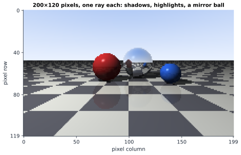

# Chapter 71 — Ray Tracing: The Geometry of Light

[← Previous](70-quaternions.md) · [Track G](README.md) · [Table of Contents](../../00-front/table-of-contents.md) · [Next →](72-physics-engines.md)

> **Level 2 · Track G — Mathematics for Computer Graphics, Games, and Simulation**
> **Builds on:** [Ch. 7](../../part-2-calculus/07-vector-calculus.md), [Ch. 5](../../part-2-calculus/05-integral-calculus.md), [Ch. 19](../../part-6-probability-statistics/19-probability.md), [Ch. 69](69-mathematics-of-3d-worlds.md) · **Leads to:** [Ch. 72](72-physics-engines.md), [Ch. 75](75-computational-geometry.md), [Ch. 76](76-signal-processing-audio-visual.md) · **Related:** [Ch. 38](../b-probability-information/38-monte-carlo.md), [Ch. 61](../e-abstract-math/61-functional-analysis.md), [Ch. 22](../../part-7-numerical-computational/22-numerical-methods.md)
> **Reading time:** ~25 min

## 71.1 The hook

In 1980 an engineer at Bell Labs named Turner Whitted published a picture of a few spheres floating over a checkerboard, one of them made of glass. The checkerboard is visible *through* the glass sphere, bent and flipped. Another sphere is a mirror, and the board, the sky and its neighbour appear on its surface, curved. Every shadow falls exactly where it should. The image is small and the colours are crude, yet people who saw it knew they were looking at something new: a computer had not been told what a reflection looks like; it had *worked it out*. The picture took well over an hour to compute.

Today a game console does the same kind of computation for two million pixels sixty times a second, and film studios spend thousands of processor-hours on a single frame. Behind both is one question, asked once for every pixel:

> *What light arrives at this point of the camera, from this direction?*

Answering it means following light backward from the eye into the world, finding the first thing it hits, asking what light reaches *that* point, which means following more rays, which hit more things... A mirror sends you on one more bounce. Glass splits your ray in two. A sheet of paper scatters light into every direction at once, so the "one more ray" becomes an integral over a whole hemisphere of directions, each of which needs its own answer.

How can a finite computer evaluate an infinite cascade of bounces? And why is it allowed to trace light backward, from the eye to the lamp, when light really travels the other way?

## 71.2 The big idea

**A pixel is a question, a ray is how you ask it.** From the camera's pinhole ([Ch. 69 §69.3](69-mathematics-of-3d-worlds.md#693-the-mathematics)), draw the line through the centre of a pixel and out into the scene. Whatever that line hits first is what the pixel shows. Rasterisation, the method of Ch. 69, asks "where on the screen does this triangle land?"; ray tracing asks "what does this pixel see?". Same geometry, opposite loop order.

**Light paths can be run in reverse.** The laws of reflection and refraction are symmetric: if light can go from $A$ to $B$ by some path, it can go from $B$ to $A$ by the same path. So instead of firing trillions of photons from the lamp and waiting for the few that happen to land in the camera, we start at the camera and walk backward. When a reverse ray reaches a surface, we ask a second question: can this point see the light? Fire a **shadow ray** toward the lamp. If anything blocks it, the point is in shadow.

**Every bounce is high-school geometry plus a rule.** Hitting a sphere is solving a quadratic. Bouncing off a mirror is reflecting a vector across the normal. Entering glass is Snell's law. Each rule turns one ray into one or two new rays, and recursion does the rest.

**Rough surfaces turn the recursion into an integral, and the integral into dice.** A matte surface gathers light from all directions. The colour is an integral over the hemisphere above the point, and we estimate it the way a pollster estimates an election: sample a few random directions and average. The answer is noisy, and the noise falls like $1/\sqrt{N}$ with $N$ samples.



*Rendered by this chapter's own tracer (the figure script is about a hundred lines of NumPy): one ray per pixel, a shadow ray to one point light, highlights, and two levels of mirror reflection. The jagged edges are what one sample per pixel looks like.*

## 71.3 The mathematics

### Rays and the first hit

> [!definition] Ray
> A **ray** is the half-line $\mathbf{p}(t)=\mathbf{o}+t\hat{\mathbf{d}}$, $t>0$, with origin $\mathbf{o}$ and unit direction $\hat{\mathbf{d}}$. Because $\hat{\mathbf{d}}$ has unit length, $t$ is the distance travelled. Intersecting a ray with a surface means finding the smallest $t>0$ at which $\mathbf{p}(t)$ lies on the surface.

For a primary ray through pixel $(i,j)$ of a $W\times H$ image, $\mathbf{o}$ is the eye and $\hat{\mathbf{d}}$ is the normalised direction to the pixel's centre on the image plane, built from the camera frame of Ch. 69.

**Planes.** A plane through $\mathbf{q}$ with normal $\hat{\mathbf{n}}$ is $\{\mathbf{x}:(\mathbf{x}-\mathbf{q})\cdot\hat{\mathbf{n}}=0\}$. Substituting the ray gives one linear equation:

$$
t=\frac{(\mathbf{q}-\mathbf{o})\cdot\hat{\mathbf{n}}}{\hat{\mathbf{d}}\cdot\hat{\mathbf{n}}},
$$

with no hit if $\hat{\mathbf{d}}\cdot\hat{\mathbf{n}}=0$ (the ray runs parallel) or $t\le0$ (the plane is behind). **Triangles**, the workhorse of real scenes, are planes with a test: write the hit point as an affine combination $\lambda_1\mathbf{a}+\lambda_2\mathbf{b}+\lambda_3\mathbf{c}$ (Result 1 of Ch. 69) and accept it when all three barycentric weights are non-negative. The Möller–Trumbore algorithm solves for $t$ and two of the weights at once, as a $3\times3$ linear system.

**Spheres** are where the geometry becomes satisfying.

> [!theorem] Result 1: ray–sphere intersection
> Let the sphere have centre $\mathbf{c}$ and radius $r$, and put $b=(\mathbf{o}-\mathbf{c})\cdot\hat{\mathbf{d}}$ and $k=\lVert\mathbf{o}-\mathbf{c}\rVert^2-r^2$. The ray meets the sphere at
> $$
> t_{0,1}=-b\mp\sqrt{b^2-k},
> $$
> two points if $b^2>k$, a tangent point if $b^2=k$, and none if $b^2<k$.

*Proof.* The point $\mathbf{p}(t)$ is on the sphere when $\lVert\mathbf{o}+t\hat{\mathbf{d}}-\mathbf{c}\rVert^2=r^2$. Write $\mathbf{m}=\mathbf{o}-\mathbf{c}$ and expand the dot product, using $\hat{\mathbf{d}}\cdot\hat{\mathbf{d}}=1$:

$$
(\mathbf{m}+t\hat{\mathbf{d}})\cdot(\mathbf{m}+t\hat{\mathbf{d}})=r^2\iff t^2+2(\mathbf{m}\cdot\hat{\mathbf{d}})\,t+\big(\mathbf{m}\cdot\mathbf{m}-r^2\big)=0\iff t^2+2bt+k=0.
$$

Completing the square, $(t+b)^2=b^2-k$, which gives the roots and the three cases. $\square$

The discriminant has a geometric meaning. The point of the line closest to the centre is at $t=-b$, and its squared distance from $\mathbf{c}$ is $h^2=\lVert\mathbf{m}\rVert^2-b^2$ (Pythagoras). So $b^2-k=r^2-h^2$: the ray hits exactly when it passes within $r$ of the centre, and $\sqrt{r^2-h^2}$ is half the chord. Example: from $\mathbf{o}=\mathbf{0}$ along $\hat{\mathbf{d}}=\hat{\mathbf{z}}$ to a unit sphere at $(0,0,5)$, $b=-5$ and $k=24$, so $t=5\mp1$: the ray enters at distance 4 and leaves at 6. The surface **normal** at a hit is $\hat{\mathbf{n}}=(\mathbf{p}-\mathbf{c})/r$, free of charge.


*Ray–sphere intersection. The ray enters at $t_0$ and exits at $t_1$; their midpoint is the closest approach, at distance $h$ from the centre. A ray with $h>r$ misses, and the discriminant $b^2-k=r^2-h^2$ is negative.*

### Reflection

Let $\hat{\mathbf{n}}$ be the unit normal at the hit point and $\hat{\mathbf{d}}$ the incoming direction. A perfect mirror keeps the part of $\hat{\mathbf{d}}$ along the surface and reverses the part along the normal.

> [!theorem] Result 2: the mirror direction
> The reflected direction is $\hat{\mathbf{r}}=\hat{\mathbf{d}}-2(\hat{\mathbf{d}}\cdot\hat{\mathbf{n}})\hat{\mathbf{n}}$. It is a unit vector, and it makes the same angle with the normal as the incoming ray (angle of incidence equals angle of reflection).

*Proof.* Split $\hat{\mathbf{d}}=\mathbf{d}_n+\mathbf{d}_t$ with $\mathbf{d}_n=(\hat{\mathbf{d}}\cdot\hat{\mathbf{n}})\hat{\mathbf{n}}$ along the normal and $\mathbf{d}_t=\hat{\mathbf{d}}-\mathbf{d}_n$ in the surface. The mirror rule "keep $\mathbf{d}_t$, flip $\mathbf{d}_n$" gives $\hat{\mathbf{r}}=\mathbf{d}_t-\mathbf{d}_n=\hat{\mathbf{d}}-2\mathbf{d}_n$. Since $\mathbf{d}_t\perp\mathbf{d}_n$, $\lVert\hat{\mathbf{r}}\rVert^2=\lVert\mathbf{d}_t\rVert^2+\lVert\mathbf{d}_n\rVert^2=\lVert\hat{\mathbf{d}}\rVert^2=1$, and $\hat{\mathbf{r}}\cdot\hat{\mathbf{n}}=-\hat{\mathbf{d}}\cdot\hat{\mathbf{n}}$: the outgoing ray has the same cosine with the normal as the incoming one, on the other side. $\square$

The map $\hat{\mathbf{d}}\mapsto\hat{\mathbf{d}}-2(\hat{\mathbf{d}}\cdot\hat{\mathbf{n}})\hat{\mathbf{n}}$ is the Householder reflection $\mathbf{I}-2\hat{\mathbf{n}}\hat{\mathbf{n}}^\mathsf{T}$, an orthogonal matrix with determinant $-1$. Two reflections in a row make a rotation: the link back to [Ch. 70](70-quaternions.md). The same formula with the light direction in place of $\hat{\mathbf{d}}$ gives the **specular highlight**: a shiny point is bright when the mirror direction of the light points nearly at the eye, and the Phong model raises $\max(0,\hat{\mathbf{r}}\cdot\hat{\mathbf{v}})$ to a power (60 in the figure) to make the highlight tight.

### Refraction and Snell's law

When light crosses from a medium of refractive index $n_1$ (air, $n\approx1$) into one of index $n_2$ (glass, about 1.5), it bends according to **Snell's law**,

$$
n_1\sin\theta_1=n_2\sin\theta_2,
$$

where the angles are measured from the normal. (It follows from Fermat's principle, that light takes the path of least time; a Lagrange-multiplier exercise in the spirit of [Ch. 6](../../part-2-calculus/06-multivariable-calculus.md).) A renderer needs a *direction*, not an angle.

> [!theorem] Result 3: the refracted direction
> Let $\hat{\mathbf{n}}$ point toward the incoming side, so $c_1=-\hat{\mathbf{d}}\cdot\hat{\mathbf{n}}=\cos\theta_1>0$, and let $\eta=n_1/n_2$. If $1-\eta^2(1-c_1^2)\ge0$, the transmitted direction is
> $$
> \hat{\mathbf{t}}=\eta\,\hat{\mathbf{d}}+\big(\eta c_1-c_2\big)\hat{\mathbf{n}},\qquad c_2=\sqrt{1-\eta^2\,(1-c_1^2)}=\cos\theta_2 .
> $$
> If $1-\eta^2(1-c_1^2)<0$, there is no transmitted ray: **total internal reflection**.

*Proof.* Split $\hat{\mathbf{d}}$ into its tangential part $\mathbf{d}_t=\hat{\mathbf{d}}+c_1\hat{\mathbf{n}}$ (length $\sin\theta_1$) and its normal part $-c_1\hat{\mathbf{n}}$. The refracted ray stays in the plane of $\hat{\mathbf{d}}$ and $\hat{\mathbf{n}}$, so its tangential part points along $\mathbf{d}_t$; Snell's law fixes its length at $\sin\theta_2=\eta\sin\theta_1$, so the tangential part is exactly $\eta\,\mathbf{d}_t$. Its normal part points into the second medium, $-\cos\theta_2\,\hat{\mathbf{n}}$, with $\cos\theta_2=\sqrt{1-\sin^2\theta_2}=\sqrt{1-\eta^2(1-c_1^2)}=c_2$. Adding the parts,

$$
\hat{\mathbf{t}}=\eta\big(\hat{\mathbf{d}}+c_1\hat{\mathbf{n}}\big)-c_2\hat{\mathbf{n}}=\eta\hat{\mathbf{d}}+(\eta c_1-c_2)\hat{\mathbf{n}},
$$

a unit vector since $\sin^2\theta_2+\cos^2\theta_2=1$. If $\eta\sin\theta_1>1$, no real $\theta_2$ exists and the square root fails: the light cannot leave, and the surface acts as a perfect mirror. $\square$

Numbers: a ray entering glass ($\eta=1/1.5$) at $50^\circ$ continues at $30.7^\circ$. Going the other way, from glass to air ($\eta=1.5$), any ray steeper than the **critical angle** $\arcsin(1/1.5)=41.8^\circ$ is trapped (for water, $48.8^\circ$). That is how optical fibres carry light around corners, and why a diamond, with $n\approx2.4$ and a critical angle under $25^\circ$, traps light and sparkles.


*Left: reflection and refraction at an air–glass surface. Right: from inside the glass, rays beyond the critical angle of $41.8^\circ$ cannot get out; the square root in Result 3 has gone negative.*

How much light reflects and how much passes through? The exact answer (the Fresnel equations, from electromagnetism) is well approximated by **Schlick's formula** $R(\theta)\approx R_0+(1-R_0)(1-\cos\theta)^5$, with $R_0=\big((n_1-n_2)/(n_1+n_2)\big)^2$. For glass, $R_0=0.04$: looking straight at a window, 4% of the light reflects. At $80^\circ$ the fraction is about 41%, which is why a lake mirrors the far shore but lets you see the stones at your feet.

### From rays to the rendering equation

Mirrors and glass send a ray in one or two definite directions. Most surfaces do not: paper, skin, concrete and cloth scatter incoming light over every outgoing direction. The simplest model is the **Lambertian** surface, which looks equally bright from every angle and whose brightness is proportional to $\cos\theta$, the cosine between the normal and the light. (A beam of cross-section $A$ hitting a surface at angle $\theta$ spreads over area $A/\cos\theta$.) In our tracer, that is the factor $\max(0,\hat{\mathbf{n}}\cdot\hat{\mathbf{L}})$.

But a matte surface is lit not only by the lamp. Light bouncing off the red sphere tints the floor beside it pink, a ceiling lit by a floor lamp lights the whole room. Accounting for all of it gives the **rendering equation** (Kajiya, 1986): the radiance $L_o$ leaving point $\mathbf{x}$ in direction $\omega_o$ is

$$
L_o(\mathbf{x},\omega_o)=L_e(\mathbf{x},\omega_o)+\int_{\Omega}f_r(\mathbf{x},\omega_i,\omega_o)\,L_i(\mathbf{x},\omega_i)\,\cos\theta_i\,d\omega_i .
$$

In words: light leaving = light emitted + light arriving from every direction $\omega_i$ in the hemisphere $\Omega$ above the surface, weighted by the cosine and by the surface's **BRDF** $f_r$ (how much light from $\omega_i$ it sends toward $\omega_o$; for a Lambertian surface of albedo $\rho$, $f_r=\rho/\pi$). The catch is hidden in $L_i$: the light arriving at $\mathbf{x}$ from direction $\omega_i$ is the light *leaving* some other point in the scene. The unknown function appears on both sides. It is an integral equation, and every bounce of light is one more turn of it.

Integrals over a hemisphere are what Monte Carlo was made for ([Ch. 19 §19.9](../../part-6-probability-statistics/19-probability.md#199-expectation-and-variance)). Draw $N$ random directions $\omega_k$ from a density $p(\omega)$ and average:

$$
\int_\Omega g(\omega)\,d\omega\ \approx\ \frac1N\sum_{k=1}^{N}\frac{g(\omega_k)}{p(\omega_k)} .
$$

The estimator is **unbiased**, because $E\big[g(\omega)/p(\omega)\big]=\int_\Omega\frac{g}{p}\,p\,d\omega=\int_\Omega g\,d\omega$, and its standard deviation falls as $\sigma/\sqrt N$, where $\sigma$ is the spread of a single sample. A test case: a patch under a uniform white sky of radiance 1 receives $\int_\Omega\cos\theta\,d\omega=\pi$. Sampling directions uniformly ($p=1/2\pi$) gives single-sample spread $\sigma=2\pi/\sqrt{12}\approx1.81$; with 16 samples the estimate has standard error about 0.45, about 14% of $\pi$. Quadruple the samples and the error only halves. That $\sqrt N$ is why film frames take hours, and why early path-traced images look as if they were printed on sandpaper.

## 71.4 The algorithm

A Whitted-style tracer (mirrors, glass, shadows) is a short recursion.

```text
trace(ray, depth):
    hit = nearest intersection of ray with every object       # Result 1, planes, triangles
    if no hit: return sky(ray.direction)
    p, n, material = hit.point, hit.normal, hit.material
    colour = ambient
    for each light:
        if nearest hit along ray(p + eps*n -> light) is beyond the light:   # shadow ray
            colour += lambert(n, light) + phong(n, light, ray)
    if depth > 0 and material.mirror > 0:
        colour = mix(colour, trace(reflect(ray, n), depth-1), material.mirror)   # Result 2
    if depth > 0 and material.glass:
        R = schlick(cos theta)
        colour = R * trace(reflect) + (1 - R) * trace(refract(ray, n, eta), depth-1)  # Result 3
    return colour
```

A **path tracer** replaces the fixed bounce directions by one random direction per bounce, drawn from the BRDF, and averages many such paths per pixel. It solves the rendering equation; the Whitted tracer only solves the special case of perfect mirrors and point lights.

**Complexity.** With $P$ pixels, $S$ samples per pixel, $D$ bounces and $N$ objects, a brute-force tracer tests about $PSDN$ intersections. For a modest $1920\times1080$ frame, one sample, three bounces and a million triangles, that is about $6\times10^{12}$ tests. No hardware does that per frame. Real tracers wrap objects in a hierarchy of bounding boxes, so a ray discards whole groups of objects with one test, and the cost per ray drops from $N$ to roughly $\log N$.

**Numerical failure cases.**

- *Shadow acne.* A shadow ray starts exactly on the surface; rounding error places its origin slightly *inside*, and it immediately hits the surface it came from. The result is a speckle of false shadow. The fix is to push the origin off the surface by a small $\varepsilon$ along the normal, but too large an $\varepsilon$ detaches shadows from their objects ("peter-panning"). There is no universally right $\varepsilon$.
- *Cancellation in the quadratic.* When $b^2\gg k$ (a small or distant sphere), $-b+\sqrt{b^2-k}$ subtracts two nearly equal numbers and loses digits; compute the larger-magnitude root first and the other from the product of the roots, $t_0t_1=k$ ([Ch. 22 §22.2](../../part-7-numerical-computational/22-numerical-methods.md#222-numerical-error)).
- *Infinite recursion.* Two facing mirrors bounce a ray forever. A depth limit stops it, which silently darkens the infinite corridor; path tracers instead stop paths at random ("Russian roulette") and reweight the survivors so that the estimate stays unbiased.
- *Aliasing.* One ray per pixel through the pixel centre makes staircase edges, and fine textures in the distance turn into shimmering moiré. More rays per pixel help; *where* inside the pixel you aim them matters more than you would think.

> [!mystery] The clue we're holding back
> For the sky-lit patch above, uniform sampling gives a 14% error with 16 rays. A cleverer choice of the density $p(\omega)$ in the same estimator makes the error *exactly zero*, with a single ray. In a real scene the perfect density is unknowable, because it depends on the very answer you are computing, yet renderers get tantalisingly close. How do you choose $p$, and why is the perfect choice always out of reach? That is importance sampling, in [Ch. 38](../b-probability-information/38-monte-carlo.md).

## 71.5 The experiment

First, play with light at a surface. The graph shows, as functions of the incidence angle $x$ in radians, the refracted angle entering glass, the refracted angle *leaving* glass (it stops at the critical angle) and Schlick's reflectance.

```desmos-graph
left=0; right=1.6; bottom=0; top=1.6
---
y=\arcsin\left(\frac{\sin(x)}{1.5}\right)|blue
y=\arcsin\left(1.5\sin(x)\right)|red
y=0.04+0.96\left(1-\cos(x)\right)^{5}|green
x=0.7297|red|dashed
```

*Blue: air into glass. Red: glass into air, which ends at the critical angle $0.7297$ rad ($41.8^\circ$, dashed). Green: fraction reflected (Schlick). Change `1.5` to `2.4` (diamond) in both arcsines and watch the red curve end much sooner; the dashed line should move to $\arcsin(1/2.4)\approx0.430$. For the green curve, a diamond's $R_0$ is $\big(1.4/3.4\big)^2\approx0.17$.*

Second, a complete ray tracer in forty lines. It renders a red ball and a mirror ball on a checkerboard, with a shadow ray per hit and recursive reflections.

```python
import numpy as np
import matplotlib.pyplot as plt

W, H = 160, 100                  # KNOB: image size in pixels
LIGHT = np.array([-3.0, 5.0, 1.0])  # KNOB: point light position
MIRROR = 0.7                     # KNOB: reflectivity of the big sphere (0..1)
SPP = 1                          # KNOB: rays per pixel (jittered); try 4 or 16
BOUNCES = 2                      # KNOB: reflection depth
S = [(np.array([-1.0, 0.7, 4.0]), 0.7, np.array([.9, .2, .2]), 0.0),     # centre, radius, colour, mirror
     (np.array([0.7, 1.0, 5.5]), 1.0, np.array([.9, .9, .9]), MIRROR)]

def hit(o, d):                   # nearest hit: t, normal, colour, mirror (ground is the plane y = 0)
    t = np.where(d[:, 1] < -1e-9, -o[:, 1] / np.minimum(d[:, 1], -1e-9), np.inf)
    n = np.tile([0.0, 1.0, 0.0], (len(o), 1)); p = o + np.where(np.isinf(t), 0, t)[:, None] * d
    col = np.where(((np.floor(p[:, 0]) + np.floor(p[:, 2])) % 2 > 0)[:, None], .9, .3) * np.ones(3); m = np.zeros(len(o))
    for c, r, cc, mr in S:       # ray-sphere: t^2 + 2bt + k = 0
        b = np.sum((o - c) * d, 1); k = np.sum((o - c) ** 2, 1) - r * r; disc = b * b - k
        ts = np.where(disc > 0, -b - np.sqrt(np.abs(disc)), np.inf); ts[ts < 1e-4] = np.inf
        closer = ts < t; t = np.where(closer, ts, t)
        n[closer] = (o[closer] + ts[closer, None] * d[closer] - c) / r; col[closer] = cc; m[closer] = mr
    return t, n, col, m

def trace(o, d, depth):
    t, n, col, m = hit(o, d)
    sky = np.array([.5, .7, 1.0]) * (0.6 + 0.4 * d[:, 1:2]); miss = np.isinf(t)
    p = o + np.where(miss, 0, t)[:, None] * d + 1e-4 * n
    L = LIGHT - p; dist = np.linalg.norm(L, axis=1); L /= dist[:, None]
    lit = hit(p, L)[0] > dist    # shadow ray: is anything between p and the light?
    shade = col * (0.1 + 0.9 * np.clip(np.sum(n * L, 1), 0, 1) * lit)[:, None]
    if depth > 0:                # reflection: r = d - 2 (d.n) n
        r = d - 2 * np.sum(d * n, 1)[:, None] * n
        shade = (1 - m[:, None]) * shade + m[:, None] * trace(p, r, depth - 1)
    return np.where(miss[:, None], sky, shade)

ys, xs = np.mgrid[0:H, 0:W]; img = np.zeros((H * W, 3)); rng = np.random.default_rng(0)
for _ in range(SPP):
    jx, jy = (rng.random((2, H * W)) - 0.5) if SPP > 1 else (0, 0)
    d = np.stack([(xs.ravel() + jx - W / 2) / H, (H / 2 - ys.ravel() - jy) / H - 0.1, np.ones(H * W)], 1)
    img += trace(np.tile([0, 1, -1.0], (H * W, 1)), d / np.linalg.norm(d, axis=1)[:, None], BOUNCES)
plt.imshow(np.clip(img / SPP, 0, 1).reshape(H, W, 3)); plt.axis("off"); plt.show()
```

Every ray in the image is processed at once as a row of a NumPy array, so the whole picture takes about a second. Things to try:

- **Move the light.** Set `LIGHT = [3, 2, 2]`: long shadows to the left. Put the light *below* the floor (`y = -1`): everything is in shadow, because every shadow ray hits the floor.
- **Break the epsilon.** Change the offset `1e-4 * n` in `p = ...` to `0.3 * n`: the shadows shrink and come loose from the balls (peter-panning). Then set it, and the `ts < 1e-4` test, to `0`. This little scene is forgiving (double precision, exact spheres, a floor test that ignores upward rays), so look closely for speckle; real renderers working with single-precision triangles are not so lucky.
- **Hall of mirrors.** Set `MIRROR = 1.0` and `BOUNCES = 0, 1, 2, 6`. The reflection of the red ball appears at depth 1; reflections of reflections need more bounces.
- **Antialiasing.** Set `SPP = 4`, then `16`. The staircase edges and the moiré on the distant checkerboard soften: each pixel now averages several jittered rays. Compare the cost with the improvement.

## 71.6 The challenge

1. **Intuition.** Stand facing a still lake. Using Schlick's formula, explain why the far shore appears mirrored in the water while near your feet you see the bottom. Then explain, with the critical angle of water ($48.8^\circ$), what a fish looking upward sees: why does the whole sky above it appear squeezed into a circle (Snell's window), and what lies outside that circle?
2. **Derivation.** A triangle has vertices $\mathbf{a},\mathbf{b},\mathbf{c}$. Write the hit point as $\mathbf{a}+u(\mathbf{b}-\mathbf{a})+v(\mathbf{c}-\mathbf{a})$ and equate it to $\mathbf{o}+t\hat{\mathbf{d}}$. Solve the resulting $3\times3$ system for $(t,u,v)$ with Cramer's rule ([Ch. 8 §8.3](../../part-3-linear-algebra/08-matrices-and-linear-systems.md#83-determinants)), and rewrite each determinant as a scalar triple product. This is the Möller–Trumbore algorithm. State the conditions on $t,u,v$ for a hit, and say what happens geometrically when the main determinant is zero.
3. **Implementation.** Add a glass sphere to the experiment script. You will need the refraction direction of Result 3, a sign flip of $\hat{\mathbf{n}}$ and $\eta$ when the ray is *leaving* the sphere, the far root $t_1$ for rays that start inside, total internal reflection, and Schlick's weight between the reflected and refracted contributions. Check your result: the checkerboard seen through the ball should appear upside down.
4. **Open investigation.** Replace the shadow ray to a point light by shadow rays to random points on a *disc* light of radius $\rho$, and render with $N$ samples per pixel. The shadows grow soft edges (penumbras). Measure the pixel noise in the penumbra as a function of $N$ and check the $1/\sqrt N$ law. Then try *stratified* sampling: split the disc into $\sqrt N\times\sqrt N$ cells and take one random point per cell. Does the noise now fall faster than $1/\sqrt N$? How fast, and does it depend on how the shadow edge is oriented?

## 71.7 Loose threads

Whitted's picture is no longer mysterious. Each pixel fires a ray; the first hit is a quadratic (Result 1); the mirror bounce is a reflection across the normal (Result 2); glass is Snell's law in vector form, with total internal reflection where the square root fails (Result 3); shadows are one more ray toward the light. Tracing backward is legitimate because light paths are reversible. And the full problem, light bouncing endlessly between rough surfaces, is an integral equation that we attack with random samples, at the price of noise that fades only as $1/\sqrt N$.

What we did not tell you:

> [!mystery] Jaggies, moiré and the right place to aim
> One ray per pixel is a *sample* of a continuous image, and a checkerboard receding to the horizon contains detail finer than any pixel. The result is moiré: false, large-scale patterns that are not in the scene. Jittering the rays turns the moiré into noise, which the eye forgives. Why does randomness trade one error for a better-looking one, and what does the spectrum of a sampling pattern have to do with it? The answer is the sampling theorem and its consequences, in [Ch. 76](76-signal-processing-audio-visual.md).

> [!mystery] A million triangles in twenty tests
> Our tracer tests every ray against every object. With a hierarchy of bounding volumes, a ray can find its first hit among a million triangles in a few dozen box tests. How do you build the hierarchy, what makes one tree better than another, and can you prove that $\log N$ is the best you can hope for? That is [Ch. 75](75-computational-geometry.md).

- **Solving the integral equation.** Substituting the rendering equation into itself expands light into a sum over paths of 0, 1, 2, ... bounces, a *Neumann series*. When does such a series converge, and how fast? Integral equations of this kind live in the world of [Ch. 61](../e-abstract-math/61-functional-analysis.md).
- **Light that is not a ray.** Ray optics ignores wavelength, so it cannot make rainbows from a thin soap film, or the colours of a peacock's feather. Those need waves and interference, and the wave equation of [Ch. 13](../../part-4-differential-equations/13-partial-differential-equations.md).
- **Moving worlds.** Every image so far is frozen. Make the balls fall, bounce and roll, and you need to integrate equations of motion without the world exploding: [Ch. 72](72-physics-engines.md).

## Further reading

- P. Shirley, *Ray Tracing in One Weekend* (series of three short books), freely available online, 2016 onward. Build a path tracer from scratch, one chapter at a time.
- M. Pharr, W. Jakob, G. Humphreys, *Physically Based Rendering: From Theory to Implementation*, 4th ed., MIT Press, 2023. The reference: geometry, sampling, Monte Carlo and the rendering equation, with complete code; free online.
- T. Whitted, "An improved illumination model for shaded display", *Communications of the ACM* 23(6), 1980. The recursive ray tracer.
- J. T. Kajiya, "The rendering equation", *SIGGRAPH* 1986. The integral equation behind every modern renderer.
