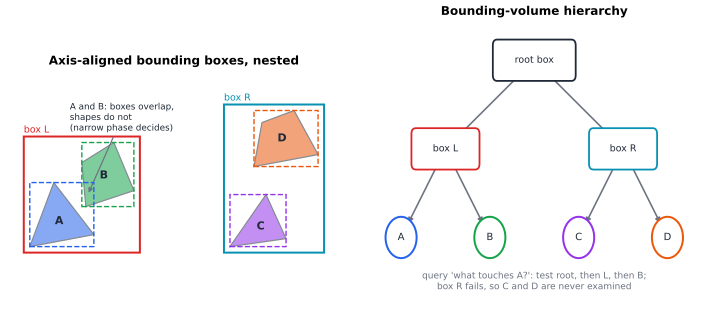
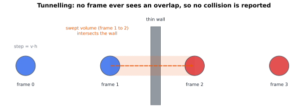

# Chapter 72 — Numerical Simulation and Physics Engines

[← Previous](71-ray-tracing.md) · [Track G](README.md) · [Table of Contents](../../00-front/table-of-contents.md) · [Next →](73-fractals.md)

> **Level 2 · Track G — Mathematics for Computer Graphics, Games, and Simulation**
> **Builds on:** [Ch. 22](../../part-7-numerical-computational/22-numerical-methods.md) (§22.9 Euler and Runge–Kutta, §22.11 stability), [Ch. 11](../../part-4-differential-equations/11-ordinary-differential-equations.md), [Ch. 6](../../part-2-calculus/06-multivariable-calculus.md) (Lagrange multipliers), [Ch. 69](69-mathematics-of-3d-worlds.md) · **Leads to:** [Ch. 75](75-computational-geometry.md), [Ch. 84](../i-dynamical-systems/84-chaos-theory.md), [Ch. 92](../j-frontier/92-mathematical-physics.md) · **Related:** [Ch. 70](70-quaternions.md), [Ch. 48](../d-optimization/48-duality.md), [Ch. 83](../i-dynamical-systems/83-dynamical-systems.md)
> **Reading time:** ~30 min

## 72.1 The hook

Every game programmer has a version of this story. You write a tiny space game: one sun, one planet, Newton's law of gravity. The planet's state is a position and a velocity, and each frame you do the obvious thing:

```python
position += velocity * dt
velocity += acceleration(position) * dt
```

You press play. The planet goes round. It is beautiful. You leave it running while you make coffee, and when you come back the planet is gone. Not crashed into the sun: *gone*, flung into the dark on a widening spiral, as if someone had been quietly feeding it fuel.

Nobody fed it anything. The physics has no engine, no friction, no external force. The real system conserves energy exactly. Your code has manufactured energy out of nothing, a little on every frame.

Now the strange part. Swap the two lines:

```python
velocity += acceleration(position) * dt
position += velocity * dt
```

Same cost. Same step size. Same "accuracy" in the textbook sense: both are first-order methods. And now the planet orbits forever. Run it for a million frames and the orbit wobbles a little, but it never spirals out.

The same ghost haunts every game engine. Ragdolls that "explode" when a character falls into a corner. A stack of crates that jitters, then leaps into the air. A bullet that passes through a wall without touching it. A rope that slowly stretches until it is twice its length. None of these are bugs in the usual sense. They are mathematics: the gap between a differential equation and the arithmetic a computer does sixty times per second.

So here is the question this chapter answers:

**Why does the obvious update rule create energy from nothing, why does swapping two lines cure it, and what else must a physics engine get right to keep a virtual world from tearing itself apart?**

## 72.2 The big idea

### A game is a map, not a flow

The laws of motion are a *flow*: a rule that moves the state continuously in time,

$$
\dot{\mathbf{x}} = \mathbf{v}, \qquad \dot{\mathbf{v}} = \mathbf{a}(\mathbf{x}).
$$

A game never sees the flow. It sees a **map**: a function $\Phi_h$ that takes the state at frame $n$ to the state at frame $n+1$, with $h$ a fixed time step (typically $1/60$ s). Whatever the true physics does between frames is invisible. The only thing that matters is what the map does when it is applied ten thousand times in a row.

That reframing is the whole chapter. The textbook question about an integrator is "how close is one step to the truth?" (local error, order of accuracy: [Ch. 22, §22.9](../../part-7-numerical-computational/22-numerical-methods.md)). The game-engine question is "what does the map do *forever*?" A first-order method with the right *structure* beats a fourth-order method with the wrong one, if you run it long enough.

### Two lines, two geometries

Think of a frictionless spring, the simplest oscillator. Its state lives in the **phase plane**, position on one axis and velocity on the other, and the true motion goes round an ellipse of constant energy.

Explicit Euler looks at the current state, reads off the tangent to the ellipse, and steps along it. A tangent to a convex curve always points slightly *outside* the curve. So every step lands on a slightly bigger ellipse. Outward, outward, outward: a spiral.

Semi-implicit (symplectic) Euler updates the velocity first and then moves the position using the *new* velocity. The two half-updates err in opposite directions: one pushes outward, the other inward. They do not cancel exactly, but they cancel in a precise geometric sense we will prove: the map preserves **area** in the phase plane. A map that preserves area cannot spiral outward forever, because a spiral would have to sweep a blob of initial conditions into an ever larger region.


*The same planet, the same step $h = 0.02$, the same cost per step. Explicit Euler gains energy at each close pass of the sun (from $-0.280$ to $-0.181$ in four orbits) and spirals away. Symplectic Euler's energy wobbles near $-0.280$ and comes back, orbit after orbit.*

### The three jobs of a physics engine

Integration is one job. A real engine has three, run every frame:

1. **Integrate**: move every body forward by $h$ under forces.
2. **Detect**: find which bodies now touch or overlap, among thousands, in well under a millisecond.
3. **Resolve**: fix the contacts and constraints (bounce, stop, stay attached) without creating or destroying energy you did not intend.

Each job has its own way to fail, and the failures interact.

## 72.3 The mathematics

### The test oscillator

Stability analysis for game physics starts, as in [Ch. 22, §22.9](../../part-7-numerical-computational/22-numerical-methods.md), with a linear test problem. Here it is the frictionless spring of angular frequency $\omega$:

$$
\dot x = v, \qquad \dot v = -\omega^2 x, \qquad E = \tfrac12\left(v^2 + \omega^2 x^2\right).
$$

Every stiff spring, vibrating joint or pendulum near the bottom of its swing looks like this locally, with $\omega^2$ the local stiffness.

**Explicit Euler** is $x_{n+1} = x_n + h v_n$, $v_{n+1} = v_n - h\omega^2 x_n$. Then

$$
v_{n+1}^2 + \omega^2 x_{n+1}^2 = (v_n - h\omega^2 x_n)^2 + \omega^2 (x_n + h v_n)^2 = (1 + h^2\omega^2)\left(v_n^2 + \omega^2 x_n^2\right),
$$

because the cross terms $-2h\omega^2 x_n v_n$ and $+2h\omega^2 x_n v_n$ cancel. Energy is multiplied by exactly $1 + h^2\omega^2$ on every step, whatever the state. After time $t = nh$ the factor is $(1+h^2\omega^2)^{t/h} \approx e^{h\omega^2 t}$. With $\omega = 1$ and $h = 0.1$ that is a factor of $1.85$ per period and about $517$ after ten periods. Ch. 22 already showed this in its stability-region picture: the eigenvalues $\pm j\omega$ of a lossless oscillator sit on the imaginary axis, outside explicit Euler's region. Making $h$ smaller slows the growth, but never stops it.

### Symplectic Euler preserves area

**Symplectic (semi-implicit) Euler** updates velocity first:

$$
v_{n+1} = v_n - h\omega^2 x_n, \qquad x_{n+1} = x_n + h\,v_{n+1}.
$$

Substituting the first line into the second gives a linear map $(x_n, v_n) \mapsto (x_{n+1}, v_{n+1})$ with matrix

$$
\mathbf{M} = \begin{pmatrix} 1 - h^2\omega^2 & h \\ -h\omega^2 & 1 \end{pmatrix}, \qquad \det\mathbf{M} = (1 - h^2\omega^2) + h^2\omega^2 = 1.
$$

> [!theorem] Area preservation
> Symplectic Euler maps every region of the phase plane to a region of the same area. Explicit Euler multiplies every area by $1 + h^2\omega^2$.
>
> *Proof.* A linear map multiplies areas by $\lvert\det\mathbf{M}\rvert$. For symplectic Euler $\det\mathbf{M} = 1$, computed above. Explicit Euler's matrix is $\begin{pmatrix}1 & h\\ -h\omega^2 & 1\end{pmatrix}$, with determinant $1 + h^2\omega^2$. ∎

For nonlinear forces the same holds with the Jacobian matrix in place of $\mathbf{M}$: the velocity kick $\mathbf{v} \mapsto \mathbf{v} + h\,\mathbf{a}(\mathbf{x})$ is a shear (it changes $\mathbf{v}$ by an amount depending only on $\mathbf{x}$), the drift $\mathbf{x}\mapsto\mathbf{x} + h\mathbf{v}$ is another shear, and shears have determinant 1. The true flow of any Hamiltonian system also preserves phase-space volume (Liouville's theorem). Symplectic Euler is a composition of two exactly solvable sub-flows, and so it inherits that geometry. This is what "symplectic" means at the level of this chapter.

Area preservation alone forbids an outward spiral, but it does not tell us how big the energy error is. For the oscillator we can do better and find what the method conserves *exactly*.

> [!theorem] A conserved "shadow energy"
> Under symplectic Euler, the quantity
> $$
> \tilde E = \tfrac12\left(v^2 + \omega^2 x^2 - h\omega^2\, x v\right)
> $$
> is exactly conserved, and for $h\omega < 2$ the true energy $E$ stays within the band
> $$
> \frac{\tilde E_0}{1 + h\omega/2} \le E_n \le \frac{\tilde E_0}{1 - h\omega/2}.
> $$
>
> *Proof.* Write $x' = x + hv'$ and $v' = v - h\omega^2 x$. First,
> $$
> \begin{aligned}
> v'^2 + \omega^2 x'^2 - h\omega^2 x' v' &= v'^2 + \omega^2(x^2 + 2h x v' + h^2 v'^2) - h\omega^2 (x + h v') v' \\
> &= v'^2 + \omega^2 x^2 + h\omega^2 x v'.
> \end{aligned}
> $$
> Now substitute $v' = v - h\omega^2 x$: $v'^2 = v^2 - 2h\omega^2 xv + h^2\omega^4 x^2$ and $h\omega^2 x v' = h\omega^2 xv - h^2\omega^4 x^2$. Adding, the $h^2\omega^4x^2$ terms cancel and we are left with $v^2 + \omega^2 x^2 - h\omega^2 xv$. So $\tilde E' = \tilde E$.
>
> For the band, use $\lvert \omega x v\rvert \le \tfrac12(v^2 + \omega^2x^2) = E$ (the AM–GM inequality). Then $h\omega^2 \lvert xv\rvert = h\omega\lvert\omega x v\rvert \le h\omega E$, so $(1 - h\omega/2)E \le \tilde E \le (1 + h\omega/2)E$. Since $\tilde E = \tilde E_0$ for all $n$, rearranging gives the band. ∎

With $\omega = 1$, $h = 0.1$, $x_0 = 1$, $v_0 = 0$ we get $\tilde E_0 = 0.5$, so $E$ must stay between $0.5/1.05 = 0.476$ and $0.5/0.95 = 0.526$. A simulation of $10^4$ steps hits $0.4762$ and $0.5263$: the bound is sharp. The energy error is $O(h)$, as expected for a first-order method, but it is *bounded forever* instead of compounding.

The theorem also gives the stability limit. $\mathbf{M}$ has determinant 1 and trace $2 - h^2\omega^2$, so its eigenvalues are $e^{\pm j\theta}$ (on the unit circle) exactly when $\lvert 2 - h^2\omega^2\rvert < 2$, that is when $h\omega < 2$. Beyond that, one eigenvalue leaves the unit circle and the method explodes. For a game: a 1 kg body on a spring of stiffness $k = 10^4$ N/m has $\omega = \sqrt{k/m} = 100$ rad/s, so it needs $h < 0.02$ s. At 60 Hz ($h = 0.0167$ s) it is stable. Drop the physics rate to 30 Hz ($h = 0.033$ s) and the same spring detonates. This is the most common reason a ragdoll explodes: a stiff joint and a long frame.

> [!mystery] The energy the planet secretly conserves
> For the linear spring we found the conserved shadow energy $\tilde E$ by hand. The planet in the figure obeys a nonlinear force, yet its energy also wobbles and returns, for as long as anyone has run it. Is there a shadow energy for *every* symplectic method and *every* Hamiltonian? Almost: the method exactly follows the flow of a slightly modified Hamiltonian, up to an error that is exponentially small in $1/h$. Why that is true, and what "symplectic" really means as geometry rather than as a determinant, is the story of backward error analysis in [Ch. 92](../j-frontier/92-mathematical-physics.md).

### Verlet: the integrator games actually ship

Add the Taylor expansions of $x(t+h)$ and $x(t-h)$:

$$
x(t \pm h) = x \pm h\dot x + \tfrac{h^2}{2}\ddot x \pm \tfrac{h^3}{6}\dddot x + O(h^4).
$$

The odd terms cancel, leaving the **Störmer–Verlet** rule

$$
x_{n+1} = 2x_n - x_{n-1} + h^2 a(x_n),
$$

with local error $O(h^4)$ and global error $O(h^2)$. It has no velocity at all: velocity is implied by the last two positions, $v_n \approx (x_{n+1} - x_{n-1})/(2h)$. That sounds like a flaw and is in fact the feature games love. If a collision or a constraint *moves* a particle, the velocity changes automatically and consistently with the move; there is no separate velocity to forget to fix.

Verlet is also **time-reversible**: swap $x_{n+1}$ and $x_{n-1}$ and the rule is unchanged. Its velocity form, *velocity Verlet* (half kick, full drift, half kick), is symplectic Euler composed with its mirror image, which is why it gains an order of accuracy for free. Runge–Kutta 4 is more accurate per step but neither symplectic nor reversible: its energy drifts, only slowly.

### Collision detection: geometry under a deadline

With $n$ bodies there are $n(n-1)/2$ pairs: for 1000 bodies, $499{,}500$ pairs every frame. Engines split detection into a cheap **broad phase** that discards most pairs and an exact **narrow phase** for the survivors.

The broad phase wraps each body in a **bounding volume**, usually an axis-aligned bounding box (AABB): the smallest box, with sides parallel to the axes, containing the body.

> [!theorem] The AABB overlap test
> Two closed intervals $[a_0, a_1]$ and $[b_0, b_1]$ intersect if and only if $a_0 \le b_1$ and $b_0 \le a_1$. Two axis-aligned boxes intersect if and only if their projections onto every coordinate axis intersect.
>
> *Proof.* If the intervals share a point $p$, then $a_0 \le p \le b_1$ and $b_0 \le p \le a_1$. Conversely, if both inequalities hold, let $p = \max(a_0, b_0)$. Then $p \le a_1$ (since $a_0 \le a_1$ and $b_0 \le a_1$) and $p \le b_1$ similarly, so $p$ lies in both. For boxes, a box is the Cartesian product of its interval projections; a point $\mathbf{p}$ lies in both boxes exactly when each coordinate $p_i$ lies in both $i$-th intervals, and such coordinates can be chosen independently axis by axis. ∎

So the test costs six comparisons in 3-D and can exit on the first failure. Boxes are conservative: overlapping boxes do not mean overlapping shapes, only "worth checking".



*Bounding boxes nest into a **bounding-volume hierarchy** (BVH). A query descends only into boxes it overlaps, so a body far from everything is rejected after a handful of tests. The overlapping boxes of A and B are a false positive that the narrow phase must reject.*

For the narrow phase on convex shapes, the workhorse is the **separating axis theorem**: two convex polygons (or polyhedra) are disjoint if and only if there is a line onto which their projections are disjoint, and it suffices to try the edge normals of both shapes (plus edge–edge cross products in 3-D). The AABB theorem above is the special case in which the only candidate axes are the coordinate axes. We state the general theorem without proof; it is a consequence of the separating hyperplane theorem for convex sets ([Ch. 47](../d-optimization/47-convexity.md)).

### Tunnelling

Detection that only looks at frames has a blind spot. A ball of radius $r$ moving at speed $v$ jumps $vh$ per frame; if $vh > 2r + w$, where $w$ is the thickness of a wall, there can be a frame before the wall and a frame after it with no overlap in between.



*Tunnelling. Each frame's overlap test passes, so no collision is ever reported. Testing the swept volume, the region the body occupies during the step, catches the crossing.*

A bullet at $900$ m/s simulated at $60$ Hz moves $15$ m per frame. Engines therefore use **continuous collision detection** for fast objects: solve for the first time $t \in [0, h]$ at which the moving shapes touch. For a sphere against a plane that is a linear equation in $t$; for two moving spheres it is a quadratic.

### Collision response: the impulse

When two bodies touch, the engine changes their velocities instantly with an **impulse** $j\,\hat{\mathbf{n}}$ along the contact normal $\hat{\mathbf{n}}$ (pointing from body 2 to body 1). Body 1 receives $+j\hat{\mathbf{n}}$ and body 2 receives $-j\hat{\mathbf{n}}$, so momentum is conserved automatically.

> [!theorem] The collision impulse
> Let the relative normal velocity before contact be $u_n = (\mathbf{v}_1 - \mathbf{v}_2)\cdot\hat{\mathbf{n}} < 0$ (approaching), and let the coefficient of restitution $e\in[0,1]$ require $u_n' = -e\,u_n$ afterwards. Then
> $$
> j = \frac{-(1+e)\,u_n}{1/m_1 + 1/m_2}.
> $$
>
> *Proof.* After the impulse, $\mathbf{v}_1' = \mathbf{v}_1 + (j/m_1)\hat{\mathbf{n}}$ and $\mathbf{v}_2' = \mathbf{v}_2 - (j/m_2)\hat{\mathbf{n}}$. Dot the difference with $\hat{\mathbf{n}}$ (a unit vector): $u_n' = u_n + j\,(1/m_1 + 1/m_2)$. Setting $u_n' = -e u_n$ gives $j(1/m_1 + 1/m_2) = -(1+e)u_n$. ∎

Example: a 1 kg ball at 4 m/s hits a resting 3 kg ball head-on, with $e = 0.5$. Then $u_n = -4$ and $j = 1.5\times 4/(4/3) = 4.5$ N·s. The first ball rebounds at $-0.5$ m/s, the second leaves at $1.5$ m/s; momentum stays $4$ kg·m/s, and kinetic energy falls from $8$ J to $3.5$ J. With $e = 1$ kinetic energy is conserved exactly; with $e > 1$ the engine would create energy, which is exactly what goes wrong when overlapping bodies are pushed apart too hard.

### Constraints: projecting back onto the rules

A rope, a ragdoll limb or a cloth is a set of particles linked by **constraints** such as $C(\mathbf{p}_1, \mathbf{p}_2) = \lVert\mathbf{p}_1 - \mathbf{p}_2\rVert - L = 0$. Integration breaks them a little every step; the engine then repairs them. **Position-based dynamics** repairs a violated constraint by the smallest mass-weighted move, which is a Lagrange-multiplier problem ([Ch. 6](../../part-2-calculus/06-multivariable-calculus.md)): minimise $\sum_i m_i\lVert\Delta\mathbf{p}_i\rVert^2$ subject to the linearised constraint $C + \nabla C\cdot\Delta\mathbf{p} = 0$. The solution moves each particle along the constraint gradient, in proportion to its inverse mass $w_i = 1/m_i$. For the distance constraint, with $\hat{\mathbf{n}} = (\mathbf{p}_1 - \mathbf{p}_2)/\lVert\mathbf{p}_1 - \mathbf{p}_2\rVert$,

$$
\Delta\mathbf{p}_1 = -\frac{w_1}{w_1 + w_2}\,C\,\hat{\mathbf{n}}, \qquad \Delta\mathbf{p}_2 = +\frac{w_2}{w_1 + w_2}\,C\,\hat{\mathbf{n}}.
$$

Two checks. The new separation is $\lVert\mathbf{p}_1 - \mathbf{p}_2\rVert - C = L$ exactly. And $m_1\Delta\mathbf{p}_1 + m_2\Delta\mathbf{p}_2 = \frac{C\hat{\mathbf{n}}}{w_1 + w_2}(-1 + 1) = \mathbf{0}$: the correction does not move the centre of mass, so it creates no net momentum. A fixed anchor is a particle with $w = 0$; it never moves.

With many constraints, fixing one breaks its neighbours. Engines simply sweep through them a few times per frame (Gauss–Seidel relaxation, the iteration of [Ch. 8](../../part-3-linear-algebra/08-matrices-and-linear-systems.md)), accepting a small residual. That residual is why a cheap rope stretches under load, and why adding iterations makes it stiffer.

## 72.4 The algorithm

### The fixed-timestep loop

Rendering rates vary; physics must not, because the stability limit $h\omega < 2$ depends on $h$. The standard pattern decouples them with an accumulator:

```python
h = 1/60                       # physics step: fixed, chosen for stability
acc = 0.0
while running:
    acc += min(frame_time(), 0.25)   # clamp: avoid the "spiral of death"
    while acc >= h:
        integrate(h)           # symplectic Euler or velocity Verlet
        detect_collisions()    # broad phase (BVH or sort-and-sweep), then narrow phase
        resolve(iterations=8)  # impulses and constraint projections
        acc -= h
    render(interpolate(acc / h))     # blend last two physics states for smooth display
```

The clamp matters. If one frame takes too long, the loop runs several physics steps to catch up, which makes the next frame longer still; without a cap, the game freezes.

### Verlet with constraints

The particle engine popularised for ragdolls and cloth is a dozen lines:

```python
def step(x, x_prev, a, h, constraints, iters=8):
    x_new = 2*x - x_prev + h*h*a            # Verlet: velocity is implicit in x - x_prev
    for _ in range(iters):
        for (i, k, L, wi, wk) in constraints:
            d = x_new[i] - x_new[k]
            dist = np.linalg.norm(d)
            C = dist - L
            n = d / dist
            x_new[i] -= wi/(wi + wk) * C * n
            x_new[k] += wk/(wi + wk) * C * n
        x_new = np.maximum(x_new, floor)    # collision with the ground: project out
    return x_new, x
```

Note the last line inside the loop: collision with the ground is handled as just another constraint (stay above the floor), and because Verlet derives velocity from positions, the bounce is automatic.

### Costs and failure modes

| Stage | Method | Cost per frame | Typical failure |
|---|---|---|---|
| integrate | symplectic Euler, Verlet | $O(n)$ | explodes if $h\omega > 2$ for the stiffest spring |
| broad phase | brute force | $O(n^2)$ | too slow beyond a few hundred bodies |
| broad phase | sort-and-sweep, BVH | about $O(n\log n + k)$ for $k$ overlapping pairs | degrades when everything is piled together |
| narrow phase | separating axes | $O(\text{edges})$ per pair | misses fast objects (tunnelling) |
| resolve | impulses + relaxation | $O(\text{iterations}\times\text{contacts})$ | jitter, stretching, stacks that creep |

Sort-and-sweep exploits time coherence: bodies barely move between frames, so the sorted list of box endpoints is nearly sorted already, and insertion sort fixes it in close to linear time.

> [!warning] Energy enters through the side door
> A perfect symplectic integrator still gains energy if collision response shoves overlapping bodies apart too hard. Most "explosions" in shipped games come from resolution, not integration. Plot total energy every frame: it is the cheapest error detector a physics engine has.

> [!mystery] Why a stack of boxes is hard
> A single bounce is one impulse. A stack of ten boxes resting on each other is a different problem: every contact must push (never pull), push only when touching, and stop touching only when the push is zero. These "either-or" conditions turn resolution into a **complementarity problem**, and sequential impulses are just one slow way to solve it. Why these conditions are the KKT conditions of an optimisation problem in disguise, and what duality says about solving them, is in [Ch. 48](../d-optimization/48-duality.md).

## 72.5 The experiment

First, the energy factors themselves. The red curve is explicit Euler's energy, $(1 + h^2)^{t/h}$ with $\omega = 1$ and $h = 0.1$, written as $1.01^{10x}$. The blue lines are the band that symplectic Euler can never leave, $1/(1 \pm h/2)$ times the shadow energy.

```desmos-graph
left=0; right=40; bottom=0.8; top=2.5
---
y=1.01^{10x}|red
y=1.0025^{20x}|orange|dashed
y=\frac{1}{0.95}|blue
y=\frac{1}{1.05}|blue
y=1|grey|dotted
```

*Energy relative to its start, against time. Red: explicit Euler with $h = 0.1$. Orange dashed: explicit Euler with $h = 0.05$, written $1.0025^{20x}$, which grows more slowly but still without limit. Blue: the band that bounds symplectic Euler with $h = 0.1$. Change $0.1$ to $0.2$ (red: $1.04^{5x}$; blue: $1/0.9$ and $1/1.1$) and watch the band widen while staying a band.*

Now a script. It simulates a nonlinear pendulum, $\ddot\theta = -(g/\ell)\sin\theta$, with three integrators and plots the energy of each. Nothing here is linear, so the shadow-energy theorem does not apply directly: you are testing whether its message survives.

```python
import numpy as np
import matplotlib.pyplot as plt

g_over_l = 9.81      # (g/l) in 1/s^2: a 1 m pendulum
h = 0.05             # time step in s: try 0.01, 0.1, 0.3, 0.6
T = 60.0             # total time in s
theta0 = 2.5         # starting angle in rad (2.5 is a wild swing; try 0.1)

def acc(th):
    return -g_over_l * np.sin(th)

def energy(th, om):
    return 0.5 * om**2 + g_over_l * (1 - np.cos(th))

def simulate(method):
    th, om = theta0, 0.0
    E = []
    for _ in range(int(T / h)):
        if method == "explicit":
            th, om = th + h * om, om + h * acc(th)
        elif method == "symplectic":
            om = om + h * acc(th)
            th = th + h * om
        else:                                   # velocity Verlet
            om_half = om + 0.5 * h * acc(th)
            th = th + h * om_half
            om = om_half + 0.5 * h * acc(th)
        E.append(energy(th, om))
    return np.array(E)

t = np.arange(int(T / h)) * h
for m in ["explicit", "symplectic", "verlet"]:
    plt.plot(t, simulate(m) / energy(theta0, 0.0), label=m)
plt.ylim(0, 3)
plt.xlabel("time (s)"); plt.ylabel("energy / initial energy")
plt.legend(); plt.show()
```

Things to try. With `h = 0.05` and `theta0 = 2.5` explicit Euler's pendulum gains energy until it goes over the top and spins; the other two hold steady. Shrink `h` to `0.01` and Verlet's wobble shrinks by a factor of about 25 (second order) while symplectic Euler's shrinks by about 5 (first order). Raise `h` until even Verlet fails: the small-angle stability limit is $h\sqrt{g/\ell} < 2$, about $h < 0.64$ s, but the wild swing fails sooner. Find out how much sooner.

## 72.6 The challenge

1. **Intuition.** A designer complains that springs in your engine "lose bounce" over time and asks you to switch from symplectic Euler to explicit Euler, because she read that explicit Euler "adds energy". Explain, using the phase-plane picture, why that is a bad fix even if it seems to cancel her damping, and suggest where the lost bounce is more likely to be coming from.

2. **Derivation.** For **backward (implicit) Euler** on the oscillator, $x_{n+1} = x_n + h v_{n+1}$, $v_{n+1} = v_n - h\omega^2 x_{n+1}$, find the matrix of the map, show that its determinant is $1/(1 + h^2\omega^2)$, and conclude what happens to energy. Then show that alternating one explicit Euler step with one backward Euler step does not give an area-preserving method, but that a half step of each, composed, gives the trapezoidal rule. Is the trapezoidal rule symplectic for this problem?

3. **Implementation.** Build a rope of 20 particles with distance constraints, the top one pinned ($w = 0$), using the Verlet-with-constraints code above. Measure the rope's total length after it settles as a function of the number of relaxation iterations (1, 2, 4, 8, 16, 32). Plot the stretch against iterations on a log–log plot. What power law do you see, and how does it change with the number of particles?

4. **Open investigation.** Stack $N$ identical boxes (in 2-D is fine) using sequential impulses with a fixed number of iterations per frame. For each $N$, find the minimum number of iterations at which the stack stands still for 60 seconds instead of creeping or collapsing. How does that number grow with $N$? Try warm starting (reusing last frame's impulses as the first guess) and see whether it changes the growth law. Real engines rely on heuristics here; there is no known clean formula.

## 72.7 Loose threads

The hook asked why the obvious update creates energy and why swapping two lines cures it. Explicit Euler multiplies every phase-space area, and the oscillator's energy, by $1 + h^2\omega^2$ per step. Symplectic Euler is a composition of two shears, preserves area exactly, and conserves a shadow energy $\tilde E$ that pins the true energy inside a band of width $O(h)$ forever. Around the integrator sit bounding volumes, continuous detection, impulses and constraint projection, each with its own way to inject energy.

What the chapter did not tell you:

- **The shadow Hamiltonian in general.** The first mystery: why every symplectic integrator follows a nearby energy-conserving system almost exactly, for exponentially long times. That is backward error analysis and symplectic geometry, in [Ch. 92](../j-frontier/92-mathematical-physics.md); the geometry of phase space as a manifold starts in [Ch. 59](../e-abstract-math/59-differential-geometry.md).
- **Contact as optimisation.** The second mystery: resting contact and friction form a complementarity problem whose structure is duality, in [Ch. 48](../d-optimization/48-duality.md).
- **Rotation.** Every body here was a point. Rigid bodies also spin, and integrating an orientation without it slowly ceasing to be a rotation needs the quaternions of [Ch. 70](70-quaternions.md).
- **Faster broad phases.** Building and updating the BVH, and the alternatives (uniform grids, k-d trees, sweep structures), belong to [Ch. 75](75-computational-geometry.md).
- **Stiffness.** Cloth and stiff joints want large $k$ and large $h$ together, which explicit and symplectic methods cannot deliver. Implicit methods, discussed in [Ch. 22, §22.9](../../part-7-numerical-computational/22-numerical-methods.md) under stiffness, buy stability with a linear solve per step.

> [!mystery] Can a simulation of chaos be trusted at all?
> A double pendulum is chaotic: two starting states differing by $10^{-12}$ end up completely different within seconds, and every step of your integrator makes an error far bigger than that. So after a minute your simulated pendulum is certainly not following the true trajectory from its starting point. Yet the motion *looks* right, and its statistics are right. Is the computed orbit following some *other* true trajectory, from a slightly different start? Sometimes provably yes, and the theorem that says when is the shadowing lemma of [Ch. 84](../i-dynamical-systems/84-chaos-theory.md).

## Further reading

- Ernst Hairer, Christian Lubich and Gerhard Wanner, "Geometric numerical integration illustrated by the Störmer–Verlet method", *Acta Numerica* 12 (2003). The clearest account of why Verlet works, including backward error analysis.
- Christer Ericson, *Real-Time Collision Detection* (Morgan Kaufmann, 2005). The standard engineering reference for bounding volumes, separating axes and continuous detection.
- Thomas Jakobsen, "Advanced Character Physics", Game Developers Conference (2001). The short paper that brought Verlet integration and constraint relaxation to games.
- Matthias Müller, Bruno Heidelberger, Marcus Hennix and John Ratcliff, "Position Based Dynamics", *Journal of Visual Communication and Image Representation* 18 (2007). The method behind most real-time cloth and soft bodies.
