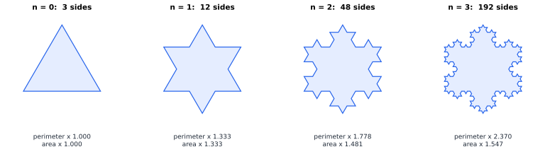
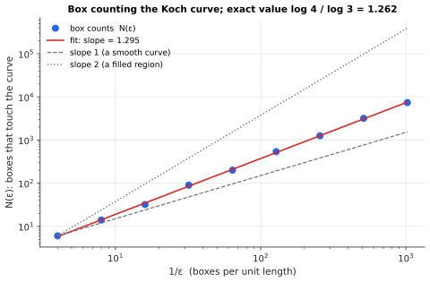
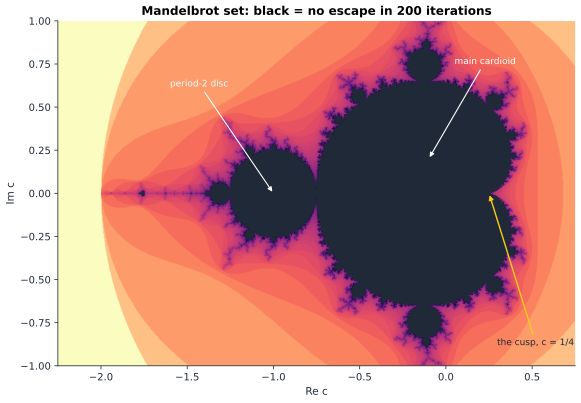

# Chapter 73 — Fractals: Infinite Complexity from Simple Rules

[← Previous](72-physics-engines.md) · [Track G](README.md) · [Table of Contents](../../00-front/table-of-contents.md) · [Next →](74-procedural-generation.md)

> **Level 2 · Track G — Mathematics for Computer Graphics, Games, and Simulation**
> **Builds on:** [Ch. 2](../../part-1-foundations/02-complex-numbers.md) (complex multiplication), [Ch. 22](../../part-7-numerical-computational/22-numerical-methods.md) (§22.3 fixed-point iteration), [Ch. 1](../../part-1-foundations/01-mathematical-language-and-algebra.md) (logarithms, geometric series) · **Leads to:** [Ch. 74](74-procedural-generation.md), [Ch. 84](../i-dynamical-systems/84-chaos-theory.md), [Ch. 97](../j-frontier/97-measure-theory.md) · **Related:** [Ch. 83](../i-dynamical-systems/83-dynamical-systems.md), [Ch. 85](../i-dynamical-systems/85-bifurcations.md), [Ch. 64](../f-logic-foundations/64-set-theory-and-infinity.md)
> **Reading time:** ~30 min

## 73.1 The hook

How long is the coast of Britain?

It sounds like a question with an answer you could look up. In the 1950s the physicist and meteorologist Lewis Fry Richardson tried to look it up, for a study of whether the length of a border between two countries affects how likely they are to go to war. He found that the published figures disagreed wildly. Spain and Portugal quoted their shared border as 987 km and 1214 km. The Netherlands and Belgium disagreed by a similar margin.

Nobody had made an arithmetic mistake. Richardson worked out what was going on by doing the measurement himself, with a pair of dividers on a map. Set the dividers to 100 km and walk them along the coast: you get some total. Set them to 50 km: the dividers now follow bays and headlands the 100 km setting stepped across, and the total goes *up*. Set them to 10 km: up again. Halving the ruler did not converge to a limit. It kept adding length, by roughly the same *factor* each time.

Richardson found that the measured length $L$ followed a power law in the ruler length $\varepsilon$,

$$
L(\varepsilon) \approx C\,\varepsilon^{1-D},
$$

with an exponent $D$ that was a property of the coastline: about $1.25$ for the west coast of Britain, close to $1.0$ for the smooth coast of South Africa. A smooth curve has $D = 1$, and then $L$ stops changing as $\varepsilon \to 0$, which is what calculus says should happen (arc length, [Ch. 7](../../part-2-calculus/07-vector-calculus.md)). The British coast does not.

In 1967 Benoît Mandelbrot read Richardson's forgotten paper and asked the question that founded a field. What if the exponent $D$ is not a nuisance but a *dimension*: a coastline is more than a line and less than an area, and $1.25$ measures exactly how much more?

**What could it mean for a shape to have dimension 1.25, and how do we compute it?**

The answer takes us through a snowflake with infinite perimeter and finite area, a two-line program that draws the most complicated object in mathematics, and a definition of dimension that a ruler can measure.

## 73.2 The big idea

### Rules, not shapes

A smooth curve looks straighter and straighter as you zoom in: that is what having a tangent line means. A **fractal** is a shape that does not simplify under zooming. Zoom into the British coastline and you see bays within bays. Zoom into a fern and you see the same fern.

The deep idea is that such shapes are usually easy to *generate* even though they are hard to *describe*. You do not draw a fern; you write a rule and apply it forever. Three kinds of rule dominate:

- **Replacement rules.** Take a segment, replace it with a bent copy of four smaller segments, and repeat (the Koch curve).
- **Iterated function systems.** Take a set of contracting maps, apply all of them to a picture, overlay the results, and repeat (the Sierpinski triangle, Barnsley's fern).
- **Escape-time rules.** Iterate a simple map like $z \mapsto z^2 + c$ and colour each starting point by what its orbit does (the Mandelbrot and Julia sets).

Each rule is a **feedback loop**: output becomes input. That is why fractals are the natural shapes of iteration, and why they turn up wherever there is feedback: turbulence, river networks, lungs, galaxies, and the chaotic systems of [Ch. 84](../i-dynamical-systems/84-chaos-theory.md).

### Dimension as a scaling law

Here is the analogy that unlocks fractal dimension. Cut a line segment into pieces scaled by $1/3$: you get 3 pieces. Do it to a square: 9 pieces. To a cube: 27. The number of pieces is $3^D$, where $D$ is the dimension. Dimension is the exponent in "how many small copies do I need?"

The Koch curve is built from 4 copies of itself, each scaled by $1/3$. So $3^D = 4$, and

$$
D = \frac{\log 4}{\log 3} \approx 1.262.
$$

That is the whole idea, and it is not a metaphor: it is a number you can measure with a ruler, exactly as Richardson did, by counting how the number of small boxes needed to cover a shape grows as the boxes shrink.



*Koch snowflake, stages 0 to 3. Each stage multiplies the perimeter by $4/3$, so it grows without bound, while the area creeps toward a limit of $8/5$ of the original triangle.*

## 73.3 The mathematics

### The Koch snowflake: infinite perimeter, finite area

Start from an equilateral triangle with side $s$, perimeter $P_0 = 3s$ and area $A_0$. At each stage, replace every side by four sides one third as long: cut out the middle third and put two sides of a small outward-pointing equilateral triangle in its place.

> [!theorem] The Koch snowflake
> After $n$ stages the snowflake has $3\cdot4^n$ sides, perimeter $P_n = 3s\,(4/3)^n$ and area
> $$
> A_n = A_0\left(1 + \frac35\left(1 - \left(\frac49\right)^{n}\right)\right).
> $$
> So $P_n \to \infty$ while $A_n \to \tfrac85 A_0$.
>
> *Proof.* Each side becomes 4 sides, each a third as long, so the side count is multiplied by 4 and the perimeter by $4/3$ at every stage. For the area: at stage $k \ge 1$ a new small triangle is added on each of the $3\cdot4^{k-1}$ sides of stage $k-1$. Its side is $s/3^k$, so its area is $A_0/9^k$ (area scales as length squared). The area added at stage $k$ is
> $$
> 3\cdot 4^{k-1}\cdot\frac{A_0}{9^k} = \frac34 A_0\left(\frac49\right)^{k}.
> $$
> Summing the geometric series for $k = 1, \dots, n$:
> $$
> A_n = A_0 + \frac34 A_0\cdot\frac{(4/9)\left(1 - (4/9)^n\right)}{1 - 4/9} = A_0\left(1 + \frac35\left(1 - \left(\frac49\right)^n\right)\right).
> $$
> As $n\to\infty$, $(4/9)^n \to 0$ and $A_n \to A_0(1 + 3/5) = \tfrac85 A_0$. ∎

You could paint the snowflake with a finite can of paint, but never fence it. And notice the *reason*: perimeter grows by $4/3 > 1$ per stage, area by additions that shrink like $(4/9)^k$. Length and area scale with different powers of the zoom factor, and a fractal sits between them.

### Similarity dimension

> [!definition] Self-similar set and similarity dimension
> A set $F$ is **strictly self-similar** if it is the union of $N$ copies of itself, each scaled by the same ratio $r < 1$, that overlap at most in negligible pieces (single points or edges). Its **similarity dimension** is the number $D$ with $N r^D = 1$:
> $$
> D = \frac{\log N}{\log(1/r)}.
> $$

The formula reproduces ordinary dimensions: a segment is $N$ copies at ratio $1/N$, so $D=1$; a square is $N^2$ copies at ratio $1/N$, so $D=2$. And it gives new ones:

| Set | Copies $N$ | Ratio $r$ | $D = \log N/\log(1/r)$ |
|---|---|---|---|
| Cantor set (keep outer thirds of $[0,1]$, repeat) | 2 | $1/3$ | $0.631$ |
| Koch curve | 4 | $1/3$ | $1.262$ |
| Sierpinski triangle | 3 | $1/2$ | $1.585$ |
| Sierpinski carpet | 8 | $1/3$ | $1.893$ |
| Menger sponge | 20 | $1/3$ | $2.727$ |

The Cantor set is a good warm-up for the strangeness. It has total length zero (we remove $1/3$, then $2/9$, then $4/27$, …, which sums to $1$), yet it has as many points as the whole interval ([Ch. 64](../f-logic-foundations/64-set-theory-and-infinity.md)). Dimension $0.631$ sits between "countable dust" (dimension 0) and "a line" (dimension 1).

When the copies have different ratios $r_1, \dots, r_N$, the same reasoning gives the **Moran equation** $\sum_i r_i^D = 1$, which has exactly one solution because the left side decreases strictly in $D$.

### Box-counting dimension

Most fractals, coastlines above all, are not exactly self-similar. The measurable version of the idea counts boxes.

> [!definition] Box-counting dimension
> Cover the plane with a grid of squares of side $\varepsilon$ and let $N(\varepsilon)$ be the number of squares that meet the set $F$. If $N(\varepsilon) \approx C\varepsilon^{-D}$ as $\varepsilon \to 0$, then $D$ is the **box-counting dimension**:
> $$
> D = \lim_{\varepsilon\to0}\frac{\log N(\varepsilon)}{\log(1/\varepsilon)}.
> $$
> In practice, $D$ is the slope of $\log N$ against $\log(1/\varepsilon)$.

For a smooth curve of length $L$, $N(\varepsilon) \approx L/\varepsilon$ (slope 1); for a region of area $A$, $N \approx A/\varepsilon^2$ (slope 2). Richardson's dividers are the same thing in disguise: the measured length is (number of steps) $\times\,\varepsilon \approx C\varepsilon^{-D}\cdot\varepsilon = C\varepsilon^{1-D}$, which is exactly his law. The exponent he measured on the British coast was the box-counting dimension.



*Box counting the Koch curve with dyadic boxes from $\varepsilon = 1/4$ to $1/1024$. The least-squares slope is $1.295$, about 3% above the exact $\log4/\log3 = 1.262$. The limit is approached slowly, and the coarse scales bias the fit.*

> [!warning] A slope is not a limit
> Box counting gives a dimension only in the limit $\varepsilon\to0$, and every real data set has a smallest scale (pixels, grains of sand, atoms). Fits over a decade or two can be biased by several percent; the local slope between consecutive scales wobbles. Report the range of scales you fitted over, and be suspicious of three significant figures.

### Iterated function systems

The Sierpinski triangle is the set left fixed by three maps of the plane. With corners $\mathbf{p}_1, \mathbf{p}_2, \mathbf{p}_3$, let

$$
f_i(\mathbf{x}) = \mathbf{p}_i + \tfrac12(\mathbf{x} - \mathbf{p}_i), \qquad i = 1, 2, 3,
$$

each a contraction by $1/2$ toward a corner. The triangle $S$ satisfies $S = f_1(S)\cup f_2(S)\cup f_3(S)$: it is three half-size copies of itself.

A family of contractions like this is an **iterated function system** (IFS). Its key property is a fixed-point theorem, the same idea as fixed-point iteration in [Ch. 22, §22.3](../../part-7-numerical-computational/22-numerical-methods.md), but where the "points" are whole compact sets and distance between sets is measured by the Hausdorff metric (the largest distance from a point of either set to the other set).

> [!theorem] Hutchinson's theorem (stated)
> If $f_1, \dots, f_N$ are contractions of the plane, the map on compact sets $\mathcal{H}(K) = f_1(K)\cup\dots\cup f_N(K)$ is itself a contraction in the Hausdorff metric. So it has exactly one fixed compact set $F$, the **attractor**, and iterating $\mathcal{H}$ from *any* starting compact set converges to $F$.

Two consequences matter for computing. First, the starting picture is irrelevant: start from a square, a dot or a photograph of a cat, and the iterates converge to the same Sierpinski triangle. Second, there is a randomized shortcut, the **chaos game**: start at any point, and repeatedly apply one of the $f_i$ chosen at random. After a few steps the point is within a pixel of the attractor and stays there, and the points it visits fill it out. We will use it in the experiment.

### The Mandelbrot set

Now the most famous rule of all. Fix a complex number $c$ ([Ch. 2](../../part-1-foundations/02-complex-numbers.md)) and iterate

$$
z_{n+1} = z_n^2 + c, \qquad z_0 = 0.
$$

The orbit $0,\ c,\ c^2 + c,\ \dots$ either stays bounded forever or runs off to infinity. The **Mandelbrot set** $M$ is the set of $c$ for which it stays bounded. For $c = 0$ the orbit is $0, 0, 0, \dots$: in $M$. For $c = -1$ it is $0, -1, 0, -1, \dots$: in $M$. For $c = 1$ it is $0, 1, 2, 5, 26, \dots$: not in $M$.

To compute $M$ we need to know when we can stop iterating and declare escape. The answer is a short, exact theorem.

> [!theorem] The escape radius
> If $\lvert z_n\rvert > 2$ for some $n$, then $\lvert z_n\rvert \to \infty$. Consequently $M$ lies inside the disc $\lvert c\rvert \le 2$.
>
> *Proof.* First suppose $\lvert c\rvert > 2$. Then $z_1 = c$ already has $\lvert z_1\rvert > 2$ and $\lvert z_1\rvert \ge \lvert c\rvert$. Otherwise $\lvert c\rvert \le 2$, and any $z_n$ with $\lvert z_n\rvert > 2$ also satisfies $\lvert z_n\rvert > \lvert c\rvert$. So in either case we have some $z = z_n$ with $\lvert z\rvert > 2$ and $\lvert z\rvert \ge \lvert c\rvert$. By the reverse triangle inequality,
> $$
> \lvert z^2 + c\rvert \ge \lvert z\rvert^2 - \lvert c\rvert \ge \lvert z\rvert^2 - \lvert z\rvert = \lvert z\rvert\left(\lvert z\rvert - 1\right).
> $$
> Write $\lvert z\rvert = 2 + \delta$ with $\delta > 0$. Then $\lvert z_{n+1}\rvert \ge (1 + \delta)\lvert z_n\rvert$, and $\lvert z_{n+1}\rvert > 2 + \delta$, so the same bound holds at the next step with the same (or larger) $\delta$. By induction $\lvert z_{n+k}\rvert \ge (1+\delta)^k\lvert z_n\rvert \to \infty$. ∎

So a computer can decide escape in finite time for every $c$ outside $M$: iterate until $\lvert z\rvert > 2$. What it can never do is certify, in finite time, that a point is *inside*: an orbit that has stayed bounded for 200 iterations might escape at iteration 201. Every picture of $M$ is an approximation from outside.

Some of the structure can be derived by hand. The big heart-shaped body, the **main cardioid**, is the set of $c$ for which the map has an attracting fixed point. A fixed point satisfies $z^* = (z^*)^2 + c$, and it attracts when the derivative $\lvert 2z^*\rvert < 1$. On the boundary, $2z^* = e^{j\theta}$, and then $c = z^* - (z^*)^2$ gives

$$
c(\theta) = \frac{e^{j\theta}}{2} - \frac{e^{2j\theta}}{4},
$$

a cardioid with its cusp at $c(0) = 1/4$ and its leftmost point at $c(\pi) = -3/4$. There the fixed point loses stability and an attracting cycle of period 2 takes over; that cycle attracts for $\lvert c + 1\rvert < 1/4$, the disc attached at $-3/4$. Then period 4, period 8, …



*The Mandelbrot set computed by the escape-time algorithm of §73.4: $900\times600$ pixels, at most 200 iterations each, coloured by the logarithm of the escape count. The black region never exceeded $\lvert z\rvert = 2$.*

> [!mystery] Is the Mandelbrot set in one piece?
> Douady and Hubbard proved in 1982 that $M$ is connected: it does not fall apart into islands, even though pictures show apparent islands (they are joined by filaments too thin to render). A much stronger statement, that $M$ is *locally connected* (every point has arbitrarily small connected neighbourhoods), is the **MLC conjecture**. If true, it would give a complete combinatorial description of $M$ and settle whether the hyperbolic components are dense. It is one of the central open problems of complex dynamics; how such problems are attacked is the subject of [Ch. 98](../j-frontier/98-mathematical-research.md).

## 73.4 The algorithm

### Escape time, vectorised

The whole Mandelbrot figure above comes from this loop, run on all pixels at once with NumPy:

```python
import numpy as np

def mandelbrot(xmin, xmax, ymin, ymax, W=900, H=600, max_iter=200):
    c = np.linspace(xmin, xmax, W)[None, :] + 1j * np.linspace(ymin, ymax, H)[:, None]
    z = np.zeros_like(c)
    count = np.full(c.shape, max_iter)          # max_iter means "never escaped"
    alive = np.ones(c.shape, dtype=bool)
    for n in range(max_iter):
        z[alive] = z[alive]**2 + c[alive]
        escaped = alive & (np.abs(z) > 2)       # the escape-radius theorem
        count[escaped] = n
        alive &= ~escaped
    return count
```

**Cost.** $O(WHI)$ in the worst case, with $I$ the iteration budget `max_iter`, dominated by points inside $M$, which never escape and run the full budget. Two cheap tests reject most of the interior before iterating: $c$ is in the main cardioid if $q(q + (x - \tfrac14)) \le \tfrac14 y^2$ with $q = (x-\tfrac14)^2 + y^2$, and in the period-2 disc if $(x+1)^2 + y^2 \le \tfrac1{16}$. Points near the boundary escape slowly, so zooming in demands more iterations: the budget must grow as you zoom.

**Smooth colouring.** Integer escape counts produce visible bands. Replacing $n$ by $n + 1 - \log_2\log\lvert z_n\rvert$ (using a large escape radius) gives a continuous value, because for large $\lvert z\rvert$ the map is essentially $z \mapsto z^2$ and $\log\log\lvert z\rvert$ grows by $\log 2$ per step.

**Precision.** Double-precision numbers have about 16 significant digits. A zoom to a width of $10^{-13}$ leaves only a few digits to distinguish neighbouring pixels, and the picture dissolves into blocks. Deep-zoom software computes one reference orbit in arbitrary precision and the other pixels as small *perturbations* of it in ordinary floating point: [Ch. 22, §22.1](../../part-7-numerical-computational/22-numerical-methods.md) is the reason this is necessary.

### The chaos game

```python
z = 0j
for i in range(n_points):
    corner = corners[rng.integers(len(corners))]
    z = corner + r * (z - corner)      # apply a random contraction from the IFS
    plot(z)                            # skip the first few points (transient)
```

Cost $O(1)$ per point. The randomness is only a device for visiting the attractor; any sequence of maps that contains every finite pattern of choices works.

### Box counting

```python
def box_count(points, eps):
    cells = np.floor(np.column_stack([points.real, points.imag]) / eps)
    return len(np.unique(cells, axis=0))           # number of occupied eps-boxes
# D is the slope of log(box_count) against log(1/eps), over a range of eps
```

Two failure cases. If $\varepsilon$ is smaller than the spacing between your sample points, the count saturates at the number of points and the slope falls toward 0. If $\varepsilon$ is comparable to the whole set, the count is dominated by its overall shape. The usable range lies between, and it is often only a decade or two wide.

## 73.5 The experiment

First, the snowflake's two diverging fates. With the stage $n$ on the horizontal axis, the red curve is the perimeter ratio $(4/3)^n$ and the blue curve is the area ratio, which flattens out under its limit $8/5$.

```desmos-graph
left=0; right=12; bottom=0; top=6
---
y=(\frac{4}{3})^{x}|red
y=1+\frac{3}{5}(1-(\frac{4}{9})^{x})|blue
y=1.6|blue|dashed
```

*Perimeter (red) and area (blue) of the Koch snowflake relative to the starting triangle. Change the $4$ and $3$ in the red curve to $N$ and $1/r$ for another replacement rule (try $\frac{5}{3}$ for a rule with five pieces of a third), and ask what happens to the area in that case.*

Now play the chaos game and measure the dimension of what it draws. The script uses $k$ corners of a regular polygon and contracts by $r$ toward a random corner each step; then it box-counts the result.

```python
import numpy as np
import matplotlib.pyplot as plt

rng = np.random.default_rng(1)
k = 3            # number of corners: try 4, 5, 6
r = 0.5          # contraction ratio toward the chosen corner: try 0.4, 0.6, 1/3
n_pts = 200_000  # points in the chaos game

corners = np.exp(2j * np.pi * np.arange(k) / k + 0.5j * np.pi)
z = 0j
pts = np.empty(n_pts, dtype=complex)
for i in range(n_pts):
    c = corners[rng.integers(k)]
    z = c + r * (z - c)          # jump a fraction (1 - r) of the way toward a random corner
    pts[i] = z
pts = pts[100:]                  # discard the transient

# box counting: how many eps-boxes contain at least one point?
eps = 2.0 ** -np.arange(2, 9)
N = [len(np.unique(np.floor(np.column_stack([pts.real, pts.imag]) / e), axis=0)) for e in eps]
D_fit = np.polyfit(np.log(1 / eps), np.log(N), 1)[0]
print(f"box-counting estimate D = {D_fit:.3f};  similarity dimension log k / log(1/r) = {np.log(k) / np.log(1 / r):.3f}")

fig, (a1, a2) = plt.subplots(1, 2, figsize=(10, 4.5))
a1.plot(pts.real, pts.imag, ",", color="navy"); a1.set_aspect("equal"); a1.set_title(f"chaos game, k={k}, r={r}")
a2.loglog(1 / eps, N, "o-"); a2.set_xlabel("1/eps"); a2.set_ylabel("N(eps)"); a2.set_title(f"slope = {D_fit:.3f}")
plt.show()
```

As written ($k = 3$, $r = 0.5$) it draws the Sierpinski triangle and estimates $D \approx 1.571$ against the exact $1.585$. Things to try:

- $k = 4$, $r = 0.5$: the four copies tile the square exactly, the attractor is the filled square, and the formula says $D = 2$. The estimate is lower ($1.914$). Is that the fit or the number of points? Raise `n_pts` and find out.
- $k = 3$, $r = 0.4$: the copies no longer touch; you get a dust of dimension $\log 3/\log 2.5 = 1.199$. The estimate ($1.222$) is close.
- $k = 5$, $r = 0.4$: the formula says $1.756$ and the estimate says $1.691$. Look at the picture closely, near where neighbouring copies meet. Something in the definition of similarity dimension has been violated. What?

## 73.6 The challenge

1. **Intuition.** A friend argues: "The Koch curve is made of line segments at every stage, so in the limit it is still a curve, and a curve has dimension 1." Find the flaw. Which property of the limit shape do the finite stages fail to predict, and why does box counting at a fixed $\varepsilon$ not care how many stages you drew once the stage's segments are shorter than $\varepsilon$?

2. **Derivation.** The **Vicsek fractal** keeps the centre square and the four corner squares of a $3\times3$ grid, and repeats. Compute its similarity dimension. Then compute the area remaining after $n$ stages, and the perimeter after $n$ stages, and decide which of them tends to 0, which to infinity, and which to a finite limit.

3. **Implementation.** Extend the Mandelbrot code to draw the **Julia set** of $z\mapsto z^2 + c$ for a fixed $c$: now $c$ is constant and the *starting point* $z_0$ varies over the pixels. Draw it for $c = -1$, $c = -0.123 + 0.745j$, and $c = 0.3$. One of these Julia sets is connected and one is a disconnected dust. Check, using your Mandelbrot code, whether each $c$ lies in $M$, and formulate a conjecture relating the two pictures.

4. **Open investigation.** Box-count a real coastline. Take any outline you can get as a list of coordinates (a country border from an open map data set, or a coastline you trace by hand from a satellite image at several zoom levels), and estimate $D$ over as many scales as the data allow. How stable is your estimate when you shift the grid by half a box, rotate it, or change the range of $\varepsilon$ you fit over? Is there a scale range over which the coastline is truly "fractal", or does $D$ drift? Researchers still argue about how to answer this for real data.

## 73.7 Loose threads

The hook asked what dimension $1.25$ could mean. Now we know: a set has dimension $D$ when the number of $\varepsilon$-boxes needed to cover it grows like $\varepsilon^{-D}$, and Richardson's ruler law $L \approx C\varepsilon^{1-D}$ is that statement in disguise. For exactly self-similar sets, $D = \log N/\log(1/r)$; the Koch curve has $D = 1.262$, and its snowflake has infinite perimeter around a finite area. Iterated function systems generate such sets as unique fixed points of a contraction on shapes, and the escape-time rule $z\mapsto z^2 + c$ generates the Mandelbrot set, whose outside a computer can certify and whose inside it never can.

What the chapter left open:

- **Is $M$ locally connected?** The first mystery is the MLC conjecture, still open.
- **The right definition of dimension.** Box counting is easy to compute but has defects: the set of rational numbers in $[0,1]$ is countable, yet every box meets it, so its box-counting dimension is 1. The **Hausdorff dimension** repairs this using measure theory; see the mystery below.
- **Where the strange attractor's dimension comes from.** Chaotic systems trace out fractal sets, and their dimension is linked to how fast nearby trajectories separate. See the last mystery.
- **Universal numbers.** Along the real axis of $M$, the period-doubling discs shrink by a ratio that tends to $4.669\ldots$, Feigenbaum's constant. The same number appears in dripping taps and convection cells. Why a single number governs so many unrelated systems is a story about bifurcations and renormalisation, begun in [Ch. 85](../i-dynamical-systems/85-bifurcations.md).
- **Fractals as worlds.** Fractal mountains, clouds and coastlines in games are built not from exact self-similarity but from *statistical* self-similarity: noise summed over octaves. That is the subject of [Ch. 74](74-procedural-generation.md).

> [!mystery] A curve of dimension two
> The boundary of the Mandelbrot set looks like a curve: it has no interior, it is "one-dimensional" topologically. Yet in 1998 Mitsuhiro Shishikura proved that its Hausdorff dimension is exactly 2, as large as a curve in the plane can possibly be. What is Hausdorff dimension, why can it disagree with box counting, and what does it mean for a boundary to be two-dimensional when nobody yet knows whether it has any area at all? The answer requires building a theory of size for wild sets, which is measure theory, in [Ch. 97](../j-frontier/97-measure-theory.md).

> [!mystery] Where chaos keeps its fractals
> Iterate the Hénon map $x_{n+1} = 1 - 1.4x_n^2 + y_n$, $y_{n+1} = 0.3x_n$ from almost any start, and the points settle onto a thin, layered set of box-counting dimension about $1.26$, a fractal made by a dynamical system no one designed to make one. Why do chaotic systems produce fractal attractors, and why can their dimension be predicted from the rates at which nearby orbits stretch and fold (the Lyapunov exponents)? That is the Kaplan–Yorke story, in [Ch. 84](../i-dynamical-systems/84-chaos-theory.md).

## Further reading

- Benoît B. Mandelbrot, *The Fractal Geometry of Nature* (W. H. Freeman, 1982). The founding book: idiosyncratic, visual and full of ideas.
- Kenneth Falconer, *Fractal Geometry: Mathematical Foundations and Applications*, 3rd ed. (Wiley, 2014). The standard mathematical text: box counting, Hausdorff dimension, IFS, Julia sets.
- Heinz-Otto Peitgen, Hartmut Jürgens and Dietmar Saupe, *Chaos and Fractals: New Frontiers of Science*, 2nd ed. (Springer, 2004). A long, generous, picture-rich introduction with algorithms.
- Michael F. Barnsley, *Fractals Everywhere*, 2nd ed. (Academic Press, 1993). Iterated function systems and the chaos game, from the person who popularised them.
