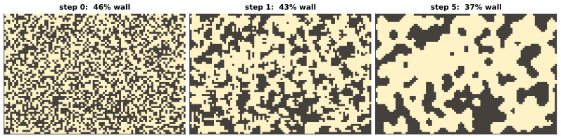
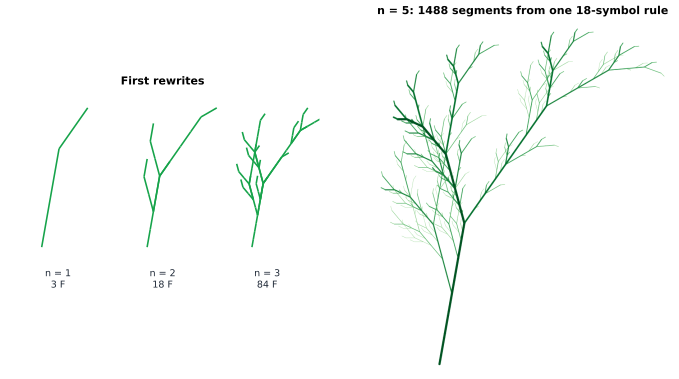

# Chapter 74 — Procedural Generation: Creating Worlds with Rules

[← Previous](73-fractals.md) · [Track G](README.md) · [Table of Contents](../../00-front/table-of-contents.md) · [Next →](75-computational-geometry.md)

> **Level 2 · Track G — Mathematics for Computer Graphics, Games, and Simulation**
> **Builds on:** [Ch. 21](../../part-6-probability-statistics/21-random-processes.md) (random processes, power spectral density), [Ch. 10](../../part-3-linear-algebra/10-eigenvalues-and-eigenvectors.md) (dominant eigenvalues), [Ch. 22](../../part-7-numerical-computational/22-numerical-methods.md) (§22.5 interpolation), [Ch. 73](73-fractals.md) · **Leads to:** [Ch. 75](75-computational-geometry.md), [Ch. 76](76-signal-processing-audio-visual.md), [Ch. 86](../i-dynamical-systems/86-cellular-automata.md) · **Related:** [Ch. 81](../h-cryptography-coding/81-pseudorandomness.md), [Ch. 30](../a-algorithms/30-limits-of-computation.md), [Ch. 29](../a-algorithms/29-discrete-mathematics-and-logic.md)
> **Reading time:** ~30 min

## 74.1 The hook

In 1984 two Cambridge undergraduates, David Braben and Ian Bell, released *Elite*, a space-trading game for the BBC Micro. The machine had 32 kilobytes of memory, shared between the program, the screen and everything else. The game contained eight galaxies of 256 star systems each: 2048 worlds, every one with a name, a position, a government, an economy, a population and a short description. Written out as text, that catalogue alone would not have fitted in the machine.

It was never written out. Each galaxy was a few bytes of **seed**. A short, deterministic scrambling routine turned the seed into the next seed, and the bits of each seed were read off as the properties of the next planet. Fly away from Lave and come back, and Lave is still there, with the same name and the same economy, because it is recomputed from the same seed every time.

Thirty-two years later *No Man's Sky* did the same thing at a larger scale: a 64-bit seed space, $2^{64} \approx 1.8\times10^{19}$ planets, each with continents, caves, weather and creatures, generated only when a player arrives. Minecraft does it for terrain: give it a seed, and an effectively endless landscape unrolls as you walk, identical for every player who types the same seed.

There is a paradox here. A world worth exploring has to look *designed*: mountains that rise smoothly into ridges, rivers that run downhill, caves that connect, trees that look like trees. Randomness alone gives static, the snow on an untuned television. Order alone gives a chessboard. And whatever you make has to be *reproducible*: the mountain you saw yesterday must still be there today, even though you never stored it.

**How can a few bytes and a set of rules produce a world that is random enough to surprise, structured enough to believe, and deterministic enough to revisit?**

## 74.2 The big idea

### Replace storage with functions

The central trick is to stop thinking of a world as data and start thinking of it as a **function of position**. The height of the terrain at $(x, y)$ is not looked up in a table; it is computed by a function $h(x, y)$ whenever it is needed. If $h$ is a pure function (same input, same output, no hidden state) then the world is automatically consistent. Two players, or the same player on two days, evaluating $h(1000, 2000)$ get the same mountain. Nothing outside the player's view ever needs to exist.

The seed is just one more argument: $h(x, y; \text{seed})$. And the randomness inside $h$ comes from a **hash function**: a deterministic scramble that maps integers to values that look independent, so that `hash(1000, 2000, seed)` and `hash(1001, 2000, seed)` appear unrelated. How a deterministic function can look random enough is a deep question of its own ([Ch. 81](../h-cryptography-coding/81-pseudorandomness.md)); here we just use it.

### Random, but smooth: noise

Hashing each pixel independently gives television static: every point unrelated to its neighbour. Real terrain is **correlated**: the height a metre away is nearly the same as here, the height a kilometre away is unrelated. In the language of [Ch. 21](../../part-6-probability-statistics/21-random-processes.md), we want a random field with a chosen autocorrelation, or equivalently a chosen power spectrum.

Ken Perlin's answer, devised in 1983 after he had worked on the film *Tron* and later honoured with an Academy Award for technical achievement, is beautifully cheap. Put random values only at the corners of an integer grid, and interpolate smoothly in between. The result is a hilly landscape with features about one grid cell across. To get features of every size at once, add copies at doubled frequency and halved amplitude, a sum of **octaves**, and the result has the statistical self-similarity of the fractal coastlines of [Ch. 73](73-fractals.md).


*Gradient noise summed over 1, 3 and 7 octaves, each octave at double the frequency and half the amplitude of the last, on the same $6\times6$ grid of lattice cells with the same seed. The large-scale continents are fixed by the first octave; later octaves only add detail.*

### Three more kinds of rule

Noise makes landscapes. Other structures need other rules, and procedural generation is a toolbox of them:

- **Cellular automata**: a grid where each cell updates from its neighbours by a local rule. A few steps of "become wall if most of your neighbours are walls" turn random static into caves.
- **Grammars**: rewriting rules on strings, like $F \to FF$, whose output is read as drawing instructions. They grow plants, buildings and road networks.
- **Spatial structures**: ways of scattering points so that they are random but not clumped (trees in a forest, stars in a sky), and of carving space into regions around them (biomes, kingdoms).

Each is a small machine for turning a seed into structure. The mathematics is about controlling what comes out.

## 74.3 The mathematics

### Value noise and the fade curve

In one dimension, attach a pseudo-random value $a_i$ to every integer $i$. For $x$ between $i$ and $i+1$, let $t = x - i \in [0,1)$ and interpolate:

$$
n(x) = a_i + f(t)\,(a_{i+1} - a_i),
$$

where $f$ is a **fade curve** with $f(0) = 0$ and $f(1) = 1$. With $f(t) = t$ this is linear interpolation ([Ch. 22, §22.5](../../part-7-numerical-computational/22-numerical-methods.md)), and the result has corners at every integer: the derivative jumps. For terrain that is fatal, because lighting depends on the surface normal, which depends on the derivative: every kink shows up as a visible crease.

How smooth does $f$ need to be? At an integer the curve from the left cell ends with slope $(a_i - a_{i-1})f'(1)$ and the curve on the right starts with slope $(a_{i+1}-a_i)f'(0)$. These generally differ unless both are zero. The same argument applies to every derivative.

> [!theorem] The quintic fade curve
> The polynomial of lowest degree with $f(0) = 0$, $f(1) = 1$ and $f'(0) = f'(1) = f''(0) = f''(1) = 0$ is
> $$
> f(t) = 6t^5 - 15t^4 + 10t^3.
> $$
> Interpolating with it makes noise whose first and second derivatives are continuous everywhere.
>
> *Proof.* We need $f'$ to vanish to first order at $t = 0$ and at $t = 1$ (so that $f'$ and $f''$ are both zero there). The lowest-degree polynomial with double roots at 0 and 1 is $f'(t) = c\,t^2(1-t)^2$. Integrating from 0,
> $$
> f(t) = c\left(\frac{t^3}{3} - \frac{t^4}{2} + \frac{t^5}{5}\right),
> $$
> and $f(1) = c\,(\tfrac13 - \tfrac12 + \tfrac15) = c/30$, so $c = 30$, giving $f(t) = 10t^3 - 15t^4 + 6t^5$. Any lower-degree candidate would make $f'$ of degree at most 3 with two double roots, which forces $f' \equiv 0$ and contradicts $f(1) = 1$. Since every cell's interpolant has zero first and second derivatives at both ends, they match across cell boundaries. ∎

Perlin's original 1985 noise used the cubic **smoothstep** $3t^2 - 2t^3$, which has $f'(0) = f'(1) = 0$ but $f''(0) = 6$ and $f''(1) = -6$. The second derivative jumps at every grid line, and on shaded terrain the grid shows through. Perlin switched to the quintic in 2002. You can compare the two curves in the experiment.

### Gradient noise

Value noise has a subtler flaw: its features line up with the grid, because the extreme values sit at lattice points. **Gradient noise**, which is what "Perlin noise" usually means, attaches a random *slope* $g_i$ to each lattice point instead of a random value, and blends the linear functions $g_i(x - i)$:

$$
n(x) = \big(1 - f(t)\big)\,g_i\,t + f(t)\,g_{i+1}\,(t - 1).
$$

At $t = 0$ this is $0$, and its derivative there is $g_i$ (because $f(0) = f'(0) = 0$). So gradient noise is *zero at every lattice point* with a random slope through it. The peaks and valleys fall between lattice points, which hides the grid, and the noise has no tendency to drift away from zero over large distances: almost no power at very low frequencies. In 2-D, the slopes become random unit vectors $\mathbf{g}_{ij}$, the linear functions become dot products $\mathbf{g}_{ij}\cdot(\mathbf{x} - \mathbf{x}_{ij})$ at the four corners of the cell, and the blending is the fade curve applied separately in $x$ and $y$.

### Fractal sums of octaves

A single layer of noise has features of one size. Terrain has all sizes. **Fractional Brownian motion** (fBm), in the procedural sense, sums octaves:

$$
F(\mathbf{x}) = \sum_{k=0}^{K-1} g^k\, n(2^k\mathbf{x}),
$$

with **gain** (or persistence) $g < 1$ and **lacunarity** 2. Two facts make this controllable.

**It is bounded.** If $\lvert n\rvert \le B$, then $\lvert F\rvert \le B\sum_{k} g^k = B\,(1-g^K)/(1-g) < B/(1-g)$. With $g = 1/2$ and $K = 7$ octaves the bound is $1.98B$: adding octaves can never make mountains taller than twice the first octave's. This is why the continents in the figure do not move as octaves are added.

**Its spectrum is a power law.** Octave $k$ puts its power, proportional to amplitude squared, $g^{2k}$, near frequency $\nu_k \propto 2^k$. So power falls off as $\nu^{-\beta}$ with $2^{-\beta k} = g^{2k}$, that is

$$
\beta = -2\log_2 g.
$$

The gain $g = 1/2$ gives $\beta = 2$, the spectrum of Brownian motion ([Ch. 21](../../part-6-probability-statistics/21-random-processes.md)). This connects noise to fractals. The exponent $H = -\log_2 g$ (the Hurst exponent) controls how roughness scales, and for $0 < H < 1$ the graph of a one-dimensional profile has fractal dimension $D = 2 - H$. With $g = 0.6$, $H = 0.737$ and $D = 1.263$: a terrain profile with almost exactly the roughness of the Koch curve. We state these relations rather than prove them; the precise statement needs the theory of self-similar random processes.

> [!mystery] The noise that is not quite isotropic
> Gradient noise on a square grid is not the same in every direction: look closely at a heightmap and features prefer to align with the axes and diagonals, and the power spectrum, viewed in 2-D, is not a perfect ring. Perlin's later *simplex noise* uses a triangular grid to reduce this, and it is also cheaper in high dimensions. But what exactly is the power spectrum of gradient noise, why is it not band-limited, and what aliasing does that cause when the terrain is sampled onto pixels? Those are sampling-theory questions, answered in [Ch. 76](76-signal-processing-audio-visual.md).

### Cellular automata: caves from static

Fill a grid with walls at random, each cell independently a wall with probability $p$. Then apply the **4–5 rule** a few times: each cell becomes a wall if at least 5 of the 9 cells in its $3\times3$ block (itself included) are walls, and floor otherwise. It is a local majority vote.

After one step, before any correlations have built up, a cell is a wall with probability

$$
P(\text{wall}) = \sum_{k=5}^{9}\binom{9}{k}p^k(1-p)^{9-k}.
$$

For $p = 0.45$ this is $0.379$: a minority shrinks under majority voting, so the floor grows. But the deeper effect is *spatial*: isolated wall cells vanish, isolated floor cells fill in, and boundaries between wall and floor straighten. After four or five steps the static has become smooth cave walls, and further steps change almost nothing.



*Cave generation with the 4–5 rule on a $60\times90$ grid, cells outside the map counting as wall. One step already clusters the static; by step 5 the caves are smooth and almost stable.*

The starting density $p$ is the main control. Too low, and the walls dissolve into one open hall; too high, and the floor breaks into sealed pockets. The useful window is narrow because connectivity of random sets does not change gradually: it switches abruptly at a **percolation threshold**, the density at which a connected floor region spanning the whole map first appears. In practice, generators run a flood fill afterwards and either connect or delete the isolated pockets.

### Grammars: L-systems

In 1968 the biologist Aristid Lindenmayer introduced string-rewriting systems to model the growth of algae. An **L-system** has an alphabet, a starting string (the axiom) and rules that replace *every* symbol at once in each generation. Lindenmayer's algae: $A \to AB$, $B \to A$, axiom $A$:

$$
A \to AB \to ABA \to ABAAB \to ABAABABA \to \cdots
$$

The lengths are $1, 2, 3, 5, 8, \dots$: Fibonacci numbers. That is no accident, and the reason gives a general tool.

> [!theorem] Growth of an L-system
> Let $c_n$ be the vector of symbol counts in generation $n$, and let $\mathbf{M}$ be the matrix whose entry $M_{ab}$ is the number of symbols $a$ produced by one symbol $b$. Then $c_{n+1} = \mathbf{M}c_n$, so $c_n = \mathbf{M}^n c_0$, and the string length grows like $\lambda^n$, where $\lambda$ is the eigenvalue of $\mathbf{M}$ of largest magnitude (when $c_0$ has a component along its eigenvector).
>
> *Proof.* Every symbol is rewritten independently, so the number of $a$'s in generation $n+1$ is $\sum_b M_{ab}\,(c_n)_b$, which is the matrix–vector product. Iterating gives $c_n = \mathbf{M}^n c_0$. Expanding $c_0$ in eigenvectors of $\mathbf{M}$ ([Ch. 10](../../part-3-linear-algebra/10-eigenvalues-and-eigenvectors.md)), the component along the largest eigenvalue dominates, exactly as in the power method. ∎

For the algae, $\mathbf{M} = \begin{pmatrix}1 & 1\\ 1 & 0\end{pmatrix}$ (columns: what $A$ and $B$ produce), with eigenvalues $\varphi = 1.618$ and $-0.618$: length grows like the golden ratio to the $n$-th power.

To draw, read the string as commands for a **turtle**: `F` draws a step forward, `+` and `-` turn by an angle, `[` saves the turtle's position and heading on a stack, `]` restores it. The brackets create branches. The plant in the figure uses $X \to F+[[X]-X]-F[-FX]+X$ and $F \to FF$ with a turn of $25°$. The counts obey $f_{n+1} = 2f_n + 3x_n$, $x_{n+1} = 4x_n$, a triangular matrix with eigenvalues 2 and 4, and solving with $f_0 = 0$, $x_0 = 1$ gives $f_n = \tfrac32(4^n - 2^n)$: $1488$ segments at $n = 5$.



*An L-system plant. One rule, applied five times, gives 1488 branch segments; line width and shade follow the depth of bracket nesting.*

### Spatial structures

Scatter trees by independent uniform random points and you get clumps and gaps: a Poisson process is clumpier than intuition expects. Forests, stars and village layouts look better with **blue-noise** point sets, where no two points are closer than a radius $r$ but the points are otherwise random. **Poisson-disk sampling** produces them; Bridson's algorithm grows the set outward from a seed point, trying a few candidates in an annulus around each active point and accepting those at least $r$ from all others, using a background grid of cell size $r/\sqrt2$ so that each check touches only a few neighbours. It runs in $O(N)$ time.

Given scattered points, the **Voronoi diagram** assigns every location to its nearest point: biomes around seed points, territories around capitals, cells for cracked stone. Computing it efficiently, along with its dual triangulation, is the business of [Ch. 75](75-computational-geometry.md).

## 74.4 The algorithm

### 2-D gradient noise

```python
def fade(t):
    return t*t*t*(t*(6*t - 15) + 10)            # 6t^5 - 15t^4 + 10t^3

def noise2(x, y, perm, grad):                    # perm: shuffled 0..255 (twice); grad: 256 unit vectors
    i, j = int(np.floor(x)), int(np.floor(y))
    u, v = x - i, y - j                          # position inside the cell
    def corner(di, dj):
        g = grad[perm[perm[(i + di) & 255] + ((j + dj) & 255)]]   # hash the lattice point
        return g[0]*(u - di) + g[1]*(v - dj)     # dot(gradient, offset to corner)
    a, b = fade(u), fade(v)
    bottom = corner(0, 0) + a*(corner(1, 0) - corner(0, 0))
    top    = corner(0, 1) + a*(corner(1, 1) - corner(0, 1))
    return bottom + b*(top - bottom)
```

**Cost.** Four hashes, four dot products and three interpolations per sample in 2-D, and $2^d$ corners in $d$ dimensions, which is why simplex noise ($d+1$ corners) wins in 3-D and 4-D. An fBm with $K$ octaves costs $K$ times as much.

**Determinism.** The permutation table is the seed. Shuffle it with a seeded generator once; never call an unseeded random function inside the noise. The table repeats every 256 cells, which is invisible at the scales most games use and very visible on an infinite map; hashing the full integer coordinates with a good integer hash removes the period.

**Precision.** At large coordinates (a million cells from the origin) single-precision floats lose the fractional part that the fade curve needs, and the terrain becomes stepped. Infinite worlds work in local coordinates, chunk by chunk.

### Caves, plants and points

```python
def cave(W, H, p=0.45, steps=5, seed=0):
    rng = np.random.default_rng(seed)
    G = (rng.random((H, W)) < p).astype(int)
    for _ in range(steps):
        P = np.pad(G, 1, constant_values=1)       # border is solid rock
        S = sum(P[1+dy:H+1+dy, 1+dx:W+1+dx] for dy in (-1, 0, 1) for dx in (-1, 0, 1))
        G = (S >= 5).astype(int)                  # 4-5 rule: majority of the 3x3 block
    return G                                      # then flood-fill to find connected caves

def lsystem(axiom, rules, n):
    for _ in range(n):
        axiom = "".join(rules.get(ch, ch) for ch in axiom)
    return axiom                                  # length grows like lambda^n
```

Cave generation costs $O(WH)$ per step and needs only a handful of steps. An L-system's string length grows exponentially, $O(\lambda^n)$, so memory runs out fast; production systems expand lazily, generating each branch only when the camera is close enough to see it, which is the same "compute on demand" principle as noise.

| Tool | What it makes | Main knob | Typical failure |
|---|---|---|---|
| gradient noise + fBm | terrain, clouds, textures | gain $g$, octaves | grid artifacts, repetition, too uniform |
| cellular automaton | caves, islands, erosion | starting density $p$, steps | disconnected pockets, one giant hall |
| L-system | plants, rivers, cities | rules, angle, generations | exponential blow-up, self-intersection |
| Poisson-disk sampling | forests, stars, loot | minimum spacing $r$ | uniform look at large scale |

> [!warning] Variety is not the same as interest
> Eighteen quintillion planets generated by one noise function are eighteen quintillion variations on one theme. Players quickly learn the generator's "voice". Shipped games layer rules: noise for the base, automata and erosion for local structure, hand-made pieces placed by grammars, and constraints that guarantee a playable result (a path from start to exit, a key before its lock).

## 74.5 The experiment

First, see the fade curves and why the quintic is smoother. The blue curve is the cubic smoothstep, the red is the quintic, and the dashed lines are their second derivatives (scaled by $1/10$ to fit).

```desmos-graph
left=-0.1; right=1.1; bottom=-0.8; top=1.2
---
y=3x^{2}-2x^{3}|blue|0<x<1
y=6x^{5}-15x^{4}+10x^{3}|red|0<x<1
y=\frac{6-12x}{10}|blue|dashed|0<x<1
y=\frac{120x^{3}-180x^{2}+60x}{10}|red|dashed|0<x<1
```

*Cubic smoothstep (blue) and quintic fade (red) on one cell. The blue dashed second derivative is $\pm0.6$ at the cell edges, so it jumps between cells; the red one is zero at both ends.*

Next, a sum of octaves you can edit. Desmos cannot hash, so this uses sines with fixed phases in place of noise, but the octave structure is the same: frequency $2^k$, amplitude $g^k$ with $g = 0.5$.

```desmos-graph
left=0; right=12; bottom=-2.5; top=2.5
---
y=\sum_{k=0}^{6}0.5^{k}\sin(2^{k}x+1.7k)|green
y=\sin(x)|grey|dashed
```

*A profile with 7 octaves (green) over its first octave alone (grey dashed). Change the $0.5$ to $0.7$ for rougher terrain, or to $0.3$ for gentle hills, and change the $6$ to see how many octaves your eye can tell apart.*

Now a real 1-D gradient-noise terrain, with knobs for the seed, the number of octaves and the gain:

```python
import numpy as np
import matplotlib.pyplot as plt

seed = 74         # change it: a different world, the same every time you run
octaves = 6       # try 1, 3, 10
gain = 0.5        # amplitude ratio per octave: try 0.3 (smooth) and 0.7 (rough)

rng = np.random.default_rng(seed)
slopes = rng.uniform(-1, 1, 4096)          # one random gradient per lattice point

def fade(t):
    return t**3 * (t * (6 * t - 15) + 10)

def noise(x):
    i = np.floor(x).astype(int)
    t = x - i
    g0, g1 = slopes[i % 4096], slopes[(i + 1) % 4096]
    return (1 - fade(t)) * g0 * t + fade(t) * g1 * (t - 1)   # zero at every integer

def fbm(x):
    return sum(gain**k * noise(2.0**k * x + 17.3 * k) for k in range(octaves))

x = np.linspace(0, 20, 4000)
h = fbm(x)
print(f"range [{h.min():.3f}, {h.max():.3f}],  bound 0.5*(1-g^K)/(1-g) = {0.5 * (1 - gain**octaves) / (1 - gain):.3f}")

plt.fill_between(x, h, h.min() - 0.2, color="sienna")
plt.fill_between(x, np.minimum(h, 0), h.min() - 0.2, where=h < 0, color="steelblue")
plt.title(f"seed {seed}, {octaves} octaves, gain {gain}")
plt.show()
```

The printed bound uses the fact that 1-D gradient noise with slopes in $[-1, 1]$ never exceeds $0.5$ in magnitude, so $B = 0.5$. Check it against the printed range for several seeds and gains. Then try `gain = 0.9` with `octaves = 10`: what happens to the picture, and to the gap between the range and the bound?

## 74.6 The challenge

1. **Intuition.** A level designer generates an island with 8 octaves of fBm, and the beach looks the same at every zoom level, which she likes. The mountains also look the same at every zoom level, which she does not: real mountains are smooth at the top and rough lower down, or the other way round. Explain, without equations, why plain fBm cannot do this, and propose a modification in which the amplitude of each octave depends on the height already accumulated.

2. **Derivation.** For 1-D gradient noise with slopes $g_0, g_1 \in [-1,1]$ on one cell, show that $\lvert n(x)\rvert \le 1/2$ for all $x$, and find the slopes and the point $t$ at which the bound is reached. Then find the lowest-degree fade curve whose first, second *and third* derivatives vanish at both ends.

3. **Implementation.** Implement Bridson's Poisson-disk sampling in a unit square with minimum spacing $r$. Compare its points with the same number of uniform random points by computing, for each set, the histogram of nearest-neighbour distances and the radially averaged power spectrum of the point pattern (place a delta at each point and take a 2-D FFT). Where does the blue-noise spectrum have *less* power than the uniform one, and why does the eye prefer that?

4. **Open investigation.** For the 4–5 cave rule on a large grid, measure, as a function of the starting density $p$, the probability that after 5 steps the floor contains a connected path from the left edge to the right edge. Locate the value of $p$ at which this probability crosses $1/2$, and see how sharply it switches as the grid grows. Is it the same threshold as for plain random static (site percolation on the 8-connected grid) or is it shifted by the automaton? Nobody has a formula for the shifted threshold.

## 74.7 Loose threads

The hook asked how a few bytes can produce a believable, revisitable world. The answer has three parts. Make the world a pure function of position and seed, so that it is consistent without being stored. Make the randomness *correlated*: lattice noise interpolated with a fade curve whose first and second derivatives vanish at the cell edges, summed over octaves into a bounded fractal with a power-law spectrum $\beta = -2\log_2 g$. And add structure with other local rules: majority-vote automata that turn static into caves, rewriting grammars whose growth rate is the dominant eigenvalue of a count matrix, and blue-noise point sets carved into Voronoi regions.

What the chapter did not tell you:

- **Spectra and sampling.** The first mystery: what is the exact spectrum of gradient noise, and how should it be filtered before sampling on pixels? That is [Ch. 76](76-signal-processing-audio-visual.md).
- **What else automata can do.** The 4–5 rule settles down. Other rules, just as simple, never do: Conway's Game of Life and the one-dimensional Rule 110 can carry out any computation. When a local rule produces stable structure, chaos or a universal computer is the subject of [Ch. 86](../i-dynamical-systems/86-cellular-automata.md).
- **Voronoi and Delaunay.** Computing nearest-point regions and their dual triangulation in $O(N\log N)$ time is [Ch. 75](75-computational-geometry.md).
- **How random is the hash?** Every seed-to-world pipeline relies on a deterministic function behaving "randomly enough". What that means precisely is [Ch. 81](../h-cryptography-coding/81-pseudorandomness.md).

> [!mystery] The tiling that no algorithm can finish
> Modern generators such as *Wave Function Collapse* build levels by placing tiles that must match their neighbours' edges, backtracking when they get stuck. It feels like a puzzle that a sufficiently clever program could always solve or reject. It is not. In 1966 Robert Berger proved that, given a finite set of square tiles with coloured edges, *no algorithm* can decide in general whether they tile the infinite plane, and some sets tile it only non-periodically. Why the answer is not merely hard but undecidable is a story about Turing machines hidden inside tiles, told in [Ch. 30](../a-algorithms/30-limits-of-computation.md).

## Further reading

- David S. Ebert, F. Kenton Musgrave, Darwyn Peachey, Ken Perlin and Steven Worley, *Texturing and Modeling: A Procedural Approach*, 3rd ed. (Morgan Kaufmann, 2003). The classic: noise, fBm and procedural terrain from the people who invented them.
- Ken Perlin, "Improving Noise", *ACM Transactions on Graphics* 21(3) (SIGGRAPH 2002). Two pages that introduce the quintic fade curve and the modern gradient set.
- Przemysław Prusinkiewicz and Aristid Lindenmayer, *The Algorithmic Beauty of Plants* (Springer, 1990; free online). L-systems and turtle graphics, with stunning figures.
- Noor Shaker, Julian Togelius and Mark J. Nelson, *Procedural Content Generation in Games* (Springer, 2016; free online). A survey of the whole field, from cellular automata to grammars and constraint solving.
