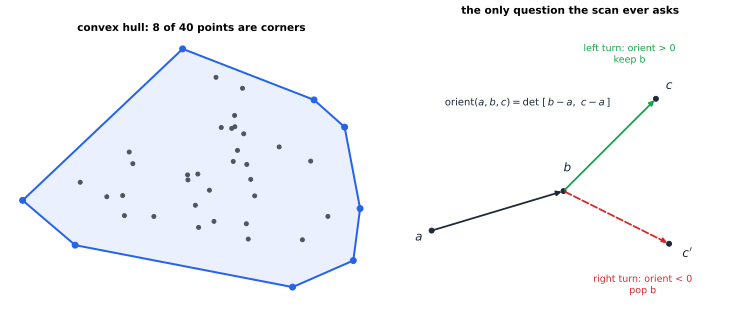
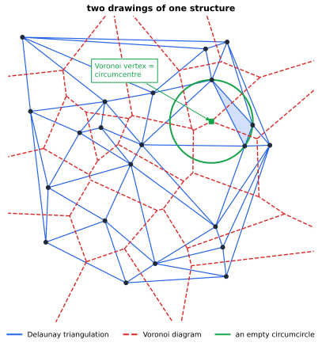

# Chapter 75 — Computational Geometry: Algorithms for Shapes

[← Previous](74-procedural-generation.md) · [Track G](README.md) · [Table of Contents](../../00-front/table-of-contents.md) · [Next →](76-signal-processing-audio-visual.md)

> **Level 2 · Track G — Mathematics for Computer Graphics, Games, and Simulation**
> **Builds on:** [Ch. 8](../../part-3-linear-algebra/08-matrices-and-linear-systems.md), [Ch. 22](../../part-7-numerical-computational/22-numerical-methods.md), [Ch. 26](../a-algorithms/26-the-mathematics-of-algorithms.md) · **Leads to:** [Ch. 76](76-signal-processing-audio-visual.md), [Ch. 89](../j-frontier/89-pde-beyond-the-basics.md) · **Related:** [Ch. 27](../a-algorithms/27-graph-theory.md), [Ch. 47](../d-optimization/47-convexity.md), [Ch. 71](71-ray-tracing.md), [Ch. 72](72-physics-engines.md), [Ch. 74](74-procedural-generation.md)
> **Reading time:** ~30 min

## 75.1 The hook

In September 1854 cholera killed more than five hundred people in a few streets of Soho, London, in ten days. The physician John Snow marked every death on a street map, and then drew one extra line on it. The line enclosed every house that was closer, by walking distance, to the water pump on Broad Street than to any other pump. The deaths clustered inside that line. The handle of the pump was removed, and the map became one of the founding documents of epidemiology.

Snow's line is a piece of a **Voronoi diagram**: give every pump the region of the plane that is nearer to it than to any other pump. He drew it by hand for a dozen pumps. Today the same question is asked millions of times a second.

- A phone network asks which tower should serve each handset.
- A game asks which of 20,000 units is nearest to the click of the mouse, sixty times a second.
- A finite-element solver needs the plane cut into well-shaped triangles whose corners are a cloud of measured points.
- A robot wants the route through a crowd of obstacles that stays as far from all of them as possible.

The naive answer to "who is nearest?" is to check every site: $n$ distance computations per query, and $n^2$ to build the whole diagram. With a million sites that is $10^{12}$ operations, about a quarter of an hour on a fast core, and it would have to be repeated whenever a site moves.

There is a second, nastier problem. Even the tiniest geometric question ("is this point to the left of that line?") is answered by a computer with rounded arithmetic. Ask it three slightly different ways and you can get three answers that cannot all be true. Geometry programs that are correct on paper crash, loop forever or produce polygons that cross themselves.

So this chapter has two goals:

> **How do you build shapes from points (hulls, triangulations, nearest-site regions) in $O(n\log n)$ time, and how do you make every decision rest on one test you can trust?**

The answer is a small toolkit: one determinant, one circle, one paraboloid and one tree. By the end you will know why Snow's map and a mesh of triangles are the same object drawn twice.

## 75.2 The big idea

**Geometry algorithms are built from tiny yes/no questions.** Almost nothing in this chapter computes a length or an angle. Every algorithm asks, over and over, a question with a one-bit answer.

- *Orientation:* do points $a,b,c$ make a left turn, a right turn, or lie on a line?
- *In-circle:* is point $d$ inside the circle through $a,b,c$?
- *Containment:* does a query box overlap this cell of space?

Each of these is the **sign of a determinant**. The whole art is to arrange the questions cleverly so that you ask as few as possible, and to compute each sign so reliably that the answers never contradict one another.

**The convex hull is a rubber band.** Hammer nails into a board at your points and snap a rubber band around them. The shape it settles into is the **convex hull**: the smallest convex set containing every point ([Ch. 47](../d-optimization/47-convexity.md) is the chapter about why convexity matters). Its corners are a subset of your points. To find them you walk around the cloud and keep only the points where the band turns left.



*Left: the hull of 40 random points has only 8 corners. Right: the scan's only question is whether the path $a\to b\to c$ turns left (keep $b$) or right (discard $b$), and that is the sign of a $2\times2$ determinant.*

**Triangulations are the plane cut into pieces you can compute with.** Given points, join them with non-crossing segments until no more can be added. You get a triangulation. There are astronomically many. The **Delaunay triangulation** is the one that avoids skinny triangles as far as possible. Its defining rule is a beautifully local one: no point lies inside the circle through the three corners of any triangle.

**Voronoi and Delaunay are one structure drawn twice.** Draw the Voronoi diagram of the points (Snow's regions). Now join two points whenever their regions share an edge. The result is exactly the Delaunay triangulation. Each Voronoi corner sits at the centre of an empty circle through three sites, which is the circumcircle of a Delaunay triangle.



*Delaunay edges (blue) cross the Voronoi edges (red) at right angles. The green circle passes through the three corners of the shaded triangle, contains no other point, and is centred on a Voronoi vertex.*

**Spatial indexes are filing cabinets for space.** To answer "what is near here?" without checking everything, put the points in a tree whose nodes are regions. A **quadtree** cuts a square into four quadrants, and keeps cutting any quadrant that holds too many points. Empty space costs almost nothing, and crowded regions get fine cells. A query descends only into cells that touch the region it cares about.

The analogy to keep in mind is a library. Nobody finds a book by reading every spine. The building is divided into floors, rooms, shelves. Each division answers one yes/no question ("is it in this room?") and discards most of the collection at once. That is where $\log n$ comes from, in sorting ([Ch. 26](../a-algorithms/26-the-mathematics-of-algorithms.md)) and in geometry.

## 75.3 The mathematics

### The orientation predicate

Points live in $\mathbb{R}^2$ with coordinates $a=(a_x,a_y)$ and so on.

> [!definition] Orientation
> $$
> \operatorname{orient}(a,b,c)=\det\begin{bmatrix} b_x-a_x & c_x-a_x\\ b_y-a_y & c_y-a_y\end{bmatrix}=(b_x-a_x)(c_y-a_y)-(b_y-a_y)(c_x-a_x).
> $$
> The path $a\to b\to c$ is a **left turn** (counter-clockwise) if $\operatorname{orient}>0$, a **right turn** if $\operatorname{orient}<0$, and the three points are **collinear** if it is zero.

Why the sign means what it says: the determinant is twice the signed area of triangle $abc$ ([§8.3](../../part-3-linear-algebra/08-matrices-and-linear-systems.md#83-determinants) interprets a determinant as signed area). It is the $z$-component of the cross product $(b-a)\times(c-a)$, which is positive exactly when $c-a$ lies counter-clockwise of $b-a$ by an angle between $0$ and $\pi$. Example: $a=(0,0)$, $b=(2,0)$, $c=(1,1)$ gives $2\cdot1-0\cdot1=2>0$, a left turn, and the triangle has area 1.

With this one predicate you can already decide whether two segments cross (each segment's endpoints lie on opposite sides of the other's line: four orientation tests) and whether a point is inside a convex polygon (it is left of every edge).

### Convex hull by Graham's scan

Sort the points by $x$ (ties by $y$). Walk left to right building the **lower hull** on a stack. Before pushing a new point $p$, look at the top two stack points $q_1,q_2$ (with $q_2$ on top). While $\operatorname{orient}(q_1,q_2,p)\le0$, pop $q_2$. Then push $p$. Repeat right to left for the **upper hull**, and join the two. (This left-to-right form is Andrew's monotone chain, a variant of Graham's 1972 scan that sorts by angle.)

> [!theorem] Graham's scan is correct and runs in $O(n\log n)$
> For $n$ points in general position the scan returns the corners of the convex hull in counter-clockwise order. After sorting, it performs at most $2n$ pushes and $2n$ pops, so its total running time is $O(n\log n)$, dominated by the sort.

*Proof of correctness (lower hull).* Write $p_1,\dots,p_k$ for the first $k$ points in sorted order. We claim that after processing $p_k$ the stack holds the lower hull of $\{p_1,\dots,p_k\}$ from $p_1$ to $p_k$. For $k=2$ the stack is $p_1,p_2$ and the lower hull of two points is the segment between them. Assume the claim for $k-1$. The new point $p_k$ has the largest $x$ so far, so it is certainly a corner of the new lower hull. A previous corner $q$ stays on the lower hull exactly when it is not above the segment from its predecessor on the hull to $p_k$. The pops remove the top point $q_2$ precisely when $q_1\to q_2\to p_k$ fails to turn left, that is, when $q_2$ lies on or above segment $q_1p_k$. Once a left turn is found at the top, every point deeper in the stack already makes left turns with its neighbours (induction hypothesis), and since $p_k$ lies to the right of all of them those turns stay left. So the remaining stack plus $p_k$ is a chain that turns left at every corner and has every point on or above it: the lower hull. ∎

*Proof of the running time.* Each point is pushed once per pass and popped at most once per pass, because a popped point never returns. Each orientation test either pops something or ends the while-loop for that $p$. So the tests number at most (pops) $+$ (pushes) $\le4n$ over both passes. This is an amortised argument ([§26.3](../a-algorithms/26-the-mathematics-of-algorithms.md#263-the-mathematics)): one step can pop many points, but the total over the whole run is linear. ∎

Can one do better than $n\log n$? Not in the comparison-style models: if you could compute hulls faster, you could sort faster. Put the numbers $x_1,\dots,x_n$ on the parabola as points $(x_i,x_i^2)$. All of them are hull corners, and reading the hull in order lists the $x_i$ sorted. So the sorting lower bound of [§26.3](../a-algorithms/26-the-mathematics-of-algorithms.md#263-the-mathematics) transfers to hulls.

> [!tip] A hull that pays for its own size
> The lower bound used a cruel input where *every* point is a corner. The figure's random cloud has 40 points but only 8 corners. Our simulations of $10^5$ uniform points in a square give about 31 corners on average. Is there an algorithm whose cost depends on the *answer* size $h$, faster than $n\log n$ when $h$ is small? Gift wrapping costs $O(nh)$, which is worse when $h$ is large. Chan's 1996 algorithm achieves $O(n\log h)$ by guessing $h$ and squaring the guess, and a matching lower bound says nobody can beat it. That kind of output-sensitive lower bound is algebraic decision-tree reasoning, the next layer of [Ch. 30](../a-algorithms/30-limits-of-computation.md).

### Counting a triangulation

How big is a triangulation? Suppose $n$ points, no three collinear, $h$ of them on the hull. Any triangulation of them, Delaunay or not, has the same size.

> [!theorem] Size of a planar triangulation
> Every triangulation of $n$ points with $h$ hull corners has exactly $t=2n-2-h$ triangles and $e=3n-3-h$ edges.

*Proof.* A triangulation is a connected planar graph with $V=n$ vertices. Its faces are the $t$ triangles plus one outer face, so $F=t+1$. Count edge–face incidences. Each triangle has 3 edges, and the outer face is bounded by the $h$ hull edges. Each edge borders exactly two faces. So

$$
3t+h=2e.
$$

Euler's formula $V-E+F=2$ ([Ch. 27](../a-algorithms/27-graph-theory.md#colouring-and-planarity)) gives $n-e+(t+1)=2$, that is $e=n+t-1$. Substitute into the incidence count: $3t+h=2n+2t-2$, so $t=2n-2-h$ and then $e=3n-3-h$. ∎

The 22 points in the Delaunay figure have 7 hull corners, so the formula predicts $2\cdot22-2-7=35$ triangles and $3\cdot22-3-7=56$ edges. A direct count with `scipy.spatial.Delaunay` agrees. The practical meaning is that a triangulation is **linear in size**: about $2n$ triangles, $3n$ edges, and an average vertex degree just under 6. So does the Voronoi diagram: its vertices are the $2n-2-h$ circumcentres.

### The empty-circle test, and the paraboloid behind it

The Delaunay triangulation is defined by: *the circumcircle of every triangle contains no other point.* To use that rule we need a test for "is $d$ inside the circle through $a,b,c$?" The beautiful way to find it is to lift the plane onto a paraboloid.

> [!definition] The lifting map
> Send each point $p=(x,y)$ to $\hat p=(x,\,y,\,x^2+y^2)$ on the paraboloid $z=x^2+y^2$.

> [!theorem] Circles become planes
> Let $C$ be a circle with centre $(c_x,c_y)$ and radius $r$. The lifted points of $C$ lie on one non-vertical plane $\Pi$. A point $d$ lies strictly inside $C$ if and only if $\hat d$ lies strictly below $\Pi$.

*Proof.* Expand the circle's equation:

$$
(x-c_x)^2+(y-c_y)^2=r^2 \iff x^2+y^2 = 2c_x x+2c_y y+\left(r^2-c_x^2-c_y^2\right).
$$

On the paraboloid $x^2+y^2=z$, so the lifted circle satisfies $z=2c_x x+2c_y y+(r^2-c_x^2-c_y^2)$. That is the plane $\Pi$. Now take any point $d=(x,y)$. Its lift has height $x^2+y^2$, while $\Pi$ above it has height $2c_x x+2c_y y+r^2-c_x^2-c_y^2$. The difference is

$$
(x^2+y^2)-\left(2c_x x+2c_y y+r^2-c_x^2-c_y^2\right)=(x-c_x)^2+(y-c_y)^2-r^2,
$$

which is negative exactly when $d$ is inside the circle. ∎

"Is $\hat d$ below the plane through $\hat a,\hat b,\hat c$?" is a 3-D orientation question, so the in-circle test is again the sign of a determinant:

$$
\operatorname{incircle}(a,b,c,d)=\det\begin{bmatrix}a_x-d_x & a_y-d_y & (a_x-d_x)^2+(a_y-d_y)^2\\ b_x-d_x & b_y-d_y & (b_x-d_x)^2+(b_y-d_y)^2\\ c_x-d_x & c_y-d_y & (c_x-d_x)^2+(c_y-d_y)^2\end{bmatrix},
$$

which is positive exactly when $d$ is inside the circle through $a,b,c$ taken counter-clockwise. Check it on $a=(0,0)$, $b=(4,0)$, $c=(1,3)$: their circle has centre $(2,1)$ and $r^2=5$. The point $d=(3.5,2.5)$ is at squared distance $4.5<5$, inside, and the determinant comes out $+6$. Move $d$ to $(4,3)$, at squared distance $8$, and it becomes $-36$.

The lifting theorem has a stunning corollary. A triangle $abc$ is Delaunay when no lifted point lies below the plane through $\hat a,\hat b,\hat c$. That says the lifted triangle is a face of the **lower convex hull** of the lifted points in 3-D. So:

$$
\text{Delaunay triangulation in 2-D} = \text{lower convex hull of the lifted points in 3-D, projected back down.}
$$

Hulls and triangulations are the same problem one dimension apart, and any 3-D hull algorithm is a Delaunay algorithm.

**Why Delaunay triangles are fat.** Take a convex quadrilateral and its two possible diagonals. Exactly one choice makes both circumcircles empty (unless the four points are concyclic), and that choice maximises the smallest of the six angles. Flipping illegal diagonals one at a time therefore never decreases the sorted list of angles, and the process ends at the Delaunay triangulation. So among all triangulations of a point set, Delaunay **maximises the minimum angle**. That is exactly what finite-element and interpolation codes want, because skinny triangles make badly conditioned equations ([§8.10](../../part-3-linear-algebra/08-matrices-and-linear-systems.md#810-numerical-conditioning)).

### Voronoi from Delaunay

> [!definition] Voronoi cell
> For sites $s_1,\dots,s_n$, the Voronoi cell of $s_i$ is $V_i=\{x:\lVert x-s_i\rVert\le\lVert x-s_j\rVert\text{ for all } j\}$.

Each condition $\lVert x-s_i\rVert\le\lVert x-s_j\rVert$ expands to the linear inequality $2(s_j-s_i)\cdot x\le\lVert s_j\rVert^2-\lVert s_i\rVert^2$: a half-plane bounded by the perpendicular bisector of $s_i s_j$. So each cell is an intersection of half-planes, and therefore convex. A point $x$ is a Voronoi vertex when it is equidistant from three sites and no site is closer: it is the centre of an empty circle through three sites. That is precisely the circumcentre of a Delaunay triangle, which proves the duality you saw in the figure. Two cells share an edge exactly when there is an empty circle through just those two sites, which is the condition for a Delaunay edge.

### Quadtrees: how deep, how fast

A point quadtree with leaf capacity 1 on a square of side $s$ keeps splitting any cell that contains two or more points.

> [!theorem] Depth of a quadtree
> If the closest pair of points is at distance $\delta$, the quadtree has depth at most $\log_2(s/\delta)+\tfrac32$.

*Proof.* A cell at depth $k$ has side $s/2^k$ and diagonal $\sqrt2\,s/2^k$. A cell is split only when it holds two points, which are at least $\delta$ apart, so its diagonal is at least $\delta$: $\sqrt2\,s/2^k\ge\delta$, that is $k\le\log_2(s/\delta)+\tfrac12$. The children of the deepest split cell are one level further down. ∎

The depth depends on the **spread** $s/\delta$, not on $n$. A thousand evenly spaced points give a shallow tree. Two points a nanometre apart in a kilometre-wide map force about 40 levels. The tree adapts to the data, which you can see in the quadtree figure of §75.4: cells subdivide only inside the two clusters, and the number of cells at each depth stays far below the $4^d$ of a full tree.

## 75.4 The algorithm

### Convex hull in twenty lines

```python
def orient(a, b, c):
    return (b[0]-a[0])*(c[1]-a[1]) - (b[1]-a[1])*(c[0]-a[0])

def convex_hull(points):
    pts = sorted(set(map(tuple, points)))      # sort by x, then y
    if len(pts) <= 2:
        return pts
    def chain(seq):
        h = []
        for p in seq:
            while len(h) >= 2 and orient(h[-2], h[-1], p) <= 0:
                h.pop()                         # right turn or straight: drop
            h.append(p)
        return h
    lower, upper = chain(pts), chain(reversed(pts))
    return lower[:-1] + upper[:-1]              # counter-clockwise, no repeats
```

The `<= 0` drops collinear points from the hull. Change it to `< 0` and they are kept, but then exactly collinear duplicates can loop. That edge case is the first taste of the robustness problem below.

### Delaunay by incremental insertion (Bowyer–Watson)

```text
start with one huge triangle containing all points
for each point p, in random order:
    find all triangles whose circumcircle contains p     # in-circle test
    delete them: they form a star-shaped hole around p
    join p to every edge of the hole's boundary
remove triangles that touch the huge starting triangle
```

Inserting points in **random order** is the trick. A single insertion can destroy many triangles, but averaged over the random order each insertion creates $O(1)$ new triangles in expectation, and the expected total time is $O(n\log n)$ if a point-location structure finds the first bad triangle quickly. In the worst order (points sorted along a curve, say) the same code takes $O(n^2)$. Fortune's sweep-line algorithm reaches $O(n\log n)$ deterministically, by sweeping a line across the plane and maintaining a "beach line" of parabolic arcs.

### Quadtree build and range query

```text
insert(cell, p):
    if cell is a leaf with fewer than CAP points: store p; return
    if cell is a leaf: split it into 4 children, push its points down
    insert(child containing p, p)

query(cell, region):
    if cell does not overlap region: return nothing     # prune: one box test
    if cell is a leaf: return its points that lie in region
    return union of query(child, region) over the 4 children
```


*Left: cells subdivide only where points crowd. A range query (red) visits only the cells it overlaps. Right: the tree has 20 cells at each of depths 3, 4 and 5, against 64, 256 and 1024 in a full tree.*

For well-spread points, a range query costs $O(\log n + k)$ where $k$ is the number of points reported. **kd-trees** do the same job by splitting on alternate coordinates at the median, which guarantees balance (depth $\lceil\log_2 n\rceil$) whatever the spread. **Bounding-volume hierarchies** group objects rather than space, and are how ray tracers ([Ch. 71](71-ray-tracing.md)) and physics engines ([Ch. 72](72-physics-engines.md)) avoid testing every ray or pair against everything.

### When geometry code fails

- **Degeneracies.** Three collinear points, four concyclic points, duplicate points. Every algorithm above silently assumes "general position". Real data (grids, CAD models, integer pixel coordinates) are full of exact degeneracies.
- **Rounding.** The orientation test subtracts nearly equal numbers. For nearly collinear points the computed sign can be wrong, and two tests that should agree can disagree. A hull algorithm can then pop a point that one test says is outside and another says is inside. In 2004 Kettner and co-authors published small inputs on which textbook hull and Delaunay codes in double precision return non-convex "hulls" or loop forever.
- **The fix is exactness, not tolerance.** Adding an $\varepsilon$ ("treat $\lvert\operatorname{orient}\rvert<10^{-12}$ as zero") makes the problem worse, because "approximately equal" is not transitive. Robust libraries compute the sign exactly: in floating point when the result is clearly far from zero, and with extra-precision arithmetic only in the rare close calls.

> [!mystery] The sign you cannot trust
> On a grid of points near $(0.5,0.5)$ spaced by $2^{-53}$, the double-precision orientation test against a fixed line produces a ragged staircase of wrong signs instead of a clean straight boundary. Why does subtracting two nearly equal products lose all the information, and how large can the error be? That is the floating-point error analysis of [§22.1](../../part-7-numerical-computational/22-numerical-methods.md#221-floating-point-arithmetic). How Shewchuk's *adaptive predicates* return the exact sign while staying almost as fast as the naive formula is a story about error-free transformations of floating-point sums that this chapter does not tell.

## 75.5 The experiment

**Drag the fourth point.** The graph shows the triangle $a=(0,0)$, $b=(4,0)$, $c=(1,3)$ and its circumcircle $(x-2)^2+(y-1)^2=5$. A fourth point $d=(3.5,2.5)$ makes the quadrilateral $abdc$, which can be split along the diagonal $bc$ (dashed) or $ad$ (dotted). Because $d$ is inside the circle, triangle $abc$ breaks the empty-circle rule, so Delaunay chooses $ad$. Change every `3.5` and `2.5` in the last three lines to move $d$: try $(4,3)$ (outside, so $bc$ wins), $(3,2.8)$ (inside) and $(2.5,3.179)$, which is almost exactly on the circle. That last one is the degenerate case where both diagonals are legal and a tiny rounding error decides.

```desmos-graph
left=-1; right=6; bottom=-1.5; top=4.5
---
(x-2)^{2}+(y-1)^{2}=5|green
y=0|0<x<4|blue
y=3x|0<x<1|blue
(0,0)|label:a
(4,0)|label:b
(1,3)|label:c
y=-x+4|1<x<4|red|dashed
(3.5,2.5)|label:d
y=\frac{2.5}{3.5}x|0<x<3.5|purple|dotted
(x-3.5)^{2}+(y-2.5)^{2}=0.004|purple
```

*The green circle passes through $a$, $b$, $c$. When $d$ sits inside it, triangle $abc$ is illegal and the Delaunay triangulation uses the diagonal $ad$ (dotted) instead of $bc$ (dashed).*

**How many corners does a random hull have?** The script draws $n$ random points from three different shapes, computes the hull with the twenty-line scan of §75.4, and prints the average number of corners as $n$ grows. Run it as is first.

```python
import numpy as np
import matplotlib.pyplot as plt

SHAPE = "square"          # knob: "square", "disc" or "gauss"
NS = [10, 100, 1000, 10000, 100000]
TRIALS = 20
rng = np.random.default_rng(1)

def orient(a, b, c):
    return (b[0]-a[0])*(c[1]-a[1]) - (b[1]-a[1])*(c[0]-a[0])

def hull(P):
    pts = sorted(map(tuple, P))
    def chain(seq):
        h = []
        for p in seq:
            while len(h) >= 2 and orient(h[-2], h[-1], p) <= 0:
                h.pop()
            h.append(p)
        return h
    return chain(pts)[:-1] + chain(pts[::-1])[:-1]

def sample(n):
    if SHAPE == "square":
        return rng.uniform(-1, 1, (n, 2))
    if SHAPE == "disc":
        r, t = np.sqrt(rng.uniform(0, 1, n)), rng.uniform(0, 2*np.pi, n)
        return np.c_[r*np.cos(t), r*np.sin(t)]
    return rng.normal(size=(n, 2))

means = [np.mean([len(hull(sample(n))) for _ in range(TRIALS)]) for n in NS]
for n, m in zip(NS, means):
    print(f"n = {n:>6}:  average hull size {m:6.1f}")
plt.semilogx(NS, means, "o-"); plt.xlabel("n"); plt.ylabel("hull corners")
plt.title(SHAPE); plt.show()
```

For the square you should see roughly 6, 12, 18, 24 and 31 corners: the hull grows like $\tfrac83\ln n$, so a hundred thousand points have only about thirty corners. Now set `SHAPE = "disc"`. The counts jump to about 15, 33, 74 and 158 for the larger $n$: growth like $n^{1/3}$. For `"gauss"` they crawl, about 9, 11, 13 and 16. Same algorithm, same $n$, wildly different answer sizes. Three more things to try:

- Replace the `sample` function with points on a circle, `np.c_[np.cos(t), np.sin(t)]`. Every point is now a corner, which is the worst case of the lower-bound argument.
- Put all the points on an integer grid, `rng.integers(0, 20, (n, 2))`. Now there are many exact collinearities and duplicates. Does the `<= 0` still produce a clean hull? What happens with `< 0`?
- Time the hull for $n=10^5$ and compare with the time of `sorted` alone. How much of the work is the scan?

## 75.6 The challenge

1. **Intuition.** Without computing anything, sketch the Voronoi diagram of four points at the corners of a square, and then of the same square with one corner nudged slightly outward. Explain why the Delaunay triangulation of the exact square is not unique, and which of the two diagonals the nudge selects.
2. **Derivation.** Prove the "Delaunay is the lower hull of the lift" corollary carefully: show that if $\hat a,\hat b,\hat c$ span a face of the lower convex hull of the lifted points, then the circumcircle of $abc$ is empty, and conversely. Then use the theorem of §75.3 on triangulation size to show that the Voronoi diagram of $n$ sites has at most $2n-5$ vertices and $3n-6$ edges for $n\ge3$.
3. **Implementation.** Write a Bowyer–Watson Delaunay triangulator from the pseudocode in §75.4, using the in-circle determinant as the only geometric test besides orientation. Check on 500 random points that every triangle's circumcircle is empty and that the triangle count equals $2n-2-h$. Then insert the same points sorted by $x$ instead of in random order and measure how the running time scales.
4. **Open investigation.** Build a quadtree and a kd-tree on $n$ points drawn from distributions with very different spreads (uniform; two tight clusters far apart; points on a spiral; a fractal dust from [Ch. 73](73-fractals.md)). For each, measure the average number of cells visited by a nearest-neighbour query. Is there a single statistic of the point set (its spread, its fractal dimension, something else) that predicts the query cost for both trees?

## 75.7 Loose threads

This chapter worked in the flat, clean plane with points in general position. Each of those three words hides a door.

> [!mystery] Three dimensions break the count
> In the plane a triangulation of $n$ points always has about $2n$ triangles. In 3-D the analogue fails dramatically: the Delaunay tetrahedralization of $n$ points can have $\Theta(n^2)$ tetrahedra, and even on nice inputs it contains *slivers*, flat tetrahedra whose four corners are nearly coplanar yet whose circumsphere is empty. Slivers wreck finite-element solutions. Why is Euler's formula no longer enough to bound the size, and how do mesh generators get rid of slivers? That is the meshing side of the finite-element method in [Ch. 89](../j-frontier/89-pde-beyond-the-basics.md).

> [!mystery] The curse of the nearest neighbour
> A kd-tree answers nearest-neighbour queries in about $\log n$ steps in the plane. In 100 dimensions (image descriptors, word embeddings) the same tree visits almost every leaf, and a linear scan is just as fast. Random points in high dimension are all nearly the same distance apart, so the pruning test almost never prunes. Is there any data structure with polynomial size that answers *exact* nearest-neighbour queries in sub-linear time in high dimension? Conditional lower bounds suggest not, linking the question to the strong exponential time hypothesis of [Ch. 30](../a-algorithms/30-limits-of-computation.md). It is an open problem, and practice has settled for approximate answers.

The robustness mystery of §75.4 is the third thread: geometric algorithms are only as correct as the sign of a determinant, and the exact computation of that sign belongs to the floating-point analysis of [Ch. 22](../../part-7-numerical-computational/22-numerical-methods.md). Two quieter threads lead elsewhere in this track. Voronoi cells of randomly placed seeds are a standard way to generate terrain regions, cracked mud and stone textures ([Ch. 74](74-procedural-generation.md)). And a triangle mesh is a sampled version of a continuous surface: whether the sampling is fine enough to reconstruct the shape is a cousin of the sampling theorem in [Ch. 76](76-signal-processing-audio-visual.md).

## Further reading

- M. de Berg, O. Cheong, M. van Kreveld and M. Overmars, *Computational Geometry: Algorithms and Applications*, 3rd ed., Springer, 2008. The standard first text: hulls, triangulations, Voronoi diagrams, kd-trees and quadtrees, each with an application.
- J. O'Rourke, *Computational Geometry in C*, 2nd ed., Cambridge University Press, 1998. Implementation-first, with careful attention to degeneracies.
- J. R. Shewchuk, "Adaptive precision floating-point arithmetic and fast robust geometric predicates," *Discrete & Computational Geometry* 18 (1997). The orientation and in-circle tests done exactly.
- L. Kettner, K. Mehlhorn, S. Pion, S. Schirra and C. Yap, "Classroom examples of robustness problems in geometric computations," *Computational Geometry* 40 (2008). Small, vivid failures of textbook code.
- S. Cheng, T. Dey and J. Shewchuk, *Delaunay Mesh Generation*, CRC Press, 2012. Where the 3-D sliver story is told in full.
