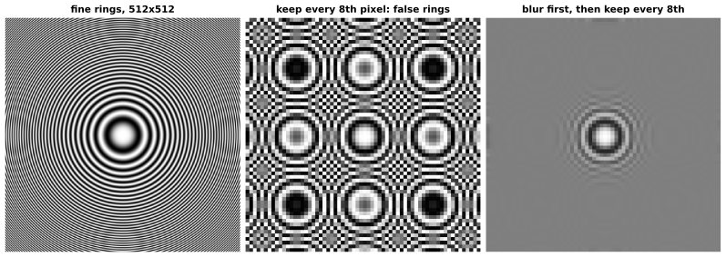
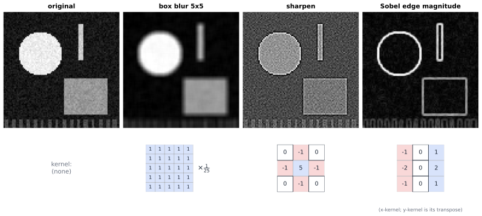

# Chapter 76 — Signal Processing for Audio and Visual Computing

[← Previous](75-computational-geometry.md) · [Track G](README.md) · [Table of Contents](../../00-front/table-of-contents.md) · [Next →](../h-cryptography-coding/README.md)

> **Level 2 · Track G — Mathematics for Computer Graphics, Games, and Simulation**
> **Builds on:** [Ch. 15](../../part-5-transforms/15-fourier-series.md), [Ch. 16](../../part-5-transforms/16-fourier-transforms.md), [Ch. 17](../../part-5-transforms/17-z-transforms.md) · **Leads to:** [Ch. 80](../h-cryptography-coding/80-coding-meets-information-theory.md), [Ch. 91](../j-frontier/91-inverse-problems.md) · **Related:** [Ch. 21](../../part-6-probability-statistics/21-random-processes.md), [Ch. 33](../b-probability-information/33-information-theory.md), [Ch. 71](71-ray-tracing.md), [Ch. 74](74-procedural-generation.md), [Ch. 75](75-computational-geometry.md)
> **Reading time:** ~30 min

## 76.1 The hook

Television presenters are told never to wear a finely striped shirt or a herringbone jacket. On camera the stripes come alive. Huge, slow, swirling bands of light and dark ripple across the fabric, sometimes with false rainbows, and they crawl whenever the presenter breathes. Nothing like that is on the shirt. The pattern is manufactured by the camera.

The same ghost haunts every screen. In an old video game, a distant chain-link fence or a tiled floor shimmers and boils as the camera moves. In a western, the wagon wheels spin slowly backwards while the wagon races forward. Shrink a photograph of a brick wall in a cheap image editor and the bricks rearrange themselves into giant curved waves. Record a whistle that slides up past the limit of a sound card, and on playback the pitch slides *down*.

Here is a ring pattern that shows the effect at its most dramatic. On the left, fine concentric rings, the rings closer and closer together towards the edge. In the middle, the same picture after keeping only every eighth pixel in each direction, exactly what a careless thumbnail generator does. Whole new sets of rings appear, centred on points where the original has nothing special at all.



*Left: rings whose spacing shrinks towards the edge. Centre: keep every 8th pixel and false ring centres appear on a lattice. Right: blur first, then keep every 8th pixel; the false rings are gone and the too-fine detail fades to grey.*

The right-hand picture is the cure: blur first, then shrink. It throws information away on purpose and looks *more* faithful. This chapter is about why that works and about the toolkit it opens:

> **Why does sampling invent patterns that were never there, where exactly do the ghosts appear, and how do blurring, sharpening, edge detection, spectrograms and JPEG all follow from one idea about frequencies?**

By the end you will be able to predict, from a single formula, where the false ring centres in the middle picture sit, to the pixel.

## 76.2 The big idea

**A picture is a signal in two variables.** A sound is a sequence of numbers $x[n]$, one per sample, typically 44,100 or 48,000 per second. A grey-scale image is an array $x[m,n]$ of brightness values. Everything the core chapters proved about one-dimensional signals carries over to images, with one more index.

**Frequency in an image means stripes.** A sinusoid in time is a pure tone. A sinusoid in an image, $\cos(2\pi(um+vn))$, is a field of parallel stripes. The pair $(u,v)$ is its spatial frequency, in cycles per pixel: its direction is perpendicular to the stripes and its size says how close together they are. Large smooth regions of a photograph are low frequencies. Edges, textures and noise are high frequencies. The Fourier transform ([Ch. 16](../../part-5-transforms/16-fourier-transforms.md)) writes any image as a sum of such stripe fields.

**Filtering is a sliding weighted average.** Replace each pixel by a weighted sum of its neighbours, using the same small table of weights (a **kernel**) everywhere. Equal positive weights blur. A big positive centre with negative neighbours sharpens. Weights that are negative on one side and positive on the other respond to edges. Each of these is a 2-D convolution, and by the convolution theorem ([§16.5](../../part-5-transforms/16-fourier-transforms.md#165-convolution-and-multiplication)) each one simply **multiplies every stripe frequency by a gain**. Blur turns down the high frequencies; sharpen turns them up; an edge detector keeps only a band of them.



*One image, three kernels. The box blur softens every edge and wipes out the fine stripes at the bottom. Sharpening amplifies edges and noise alike. The Sobel operator keeps only the outlines. Blue cells are positive weights, red negative.*

**Sampling folds frequencies.** A grid of pixels can only represent stripes up to half a cycle per pixel, the Nyquist limit ([§16.8](../../part-5-transforms/16-fourier-transforms.md#168-sampling-related-mathematical-foundations)). Any finer stripe does not vanish when sampled. It is **folded back** and impersonates a coarser one. That is the shirt, the wheel and the ring lattice. Blurring before sampling removes the too-fine stripes while they can still be told apart from the coarse ones.

**Sound needs a spectrum that changes in time.** A single Fourier transform of a whole song tells you which notes occur, but not when. Cut the sound into short overlapping windows and transform each one: you get a **spectrogram**, a picture with time across and frequency up. Musicians, speech recognisers and bat biologists all read these pictures. Their resolution is limited by a trade-off that no cleverness removes.

The analogy to keep in mind is a graphic equaliser on a stereo. Each slider is the gain at one frequency band. Every linear, shift-invariant operation on a sound or an image, however it is described in pixels, is just a setting of those sliders.

## 76.3 The mathematics

### Two-dimensional convolution and its spectrum

The discrete convolution sum of [§17.1](../../part-5-transforms/17-z-transforms.md#discrete-time-systems-and-the-convolution-sum) gains a second index.

> [!definition] 2-D convolution and the 2-D DFT
> For an image $x[m,n]$ and a kernel $h[k,l]$,
> $$
> y[m,n]=(h*x)[m,n]=\sum_{k}\sum_{l}h[k,l]\,x[m-k,\,n-l].
> $$
> For an $M\times N$ array, the 2-D DFT is
> $$
> X[p,q]=\sum_{m=0}^{M-1}\sum_{n=0}^{N-1}x[m,n]\,e^{-j2\pi(pm/M+qn/N)}.
> $$

The 2-D DFT is just the 1-D DFT of [§15.7](../../part-5-transforms/15-fourier-series.md#computing-coefficients-numerically-the-dft) applied to every row and then every column. The central fact is that it turns convolution into multiplication. Here is the proof for **circular** convolution, where indices wrap around modulo $M$ and $N$ (which is what the FFT computes).

> [!theorem] The 2-D convolution theorem
> If $y[m,n]=\sum_{k,l}h[k,l]\,x[(m-k)\bmod M,\,(n-l)\bmod N]$, then $Y[p,q]=H[p,q]\,X[p,q]$ for every $p,q$.

*Proof.* Substitute the definition of $y$ into the DFT and swap the order of summation:

$$
Y[p,q]=\sum_{k,l}h[k,l]\sum_{m,n}x[(m-k)\bmod M,(n-l)\bmod N]\,e^{-j2\pi(pm/M+qn/N)}.
$$

In the inner sum put $m'=(m-k)\bmod M$ and $n'=(n-l)\bmod N$. As $m$ runs over $0,\dots,M-1$ so does $m'$, and because $e^{-j2\pi p\cdot M/M}=1$ the exponential is unchanged by the wrap-around: $e^{-j2\pi pm/M}=e^{-j2\pi pm'/M}\,e^{-j2\pi pk/M}$. The inner sum therefore equals $e^{-j2\pi(pk/M+ql/N)}X[p,q]$, and

$$
Y[p,q]=X[p,q]\sum_{k,l}h[k,l]\,e^{-j2\pi(pk/M+ql/N)}=H[p,q]\,X[p,q].\qquad\blacksquare
$$

So the **frequency response** of a kernel, its DFT $H$, is the table of equaliser gains. It also tells you how to compute big blurs fast: transform, multiply, transform back, at $O(MN\log(MN))$ cost whatever the kernel size. For small kernels, direct summation is cheaper. Real images do not wrap around, so practical code pads the borders (by zeros, by copying the edge, or by mirroring) to stop the left edge bleeding into the right.

### Reading the three kernels

It is easiest to use the continuous-frequency form $H(\omega_x,\omega_y)=\sum_{k,l}h[k,l]e^{-j(\omega_x k+\omega_y l)}$, with $\omega$ in radians per pixel and $\pm\pi$ the Nyquist limit.

**Box blur.** The $L\times L$ box has weights $1/L^2$, and it is **separable**: it is a 1-D box of length $L$ along the rows followed by the same along the columns. So $H(\omega_x,\omega_y)=B(\omega_x)B(\omega_y)$, with $B$ a geometric series. For odd $L=2r+1$, centred,

$$
B(\omega)=\frac1L\sum_{k=-r}^{r}e^{-j\omega k}=\frac{1}{L}\,\frac{\sin(L\omega/2)}{\sin(\omega/2)}.
$$

At $\omega=0$ the gain is 1: flat regions are untouched. The gain falls to zero at $\omega=2\pi/L$, so for $L=5$ stripes with a period of exactly 5 pixels are wiped out completely, and the period-6 stripes at the bottom of the figure, just beyond that zero, keep only a fifth of their contrast. But the gain does not stay small: it comes back negative, and at the Nyquist limit it is $B(\pi)=1/5$ for $L=5$ (and $-1/3$ for $L=3$, a flipped-sign ripple). A box is a crude low-pass filter, and those side lobes are why box-filtered thumbnails still show some moiré. Separability also matters for speed: a $5\times5$ box costs 25 multiplications per pixel directly, but only $5+5=10$ as two 1-D passes.

**Sharpen.** The kernel in the figure is the identity minus the discrete Laplacian $\nabla^2$ (the five-point stencil of [§22.10](../../part-7-numerical-computational/22-numerical-methods.md#2210-numerical-solution-of-pdes)): centre 5, the four neighbours $-1$. Its response is

$$
H(\omega_x,\omega_y)=5-2\cos\omega_x-2\cos\omega_y.
$$

The gain is 1 at $(0,0)$, rises to 5 for the finest horizontal or vertical stripes, and reaches 9 for the checkerboard at $(\pi,\pi)$. Sharpening is a high-frequency boost, and noise lives at high frequency, which is why the sharpened panel looks grainy.

**Sobel.** The horizontal Sobel kernel is the outer product of a smoothing column $[1,2,1]^\mathsf{T}$ and a difference row $[-1,0,1]$. Its magnitude response is

$$
\lvert H(\omega_x,\omega_y)\rvert=2\lvert\sin\omega_x\rvert\,(2+2\cos\omega_y).
$$

The $\sin\omega_x$ factor is a derivative: it is zero for flat regions, and for slow variations it grows like $\omega_x$, exactly as $d/dx$ multiplies a frequency by $j\omega$ ([§16.3](../../part-5-transforms/16-fourier-transforms.md#163-transform-properties)). The $(2+2\cos\omega_y)$ factor smooths along the edge and kills the pixel-scale noise at $\omega_y=\pi$. Combining the horizontal and vertical responses into $\sqrt{g_x^2+g_y^2}$ gives the edge-magnitude image.

### Aliasing in two dimensions, and where the ghosts sit

Sampling theory is in [§16.8](../../part-5-transforms/16-fourier-transforms.md#aliasing): sampling at rate $f_s$ makes the spectrum periodic with period $f_s$, so a frequency $f$ is indistinguishable from $f-kf_s$ for every integer $k$. In audio this is immediate. A 30 kHz tone (inaudible) sampled at 44.1 kHz shows up at $44.1-30=14.1$ kHz, squarely in the audible band, which is why every sound card has an analogue low-pass filter before its converter. In images the same rule applies to each coordinate separately: a stripe pattern $(u,v)$ sampled on a grid of spacing $D$ pixels aliases to $(u-k/D,\,v-l/D)$ for integers $k,l$.

Now the ring pattern. The left image is

$$
x(s,t)=\tfrac12+\tfrac12\cos\!\left(2\pi a\,(s^2+t^2)\right),\qquad a=110,
$$

with $s,t$ measured in image widths from the centre, so $-\tfrac12\le s,t\le\tfrac12$. Along the $s$-axis the phase is $2\pi a s^2$. Its local frequency is the derivative of the phase divided by $2\pi$: $2as=220s$ cycles per image width. The rings get finer linearly with distance from the centre. That is a **chirp** in space.

The middle image keeps every 8th of 512 pixels, so it has $64$ samples per image width and its Nyquist limit is $32$ cycles per width.

> [!theorem] False ring centres
> Sampling $\cos(2\pi a s^2)$ at points spaced $1/F$ apart produces exact copies of the central ring pattern centred at $s_0=k F/(2a)$ for every integer $k$ (and the same in $t$), up to a constant phase.

*Proof.* Compare the phase at a sample point $s=n/F$ with the phase of a ring pattern centred at $s_0$:

$$
a\,(s-s_0)^2=a s^2-2a s_0 s+a s_0^2.
$$

At the sample points, $2as_0s=2as_0\,n/F$. If $s_0=kF/(2a)$ this equals $kn$, an integer, which shifts the cosine's phase by a whole number of turns and so changes nothing. The remaining term $as_0^2$ is the same constant for every sample. So on the sampling grid, the pattern centred at $0$ and the pattern centred at $s_0$ agree, apart from that fixed phase. $\blacksquare$

For our picture $F=64$ and $a=110$, so the ghosts sit at $s_0=64/220\approx0.291$ image widths from the centre, which is about 149 of the original 512 pixels, in each direction: a $3\times3$ lattice of false centres, exactly as in the middle panel. The constant phase $as_0^2\approx9.31$ turns is not a whole number, so the ghost centres are not as bright as the true one. On the axes the sampled centre value is about $0.33$ on the $0$-to-$1$ scale; along the diagonals the phase doubles to about $18.62$ turns and the centres are darker still, about $0.12$. Aliasing starts where the local frequency crosses Nyquist: $220s=32$ gives $s\approx0.145$ widths, about 74 pixels from the centre. Inside that radius the sampled rings are faithful.

The cure in the right panel is a Gaussian blur of standard deviation $4.8$ pixels before decimation. A Gaussian's spectrum is again a Gaussian ([§16.1](../../part-5-transforms/16-fourier-transforms.md#161-continuous-fourier-transform)), and with that width its gain $e^{-\sigma^2\omega^2/2}$ is about $0.17$ at the new Nyquist limit $\omega=\pi/8$ and below $0.001$ at twice that frequency. What remains is a faithful picture of the part of the image the coarse grid *can* represent. Ray tracers ([Ch. 71](71-ray-tracing.md)) and texture samplers face the same choice with pixels and texels; mipmaps are pre-blurred copies of a texture at each power-of-two size, precisely so that a distant floor is sampled from a version with no stripes finer than the screen can show.

### The short-time Fourier transform

> [!definition] STFT and spectrogram
> Choose a window $w[n]$ of length $L$ (for example a Hann window) and a hop $R$. The short-time Fourier transform of $x[n]$ is
> $$
> X[r,k]=\sum_{n=0}^{L-1}w[n]\,x[rR+n]\,e^{-j2\pi kn/L},
> $$
> the DFT of the $r$-th windowed frame. The **spectrogram** is $\lvert X[r,k]\rvert^2$, usually drawn in decibels with time $rR/f_s$ across and frequency $kf_s/L$ up.

The window is a short-time version of the leakage story in [§16.6](../../part-5-transforms/16-fourier-transforms.md#finite-observation-windowing-and-leakage): each frame's spectrum is the true local spectrum convolved with the window's spectrum. That leads to the fundamental trade-off. A window of $L$ samples lasts $T=L/f_s$ seconds and has frequency bins spaced $\Delta f=f_s/L$ apart. Their product is

$$
T\,\Delta f=1,
$$

whatever the sample rate. Short windows locate events precisely in time and smear them in frequency. Long windows do the opposite.


*A chirp sweeping from 200 Hz to 3 kHz in 2 s at $f_s=8$ kHz, with a 1 kHz tone switched on at 1.2 s. The short window (centre) pins down the onset but blurs every frequency over about 125 Hz. The long window (right) resolves the steady tone to within 8 Hz but smears the onset and thickens the sweeping chirp.*

How long should the window be for a chirp? Suppose the frequency rises at $\kappa$ Hz per second (here $\kappa=1400$). During a window of length $T$ the chirp sweeps $\kappa T$ hertz, while the bin width is $1/T$. Total frequency blur is roughly $\kappa T+1/T$, which is smallest when $\kappa T=1/T$:

$$
T_{\text{best}}=\frac{1}{\sqrt{\kappa}}=\frac{1}{\sqrt{1400}}\ \text{s}\approx26.7\ \text{ms}.
$$

The 8 ms window has $1/T=125$ Hz of bin blur and only about 11 Hz of sweep; the 128 ms window has under 8 Hz of bin blur but sweeps about 179 Hz. Each is far from balanced, and each is bad in the opposite direction.

> [!mystery] A window sharp in both directions?
> $T\,\Delta f=1$ was a statement about DFT bins. Is there some cleverer window, perhaps not a frame at all, that is sharply concentrated in time *and* in frequency? There is a hard limit: the product of the root-mean-square durations in time and frequency can never fall below $1/(4\pi)$, and only the Gaussian attains it. The proof is the same Cauchy–Schwarz argument that gives Heisenberg's uncertainty principle in quantum mechanics, and it is told in [Ch. 92](../j-frontier/92-mathematical-physics.md). Wavelets, which use long windows for low notes and short windows for high ones, are one way to cheat the trade-off locally; their theory lives in the function spaces of [Ch. 61](../e-abstract-math/61-functional-analysis.md).

### The idea behind JPEG

A photograph has strong correlation between neighbouring pixels: most $8\times8$ blocks are smooth, with a little texture. JPEG exploits this with the **discrete cosine transform** (DCT). For a block of 8 values,

$$
c_k=\alpha_k\sum_{n=0}^{7}x[n]\cos\!\left(\frac{\pi(2n+1)k}{16}\right),\qquad \alpha_0=\sqrt{1/8},\ \alpha_k=\sqrt{2/8}\ (k\ge1).
$$

These eight cosines are orthonormal ([§9.7](../../part-3-linear-algebra/09-vector-spaces-and-linear-transformations.md#97-orthogonality)), so the transform is a rotation: no information is lost and energy is preserved. The 2-D version applies it to rows and then columns, giving 64 coefficients per block. Then comes the lossy step. Each coefficient is divided by a step size from a table, larger steps for higher frequencies, and rounded. Most high-frequency coefficients round to zero, and long runs of zeros cost almost nothing to store. A quality setting simply scales the table.

Why cosines rather than the DFT? The DFT treats a block as one period of a periodic signal, so a smooth ramp from dark to light becomes a sawtooth with a jump at the block edge. Jumps make Fourier coefficients decay slowly, like $1/k$ ([§15.7](../../part-5-transforms/15-fourier-series.md#smoothness-and-the-rate-of-decay)). The DCT implicitly extends the block by its mirror image, which is continuous, so coefficients decay like $1/k^2$. On the ramp $x=(0,1,\dots,7)$, the first two DCT coefficients carry 99.6% of the energy (all even-index coefficients beyond $c_0$ are exactly zero). The DFT needs three coefficients (the mean and the $\pm1$ frequencies) to capture only 89.5%. Audio codecs such as MP3 and AAC use a close relative, the modified DCT on overlapping windows: a spectrogram, quantised according to what the ear cannot hear.

> [!mystery] Why the cosine is nearly optimal
> For any family of images you can compute the *best possible* orthogonal transform for compaction: the Karhunen–Loève transform, whose basis vectors are the eigenvectors of the pixel covariance matrix ([Ch. 10](../../part-3-linear-algebra/10-eigenvalues-and-eigenvectors.md), [Ch. 21](../../part-6-probability-statistics/21-random-processes.md)). It depends on the data and is expensive. The fixed, data-independent DCT turns out to be almost exactly as good for natural photographs. Why should one universal set of cosines nearly match the eigenvectors of every photograph's statistics? And how many bits per pixel are truly necessary for a given distortion? Both questions are answered by transform coding and rate–distortion theory in [Ch. 80](../h-cryptography-coding/80-coding-meets-information-theory.md).

## 76.4 The algorithm

### Filtering an image

```text
input: image x (M x N), kernel h (K x K), border rule
if K is small (say K <= 9):
    if h is separable (h = column * row): filter rows with row, then columns with column
    else: direct sum, K^2 multiply-adds per pixel
else:
    pad x by K pixels on every side using the border rule
    Y = FFT2(x_padded) * FFT2(h, same size)      # convolution theorem
    y = IFFT2(Y), cropped back to M x N
```

Direct filtering costs $O(MNK^2)$, separable filtering $O(MNK)$, and FFT filtering $O(MN\log MN)$ regardless of $K$. A $1920\times1080$ frame has about two million pixels; a direct $31\times31$ blur costs about two billion multiply-adds, while two separable passes cost about 130 million. A Gaussian is separable, which is one reason it is everyone's favourite blur.

Failure cases are mostly about edges and numbers. With no padding, FFT filtering wraps the top of the image into the bottom. With zero padding, blur darkens the borders. Sharpening can push values below 0 or above 255, and integer pipelines must clip. Filters with many large positive and negative weights lose precision in 8-bit arithmetic.

### Downsampling without ghosts

```text
to shrink an image by an integer factor D:
    blur with a low-pass kernel whose gain is small beyond 1/(2D) cycles per pixel
    keep every D-th pixel in each direction
```

Real resizers fold the two steps into one kernel (bilinear, bicubic, Lanczos), evaluated only at the output pixels. A box of width $D$ is the cheapest acceptable prefilter; as §76.3 showed, its side lobes let some aliasing through. Mipmapping pre-computes the blurred versions at every power-of-two size, and a GPU picks the level whose texel size matches the pixel's footprint on screen.

### A spectrogram in ten lines

```python
import numpy as np

def spectrogram(x, fs, L=256, hop=64):
    w = np.hanning(L)
    starts = range(0, len(x) - L + 1, hop)
    frames = np.array([w * x[s:s + L] for s in starts])
    S = np.abs(np.fft.rfft(frames, axis=1))**2            # power per frame
    times = (np.array(list(starts)) + L / 2) / fs
    freqs = np.fft.rfftfreq(L, 1 / fs)
    return times, freqs, 10 * np.log10(S.T + 1e-12)       # dB, frequency on rows
```

The cost is one FFT of length $L$ per hop, $O\!\left((N/R)\,L\log L\right)$ for $N$ samples. Choosing the hop $R=L/4$ with a Hann window means the overlapping windows add up to a constant, so the frames can be put back together exactly: you can edit a spectrogram (remove a cough, a hum line, a squeak) and resynthesise sound. Its failure case is the trade-off itself: no setting of $L$ is right for a sound containing both drum hits and sustained bass notes.

### The JPEG pipeline

```text
convert RGB to luminance + two colour channels; halve the colour resolution
for each 8x8 block of each channel:
    subtract 128; apply the 2-D DCT
    divide each coefficient by its quantisation step, round to an integer
    read coefficients in zig-zag order (low to high frequency)
    run-length encode the zeros, then Huffman-code the result
decoding reverses every step except the rounding
```

Only the rounding loses information. Halving the colour resolution works because the eye is far less sensitive to fine detail in colour than in brightness. The failure case is famous: at high compression the block boundaries become visible ("blocking"), and sharp edges ring with faint ripples, Gibbs-like overshoot ([§15.6](../../part-5-transforms/15-fourier-series.md#the-gibbs-phenomenon)) from the discarded high frequencies.

## 76.5 The experiment

**Turn the equaliser knobs.** The three curves are 1-D frequency responses from $\omega=0$ to the Nyquist limit $\omega=\pi$: the box blur of length 5 (blue), a Gaussian blur with $\sigma=1.5$ pixels (green) and the 1-D sharpen kernel $[-1,3,-1]$ (red). Change the `5`s in the first line to `3` or `9` and watch the zeros of the box move and its negative side lobes appear. Change `1.125` (which is $\sigma^2/2$) to `0.125` or `2` to make the Gaussian narrower or wider. The Gaussian never goes negative, which is why it never flips the contrast of fine detail the way the box does.

```desmos-graph
left=0; right=3.2; bottom=-0.4; top=5.2
---
y=\frac{\sin(5x/2)}{5\sin(x/2)}|blue|0<x<3.1416
y=e^{-1.125x^{2}}|green|0<x<3.1416
y=3-2\cos(x)|red|0<x<3.1416
y=0|grey|dashed
```

*Gain against frequency (radians per pixel). Blurs pass low frequencies and attenuate high ones; sharpening does the opposite, with gain 5 for the finest stripes.*

**Summon the ghosts, then banish them.** The script builds the ring pattern of the hook, samples it naively and with a Gaussian prefilter applied by the convolution theorem, and also sharpens it through the FFT. It prints where the false ring centres should be (149 pixels apart on the original grid) and the sharpen kernel's gains at the two ends of the spectrum (1 and 9).

```python
import numpy as np
import matplotlib.pyplot as plt

# --- knobs ---------------------------------------------------------------
A = 110          # ring chirp rate: local frequency is 2*A*r cycles per width
D = 8            # keep every D-th pixel
SIGMA = 0.6 * D  # Gaussian prefilter width in pixels (try 0, 0.3*D, 1.0*D)
KERNEL = np.array([[0, -1, 0], [-1, 5, -1], [0, -1, 0]], float)  # sharpen

M = 512
y, x = (np.mgrid[0:M, 0:M] - M / 2) / M
img = 0.5 + 0.5 * np.cos(2 * np.pi * A * (x**2 + y**2))

def filt(im, H):                       # multiply spectra: convolution theorem
    return np.real(np.fft.ifft2(np.fft.fft2(im) * H))

f = np.fft.fftfreq(M)                  # cycles per pixel
FX, FY = np.meshgrid(f, f)
gauss = np.exp(-2 * (np.pi * SIGMA)**2 * (FX**2 + FY**2))
K = np.zeros((M, M)); K[:3, :3] = KERNEL
K = np.roll(K, (-1, -1), axis=(0, 1))  # centre the kernel on pixel (0, 0)
sharp = np.fft.fft2(K)

naive = img[::D, ::D]
clean = filt(img, gauss)[::D, ::D]
print("false ring centres expected every", round(M * (M / D) / (2 * A)), "pixels")
print("sharpen gain at DC and at (pi, pi):", sharp[0, 0].real, sharp[M//2, M//2].real)

fig, ax = plt.subplots(1, 4, figsize=(13, 3.6))
for a, im, t in zip(ax, [img, naive, clean, filt(img, sharp)],
                    ["original", f"every {D}th pixel", f"blur sigma={SIGMA:.1f}, then sample",
                     "sharpened"]):
    a.imshow(im, cmap="gray", vmin=0, vmax=1); a.set_title(t); a.axis("off")
plt.tight_layout(); plt.show()
```

Things to try:

- Set `D = 4` and predict before running: the ghosts should move twice as far out, to $s_0=128/220\approx0.58$ widths, which is outside the image. Do any remain?
- Set `SIGMA = 0.3 * D`. The prefilter is now too narrow: how much of the false lattice survives? Then `1.0 * D`: the ghosts are gone, but how much real detail near the centre have you thrown away?
- Replace the Gaussian by a box prefilter of width `D` (build its 2-D transfer function from the formula for $B(\omega)$ in §76.3) and compare. The side lobes should let faint ghosts through.
- Replace `KERNEL` with the Sobel x-kernel `[[-1,0,1],[-2,0,2],[-1,0,1]]` and display `np.abs(...)`. Which ring segments vanish, and why does the formula for $\lvert H\rvert$ predict it?

## 76.6 The challenge

1. **Intuition.** A camera films a wheel with 12 spokes turning at 2.2 revolutions per second, at 24 frames per second. Without a calculator, decide whether the wheel appears to turn forwards or backwards, and roughly how fast. Then explain in one sentence why a fast-moving fan photographed under a flickering 100 Hz light can appear frozen.
2. **Derivation.** Derive the frequency response of the $3\times3$ Gaussian-like kernel $\tfrac1{16}[1,2,1]^\mathsf{T}[1,2,1]$ and show it is non-negative everywhere, with a zero exactly at the Nyquist limit in each direction. Then prove that the discrete Laplacian kernel (centre $-4$, neighbours $1$) has response $2\cos\omega_x+2\cos\omega_y-4$, and use it to explain why "unsharp masking", $x+\lambda(x-\text{blur}(x))$, sharpens.
3. **Implementation.** Implement an 8x8 block DCT codec for a grey-scale image (any photograph you own, or a synthetic one): DCT, a single quantisation step $q$ for all coefficients, rounding, inverse DCT. Plot the fraction of non-zero coefficients and the root-mean-square error against $q$. Then replace the uniform $q$ with one that grows with frequency and compare the two curves at equal numbers of non-zero coefficients.
4. **Open investigation.** For the chirp of §76.3, the balanced window length was $1/\sqrt\kappa$. Real sounds contain several chirps with different rates at once (a bird call, a siren, a speech formant). Design an experiment to measure how readable a spectrogram is (for example, how accurately you can recover the instantaneous frequency of each component) as a function of the window length and the window shape. Is there a single window that is close to the best for most natural sounds, or does each sound need its own?

## 76.7 Loose threads

The chapter treated sampling as a regular grid, filters as fixed and linear, and images as arbitrary arrays. Each of those assumptions is a door that this chapter leaves closed.

> [!mystery] Beating Nyquist
> Sampling theory says you need twice the highest frequency, or ghosts appear. Yet a modern MRI scanner reconstructs a sharp image from a small fraction of the Fourier samples the theorem demands, by sampling them at *random* and assuming the image is sparse in some basis (a few large wavelet coefficients). Random sampling turns structured ghosts into faint noise-like error, and a convex optimization ([Ch. 47](../d-optimization/47-convexity.md)) then removes it. How few samples are enough, and why does randomness help where a regular grid fails? That is compressed sensing, one of the central stories of [Ch. 91](../j-frontier/91-inverse-problems.md).

The two mysteries of §76.3 are the other threads. The time–frequency uncertainty limit and its Gaussian optimum are proved in [Ch. 92](../j-frontier/92-mathematical-physics.md), and wavelets that sidestep it live in [Ch. 61](../e-abstract-math/61-functional-analysis.md). Why one universal cosine basis nearly matches the eigenvectors of every photograph's statistics, and how many bits a picture truly needs, are questions of transform coding and rate–distortion theory in [Ch. 80](../h-cryptography-coding/80-coding-meets-information-theory.md), built on the entropy of [Ch. 33](../b-probability-information/33-information-theory.md).

Two quieter connections stay inside this track. Noise textures in procedural generation ([Ch. 74](74-procedural-generation.md)) are designed by shaping their power spectrum, the 2-D version of the power spectral density in [§21.4](../../part-6-probability-statistics/21-random-processes.md#214-power-spectral-density). And the irregular sample patterns a ray tracer uses for anti-aliasing ([Ch. 71](71-ray-tracing.md)) are chosen, like Poisson-disk points, to push aliasing energy into high frequencies where the eye forgives it. Why the eye forgives it, nobody can yet write down as a theorem.

## Further reading

- A. V. Oppenheim and R. W. Schafer, *Discrete-Time Signal Processing*, 3rd ed., Pearson, 2010. The standard reference for sampling, filtering, the DFT and the short-time Fourier transform.
- R. C. Gonzalez and R. E. Woods, *Digital Image Processing*, 4th ed., Pearson, 2018. Spatial and frequency-domain filtering of images, edge detection and compression, with many examples.
- J. O. Smith III, *Spectral Audio Signal Processing*, W3K Publishing, 2011. Windows, the STFT and overlap-add resynthesis for audio. Freely available online.
- G. K. Wallace, "The JPEG still picture compression standard," *Communications of the ACM* 34(4), 1991. A short, readable account of the DCT pipeline by one of its designers.
- D. P. Mitchell and A. N. Netravali, "Reconstruction filters in computer graphics," *SIGGRAPH* 1988. How aliasing and blur trade off when graphics resamples images.
