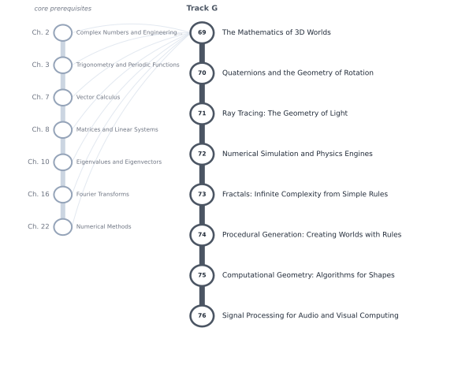

# Track G — Mathematics for Computer Graphics, Games, and Simulation

[← Table of Contents](../../00-front/table-of-contents.md) · [Start: Ch. 69 →](69-mathematics-of-3d-worlds.md)

> **Level 2 — Specializations.** The geometry, algebra and numerics that turn equations into worlds on a screen.

*Suggested reading order for Track G. The grey stations on the left are the core chapters it leans on.*

## Before you start

This track assumes you are comfortable with these core chapters:

- Ch. 2 — [Complex Numbers and Engineering Representation](../../part-1-foundations/02-complex-numbers.md)
- Ch. 3 — [Trigonometry and Periodic Functions](../../part-1-foundations/03-trigonometry-and-periodic-functions.md)
- Ch. 7 — [Vector Calculus](../../part-2-calculus/07-vector-calculus.md)
- Ch. 8 — [Matrices and Linear Systems](../../part-3-linear-algebra/08-matrices-and-linear-systems.md)
- Ch. 10 — [Eigenvalues and Eigenvectors](../../part-3-linear-algebra/10-eigenvalues-and-eigenvectors.md)
- Ch. 16 — [Fourier Transforms](../../part-5-transforms/16-fourier-transforms.md)
- Ch. 22 — [Numerical Methods](../../part-7-numerical-computational/22-numerical-methods.md)

## Chapters

| Ch. | Chapter | What it explores |
|---|---|---|
| 69 | [The Mathematics of 3D Worlds](69-mathematics-of-3d-worlds.md) | Coordinate systems, affine transformations, homogeneous coordinates, projections. |
| 70 | [Quaternions and the Geometry of Rotation](70-quaternions.md) | Rotation groups, quaternion algebra, interpolation, rigid-body transforms. |
| 71 | [Ray Tracing: The Geometry of Light](71-ray-tracing.md) | Rays, intersections, reflection, refraction, sampling, rendering equations. |
| 72 | [Numerical Simulation and Physics Engines](72-physics-engines.md) | Numerical integration, collision detection, constraints, stability, error. |
| 73 | [Fractals: Infinite Complexity from Simple Rules](73-fractals.md) | Iterated functions, self-similarity, fractal dimensions, chaotic sets. |
| 74 | [Procedural Generation: Creating Worlds with Rules](74-procedural-generation.md) | Noise functions, random fields, cellular automata, grammars, spatial structures. |
| 75 | [Computational Geometry: Algorithms for Shapes](75-computational-geometry.md) | Convex hulls, triangulation, Voronoi diagrams, spatial indexing. |
| 76 | [Signal Processing for Audio and Visual Computing](76-signal-processing-audio-visual.md) | Sampling, filtering, convolution, transforms, spectral analysis. |

Every chapter follows the same arc: **the hook** (a puzzle or a failure), **the big idea**, **the mathematics**, **the algorithm**, **the experiment** you can run, **the challenge**, and **loose threads**: the questions the chapter deliberately leaves open.
