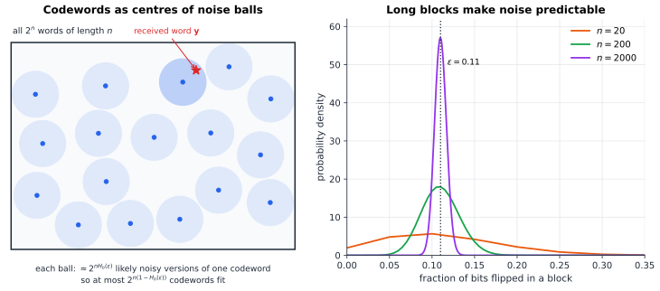
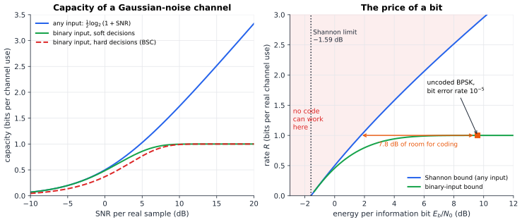

# Chapter 80 — Coding Theory Meets Information Theory

[← Previous](79-error-correcting-codes.md) · [Track H](README.md) · [Table of Contents](../../00-front/table-of-contents.md) · [Next →](81-pseudorandomness.md)

> **Level 2 · Track H — Cryptography, Coding, and Digital Security**
> **Builds on:** [Ch. 33](../b-probability-information/33-information-theory.md), [Ch. 79](79-error-correcting-codes.md), [Ch. 19](../../part-6-probability-statistics/19-probability.md), [Ch. 21](../../part-6-probability-statistics/21-random-processes.md) · **Leads to:** [Ch. 81](81-pseudorandomness.md), [Ch. 77](77-cryptography.md) · **Related:** [Ch. 32](../b-probability-information/32-counting-random-worlds.md), [Ch. 76](../g-graphics-simulation/76-signal-processing-audio-visual.md), [Ch. 6](../../part-2-calculus/06-multivariable-calculus.md)
> **Reading time:** ~30 min

## 80.1 The hook

A wire flips 11 % of the bits you send through it, at random. You want to send a file so that it arrives intact.

The obvious remedy is repetition. Send every bit three times and let the receiver take a majority vote. A bit is now lost only if two of its three copies flip, which happens with probability $3(0.11)^2(0.89)+(0.11)^3\approx0.034$. That is three times better, and it costs you two thirds of your throughput. Want one error in a million? Repetition needs each bit sent about 21 times (error $3.5\times10^{-6}$) and drops the rate to under 5 %. One error in a billion needs 39 copies. Error-free means infinitely many copies and a rate of zero. Every engineer in the 1940s took that trade-off for granted: reliability is paid for with speed, and perfect reliability costs everything.

In 1948 Claude Shannon said this is wrong. For this wire, he claimed, there are codes that send **0.49 bits of information per bit transmitted** with an error probability *as small as you like*: one in a billion, one in $10^{100}$, whatever you name. The rate does not have to fall as the reliability rises. There is a single number, the channel's **capacity**, here $C=1-H_b(0.11)\approx0.500$. Below it, reliability is free in the limit of long blocks. Above it, failure is certain.

[Ch. 33](../b-probability-information/33-information-theory.md) stated that claim and then refused to explain it. Its mystery asked two things: why a code chosen *at random* should work, and why it took until the 1990s to build codes that come close. This chapter answers the first question with a complete proof, and goes as far into the second as a single chapter can. On the way you will see where the most famous formula in communications, $C=B\log_2(1+S/N)$, comes from, and why no radio link anywhere can work with less than $-1.59$ dB of energy per bit.

## 80.2 The big idea

**Noise is random for one bit and almost deterministic for a million.** If you send one bit, it either flips or it doesn't, and you cannot tell which. Send a block of $n=10\,000$ bits, and the law of large numbers ([Ch. 19](../../part-6-probability-statistics/19-probability.md)) guarantees that very nearly $1100$ of them flip: the standard deviation is only $31$. You still don't know *which* bits flipped, but you know *how many*, to within a few percent. Figure 80.2 (right) shows the fraction of flipped bits concentrating around $0.11$ as the block grows.

**So the noise draws a ball around each codeword.** Picture all $2^n$ binary words of length $n$ as points in a huge space. Send codeword $\mathbf{x}$, and the received word $\mathbf{y}$ lands, almost surely, at Hamming distance about $0.11n$ from $\mathbf{x}$ ([Ch. 79](79-error-correcting-codes.md) defined Hamming distance). The set of such words is a "noise ball" around $\mathbf{x}$ containing roughly $2^{nH_b(0.11)}$ words. If the balls around different codewords do not overlap, the receiver just asks which ball $\mathbf{y}$ fell into.

**Capacity is a packing count.** The space holds $2^n$ words. Each ball holds about $2^{nH_b(\varepsilon)}$. So at most

$$
\frac{2^n}{2^{nH_b(\varepsilon)}}=2^{n(1-H_b(\varepsilon))}
$$

codewords fit, and with $2^{nR}$ codewords you send $nR$ bits in $n$ channel uses. The rate cannot exceed $1-H_b(\varepsilon)$. That is the converse, by counting.

**And random placement nearly achieves the packing.** In a space of a million dimensions, balls scattered at random almost never overlap, as long as there are fewer of them than the count above. You don't need to design a clever arrangement. You need to throw darts. That is why Shannon's proof picks a code at random, and why that proof gives no help at all in building one.

**The analogy.** A cocktail party where everyone speaks at once is hopeless for one word at a time, but a long sentence from your friend has a statistical fingerprint, the voice, the topic and the rhythm, that no other speaker's sentence will match by accident. Long messages are distinguishable even when every single sound is ambiguous.


*Figure 80.2 — Left: codewords (dots) as centres of noise balls in the space of all $2^n$ words. A received word falls, with high probability, inside the ball of the codeword that was sent. Right: the fraction of bits flipped in a block of $n$ bits on a channel with $\varepsilon=0.11$. For long blocks it is pinned to $\varepsilon$, which is what gives the balls a definite size.*

## 80.3 The mathematics

Logarithms are base 2. $H_b(p)=-p\log p-(1-p)\log(1-p)$ is the binary entropy of [Ch. 33 §33.3](../b-probability-information/33-information-theory.md#333-the-mathematics), where entropy, mutual information $I(X;Y)$ and KL divergence are defined. We do not repeat them.

### Channels and capacity

> [!definition] Discrete memoryless channel and capacity
> A **discrete memoryless channel** (DMC) takes an input symbol $x$ and outputs $y$ with probability $W(y\mid x)$, independently on each use. Its **information capacity** is
> $$
> C=\max_{p_X}I(X;Y),
> $$
> the largest mutual information between input and output over all input distributions.

Three channels carry most of the intuition.

- **Binary symmetric channel** BSC($\varepsilon$): each bit flips with probability $\varepsilon$. With a uniform input, $I=H(Y)-H(Y\mid X)=1-H_b(\varepsilon)$, and no input does better since $H(Y)\le1$. So $C=1-H_b(\varepsilon)$: $0.919$ at $\varepsilon=0.01$, $0.500$ at $\varepsilon=0.11$, zero at $\varepsilon=\tfrac12$.
- **Binary erasure channel** BEC($\alpha$): each bit is either delivered or replaced by "?" with probability $\alpha$. Here $C=1-\alpha$, which is exactly the fraction of bits that get through. It is as if the sender knew in advance which bits would be erased. The receiver knows, and remarkably that is enough.
- **Gaussian channel**: $Y=X+Z$ with $Z\sim\mathcal N(0,\sigma^2)$ and a power limit $E[X^2]\le P$, treated below.

The definition of $C$ is a maximisation. The theorem that gives it meaning is about *codes*.

> [!definition] Codes, rates and errors
> An $(n,M)$ **code** maps each message $w\in\{1,\dots,M\}$ to a codeword $\mathbf{x}(w)$ of $n$ channel symbols. A decoder maps each received word to a guess $\hat w$. The **rate** is $R=\frac{\log M}{n}$ bits per channel use. A rate $R$ is **achievable** if there are codes with $M\ge2^{nR}$ and error probability tending to zero as $n\to\infty$.

> [!theorem] Noisy-channel coding theorem (Shannon, 1948)
> Every rate $R<C$ is achievable. No rate $R>C$ is achievable: for such rates the error probability stays bounded away from zero, and in fact tends to one.

We prove the achievability half for the BSC, where every step can be done by hand. The same plan works for every DMC, with "typical sets" in place of Hamming balls.

### Result 1: the size of a Hamming ball

Let $V(n,r)=\sum_{k=0}^{r}\binom nk$ be the number of binary words within Hamming distance $r$ of a fixed word.

> [!theorem] Volume bound
> For $0<\lambda\le\tfrac12$,
> $$
> V(n,\lambda n)\le2^{nH_b(\lambda)} .
> $$

*Proof.* By the binomial theorem, $1=(\lambda+(1-\lambda))^n\ge\sum_{k\le\lambda n}\binom nk\lambda^k(1-\lambda)^{n-k}$. Write each term as $\binom nk(1-\lambda)^n\bigl(\tfrac{\lambda}{1-\lambda}\bigr)^k$. Because $\lambda\le\tfrac12$, the ratio $\frac\lambda{1-\lambda}$ is at most $1$, so its $k$-th power only shrinks as $k$ grows, and for $k\le\lambda n$ it is at least $\bigl(\tfrac\lambda{1-\lambda}\bigr)^{\lambda n}$. Hence

$$
1\ \ge\ V(n,\lambda n)\,(1-\lambda)^n\Bigl(\frac{\lambda}{1-\lambda}\Bigr)^{\lambda n}=V(n,\lambda n)\,\lambda^{\lambda n}(1-\lambda)^{(1-\lambda)n}=V(n,\lambda n)\,2^{-nH_b(\lambda)}. \qquad\square
$$

The bound is tight in the exponent. For $n=1000$ and $\lambda=0.11$, $\log_2V=495.5$ while $nH_b(\lambda)=499.9$: the ball really does hold about $2^{nH_b}$ words, give or take a factor polynomial in $n$.

### Result 2: random codes achieve every rate below capacity

> [!theorem] Random coding on the BSC
> Fix $\varepsilon<\tfrac12$, a margin $\delta>0$ with $\rho=\varepsilon+\delta<\tfrac12$, and a rate $R<1-H_b(\rho)$. Then for every $n$ there is a code with $M=2^{nR}$ codewords whose error probability, averaged over the messages, is at most
> $$
> \frac{\varepsilon(1-\varepsilon)}{n\delta^2}+2^{-n\left(1-H_b(\rho)-R\right)}\ \xrightarrow[n\to\infty]{}\ 0 .
> $$

*Proof.* Choose every bit of every codeword independently and uniformly at random. (We have no idea what the code looks like, and we don't need to.) The decoder is simple: given $\mathbf{y}$, output the unique $w$ with $d(\mathbf{x}(w),\mathbf{y})\le\rho n$. If there is none, or more than one, declare an error.

Suppose message $w$ is sent. The decoder can fail in only two ways.

*(a) Too much noise.* The number of flips is $\operatorname{Binomial}(n,\varepsilon)$, with mean $n\varepsilon$ and variance $n\varepsilon(1-\varepsilon)$. Chebyshev's inequality gives

$$
P\bigl(d(\mathbf{x}(w),\mathbf{y})>\rho n\bigr)\le P\bigl(\lvert\text{flips}-n\varepsilon\rvert\ge n\delta\bigr)\le\frac{\varepsilon(1-\varepsilon)}{n\delta^2}.
$$

*(b) An impostor.* Some other codeword $\mathbf{x}(w')$ lies within $\rho n$ of $\mathbf{y}$. Here is the key: $\mathbf{x}(w')$ was drawn independently of $\mathbf{x}(w)$ and of the noise, hence independently of $\mathbf{y}$, and it is uniform on all $2^n$ words. So the chance that it lands in the ball of radius $\rho n$ around $\mathbf{y}$ is the ball's share of the space. By Result 1,

$$
P\bigl(d(\mathbf{x}(w'),\mathbf{y})\le\rho n\bigr)=\frac{V(n,\rho n)}{2^n}\le2^{-n(1-H_b(\rho))}.
$$

There are fewer than $2^{nR}$ impostors, so by the union bound, (b) has probability at most $2^{nR}\cdot2^{-n(1-H_b(\rho))}$.

Adding (a) and (b) bounds the error probability for each message, *averaged over the random choice of code*. An average over codes is a weighted mean of the averages of individual codes, so at least one code does at least as well as the mean. $\square$

Since $\delta$ can be as small as we like, every rate below $1-H_b(\varepsilon)$ is achievable. Two remarks finish the job. First, "average over messages" can be upgraded to "worst message": throw away the worse half of the codewords. The survivors all have error at most twice the average, and the rate drops by only $1/n$. Second, the proof is an instance of the **probabilistic method** of [Ch. 32](../b-probability-information/32-counting-random-worlds.md): it shows that a good code exists by showing that a random one is good on average, and it never exhibits one.

**The converse in one line.** Fano's inequality says that if the decoder errs with probability $P_e$, the remaining uncertainty about the message is at most $H(W\mid\mathbf{Y})\le1+P_e\,nR$. And $n$ channel uses can carry at most $nC$ bits of mutual information: $I(W;\mathbf{Y})\le nC$. A uniform message has $nR=H(W)=I(W;\mathbf{Y})+H(W\mid\mathbf{Y})\le nC+1+P_enR$, so

$$
P_e\ \ge\ 1-\frac{C}{R}-\frac1{nR}.
$$

Above capacity the error probability cannot vanish. This is the counting argument of §80.2, made rigorous. A sharper argument, the **strong converse**, shows that the error probability tends to *one*.

> [!mystery] The codes that finally got there
> Result 2 proves that good codes exist, and the experiment in §80.5 will show that finding them by brute force is hopeless: decoding a random code means comparing against $2^{nR}$ codewords. The codes that reach capacity in practice impose structure. LDPC codes (Gallager, 1960, forgotten until 1996) and turbo codes (1993) come within a fraction of a dB, decoded by passing beliefs along a sparse graph. Polar codes (Arıkan, 2009, now in 5G) are the first *provably* capacity-achieving codes with an $O(n\log n)$ decoder. They work because combining two copies of a channel splits it into one better and one worse channel, and repeating this pushes almost every channel to be perfect or useless. Why must that split polarize, rather than settle somewhere in between? The proof is a martingale convergence argument: see [Ch. 97](../j-frontier/97-measure-theory.md).

### Result 3: the Gaussian channel and the Shannon limit

For the channel $Y=X+Z$ with Gaussian noise of variance $\sigma^2$ and input power at most $P$, the entropies are *differential* entropies $h(\cdot)$, the continuous analogue flagged at the end of Ch. 33. Two facts do all the work. Noise independent of the input gives $h(Y\mid X)=h(Z)=\tfrac12\log(2\pi e\sigma^2)$. And among all variables with a given variance, the Gaussian has the largest differential entropy, so $h(Y)\le\tfrac12\log\bigl(2\pi e(P+\sigma^2)\bigr)$, since $\operatorname{Var}(Y)\le P+\sigma^2$. Subtracting,

$$
C=\max I(X;Y)=\frac12\log_2\Bigl(1+\frac{P}{\sigma^2}\Bigr)\ \text{bits per real sample},
$$

with equality for a Gaussian input. A channel of bandwidth $B$ carries $2B$ independent real samples per second (the sampling theorem of [Ch. 16](../../part-5-transforms/16-fourier-transforms.md)), and white noise of spectral density $N_0/2$ ([Ch. 21 §21.6](../../part-6-probability-statistics/21-random-processes.md#216-white-noise)) gives noise power $N=N_0B$. This is the **Shannon–Hartley theorem**:

$$
C=B\log_2\Bigl(1+\frac SN\Bigr)\ \text{bits per second}.
$$

A 3 kHz telephone line at 30 dB SNR ($S/N=1000$) has $C=3000\log_2(1001)\approx29.9$ kbit/s. The last generation of analogue modems, at 33.6 kbit/s over slightly better lines, ran within a whisker of it. Splitting power among several parallel channels of different quality is the "water-filling" problem solved with Lagrange multipliers in [Ch. 6 §6.11](../../part-2-calculus/06-multivariable-calculus.md#611-lagrange-multipliers).

> [!theorem] The Shannon limit
> On an AWGN channel, reliable communication at any rate requires
> $$
> \frac{E_b}{N_0}>\ln2\approx0.693\quad(-1.59\ \text{dB}),
> $$
> where $E_b$ is the energy spent per information bit.

*Proof.* At rate $R$ bits per real sample, each sample carries energy $E_s=RE_b$, and the noise variance per sample is $\sigma^2=N_0/2$. So $P/\sigma^2=2RE_b/N_0$, and $R<C$ requires

$$
R<\frac12\log_2\Bigl(1+\frac{2RE_b}{N_0}\Bigr)\quad\Longleftrightarrow\quad\frac{E_b}{N_0}>\frac{2^{2R}-1}{2R}.
$$

The right side increases with $R$. As $R\to0$, $2^{2R}=e^{2R\ln2}=1+2R\ln2+O(R^2)$, so the bound decreases to $\ln2$. $\square$

You can buy speed with energy, or save energy by going slowly, but below $-1.59$ dB no amount of slowness, bandwidth or cleverness helps. Figure 80.1 (right) shows the whole trade-off. Uncoded binary signalling needs $9.6$ dB to reach a bit error rate of $10^{-5}$ at one bit per sample. The Shannon bound at that rate is $1.76$ dB. The $7.8$ dB between them is the room in which coding theory has worked for seventy years: a factor of six in transmitter power, or in battery life, or in the distance to a space probe.


*Figure 80.1 — Left: capacity versus SNR. Restricting the input to $\pm1$ (green) caps the rate at one bit; throwing away the analogue value and keeping only the sign (red, dashed) costs a further fixed loss, about $2$ dB at low SNR. Right: the minimum energy per bit at each rate. The shaded region is forbidden by Result 3. The vertical line is the Shannon limit, which no rate escapes.*

> [!tip] Engineering note: soft decisions
> At low SNR, hard decisions (rounding each received sample to a bit before decoding) multiply the required power by $\pi/2$, a loss of $1.96$ dB. That is why modern receivers pass *probabilities*, not bits, to the decoder.

### Coding bounds: how far apart can codewords be?

Capacity concerns *random* noise and *average* error. [Ch. 79](79-error-correcting-codes.md) asked a worst-case question: a code with minimum distance $d$ corrects every pattern of fewer than $d/2$ errors. For long codes write $\delta=d/n$ for the relative distance. What rates are compatible with a given $\delta$? Counting gives an upper and a lower bound.

- **Hamming (sphere-packing) bound.** Balls of radius $\delta n/2$ around codewords are disjoint, so $2^{nR}V(n,\delta n/2)\le2^n$, which gives asymptotically $R\le1-H_b(\delta/2)$.
- **Gilbert–Varshamov bound.** Pick codewords greedily, each at distance at least $\delta n$ from those chosen so far. You can only get stuck when the balls of radius $\delta n$ cover the whole space, so you get at least $2^n/V(n,\delta n)$ codewords: $R\ge1-H_b(\delta)$ is achievable.
- **Singleton bound.** Delete $d-1$ coordinates and the codewords stay distinct, so $R\le1-\delta$. Reed–Solomon codes meet it exactly, but only over large alphabets.

At $\delta=0.11$, Gilbert–Varshamov guarantees rate $0.50$ and the Hamming bound forbids rates above $0.69$. The true answer lies somewhere between, and nobody knows where.

> [!mystery] Is the greedy code the best code?
> The Gilbert–Varshamov bound comes from the dumbest possible construction, yet for binary codes no one has ever found a family that beats it, and the best upper bound (the "linear programming bound" of McEliece, Rodemich, Rumsey and Welch, 1977) still sits well above it. Over alphabets of size $q\ge49$, codes built from algebraic curves *do* beat Gilbert–Varshamov, a shock when it was found in 1982. For binary codes, whether $1-H_b(\delta)$ is the true answer is one of the oldest **open problems** in coding theory.

### Compression: the same picture, run backwards

Source coding ([Ch. 33 §33.3](../b-probability-information/33-information-theory.md#333-the-mathematics)) and channel coding are mirror images. A source of entropy $H$ produces, in $n$ symbols, about $2^{nH}$ "typical" sequences that carry nearly all the probability. A compressor indexes them with $nH$ bits and so *removes* redundancy. A channel code *adds* structured redundancy so that noise balls do not overlap. Both rest on the same law of large numbers.

If you will tolerate some error, you can compress below the entropy. The **rate–distortion function** $R(D)$ is the fewest bits per symbol that let you reconstruct with average distortion at most $D$. For fair random bits with Hamming distortion, $R(D)=1-H_b(D)$: allowing 11 % of bits to be wrong halves the file. For a Gaussian source of variance $\sigma^2$ with squared error, $R(D)=\tfrac12\log(\sigma^2/D)$, so each extra bit buys 6 dB of quality. This is the theory behind JPEG and MP3 ([Ch. 76](../g-graphics-simulation/76-signal-processing-audio-visual.md)). Shannon's **separation theorem** says that compressing optimally and then channel-coding optimally loses nothing compared with any joint scheme, as long as the blocks are long. That theorem is why your phone has separate codecs and modems at all.

> [!warning] Correct mathematics is not a secure system
> Everything above assumes *random* noise that knows nothing about your code. An adversary is not random. An error-correcting code, or a checksum such as CRC-32, detects accidents but gives no integrity against an attacker. Because CRC is linear, anyone can flip chosen bits of a message *and* fix up the checksum without knowing any key. The original Wi-Fi encryption standard, WEP, relied on a CRC for integrity and was broken in exactly this way in 2001. Integrity against an adversary needs a cryptographic message authentication code ([Ch. 77](77-cryptography.md)), and resistance to a jammer who knows your code needs secret randomness that the jammer cannot predict ([Ch. 81](81-pseudorandomness.md)). A capacity theorem is a statement about a probability model. Whether your real channel fits that model is an engineering question that the theorem cannot answer.

## 80.4 The algorithm

Capacity is defined as a maximum over input distributions. For the BSC symmetry gives the answer, but for a lopsided channel you must compute it. The **Blahut–Arimoto algorithm** (1972) does this by alternating maximisation. It repeatedly reweights each input symbol $x$ by $2^{D_x}$, where $D_x=D\bigl(W(\cdot\mid x)\,\Vert\,p_Y\bigr)$ measures how distinctive the outputs of $x$ are compared with the average output.

```python
import numpy as np

def blahut_arimoto(W, tol=1e-12, max_iter=10_000):
    """Capacity (bits) of a discrete memoryless channel with transition matrix W[x, y]."""
    q = np.full(W.shape[0], 1.0 / W.shape[0])          # start from the uniform input
    for _ in range(max_iter):
        py = q @ W                                      # output distribution
        with np.errstate(divide="ignore", invalid="ignore"):
            D = np.where(W > 0, W * np.log2(W / py), 0.0).sum(axis=1)   # D(W(.|x) || p_Y)
        lower, upper = q @ D, D.max()                   # I(q) <= C <= max_x D_x
        if upper - lower < tol:
            break
        q = q * np.exp2(D); q /= q.sum()                # reweight inputs by 2^D
    return lower, q

bsc = np.array([[0.89, 0.11], [0.11, 0.89]])
z   = np.array([[1.0, 0.0], [0.5, 0.5]])               # Z-channel: a sent 1 arrives as 0 half the time
print(blahut_arimoto(bsc))   # (0.5000..., [0.5, 0.5])
print(blahut_arimoto(z))     # (0.3219..., [0.6, 0.4])
```

The stopping rule is a certificate, not a guess. For any input $q$, $I(q)=\sum_xq(x)D_x$ is achievable, and a standard duality argument shows that $C\le\max_xD_x$. When the two meet, you have the capacity to within `tol`. For the Z-channel the optimum sends 1s only 40 % of the time, because 1s are the fragile symbol, and the capacity is $\log_2(1.25)=0.322$ bits.

**Complexity.** Each iteration costs $O(\lvert\mathcal X\rvert\lvert\mathcal Y\rvert)$. Convergence is monotone, and the gap shrinks like $O(1/k)$ in general, much faster when the optimum is unique and in the interior.

**Failure cases.**

1. *Capacity is not a code.* Blahut–Arimoto tells you the target, not how to hit it. Decoding a random code by brute force costs $n\,2^{nR}$ operations per block. At $n=1000$ and $R=\tfrac12$ that is $2^{500}$ comparisons.
2. *Structure helps encoding, not decoding.* Linear codes ([Ch. 79](79-error-correcting-codes.md)) encode in $O(n^2)$ time, and random linear codes still achieve capacity on the BSC. But decoding a general linear code is NP-hard (Berlekamp, McEliece and van Tilborg, 1978). Cryptographers turned that hardness into a weapon: the McEliece cryptosystem hides a decodable code inside a random-looking one.
3. *Finite blocklength.* Capacity is a limit. At $n=1000$ the best possible rate for a given error probability is noticeably below $C$, by roughly $\sqrt{V/n}\,Q^{-1}(P_e)$, where $V$ is the "channel dispersion". Short packets, such as control messages in 5G, pay this penalty.

## 80.5 The experiment

First, drag the Shannon bound around. The curve gives the least $E_b/N_0$ (in dB, horizontal) needed at each rate $R$ (vertical).

```desmos-graph
left=-3; right=12; bottom=0; top=3
---
x=10\log_{10}(\frac{2^{2y}-1}{2y})|blue|0<y<3
x=-1.59|black|dashed
x=10\log_{10}(\frac{2^{y}-1}{y})|green|dotted|0<y<3
(9.59,1)|orange|label:uncoded BPSK
(1.76,1)|blue|label:Shannon bound at R=1
```

*Blue: real channel, $E_b/N_0>(2^{2R}-1)/(2R)$. Green: the same bound per complex sample (two real dimensions), $(2^R-1)/R$. Both reach $-1.59$ dB as $R\to0$. Move the orange point to your own modem's operating point (for example $(4.4,0.5)$, the classic rate-$\tfrac12$ convolutional code of deep-space links at a bit error rate of $10^{-5}$) and read off how much is left to gain. Then add the point $(-1,0.1)$: any system claiming that operating point is claiming the impossible.*

Next, build random codes and watch Result 2 happen, slowly.

```python
import numpy as np
rng = np.random.default_rng(1)

EPS = 0.05     # bit-flip probability of the channel (capacity 1 - H(EPS) = 0.714)
R = 0.25       # code rate in bits per channel use: try 0.5, 0.7, 0.8
TRIALS = 1000  # messages sent per block length
MAXBITS = 12   # keeps 2^(nR) codewords manageable

H = lambda p: -p * np.log2(p) - (1 - p) * np.log2(1 - p)
print(f"capacity C = {1 - H(EPS):.3f} bits/use, rate R = {R}")

for n in range(4, int(MAXBITS / R) + 1, max(1, int(2 / R))):
    k = round(n * R)                                   # message bits
    M = 2 ** k                                         # codewords
    code = rng.integers(0, 2, (M, n), dtype=np.int8)   # a random codebook
    sent = rng.integers(0, M, TRIALS)
    noise = (rng.random((TRIALS, n)) < EPS).astype(np.int8)
    y = code[sent] ^ noise                             # received words
    dist = (y[:, None, :] ^ code[None, :, :]).sum(axis=2)
    guess = dist.argmin(axis=1)                        # minimum-distance decoding
    err = np.mean(guess != sent)
    print(f"n = {n:3d}  k = {k:2d}  codewords = {M:5d}  block error = {err:.3f}")
```

At $R=0.25$, a third of capacity, the block error falls from about $4\%$ at $n=4$ to zero in a thousand trials by $n=36$. At $R=0.5$ it hovers around $6$–$10\%$ up to $n=24$: the theorem promises it will fall, but only for blocks far longer than your memory allows. At $R=0.8$, above capacity, it *rises* with $n$, which is the strong converse in action. Raise `MAXBITS` to 14 or 15 and see how quickly time and memory run out. That wall is the whole reason the codes in the first mystery took fifty years.

## 80.6 The challenge

1. **Intuition.** On the erasure channel BEC($\alpha$) the receiver knows which bits were erased, but the sender does not. Explain in words why capacity is still $1-\alpha$, as if the sender had known, and why this argument fails on the BSC, where nobody knows which bits flipped.
2. **Derivation.** Prove the lower bound $V(n,\lambda n)\ge\frac1{n+1}2^{nH_b(\lambda)}$ for $\lambda n$ an integer, so that Result 1 is tight up to a polynomial factor. Then use it to prove the sphere-packing converse $R\le1-H_b(\varepsilon)$ for codes that correct *every* pattern of up to $\varepsilon n$ errors.
3. **Implementation.** Modify the experiment so that the codebook is a random *linear* code: a random $k\times n$ generator matrix over $\mathbb F_2$, with codewords $\mathbf{u}\mathbf{G}$. Compare block error rates with the fully random code at the same $n$ and $k$. Then extend Blahut–Arimoto to a channel with input *cost* (for example, sending a 1 costs energy) and plot capacity against the cost budget.
4. **Open investigation.** For the BSC with $\varepsilon=0.05$, estimate by simulation the smallest block error achievable at $n=24$ and $R=0.5$ by searching over many random codes and keeping the best. How close can you get to the normal approximation $C-\sqrt{V/n}\,Q^{-1}(P_e)$? Exact optimal codes at moderate $n$ are unknown for almost every parameter choice, and your search will not settle it. Where does the improvement curve flatten, and why?

## 80.7 Loose threads

The question Ch. 33 left open now has its answer. A random code works because, in high dimensions, the noise around each codeword fills a ball of predictable size, and randomly placed balls almost never collide while there are fewer than $2^{n(1-H_b(\varepsilon))}$ of them. The proof is three lines of counting and a law of large numbers. What it does not give is a code you can decode. Bridging that gap took from 1948 to 2009, and the codes that did it are still being refined.

What we did not tell you:

- **How fast the error falls.** Result 2 says the error tends to zero. In fact the best codes drive it down exponentially, $P_e\approx2^{-nE(R)}$, and the **reliability function** $E(R)$ is known exactly only for rates near capacity. At low rates the best upper and lower bounds disagree, and closing that gap is an open problem tied to the Gilbert–Varshamov mystery above.
- **Feedback.** If the receiver can talk back, capacity does not increase for a memoryless channel (another theorem of Shannon's), but the error exponent improves dramatically and simple schemes become possible.
- **Networks.** With many senders and receivers, the capacity region of even a three-node relay channel is unknown.
- **Secrecy.** Shannon wrote a second great paper in 1949, on secrecy systems. In it he proved that a cipher is *perfectly* secret, revealing nothing about the message to an eavesdropper with unlimited computing power, only if the key carries at least as much entropy as the message. The one-time pad meets this bound, and nothing shorter can.

> [!mystery] A short key for a long secret
> By Shannon's 1949 theorem, a 256-bit key can perfectly hide only 256 bits. Yet every web browser encrypts gigabytes with a 256-bit key, and nobody can read the traffic. Both statements are true. The escape is to give up on *perfect* secrecy against *unlimited* adversaries, and to demand only that no *efficient* adversary can tell the ciphertext from random noise. What exactly does "cannot tell" mean, and how can 256 random bits be stretched into a gigabyte of bits that look just as random? See [Ch. 81](81-pseudorandomness.md).

## Further reading

- T. M. Cover and J. A. Thomas, *Elements of Information Theory*, 2nd ed., Wiley, 2006. Chapters 7–10 give the channel coding theorem, the Gaussian channel and rate–distortion in full.
- D. J. C. MacKay, *Information Theory, Inference, and Learning Algorithms*, Cambridge University Press, 2003. Free online; outstanding on LDPC codes and message passing.
- T. Richardson and R. Urbanke, *Modern Coding Theory*, Cambridge University Press, 2008. The theory of codes on graphs.
- C. E. Shannon, "A Mathematical Theory of Communication," *Bell System Technical Journal*, 27, 1948, and "Communication Theory of Secrecy Systems," *BSTJ*, 28, 1949.
