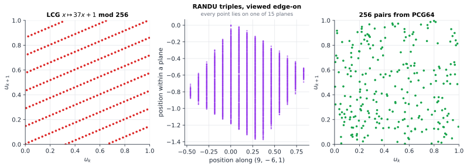
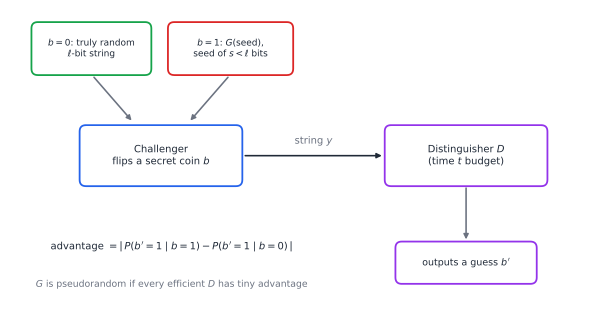

# Chapter 81 — Pseudorandomness and Computational Indistinguishability

[← Previous](80-coding-meets-information-theory.md) · [Track H](README.md) · [Table of Contents](../../00-front/table-of-contents.md) · [Next →](82-zero-knowledge-proofs.md)

> **Level 2 · Track H — Cryptography, Coding, and Digital Security**
> **Builds on:** [Ch. 19](../../part-6-probability-statistics/19-probability.md), [Ch. 21](../../part-6-probability-statistics/21-random-processes.md), [Ch. 77](77-cryptography.md), [Ch. 80](80-coding-meets-information-theory.md) · **Leads to:** [Ch. 82](82-zero-knowledge-proofs.md) · **Related:** [Ch. 30](../a-algorithms/30-limits-of-computation.md), [Ch. 38](../b-probability-information/38-monte-carlo.md), [Ch. 57](../e-abstract-math/57-number-theory.md), [Ch. 24](../../part-7-numerical-computational/24-computational-mathematics.md)
> **Reading time:** ~30 min

## 81.1 The hook

**1968.** George Marsaglia publishes a paper with a blunt title: "Random numbers fall mainly in the planes." The generator he is talking about, IBM's RANDU, had been the standard random number source on mainframes for years. It computes $x_{k+1}=65539\,x_k\bmod2^{31}$. Plot its outputs as points $(x_k,x_{k+1},x_{k+2})$ in a cube, rotate the cube to the right angle, and the "random" cloud collapses onto just **15 parallel planes**, with nothing at all in between. Physics simulations had been run on those planes for years.

**1995.** Two Berkeley graduate students, Ian Goldberg and David Wagner, look at how the Netscape browser picks the secret keys that protect credit-card numbers. The keys came from a generator seeded with the time of day and two process IDs. An attacker who could estimate those three numbers was left with a search small enough to finish in minutes on 1995 hardware, so the "128-bit" keys were worth only a few dozen bits.

**2008.** A Debian developer had removed two lines from the OpenSSL random generator two years earlier, to silence a warning from a code-checking tool. After the change, the only unpredictable input left was the process ID, at most 32,768 values. Every SSH and TLS key generated on Debian and Ubuntu systems in those two years came from a list short enough to print out.

In each case the output *looked* random. RANDU passes the simple frequency tests. The Netscape and Debian keys would pass any statistical test you could name, because each key, on its own, is just a string of bits. What failed was not the look of the numbers but their *unpredictability* to someone who knew how they were made.

So what does it mean for a deterministic program to produce randomness? If an algorithm, a seed and a little arithmetic produce every bit, then each bit is fully determined. In what sense can it be "random" at all? And [Ch. 80](80-coding-meets-information-theory.md) left a sharper version of the question. Shannon proved that perfect secrecy needs a key as long as the message, yet a 256-bit key protects gigabytes of web traffic every day. This chapter resolves the contradiction. The answer changes the meaning of "random" itself.

## 81.2 The big idea

**Randomness is in the eye of the observer.** A sequence is not random or non-random in itself. It is random *to someone*, if that someone cannot tell it apart from coin flips. A shuffled deck is random to the players and not to the dealer who stacked it. The digits of $\pi$ are random enough for a dice game and useless as a password, because anyone can compute them.

**Make the observer a program with a time limit.** Modern cryptography fixes the observer: any algorithm that runs in a reasonable time. It plays a game (Figure 81.2). A challenger secretly flips a coin and hands the algorithm either a truly random string or the output of our generator on a random short seed. The algorithm, the *distinguisher*, must guess which one it got. If no efficient distinguisher guesses right noticeably more often than half the time, the generator is **pseudorandom**. Its output is, for every practical purpose, as good as random, *even though it is not random at all*.

**Statistical tests are just distinguishers.** A frequency count, a chi-square test or a spectral test is a particular distinguisher. Passing a hundred of them is evidence, not proof: the hundred-and-first may be the one that finds the planes. Cryptographic pseudorandomness asks for something far stronger, namely that *every* efficient test fails.

**The analogy.** An art forger does not need a painting that *is* a Vermeer. She needs one that no expert can tell from a Vermeer within the time the auction allows. Give the expert unlimited time and an electron microscope and the forgery falls. Bound the expert, and the forgery is, operationally, a Vermeer.


*Figure 81.1 — Left: all 256 consecutive pairs of a full-period linear congruential generator lie on a handful of parallel lines. Centre: 6000 RANDU triples projected along the direction $(9,-6,1)$; every one of them lies on one of 15 planes. Right: pairs from a modern generator (PCG64) show no visible structure. That does not make PCG64 safe for cryptography.*

## 81.3 The mathematics

Throughout, $U_\ell$ denotes a uniformly random string of $\ell$ bits, and a "generator" is a deterministic function $G:\{0,1\}^s\to\{0,1\}^\ell$ with $\ell>s$. Its output distribution is $G(U_s)$: the result of feeding it a uniformly random seed.

### Result 1: no generator fools an unbounded observer

How different are two distributions $P$ and $Q$ on the same finite set? The natural measure is the **statistical distance**

$$
\Delta(P,Q)=\max_{A}\bigl\lvert P(A)-Q(A)\bigr\rvert=\frac12\sum_y\bigl\lvert P(y)-Q(y)\bigr\rvert,
$$

the largest difference in probability any event can show. If $\Delta$ is tiny, no test whatever, however slow, can tell $P$ from $Q$ with more than tiny advantage.

> [!theorem] Generators are statistically far from uniform
> For every $G:\{0,1\}^s\to\{0,1\}^\ell$ with $\ell>s$,
> $$
> \Delta\bigl(G(U_s),U_\ell\bigr)\ \ge\ 1-2^{s-\ell}\ \ge\ \tfrac12 .
> $$

*Proof.* Let $A=G(\{0,1\}^s)$ be the set of strings the generator can output. There are at most $2^s$ of them. The generator's output always lies in $A$, so $P(A)=1$ for $P=G(U_s)$. A uniform string lands in $A$ with probability $\lvert A\rvert/2^\ell\le2^{s-\ell}$. The event $A$ alone therefore shows a difference of at least $1-2^{s-\ell}$. $\square$

The distinguisher in this proof is easy to describe ("is $y$ one of the possible outputs?") but it takes $2^s$ steps to run: try every seed. That is the whole loophole. Statistically, a generator is always a fake. Computationally, checking whether it is a fake may be infeasible.

This is also where Shannon's 1949 theorem from [Ch. 80](80-coding-meets-information-theory.md) bites. Perfect secrecy is a statement about statistical distance: the ciphertext's distribution must not depend on the message *at all*. Result 1 says no short key can achieve that. Weaken "not at all" to "not detectably by any efficient algorithm", and the door opens.

### Computational indistinguishability

> [!definition] Distinguisher, advantage, pseudorandom generator
> A **distinguisher** is an algorithm $D$ that reads a string and outputs $0$ or $1$. Its **advantage** against $G$ is
> $$
> \operatorname{Adv}(D)=\Bigl\lvert P\bigl(D(G(U_s))=1\bigr)-P\bigl(D(U_\ell)=1\bigr)\Bigr\rvert .
> $$
> $G$ is a **$(t,\epsilon)$-secure pseudorandom generator** if every distinguisher running in time at most $t$ has advantage at most $\epsilon$.

Concrete numbers make the definition real. A generator with a 128-bit seed is considered secure if no attack with $t$ operations has advantage much above $t/2^{128}$. That is the advantage of the trivial attack that guesses seeds at random and checks each guess. Asymptotic cryptography says the same thing with a security parameter $\kappa$: $G$ is pseudorandom if every distinguisher running in time polynomial in $\kappa$ has advantage smaller than every inverse polynomial (a *negligible* function, such as $2^{-\kappa}$).

Two properties make the notion workable.

- **Closure under efficient processing.** If $G(U_s)$ is indistinguishable from $U_\ell$, so is $f(G(U_s))$ from $f(U_\ell)$, for any efficient $f$. Otherwise, composing $f$ with the distinguisher would break $G$. This is the computational version of the data-processing inequality.
- **Hybrid arguments.** Indistinguishability is "almost transitive": if $X\approx Y$ with advantage $\epsilon_1$ and $Y\approx Z$ with $\epsilon_2$, then $X\approx Z$ with advantage at most $\epsilon_1+\epsilon_2$, by the triangle inequality. Long chains of small steps are the workhorse of every security proof.

With these, the contradiction of Ch. 80 disappears. Encrypt a long message $m$ as $c=m\oplus G(k)$, where $k$ is a short random key. If $G$ is pseudorandom, $c$ is indistinguishable from $m\oplus U_\ell$, which is a one-time pad and so perfectly random. An efficient eavesdropper learns nothing she could detect. This is the skeleton of every **stream cipher**, from ChaCha20 in your browser to the counter mode of AES ([Ch. 77](77-cryptography.md)).

### Result 2: why RANDU falls on 15 planes

The generator $x_{k+1}=ax_k\bmod m$ with $a=65539=2^{16}+3$ and $m=2^{31}$ was chosen because multiplying by $2^{16}+3$ is fast on binary hardware. That choice is also its downfall.

> [!theorem] RANDU's planes
> Every RANDU triple satisfies $x_{k+2}\equiv6x_{k+1}-9x_k\pmod{2^{31}}$. Consequently the normalised triples $u_k=x_k/2^{31}$ all lie on the 15 planes $9u-6v+w=j$, $j=-5,\dots,9$.

*Proof.* Square the multiplier: $a^2=2^{32}+6\cdot2^{16}+9$. Modulo $2^{31}$ the first term vanishes, and $6\cdot2^{16}=6(a-3)$, so

$$
a^2\equiv6(a-3)+9=6a-9\pmod{2^{31}} .
$$

Since $x_{k+2}\equiv a^2x_k$ and $x_{k+1}\equiv ax_k$, we get $x_{k+2}\equiv6x_{k+1}-9x_k$. Hence $9x_k-6x_{k+1}+x_{k+2}$ is a multiple of $2^{31}$, and dividing by $2^{31}$ shows that $9u_k-6u_{k+1}+u_{k+2}$ is an integer. With each $u$ in $[0,1)$, that integer lies strictly between $-6$ and $10$, so it is one of the 15 values $-5,\dots,9$. $\square$

Every linear congruential generator has some version of this flaw. Marsaglia's theorem says that $d$-tuples from any LCG with modulus $m$ lie on at most about $(d!\,m)^{1/d}$ hyperplanes. The **spectral test** measures the gap between them, and it is the standard way to grade an LCG multiplier. The Hull–Dobell conditions for a full period ([Ch. 57](../e-abstract-math/57-number-theory.md)) say nothing about these planes. A generator can visit every value and still be badly structured.

The flaw is a distinguisher in disguise. Compute $9u_k-6u_{k+1}+u_{k+2}$ for a few consecutive outputs. For RANDU it is always an integer; for true random numbers, essentially never. The advantage is almost exactly 1, and the test costs three multiplications.

### Result 3: unpredictability is the same as indistinguishability

A cryptographer's first instinct is a different definition: a good generator is one whose next bit you cannot predict. Given $y_1,\dots,y_{i-1}$, no efficient algorithm should guess $y_i$ with probability noticeably above $\tfrac12$. Andrew Yao proved in 1982 that this **next-bit test** is not merely necessary. It is sufficient.

> [!theorem] Yao's next-bit theorem
> If some distinguisher $D$ running in time $t$ has advantage $\epsilon$ against $G:\{0,1\}^s\to\{0,1\}^\ell$, then for some position $i$ there is a predictor $A$, running in time about $t$, that guesses $y_i$ from $y_1\dots y_{i-1}$ with probability at least $\tfrac12+\epsilon/\ell$.

*Proof.* Let $y=G(U_s)$ and define $\ell+1$ **hybrid** distributions. In $H_i$ the first $i$ bits come from $y$ and the remaining $\ell-i$ bits are fresh coin flips. So $H_0=U_\ell$ and $H_\ell=G(U_s)$. Let $p_i=P(D(H_i)=1)$. Replacing $D$ by $1-D$ if necessary, we may assume $p_\ell-p_0=\epsilon$. The telescoping sum

$$
\epsilon=p_\ell-p_0=\sum_{i=1}^{\ell}(p_i-p_{i-1})
$$

has $\ell$ terms, so for some $i$, $p_i-p_{i-1}\ge\epsilon/\ell$. The neighbours $H_{i-1}$ and $H_i$ differ only in bit $i$: real in $H_i$, random in $H_{i-1}$.

The predictor, given $y_1\dots y_{i-1}$, flips a coin $b$ and fresh coins $r_{i+1},\dots,r_\ell$, and runs $D$ on $(y_1,\dots,y_{i-1},b,r_{i+1},\dots,r_\ell)$. If $D$ says $1$ ("looks real"), it predicts $y_i=b$; otherwise it predicts $y_i=1-b$.

To analyse it, let $q$ be the probability that $D$ outputs $1$ when bit $i$ is set to the *wrong* value $1-y_i$. Half the time $b=y_i$, and the input to $D$ is distributed exactly as $H_i$. Half the time $b\ne y_i$. So $p_{i-1}=\tfrac12p_i+\tfrac12q$, which gives $q=2p_{i-1}-p_i$. The predictor is right when $b=y_i$ and $D$ says $1$, or when $b\neq y_i$ and $D$ says $0$:

$$
P(\text{correct})=\tfrac12p_i+\tfrac12(1-q)=\tfrac12+p_i-p_{i-1}\ \ge\ \tfrac12+\frac{\epsilon}{\ell}. \qquad\square
$$

Read in reverse, the theorem says that a generator whose bits cannot be predicted passes *every* efficient statistical test, including all the tests nobody has invented yet. That is the strongest guarantee anyone could ask of a sequence, and it follows from a single, natural property.

### Where pseudorandom generators come from

A generator needs a source of hardness. The classical recipe has three steps.

1. Start from a **one-way function** $f$: easy to compute, hard to invert on random inputs. Candidates are multiplying two primes ([Ch. 57](../e-abstract-math/57-number-theory.md)) and exponentiation in a group ([Ch. 78](78-elliptic-curves.md)).
2. Find a **hard-core bit**: one bit of $x$ that is as hard to guess from $f(x)$ as $x$ is to find. Goldreich and Levin (1989) showed that every one-way function has one: the parity of a random subset of the bits of $x$.
3. **Iterate**: output the hard-core bit, apply $f$, repeat. Yao's theorem, read backwards, proves the output unpredictable.

The **Blum–Blum–Shub** generator is the textbook instance. Pick primes $p\equiv q\equiv3\pmod4$, set $N=pq$, square repeatedly ($x\mapsto x^2\bmod N$) and output the lowest bit each time. Predicting its bits is provably as hard as factoring $N$. It is also very slow, which is why practical generators (ChaCha20, AES in counter mode, the DRBGs of NIST SP 800-90A) are built from ciphers whose security is assumed, not proved.

> [!mystery] Does pseudorandomness exist at all?
> Everything above is conditional. Håstad, Impagliazzo, Levin and Luby proved in 1999 that pseudorandom generators exist *if and only if* one-way functions exist. But nobody has proved that any one-way function exists, and doing so would prove $\mathsf P\ne\mathsf{NP}$ along the way ([Ch. 30](../a-algorithms/30-limits-of-computation.md)). Every stream cipher you have ever used rests on an **open problem**: is there any function that is easy to compute and hard to invert?

## 81.4 The algorithm

Two short programs show both sides. The first *breaks* a linear congruential generator from three outputs. With a prime modulus and unknown multiplier $a$ and increment $c$, two consecutive differences satisfy $x_2-x_1\equiv a(x_1-x_0)$, so $a$ is one modular division away. The division uses the inverse from the extended Euclidean algorithm ([Ch. 57](../e-abstract-math/57-number-theory.md)).

```python
def crack_lcg(x0, x1, x2, m):
    """Recover (a, c) of x -> (a*x + c) mod m from three outputs; m prime."""
    a = (x2 - x1) * pow(x1 - x0, -1, m) % m     # modular inverse of (x1 - x0)
    c = (x1 - a * x0) % m
    return a, c

m, a, c = 2**31 - 1, 48271, 12345               # toy secret parameters
xs = [987654]
for _ in range(4):
    xs.append((a * xs[-1] + c) % m)
A, C = crack_lcg(*xs[:3], m)
print(A, C, (A * xs[3] + C) % m == xs[4])       # 48271 12345 True: every future output known
```

That is a next-bit predictor with advantage $\tfrac12$: it predicts every bit. By Yao's theorem in its easy direction, it is also a perfect distinguisher. When the modulus is unknown or the outputs are truncated, lattice reduction still recovers the state. The Mersenne Twister, NumPy's legacy default, falls to linear algebra over $\mathbb F_2$ after 624 consecutive 32-bit outputs.

The second program is a **toy** Blum–Blum–Shub generator.

```python
def bbs_bits(seed, nbits, p=499, q=547):
    """Blum-Blum-Shub with TOY primes p, q = 3 mod 4. Real use needs primes of 1500+ bits."""
    N = p * q
    x = seed * seed % N                          # seed must be coprime to N
    bits = []
    for _ in range(nbits):
        x = x * x % N
        bits.append(x & 1)
    return bits

print("".join(map(str, bbs_bits(2024, 64))))
```

**Complexity.** An LCG costs one multiply per output. BBS costs one modular squaring of a $\kappa$-bit number per output *bit*, about $O(\kappa^2)$ bit operations, so it is thousands of times slower than a cipher-based generator. That is why it lives in textbooks.

**Failure cases.**

1. *Toy parameters are toys.* With $p=499$ and $q=547$, the seed $2024$ enters a cycle of only 492 states, and anyone can factor $N=272\,953$ instantly. The theorem "as hard as factoring" is worthless when factoring is easy.
2. *The seed is the secret.* A perfect generator on a guessable seed is a guessable generator. Netscape and Debian had sound generators and broken seeds.
3. *Statistical quality is not security.* PCG64 and the Mersenne Twister are excellent for Monte Carlo ([Ch. 38](../b-probability-information/38-monte-carlo.md)) and trivial to predict. Conversely, a CSPRNG (cryptographically secure generator) is fine for simulation, only slower.

> [!warning] Correct mathematics is not a secure implementation
> A proof that "$G$ is pseudorandom if factoring is hard" says nothing about where your seed came from, whether two virtual machines cloned from one snapshot now share the same generator state, whether the state leaks through a crash dump or a timing side channel, or whether the standard you followed was designed honestly. (The NIST generator Dual\_EC\_DRBG was withdrawn in 2014 after evidence that its constants could hide a back door.) In code, use the operating system's generator: `secrets` or `os.urandom` in Python, never `random` or `numpy.random`, for keys, tokens, nonces and passwords. Every generator in this chapter's code is a teaching toy.

## 81.5 The experiment

First, see the lines. Every point below is a pair $(u_k,u_{k+1})$ from a full-period LCG with modulus 256.

```desmos-graph
left=0; right=1; bottom=0; top=1
---
L=[0,...,255]
(\frac{L}{256},\frac{\operatorname{mod}(37L+1,256)}{256})|red
```

*Change the multiplier $37$ to $5$, $69$, $101$, $137$ or $197$ (each keeps the full period, since it is $1\bmod4$) and count the lines. Which multiplier spreads the points most evenly? That question, asked in higher dimensions, is the spectral test. Then try an even multiplier such as $38$ and watch the period collapse.*

Now play the distinguishing game of Figure 81.2. Each test below is a distinguisher; the script estimates its advantage against two broken generators.

```python
import numpy as np
rng = np.random.default_rng()
N, GAMES = 1200, 400            # numbers per challenge string, rounds of the game

def lcg(a, c, m, seed, n):      # a linear congruential generator, scaled to [0, 1)
    x, out = seed, np.empty(n)
    for i in range(n):
        x = (a * x + c) % m; out[i] = x / m
    return out

GENERATORS = {                  # toy, broken generators: never use these for anything real
    "RANDU":       lambda s: lcg(65539, 0, 2**31, s | 1, N),
    "LCG mod 2^32": lambda s: lcg(1664525, 1013904223, 2**32, s, N),
}
TESTS = {                       # each test is a distinguisher: 1 means "I think this is fake"
    "plane test":  lambda u: np.mean(np.abs(np.round(9*u[:-2] - 6*u[1:-1] + u[2:])
                                      - (9*u[:-2] - 6*u[1:-1] + u[2:])) < 1e-6) > 0.5,
    "low bits":    lambda u: np.all(((u * 2**31).astype(np.int64) & 3)[8:]
                                    == ((u * 2**31).astype(np.int64) & 3)[:-8]),
    "pair chi^2":  lambda u: np.sum((np.histogram2d(u[:-1], u[1:], 8)[0] - (N-1)/64)**2
                                    / ((N-1)/64)) > 100,
}

for gname, G in GENERATORS.items():
    for tname, D in TESTS.items():
        said_fake, played = [0, 0], [0, 0]
        for _ in range(GAMES):
            b = rng.integers(2)                      # the challenger's secret coin
            u = G(int(rng.integers(2**31))) if b else rng.random(N)
            said_fake[b] += D(u); played[b] += 1
        adv = abs(said_fake[1] / played[1] - said_fake[0] / played[0])
        print(f"{gname:13s} vs {tname:11s} advantage ~ {adv:.2f}")
```

The plane test destroys RANDU (advantage about $1.00$) and sees nothing in the other LCG. The low-bits test, which checks whether the two lowest bits repeat with period 8, destroys *both*, because the low bits of any LCG with a power-of-two modulus have tiny periods. The chi-square test on pairs, the kind of check a textbook recommends, has advantage near zero against both. A generator can pass the test you ran and fail the one you didn't. Write your own distinguisher and add it to `TESTS`. Then replace a broken generator by `lambda s: np.random.default_rng(s).random(N)` and try to find *any* test with a visible advantage.


*Figure 81.2 — The game that defines pseudorandomness. The challenger hands the distinguisher either true randomness or generator output; the distinguisher's advantage is how much more often it says "1" in one case than in the other. Security means every efficient distinguisher has negligible advantage.*

## 81.6 The challenge

1. **Intuition.** The digits of $\pi$ are believed to pass every standard statistical test of randomness. Explain why they are nonetheless a terrible pseudorandom generator in the sense of this chapter, and describe a distinguisher with advantage close to 1. What resource does your distinguisher need that a chi-square test does not?
2. **Derivation.** Suppose $G:\{0,1\}^s\to\{0,1\}^{s+1}$ is a $(t,\epsilon)$-secure generator that stretches by just one bit. Define $G'$ by applying $G$ to the seed, outputting the last bit, feeding the first $s$ bits back in, and repeating $\ell$ times. Use a hybrid argument to show that $G'$ is $(t',\ell\epsilon)$-secure for $t'$ slightly less than $t$. Identify exactly where the proof uses that each hybrid can be sampled efficiently.
3. **Implementation.** Implement the NIST "runs" test and the "approximate entropy" test, and apply them to the bits of the toy BBS generator, to the lowest bit of an LCG with modulus $2^{32}$, and to `os.urandom`. Then write a program that recovers the parameters of an LCG with an *unknown* modulus from eight consecutive outputs. (Hint: the numbers $t_k=x_{k+1}-x_k$ satisfy $t_{k+2}t_k-t_{k+1}^2\equiv0\pmod m$.)
4. **Open investigation.** Design the best distinguisher you can against `numpy.random.default_rng` (PCG64) given $10^9$ outputs and an hour of laptop time. PCG64 is not a cryptographic generator, and its output function is known, so a distinguisher must exist. How large an advantage can you actually measure? Finding a practical distinguisher, or arguing convincingly that none exists at this budget, is an open experimental question.

## 81.7 Loose threads

The hook asked how a deterministic program can produce randomness. The answer is that "random" was never a property of the bits alone. It is a relation between a distribution and an observer with limited time. Result 1 shows that no generator fools an unbounded observer. Yao's theorem shows that fooling bounded predictors is the same as fooling bounded tests. And a short key, stretched by a pseudorandom generator, is how a 256-bit secret protects a gigabyte, the answer to the mystery of [Ch. 80](80-coding-meets-information-theory.md).

What we did not tell you:

- **Pseudorandom functions.** A generator produces one long string. Many protocols need a random-looking *function*: give it any input and it returns an output that looks fresh. Goldreich, Goldwasser and Micali (1986) built one from any generator, using a binary tree of generator calls. Block ciphers such as AES are modelled as pseudorandom permutations.
- **Extracting randomness.** Seeds come from physical noise (clock jitter, thermal noise in a diode, the timing of keystrokes), which is unpredictable but not uniform. *Randomness extractors* turn such weak sources into nearly uniform bits. Their analysis uses the min-entropy, a cousin of the entropy of [Ch. 33](../b-probability-information/33-information-theory.md).
- **Does randomness help computation?** [Ch. 30](../a-algorithms/30-limits-of-computation.md) and [Ch. 38](../b-probability-information/38-monte-carlo.md) both asked whether every randomised algorithm can be made deterministic. Pseudorandomness gives a striking conditional answer. Impagliazzo and Wigderson (1997) proved that if some problem solvable in exponential time requires exponential-size circuits, then there are generators strong enough to fool every polynomial-time algorithm, and then $\mathsf{BPP}=\mathsf{P}$. Try all seeds of a logarithmic-length generator and take a majority vote. *Hardness can be traded for randomness*, in both directions.

> [!mystery] Is the hardness really there?
> The Impagliazzo–Wigderson theorem turns a lower bound into derandomisation. But no one can prove the lower bound: the best known circuit lower bound for an explicit problem is barely larger than linear. Conversely, Kabanets and Impagliazzo (2003) showed that derandomising even one specific problem (testing whether a polynomial is identically zero) would itself imply new circuit lower bounds. So $\mathsf{BPP}=\mathsf P$ and circuit lower bounds rise or fall together. Most researchers believe $\mathsf{BPP}=\mathsf P$; proving it is an **open problem** at the heart of complexity theory.

There is one more use for computational indistinguishability, perhaps the most surprising. We used it to say that a ciphertext reveals nothing. It can also say that a *conversation* reveals nothing: that everything you saw while someone convinced you of a fact, you could have produced yourself.

> [!mystery] A proof that teaches you nothing
> Suppose a prover convinces you that she knows the password to an account, and the transcript of your conversation is indistinguishable from one you could have generated on your own, without her, without the password. Then you learned nothing except that the claim is true. Can a proof really be both convincing and empty? How do you prove such a property, and why does the proof rely on a simulator that rewinds time? See [Ch. 82](82-zero-knowledge-proofs.md).

## Further reading

- O. Goldreich, *Foundations of Cryptography, Volume 1: Basic Tools*, Cambridge University Press, 2001. Pseudorandom generators, hard-core bits and the hybrid method, done rigorously.
- J. Katz and Y. Lindell, *Introduction to Modern Cryptography*, 3rd ed., CRC Press, 2020. Chapters 3 and 8 connect the definitions to real stream and block ciphers.
- D. E. Knuth, *The Art of Computer Programming, Vol. 2: Seminumerical Algorithms*, 3rd ed., Addison-Wesley, 1997. Chapter 3 is the classic treatment of LCGs and the spectral test.
- S. Vadhan, "Pseudorandomness," *Foundations and Trends in Theoretical Computer Science*, 7, 2012. Extractors, expanders, and hardness versus randomness.
