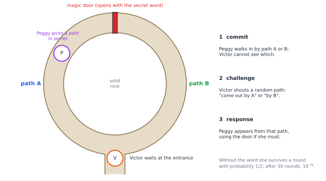
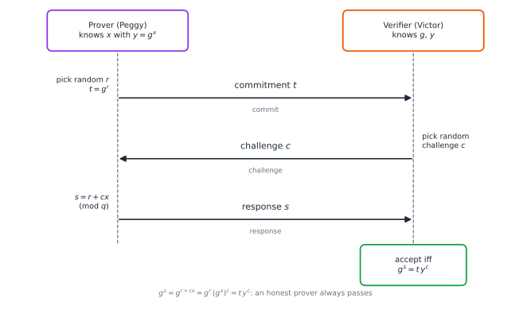

# Chapter 82 — Zero-Knowledge Proofs and the Mathematics of Trust

[← Previous](81-pseudorandomness.md) · [Track H](README.md) · [Table of Contents](../../00-front/table-of-contents.md) · [Next →](../i-dynamical-systems/README.md)

> **Level 2 · Track H — Cryptography, Coding, and Digital Security**
> **Builds on:** [Ch. 19](../../part-6-probability-statistics/19-probability.md), [Ch. 57](../e-abstract-math/57-number-theory.md), [Ch. 77](77-cryptography.md), [Ch. 78](78-elliptic-curves.md), [Ch. 81](81-pseudorandomness.md) · **Leads to:** [Ch. 67](../f-logic-foundations/67-formal-verification.md), [Ch. 94](../j-frontier/94-algebraic-geometry.md) · **Related:** [Ch. 30](../a-algorithms/30-limits-of-computation.md), [Ch. 46](../c-game-theory/46-adversarial-decision-making.md), [Ch. 63](../f-logic-foundations/63-think-like-a-mathematician.md)
> **Reading time:** ~30 min

## 82.1 The hook

Every time you log in to a website, you prove who you are by handing over your password. That is a strange way to prove you know a secret: you give it away. If the server is fake, or hacked, or simply logs too much, your secret now belongs to someone else. Could you instead convince the server that you know the password *without revealing anything about it*? Not a hint, not a hash it could attack offline, nothing except the single fact "this person knows it".

That sounds like a contradiction. A proof is supposed to *transfer* understanding. Read a proof that $\sqrt2$ is irrational and you can repeat it to someone else. How could a proof convince you and leave you with nothing you could pass on?

Here is a small version. Your friend is red–green colour-blind, and you hold two balls, one red and one green, identical in every other way. You want to convince him that they really are different colours, without telling him which is which. He takes the balls, hides them behind his back, and either swaps them or not, at random. Then he shows them to you and asks: "Did I swap?" You can always answer correctly, because you can see the colours. If the balls were really the same colour, you would be guessing, and you would be right only half the time. After 20 rounds without a mistake, the chance that you were lucky is below one in a million. He is convinced that the colours differ. Yet he has learned nothing about *which* ball is red: every answer you gave was one he already knew, since he did the swapping.

In 1985, Shafi Goldwasser, Silvio Micali and Charles Rackoff turned this idea into mathematics and called it **zero knowledge**. Their theory now protects blockchains worth billions and digital identity documents. This chapter asks the question in the title of their field: how can you prove a statement while revealing nothing beyond its truth? And what, precisely, does "revealing nothing" mean?

## 82.2 The big idea

**A proof can be a conversation.** A classical proof is a static text. An *interactive* proof is a dialogue between a **prover** (call her Peggy) and a **verifier** (Victor). Victor asks random questions; Peggy answers. A prover who knows the truth can always answer. A prover who is bluffing will, with high probability, be caught by some question she could not anticipate. Randomness is the verifier's weapon: Peggy cannot prepare for a question that has not been chosen yet.

**The cave.** A ring-shaped cave has one entrance and a magic door deep inside that blocks the ring (Figure 82.1). Peggy claims to know the word that opens the door. Victor waits outside while she walks in, by path A or path B, and he cannot see which. Then he steps in and shouts a random path: "come out by A!" If Peggy knows the word, she can always comply, passing through the door if necessary. If she does not, she can comply only when Victor happens to name the path she took: probability $\tfrac12$. Thirty rounds drive the bluffing probability to $2^{-30}\approx10^{-9}$.


*Figure 82.1 — The zero-knowledge cave of Quisquater and colleagues (1989). Commit, challenge, respond: Peggy picks a side in secret, Victor names a side at random, and Peggy must appear from it. Every protocol in this chapter has the same three moves.*

**Knowledge is what you could not have produced yourself.** Victor films the whole session and shows it to a friend. The friend is unimpressed: Peggy and Victor could have agreed in advance which paths would be called, or simply cut out the rounds she failed. A video of a *successful* session can be faked without knowing the word. That observation is the definition. Victor gained nothing from the interaction, because everything he saw, he could have **simulated** alone. What convinced *him* was not the content of the transcript but the fact that he chose the challenges himself, live, after Peggy had committed.

**The analogy.** A magician performs a card trick at your table. You are sure she has a real method, because you chose the card yourself. But a recording of the trick proves nothing to anyone else, and you leave no closer to knowing how it was done.

## 82.3 The mathematics

We work in a cyclic group of prime order $q$, generated by $g$: for concreteness, the order-$q$ subgroup of $\mathbb Z_p^*$ for a prime $p=2q+1$, or an elliptic-curve group ([Ch. 78](78-elliptic-curves.md)). The **discrete logarithm assumption** says that given $y=g^x$ for random $x$, no efficient algorithm finds $x$ with non-negligible probability ([Ch. 57](../e-abstract-math/57-number-theory.md), [Ch. 77](77-cryptography.md)). Exponents live in $\mathbb Z_q$, so they can be added, multiplied and divided modulo $q$.

### Interactive proofs and zero knowledge

> [!definition] Interactive proof
> An interactive proof for a claim is a protocol between a prover $P$ and an efficient, randomised verifier $V$ with two properties.
> - **Completeness:** if the claim is true and $P$ follows the protocol, $V$ accepts (with probability 1, or close to it).
> - **Soundness:** if the claim is false, then *whatever* any cheating prover $P^*$ does, $V$ accepts with probability at most $\sigma$, the **soundness error**.
>
> A **proof of knowledge** strengthens soundness: any prover who convinces $V$ with probability noticeably above $\sigma$ "knows" a witness, in the sense that an efficient **extractor** could compute it by interacting with her.

Repetition shrinks the error: $k$ independent rounds give $\sigma^k$.

> [!definition] Zero knowledge
> A protocol is **zero-knowledge** if for every efficient verifier $V^*$ there is an efficient **simulator** $S$ that, given only the claim (and no witness), outputs transcripts whose distribution is indistinguishable from that of real conversations between $P$ and $V^*$. It is *perfect*, *statistical* or *computational* zero-knowledge according to whether the two distributions are identical, statistically close or computationally indistinguishable in the sense of [Ch. 81](81-pseudorandomness.md). If this is required only for the honest $V$, the protocol is **honest-verifier zero-knowledge** (HVZK).

The logic is that of the video. Anything $V^*$ could compute from a real conversation, it could compute from a simulated one, and the simulator needs no secret. So the conversation gave $V^*$ no ability it did not already have.

### Commitments: sealed envelopes made of mathematics

Peggy's first move in the cave, entering a path Victor cannot see, is a **commitment**: she fixes a choice now and reveals it later. In digital protocols this is done with a commitment scheme, a mathematical sealed envelope.

> [!definition] Commitment scheme
> To commit to a value $m$, compute $\operatorname{Com}(m;r)$ with fresh randomness $r$ and publish it. To open, reveal $(m,r)$. The scheme is **hiding** if the commitment reveals nothing about $m$, and **binding** if no one can open it to two different values.

No scheme can be both *perfectly* hiding and *perfectly* binding. If every commitment is consistent with every message (perfect hiding), an unbounded cheater can always find a second opening. One of the two properties must rest on computational hardness.

> [!theorem] Pedersen commitment
> Let $h$ be a second generator whose discrete logarithm $\log_gh$ nobody knows. Commit to $m\in\mathbb Z_q$ as $C=g^mh^r$ with $r$ uniform in $\mathbb Z_q$. Then the scheme is perfectly hiding, and any algorithm that breaks binding computes $\log_gh$.

*Proof.* *Hiding.* For any fixed $m$, the map $r\mapsto g^mh^r$ is a bijection from $\mathbb Z_q$ onto the group, because $h$ has order $q$. So with $r$ uniform, $C$ is uniform on the group whatever $m$ is. Its distribution does not depend on $m$ at all.

*Binding.* Suppose someone produces two openings, $g^mh^r=g^{m'}h^{r'}$ with $m\ne m'$. Then $g^{m-m'}=h^{r'-r}$. Since $m\ne m'$ the left side is not $1$, so $r'\ne r$ and $r'-r$ is invertible modulo $q$. Raising both sides to the power $(r'-r)^{-1}$,

$$
h=g^{(m-m')(r'-r)^{-1}},\qquad\text{so}\qquad\log_gh=(m-m')(r'-r)^{-1}\bmod q .
$$

Breaking binding is therefore as hard as computing a discrete logarithm. $\square$

### The Schnorr protocol

Peggy's public key is $y=g^x$, and she wants to prove that she knows $x$. Claus Schnorr's protocol (1989) has the three moves of the cave (Figure 82.2).

1. **Commit.** Peggy picks a random $r\in\mathbb Z_q$ and sends $t=g^r$.
2. **Challenge.** Victor picks a random $c\in\{0,\dots,q-1\}$ and sends it.
3. **Respond.** Peggy sends $s=r+cx\bmod q$. Victor accepts if $g^s=t\,y^c$.

*Completeness* is one line: $g^s=g^{r+cx}=g^r(g^x)^c=t\,y^c$.


*Figure 82.2 — Schnorr's identification protocol. The random $r$ masks the secret $x$ inside $s$ the way a one-time pad masks a message. The challenge $c$ arrives only after $t$ has fixed $r$.*

> [!theorem] Special soundness
> From two accepting transcripts $(t,c,s)$ and $(t,c',s')$ with the same commitment and $c\ne c'$, the secret is
> $$
> x=(s-s')(c-c')^{-1}\bmod q .
> $$
> Consequently a prover who does not know $x$ can answer at most one challenge per commitment, and convinces Victor with probability at most $1/q$.

*Proof.* Both transcripts pass the check: $g^s=ty^c$ and $g^{s'}=ty^{c'}$. Dividing eliminates the unknown $t$: $g^{s-s'}=y^{c-c'}=g^{x(c-c')}$. Since $g$ has prime order $q$, exponents agree modulo $q$, so $s-s'\equiv x(c-c')$, and $c-c'$ is invertible. For the second claim, fix any strategy and any commitment $t$ that the strategy sends. If it could answer two different challenges for this $t$, the formula would produce $x$, contradicting the assumption that the prover cannot compute it. So for each $t$ at most one of the $q$ equally likely challenges is answerable. $\square$

The rigorous version of the second claim, for a prover who succeeds only sometimes, uses an extractor that **rewinds** her: run her to get $t$, send a challenge, then rewind to the moment after $t$ and send a different challenge. A forking argument shows that if she succeeds with probability noticeably above $1/q$, two accepting answers for the same $t$ turn up after a few tries. Rewinding is legitimate in a proof, because the extractor is a thought experiment that controls the prover as a program. In the real world nobody can rewind Peggy.

> [!theorem] Honest-verifier zero knowledge
> The following simulator, which never sees $x$, outputs transcripts with exactly the same distribution as honest conversations: pick $c$ and $s$ uniformly from $\mathbb Z_q$, and set $t=g^sy^{-c}$.

*Proof.* In a real conversation $r$ and $c$ are independent and uniform. Then $s=r+cx$ is uniform and independent of $c$, because for each fixed $c$ the map $r\mapsto r+cx$ is a bijection of $\mathbb Z_q$. So $(c,s)$ is a uniform pair, and $t$ is the unique value that makes the check pass, $t=g^sy^{-c}$. The simulator produces a uniform pair $(c,s)$ and the same function $t=g^sy^{-c}$ of it. The two distributions are identical. $\square$

The simulator does what Peggy in the cave cannot. It picks the challenge *first* and then builds a commitment to match, exactly like the staged video. Its transcripts are perfectly valid. They only lack the time order that made the real ones convincing.

What about a *dishonest* verifier, whose challenge depends on $t$? With challenges restricted to $\{0,1\}$ the simulator can guess $c$, build $t$ to match, and rewind whenever the verifier asks the other bit. That takes two tries on average, and the protocol is fully zero-knowledge with soundness error $\tfrac12$ per round. With challenges from all of $\mathbb Z_q$, the guess succeeds with probability only $1/q$, and no efficient simulator for Schnorr's protocol is known. Large challenges give soundness in one round; small challenges give zero knowledge for every verifier. Getting both at once needs an extra idea, such as having the verifier commit to his challenge in advance.

### From conversations to signatures: Fiat–Shamir

Interaction is inconvenient: Victor has to be online. Amos Fiat and Adi Shamir (1986) removed him by replacing his random challenge with a hash of everything said so far, $c=H(g,y,t,\text{message})$. Peggy can now produce $(t,s)$ alone, and anyone can check it. That pair is a **Schnorr signature** on the message. EdDSA (Ed25519, used in SSH and Signal) and Bitcoin's Taproot signatures are Schnorr signatures of this kind.

The security argument models $H$ as a *random oracle*, a truly random function that the prover cannot predict. Then a cheating signer faces the same unpredictable challenge as in the interactive protocol, and the special-soundness extractor works by "rewinding" the oracle.

> [!mystery] The leap of faith in Fiat–Shamir
> Real hash functions such as SHA-256 are fixed public programs, not random oracles. Goldwasser and Kalai (2003) built a protocol that is secure as an interactive proof but becomes *insecure* under Fiat–Shamir with **every** concrete hash function. So the transformation is not sound in general. For Schnorr signatures, decades of attacks have found nothing. Which protocols survive the transformation with which hash functions? Recent work using lattice assumptions has proved soundness for some protocols. The general question is an **open problem**.

### Zero knowledge for every NP statement

Discrete logarithms are one claim. Goldreich, Micali and Wigderson (1986) showed that *every* claim with a short, checkable certificate (every NP statement, [Ch. 30](../a-algorithms/30-limits-of-computation.md)) has a zero-knowledge proof. Since graph 3-colouring is NP-complete, a protocol for it is enough. Peggy knows a proper 3-colouring of a graph with $\lvert E\rvert$ edges.

1. She permutes the three colours at random and commits to the colour of every vertex.
2. Victor picks a random edge.
3. Peggy opens the two commitments at its endpoints. Victor checks that the two colours differ.

A cheater with no valid colouring has at least one bad edge, so she is caught with probability at least $1/\lvert E\rvert$ per round. Soundness error $(1-1/\lvert E\rvert)^k$ after $k$ rounds needs about $\lvert E\rvert\ln(1/\sigma)$ rounds: for 20 edges and $\sigma=10^{-9}$, about 400. Zero knowledge holds because each opening shows two *different random colours*, which the simulator can fake by guessing the edge in advance and rewinding. This is where [Ch. 81](81-pseudorandomness.md) enters: the commitments need only computational hiding, and Naor (1991) built them from any pseudorandom generator.

### Proof systems beyond NP

Interaction and randomness are astonishingly powerful. Shamir proved in 1990 that $\mathsf{IP}=\mathsf{PSPACE}$: interactive proofs can certify any claim checkable with polynomial *memory*, including "the first player has a winning strategy" in any game that lasts polynomially many moves, far beyond NP as far as anyone knows. The proof turns logic into polynomials over a finite field and checks them at random points. The **PCP theorem** (1992) says that any NP proof can be rewritten so that a verifier, reading only a *constant number* of randomly chosen bits, rejects any false claim with probability at least $\tfrac12$.

> [!mystery] A proof shorter than the computation
> Modern **SNARKs** (succinct non-interactive arguments of knowledge) prove that a computation of a billion steps was done correctly with a proof of a few hundred bytes, checked in milliseconds, and in zero knowledge. The best-known construction, Groth16, uses three elliptic-curve points. The recipe combines PCP-style polynomial checking with **pairings**, bilinear maps on elliptic curves that let a verifier test a polynomial identity "in the exponent" without seeing the polynomial. What is a pairing, and why do only special curves have efficient ones? See [Ch. 78](78-elliptic-curves.md).

> [!warning] Correct mathematics is not a secure implementation
> The special-soundness proof *is* an attack. If Peggy ever uses the same random $r$ twice, two signatures share one commitment, and anyone can compute $x=(s-s')(c-c')^{-1}$ by the formula above. In 2010, hackers recovered the master signing key of Sony's PlayStation 3 in exactly this way: its ECDSA signatures used a constant nonce. Even slightly *biased* nonces leak the key through lattice attacks. In 2022, several open-source zero-knowledge libraries were found to compute Fiat–Shamir challenges without hashing all the public inputs ("Frozen Heart"), which allowed forged proofs. A protocol proved secure on paper is secure only when its randomness is fresh, its hash covers everything, and its arithmetic does not leak through timing. The group in this chapter's code has order $1019$: a discrete logarithm in it takes microseconds. Real deployments use groups of order about $2^{256}$ and audited libraries.

## 82.4 The algorithm

The complete Schnorr protocol, the simulator and the extractor fit in a few lines, using toy parameters. With $p=2039=2\cdot1019+1$ and $g=4$, $g$ generates the subgroup of prime order $q=1019$.

```python
import secrets
p, q, g = 2039, 1019, 4          # TOY group, insecure: real q has ~256 bits

def keygen():
    x = secrets.randbelow(q - 1) + 1
    return x, pow(g, x, p)                           # secret x, public y = g^x

def prove_commit():
    r = secrets.randbelow(q)                         # FRESH randomness, every time
    return r, pow(g, r, p)

def prove_respond(x, r, c):
    return (r + c * x) % q

def verify(y, t, c, s):
    return pow(g, s, p) == t * pow(y, c, p) % p

def extract(c1, s1, c2, s2):                         # special soundness
    return (s1 - s2) * pow(c1 - c2, -1, q) % q

x, y = keygen()
r, t = prove_commit(); c = secrets.randbelow(q); s = prove_respond(x, r, c)
print(verify(y, t, c, s))                            # True
```

**Complexity.** The prover does one exponentiation, the verifier two, each $O(\log q)$ group multiplications. With $q\approx2^{256}$ that is a few hundred multiplications of 256-bit numbers, well under a millisecond. The graph-colouring protocol costs $O(\lvert V\rvert)$ commitments per round and $O(\lvert E\rvert)$ rounds, which is why general-purpose zero knowledge was a theoretical curiosity until SNARKs made proofs short.

**Failure cases.**

1. *Predictable or repeated $r$.* As above: the key falls out. The random module of Python, or any generator of [Ch. 81](81-pseudorandomness.md) that is not cryptographic, is enough to break it. Deterministic nonces, $r=H(x,\text{message})$, as in EdDSA, remove the dependence on a good runtime generator.
2. *Wrong group.* If $g$ does not have prime order, exponents are not a field, $c-c'$ may not be invertible, and small-subgroup attacks leak bits of $x$. Every received group element must be checked to lie in the right subgroup.
3. *Challenges not bound to context.* If the Fiat–Shamir hash omits the public key or the statement, a cheater can choose them *after* seeing the challenge. That is the Frozen Heart bug.

## 82.5 The experiment

How many rounds does trust cost? The curves show $\log_{10}$ of the soundness error after $x$ rounds.

```desmos-graph
left=0; right=60; bottom=-12; top=0
---
y=x\log_{10}(0.5)|blue
y=x\log_{10}(1-\frac{1}{20})|red
y=-9|black|dashed
```

*Blue: the cave, or Schnorr with one-bit challenges: error $2^{-x}$, below $10^{-9}$ (the dashed line) after 30 rounds. Red: graph 3-colouring with 20 edges: error $(1-\frac1{20})^x$. Change $20$ to $200$ and set `right=4000` to see how large graphs blow up the round count.*

Now run the protocol, the simulator, a cheater, and the nonce-reuse attack.

```python
import random
p, q, g = 2039, 1019, 4          # TOY group: g has prime order q mod p. Real systems use ~256-bit q.
x = random.randrange(1, q)       # Peggy's secret
y = pow(g, x, p)                 # her public key
C = 1019                         # size of the challenge space: try 2

def accept(t, c, s):             # Victor's check: g^s == t * y^c
    return pow(g, s, p) == t * pow(y, c, p) % p

def honest():                    # a real run of the protocol (uses x)
    r = random.randrange(q); t = pow(g, r, p)
    c = random.randrange(C)
    return t, c, (r + c * x) % q

def simulate():                  # a fake transcript made WITHOUT x
    c, s = random.randrange(C), random.randrange(q)
    return pow(g, s, p) * pow(y, -c, p) % p, c, s

def cheat():                     # a prover without x: bet on the challenge in advance
    t, c_bet, s = simulate()
    c = random.randrange(C)      # Victor's real challenge
    return accept(t, c, s) if c == c_bet else accept(t, c, random.randrange(q))

N = 20000
print("honest accepted   ", sum(accept(*honest()) for _ in range(N)) / N)
print("simulated accepted", sum(accept(*simulate()) for _ in range(N)) / N)
print("cheater accepted  ", sum(cheat() for _ in range(N)) / N, " vs 1/C =", 1 / C)
print("three honest:", [honest() for _ in range(3)])
print("three fake:  ", [simulate() for _ in range(3)])

r = random.randrange(q); t = pow(g, r, p)          # the fatal mistake: reuse r
s1, s2 = (r + 5 * x) % q, (r + 9 * x) % q          # two challenges, same commitment
print("secret x =", x, " extracted =", (s1 - s2) * pow(5 - 9, -1, q) % q)
```

Honest and simulated transcripts are both accepted every time. Look at the three of each and try to tell them apart: you cannot, because they have the same distribution. The cheater, who has to bet on the challenge before committing, succeeds about $0.2\%$ of the time: $1/C$, plus a $1/q$ chance that a random guess at $s$ happens to pass. Set `C = 2` and the cheater wins half the time. The last line recovers the secret from two answers to one commitment. (This script uses Python's `random` module only because it is a toy. Real code would use `secrets`.)

## 82.6 The challenge

1. **Intuition.** In the cave, suppose Victor, instead of choosing at random, always shouts "A". Explain why a Peggy who does not know the word can now fool him every time, and why Victor's recording of a session in which he chose at random is still not evidence for a third party. What exactly is the difference between what convinced Victor and what the recording contains?
2. **Derivation.** Prove that the Pedersen commitment is *additively homomorphic*: $\operatorname{Com}(m_1;r_1)\cdot\operatorname{Com}(m_2;r_2)=\operatorname{Com}(m_1+m_2;r_1+r_2)$. Then design a three-move protocol, in the style of Schnorr's, by which Peggy proves she knows an opening $(m,r)$ of a commitment $C=g^mh^r$, and prove that it has special soundness and is honest-verifier zero-knowledge.
3. **Implementation.** Turn the toy Schnorr protocol into a Fiat–Shamir signature: $c=H(y\,\Vert\,t\,\Vert\,\text{message})\bmod q$ with SHA-256, and write `sign` and `verify`. Then deliberately introduce the Frozen Heart bug by leaving $y$ out of the hash, and write a forger that produces a valid-looking signature for a public key of its own choosing without knowing any secret.
4. **Open investigation.** Implement the graph 3-colouring protocol with hash-based commitments, $\operatorname{Com}(m;r)=\text{SHA-256}(r\,\Vert\,m)$, on random graphs. Measure the total proof size needed for soundness error $2^{-40}$ as the number of edges grows. How do real systems avoid this cost? Investigate the trade-offs between proof size, prover time and trust assumptions among SNARKs and STARKs. Which assumptions are actually needed for short zero-knowledge proofs is a question still under active research.

## 82.7 Loose threads

The hook asked how a proof can convince and reveal nothing. The answer has three parts. Randomness in the verifier's challenges makes bluffing detectable. A commitment fixes the prover's choices before she sees those challenges. And "reveals nothing" means "could be simulated": everything the verifier sees, he could have produced alone, so it can carry no knowledge that he lacked. Schnorr's protocol shows all three in four lines of algebra, and the GMW theorem extends them to every statement in NP.

What we did not tell you:

- **Proofs about secrets you share.** Zero knowledge is one tool of *secure multiparty computation*, in which several parties compute a function of their private inputs (an auction, an average salary, a vote count) while learning nothing but the output. The theory again rests on simulators and commitments.
- **Witness indistinguishability.** A weaker property than zero knowledge, but one that survives running many sessions in parallel, which zero knowledge in general does not.
- **Who checks the checker?** A SNARK verifier is a program, and bugs in it have caused real losses. Formally verifying such code, proving the program correct with a proof assistant, is the subject of [Ch. 67](../f-logic-foundations/67-formal-verification.md).
- **Polynomials everywhere.** Modern proof systems reduce every statement to identities between polynomials, which are tested at random points (the Schwartz–Zippel lemma: two different polynomials of degree $d$ agree on at most a fraction $d/q$ of a field of size $q$). The geometry of polynomial equations is the subject of [Ch. 94](../j-frontier/94-algebraic-geometry.md).

> [!mystery] When the verifier is quantum
> Shor's algorithm would compute discrete logarithms on a large quantum computer, breaking Schnorr's assumption outright. There is a subtler problem too. Every zero-knowledge and soundness proof in this chapter **rewinds** a party and runs it twice. A quantum verifier cannot be copied (the no-cloning theorem), and measuring its answer can disturb its state, so rewinding is no longer free. Which zero-knowledge proofs survive against quantum adversaries, and what replaces discrete logarithms? Watrous found the first quantum rewinding technique in 2006, and lattice-based and hash-based proofs are the leading candidates. Post-quantum cryptography is taken up in [Ch. 77](77-cryptography.md), and the quantum mechanics behind no-cloning in [Ch. 92](../j-frontier/92-mathematical-physics.md).

This is the end of Track H. Its six chapters started from codes that defeat noise and ended with proofs that defeat suspicion, and the same tools ran through all of them: probability, finite fields, and the gap between what is true and what can be efficiently checked.

## Further reading

- O. Goldreich, *Foundations of Cryptography, Volume 1: Basic Tools*, Cambridge University Press, 2001. Chapter 4 is the definitive treatment of zero-knowledge proofs.
- J. Katz and Y. Lindell, *Introduction to Modern Cryptography*, 3rd ed., CRC Press, 2020. Identification schemes, Schnorr signatures and the Fiat–Shamir transform.
- J.-J. Quisquater et al., "How to Explain Zero-Knowledge Protocols to Your Children," *CRYPTO '89*, Springer, 1990. The cave, in four pages.
- J. Thaler, *Proofs, Arguments, and Zero-Knowledge*, Foundations and Trends in Privacy and Security, 2022. Free online; from interactive proofs to modern SNARKs.
