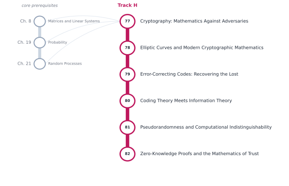

# Track H — Cryptography, Coding, and Digital Security

[← Table of Contents](../../00-front/table-of-contents.md) · [Start: Ch. 77 →](77-cryptography.md)

> **Level 2 — Specializations.** Mathematics against adversaries and noise. Correct mathematics alone does not guarantee a secure implementation.

*Suggested reading order for Track H. The grey stations on the left are the core chapters it leans on.*

## Before you start

This track assumes you are comfortable with these core chapters:

- Ch. 8 — [Matrices and Linear Systems](../../part-3-linear-algebra/08-matrices-and-linear-systems.md)
- Ch. 19 — [Probability](../../part-6-probability-statistics/19-probability.md)
- Ch. 21 — [Random Processes](../../part-6-probability-statistics/21-random-processes.md)

## Chapters

| Ch. | Chapter | What it explores |
|---|---|---|
| 77 | [Cryptography: Mathematics Against Adversaries](77-cryptography.md) | Security definitions, symmetric encryption, public-key cryptography. |
| 78 | [Elliptic Curves and Modern Cryptographic Mathematics](78-elliptic-curves.md) | Finite fields, elliptic-curve groups, discrete logarithms. |
| 79 | [Error-Correcting Codes: Recovering the Lost](79-error-correcting-codes.md) | Hamming distance, linear codes, cyclic codes, Reed–Solomon codes. |
| 80 | [Coding Theory Meets Information Theory](80-coding-meets-information-theory.md) | Channel capacity, entropy, coding bounds, compression. |
| 81 | [Pseudorandomness and Computational Indistinguishability](81-pseudorandomness.md) | Randomness tests, pseudorandom generators, computational security. |
| 82 | [Zero-Knowledge Proofs and the Mathematics of Trust](82-zero-knowledge-proofs.md) | Interactive proofs, commitment schemes, proof systems. |

Every chapter follows the same arc: **the hook** (a puzzle or a failure), **the big idea**, **the mathematics**, **the algorithm**, **the experiment** you can run, **the challenge**, and **loose threads**: the questions the chapter deliberately leaves open.
