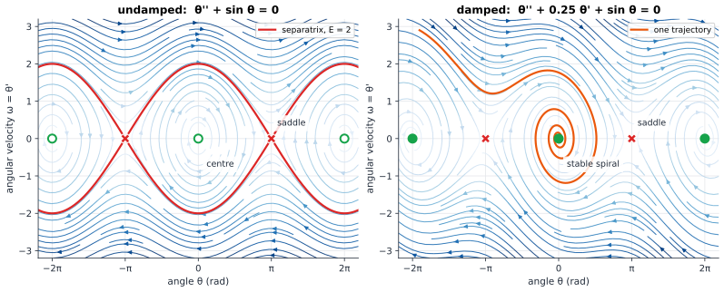
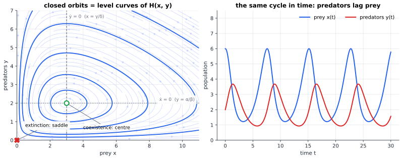
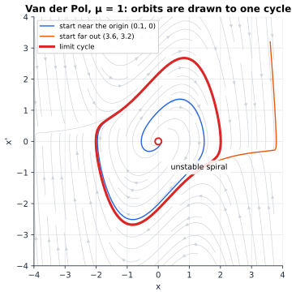

# Chapter 83 — Dynamical Systems: Rules That Create Motion

[← Previous](README.md) · [Track I](README.md) · [Table of Contents](../../00-front/table-of-contents.md) · [Next →](84-chaos-theory.md)

> **Level 2 · Track I — Dynamical Systems, Chaos, and Complexity**
> **Builds on:** [Ch. 11](../../part-4-differential-equations/11-ordinary-differential-equations.md) (§11.7 existence and uniqueness, §11.9 phase plane and linearisation), [Ch. 10](../../part-3-linear-algebra/10-eigenvalues-and-eigenvectors.md) (eigenvalues), [Ch. 22](../../part-7-numerical-computational/22-numerical-methods.md) (§22.3 fixed-point iteration, §22.9 Runge–Kutta) · **Leads to:** [Ch. 84](84-chaos-theory.md), [Ch. 85](85-bifurcations.md), [Ch. 87](87-network-science.md) · **Related:** [Ch. 45](../c-game-theory/45-evolutionary-games.md), [Ch. 51](../d-optimization/51-optimal-control.md), [Ch. 72](../g-graphics-simulation/72-physics-engines.md), [Ch. 25](../../part-7-numerical-computational/25-mathematical-modeling.md)
> **Reading time:** ~30 min

## 83.1 The hook

For almost a century the Hudson's Bay Company kept careful books on the furs its trappers brought in from the Canadian north. When the ecologist Charles Elton went through the ledgers in the 1920s and 1930s he found something nobody had designed and nobody could explain. The number of snowshoe hare pelts rose and fell with a period of roughly ten years. The number of lynx pelts did the same, with the same period, peaking a year or two after the hares.

No calendar sets that ten-year beat. The cycle is made *inside* the system, by two facts: lynx eat hares, and lynx starve without them. Plentiful hares feed more lynx; the lynx eat the hares down, then starve; the hares, relieved, recover. Round and round.

The first serious model of this, written in the 1920s by Alfred Lotka and Vito Volterra independently, is two lines:

$$
\dot x = \alpha x - \beta x y,\qquad \dot y = \delta x y - \gamma y,
$$

where $x$ is prey, $y$ is predators, and $\alpha, \beta, \gamma, \delta > 0$. It has an equilibrium where both species coexist, and if you do what [Ch. 11, §11.9](../../part-4-differential-equations/11-ordinary-differential-equations.md) taught you, linearise there and compute eigenvalues, you get a pure imaginary pair, $\pm j\sqrt{\alpha\gamma}$. A centre. Oscillation forever, neither growing nor shrinking.

And then §11.9 hands you a warning: a linear centre is exactly the case where linearisation tells you *nothing*. Hartman–Grobman needs every eigenvalue off the imaginary axis. The nonlinear terms you threw away get the deciding vote. They could make the oscillation spiral slowly inward to a quiet balance, or outward until one day the hares crash so low that the lynx die out. A small push either way, accumulated over centuries, decides between eternal cycles, calm and extinction.

So here is the question this chapter will answer: **does the Lotka–Volterra model really cycle forever, and how would you know without solving it?** It has no closed-form solution in elementary functions. You will answer it anyway, in about six lines, by asking not "what is $x(t)$?" but "what *shape* do the solutions have?". That change of question is the founding move of dynamical systems.

## 83.2 The big idea

### A rule, and the motion it creates

A **dynamical system** is a state and a rule. The state is everything you need to know right now to determine the future: for a pendulum, angle and angular velocity; for the forest, the two populations; for a circuit, capacitor voltages and inductor currents ([Ch. 25, §25.2](../../part-7-numerical-computational/25-mathematical-modeling.md)). The rule says how the state changes, either continuously ($\dot{\mathbf{x}} = \mathbf{F}(\mathbf{x})$, a **flow**) or in jumps ($\mathbf{x}_{n+1} = \mathbf{f}(\mathbf{x}_n)$, a **map**).

The rule is local and dumb: at each point it only says "from here, move that way, this fast". Yet the motion it creates can cycle, settle, switch, and in the next chapter, turn chaotic.

### Think in pictures: a river of arrows

Draw the state space as a sheet of paper and, at every point, the arrow $\mathbf{F}(\mathbf{x})$: a picture of a river's surface. A leaf dropped anywhere drifts along a curve tangent to the arrows, a **trajectory** (or **orbit**). Currents plus representative trajectories make the **phase portrait**. Three features matter most: **still water**, points where $\mathbf{F}(\mathbf{x}) = \mathbf{0}$ (**fixed points**); whether nearby leaves drift into still water (**stable**), away from it (**unstable**) or circle it; and **closed loops** of current that attract nearby leaves (**limit cycles**), self-sustained oscillations of a definite size.



*Left: the frictionless pendulum. Hanging-down states (green circles) are centres surrounded by closed orbits; the inverted states (red crosses) are saddles. The red separatrix, at energy $E = 2$, divides swinging back and forth from whirling over the top. Right: add friction and the centres become stable spirals; the orange trajectory whirls over the top once, loses energy, and is captured.*

In one glance you see every possible motion of the pendulum from every starting state. Henri Poincaré, who invented this way of thinking in the 1880s for planetary orbits, called it the **qualitative theory**: you give up exact numbers and get the shape of all futures.

### Why the nonlinear part is the interesting part

[Ch. 10](../../part-3-linear-algebra/10-eigenvalues-and-eigenvectors.md) and [Ch. 12](../../part-4-differential-equations/12-linear-differential-equations.md) solved linear systems completely: every solution is a combination of modes $e^{\lambda t}\mathbf{v}$. A linear system has at most one isolated fixed point, and its oscillations have amplitudes set purely by the initial condition. It cannot choose an amplitude of its own, have two resting states, or switch between them. A flip-flop, an oscillator that grows from noise to one definite amplitude, a pendulum that can hang or whirl: all of these are nonlinear, and the phase portrait is the tool built to see them.

## 83.3 The mathematics

### Flows and the no-crossing rule

> [!definition] Autonomous system, flow, orbit
> An **autonomous system** is $\dot{\mathbf{x}} = \mathbf{F}(\mathbf{x})$ with $\mathbf{x} \in \mathbb{R}^n$ (the **state space**) and $\mathbf{F}$ continuously differentiable. Its **flow** $\varphi_t(\mathbf{x}_0)$ is the state at time $t$ of the solution that starts at $\mathbf{x}_0$. The **orbit** of $\mathbf{x}_0$ is the set of all states $\varphi_t(\mathbf{x}_0)$ it passes through.

"Autonomous" means $\mathbf{F}$ does not depend on $t$: the river's currents do not change with time. A forced system $\dot{\mathbf{x}} = \mathbf{F}(\mathbf{x}, t)$ can always be made autonomous by adding time as an extra state, $\dot\tau = 1$, at the cost of one dimension.

> [!theorem] The flow property
> For all $s, t$ (for which the solutions exist), $\varphi_{t+s} = \varphi_t \circ \varphi_s$. Consequently two distinct orbits never cross, and an orbit that returns to a state it has visited before is periodic.

*Proof.* Fix $s$ and $\mathbf{x}_0$, and compare two functions of $t$: $\mathbf{u}(t) = \varphi_{t+s}(\mathbf{x}_0)$ and $\mathbf{w}(t) = \varphi_t(\varphi_s(\mathbf{x}_0))$. Both satisfy $\dot{\mathbf{u}} = \mathbf{F}(\mathbf{u})$: the first because shifting time does not change an autonomous equation, the second by definition of the flow. Both equal $\varphi_s(\mathbf{x}_0)$ at $t = 0$. Because $\mathbf{F}$ is $C^1$, it is locally Lipschitz, and the uniqueness theorem of [Ch. 11, §11.7](../../part-4-differential-equations/11-ordinary-differential-equations.md) says the two must coincide. If two orbits shared a point $\mathbf{p}$, both would be "the solution through $\mathbf{p}$", so by uniqueness they would be the same orbit. Finally, if $\varphi_T(\mathbf{x}_0) = \mathbf{x}_0$ for some $T > 0$, then $\varphi_{t+T}(\mathbf{x}_0) = \varphi_t(\varphi_T(\mathbf{x}_0)) = \varphi_t(\mathbf{x}_0)$ for every $t$. $\blacksquare$

In the plane the no-crossing rule is enormously restrictive, and it is the reason two-dimensional flows are tame.

### Fixed points of maps

For a map $x_{n+1} = f(x_n)$, a fixed point is $x^*$ with $f(x^*) = x^*$. You have met the numerical side of this in [Ch. 22, §22.3](../../part-7-numerical-computational/22-numerical-methods.md), where fixed-point iteration converges when $\lvert g'\rvert < 1$. Read as dynamics, the same statement is a stability theorem:

> [!theorem] Stability of a fixed point of a map
> Let $f$ be $C^1$ with $f(x^*) = x^*$. If $\lvert f'(x^*)\rvert < 1$, nearby orbits converge to $x^*$ geometrically. If $\lvert f'(x^*)\rvert > 1$, nearby orbits are pushed away.

*Proof.* Take $\lvert f'(x^*)\rvert < k < 1$. By continuity, $\lvert f'\rvert \le k$ on some interval $I = [x^* - r, x^* + r]$. For $x_n \in I$ the mean value theorem gives $x_{n+1} - x^* = f(x_n) - f(x^*) = f'(\xi)(x_n - x^*)$ with $\xi$ between them, so $\lvert x_{n+1} - x^*\rvert \le k\lvert x_n - x^*\rvert$. Hence $x_{n+1} \in I$ too, and by induction $\lvert x_n - x^*\rvert \le k^n \lvert x_0 - x^*\rvert \to 0$. The unstable case is the same argument with the inequality reversed. $\blacksquare$

The sign of $f'(x^*)$ matters too: positive means orbits approach from one side, negative means they hop from side to side. That alternation is the seed of the period-doubling cascade of [Ch. 85](85-bifurcations.md).

### What "stable" means

> [!definition] Stability of an equilibrium
> An equilibrium $\mathbf{x}^*$ of $\dot{\mathbf{x}} = \mathbf{F}(\mathbf{x})$ is **(Lyapunov) stable** if for every $\varepsilon > 0$ there is a $\delta > 0$ such that $\lVert\mathbf{x}(0) - \mathbf{x}^*\rVert < \delta$ implies $\lVert\mathbf{x}(t) - \mathbf{x}^*\rVert < \varepsilon$ for all $t \ge 0$. It is **asymptotically stable** if, in addition, $\mathbf{x}(t) \to \mathbf{x}^*$ for all starts close enough.

A centre is stable but not asymptotically stable; a pendulum with friction is both. For a hyperbolic equilibrium the Jacobian decides everything (§11.9). This chapter is about the cases where it does not, and the tool that works anyway.

### Lyapunov's direct method: stability without solving

In 1892 Aleksandr Lyapunov proposed generalising the most physical idea in mechanics: if energy never increases, a system at the bottom of a bowl cannot climb out.

> [!theorem] Lyapunov's stability theorem
> Let $\mathbf{x}^* = \mathbf{0}$ be an equilibrium of $\dot{\mathbf{x}} = \mathbf{F}(\mathbf{x})$, and let $V$ be a $C^1$ function on a neighbourhood $U$ of $\mathbf{0}$ with $V(\mathbf{0}) = 0$ and $V(\mathbf{x}) > 0$ for $\mathbf{x} \neq \mathbf{0}$. Its derivative along trajectories is
> $$
> \dot V(\mathbf{x}) = \nabla V(\mathbf{x}) \cdot \mathbf{F}(\mathbf{x}).
> $$
> If $\dot V \le 0$ on $U$, the equilibrium is stable. If $\dot V < 0$ on $U \setminus \{\mathbf{0}\}$, it is asymptotically stable.

*Proof (stability).* Given $\varepsilon > 0$ (small enough that the closed ball $\bar B_\varepsilon \subset U$), let $m$ be the minimum of $V$ on the sphere $\lVert\mathbf{x}\rVert = \varepsilon$; it is positive because $V > 0$ away from the origin and the sphere is compact. By continuity of $V$ and $V(\mathbf{0}) = 0$, choose $\delta < \varepsilon$ with $V < m$ on $B_\delta$. Start at $\mathbf{x}(0) \in B_\delta$. Along the trajectory $\frac{d}{dt}V(\mathbf{x}(t)) = \dot V \le 0$, so $V(\mathbf{x}(t)) \le V(\mathbf{x}(0)) < m$ for all $t \ge 0$. To leave $B_\varepsilon$ the trajectory would have to cross the sphere, where $V \ge m$. It cannot, so $\lVert\mathbf{x}(t)\rVert < \varepsilon$ forever.

*(Asymptotic stability.)* $V(\mathbf{x}(t))$ is decreasing and bounded below by 0, so it tends to a limit $c \ge 0$. If $c > 0$, the trajectory stays in the compact shell $\{\mathbf{x} \in \bar B_\varepsilon : V(\mathbf{x}) \ge c\}$, which excludes a neighbourhood of the origin. On that shell $\dot V$ is continuous and negative, so $\dot V \le -a$ for some $a > 0$, and $V(\mathbf{x}(t)) \le V(\mathbf{x}(0)) - at$, which becomes negative: a contradiction. So $c = 0$, and since $V$ is positive away from $\mathbf{0}$, $\mathbf{x}(t) \to \mathbf{0}$. $\blacksquare$

The theorem needs no solution and no eigenvalues. It works at a centre, where the Jacobian is silent, and it can certify whole regions, not just infinitesimal neighbourhoods.

> [!example] The damped pendulum, by energy
> Take $\dot\theta = \omega$, $\dot\omega = -\sin\theta - b\omega$ with $b \ge 0$ (time scaled so that $g/L = 1$). Try the mechanical energy $V = \tfrac12\omega^2 + (1 - \cos\theta)$, which is zero at $(0, 0)$ and positive nearby. Then
> $$
> \dot V = \omega\dot\omega + \sin\theta\,\dot\theta = \omega(-\sin\theta - b\omega) + \omega\sin\theta = -b\,\omega^2 \le 0.
> $$
> So the hanging pendulum is stable. But $\dot V = 0$ on the whole line $\omega = 0$, so the theorem does not give asymptotic stability, though every simulation shows the damped pendulum coming to rest. The fix, **LaSalle's invariance principle**, notes that a trajectory cannot *stay* on $\omega = 0$ unless $\sin\theta = 0$, so the only motion compatible with $\dot V = 0$ forever is the equilibrium itself.

With $b = 0$, energy is **conserved** and the left panel of the pendulum figure is just a contour map of $E = \tfrac12\omega^2 + 1 - \cos\theta$; the separatrix is the level $E = 2$ of the inverted pendulum. Its period betrays the nonlinearity: relative to the small-swing period $2\pi$, the swing is $1.066$ times longer at amplitude $1$ rad, $1.329$ times at $2$ rad, $2.571$ times at $3$ rad, and infinitely long as the amplitude approaches $\pi$, where the orbit creeps past a saddle.

### The answer to the hook: a hidden conserved quantity

Back to the forest. The trick is to look not at $x(t)$ and $y(t)$ but at the orbit, the curve $y$ versus $x$. Divide the two equations:

$$
\frac{dy}{dx} = \frac{y(\delta x - \gamma)}{x(\alpha - \beta y)}.
$$

This is separable ([Ch. 11, §11.2](../../part-4-differential-equations/11-ordinary-differential-equations.md)). Collect the $y$'s on the left and the $x$'s on the right:

$$
\frac{\alpha - \beta y}{y}\,dy = \frac{\delta x - \gamma}{x}\,dx
\quad\Longrightarrow\quad
\alpha\ln y - \beta y = \delta x - \gamma\ln x - C .
$$

> [!theorem] The Lotka–Volterra invariant
> For $x, y > 0$ the function
> $$
> H(x, y) = \delta x - \gamma\ln x + \beta y - \alpha\ln y
> $$
> is constant along every solution. Every orbit in the open quadrant other than the equilibrium $(\gamma/\delta,\ \alpha/\beta)$ is a closed curve, so every solution is periodic.

*Proof.* Constancy is a direct check:

$$
\begin{aligned}
\dot H &= \Big(\delta - \frac{\gamma}{x}\Big)\dot x + \Big(\beta - \frac{\alpha}{y}\Big)\dot y \\
&= \Big(\delta - \frac{\gamma}{x}\Big)x(\alpha - \beta y) + \Big(\beta - \frac{\alpha}{y}\Big)y(\delta x - \gamma) \\
&= (\delta x - \gamma)(\alpha - \beta y) + (\beta y - \alpha)(\delta x - \gamma) = 0 .
\end{aligned}
$$

Now the shape. The $x$-part of $H$, $\delta x - \gamma\ln x$, has second derivative $\gamma/x^2 > 0$: it is strictly convex with a unique minimum at $x = \gamma/\delta$, and tends to $+\infty$ as $x \to 0^+$ and as $x \to \infty$. The $y$-part is the same with minimum at $y = \alpha/\beta$. So $H$ is a bowl with its lowest point at the coexistence equilibrium and walls rising to infinity at the edges of the quadrant, and every level set $\{H = c\}$ above the minimum is a single closed curve around the equilibrium.

A solution starting on such a curve stays on it, and moves along it with speed $\lVert\mathbf{F}\rVert$ bounded below by a positive constant (the curve is compact and contains no zero of $\mathbf{F}$). So it goes all the way round in finite time and returns to its start; by the flow property, it is periodic. $\blacksquare$

The populations cycle forever, and the size of the cycle is fixed for all time by the initial value of $H$. You have the complete phase portrait without solving anything.



*Left: orbits of the Lotka–Volterra model with $\alpha = 1$, $\beta = 0.5$, $\gamma = 0.75$, $\delta = 0.25$ are the level curves of $H$, nested around the coexistence centre at $(3, 2)$. The nullclines (dashed and dotted) cross there. Right: the orbit starting at $(6, 2)$ in time. Prey swing between 1.22 and 6, predators between 0.93 and 3.68, with period 7.58, longer than the small-oscillation period $2\pi/\sqrt{\alpha\gamma} = 7.26$. The predator peak lags the prey peak.*

The predators' lag, visible in the fur ledgers too, is in the phase plane simply the fact that orbits go round anticlockwise.

> [!warning] A centre is a knife edge
> The eternal cycles depend on $H$ being exactly conserved. Give the prey a carrying capacity, $\dot x = x(\alpha - \beta y - \varepsilon x)$ with small $\varepsilon > 0$, and the trace of the Jacobian at coexistence becomes $-\varepsilon x^* < 0$: the centre turns into a stable spiral and the cycles die out. A model whose qualitative behaviour changes under arbitrarily small perturbations is **structurally unstable**, and good modellers distrust it. Real lynx–hare cycles persist for reasons the two-line model does not capture.

The invariant reaches beyond ecology. Josef Hofbauer showed in 1981 that the replicator equation of [Ch. 45](../c-game-theory/45-evolutionary-games.md) with $n + 1$ strategies becomes, under the change of variables $y_i = x_i/x_{n+1}$ and a rescaling of time, a Lotka–Volterra system with $n$ species, so the theory of the forest transfers to populations of strategies.

### Limit cycles: oscillation with a size of its own

The predator–prey cycles have no preferred amplitude. A clock, a heartbeat or an oscillator circuit should instead settle to *one* amplitude however it was started. That is a limit cycle, and no linear system can have one.

Balthasar van der Pol found the classic example in 1920 while studying triode oscillators:

$$
\ddot x - \mu(1 - x^2)\dot x + x = 0 ,\qquad \mu > 0 .
$$

The middle term is a nonlinear damping. For small $\lvert x\rvert$ it is *negative* damping, pumping energy in; for $\lvert x\rvert > 1$ it is positive damping, draining energy out. Small oscillations grow, large ones shrink, and in between there is one closed orbit where the energy pumped in over a cycle exactly balances the energy drained.



*The Van der Pol oscillator with $\mu = 1$. A trajectory starting near the unstable spiral at the origin (blue) grows outward; one starting far out (orange) falls inward; both are captured by the same limit cycle (red), with amplitude about 2.01 and period 6.66.*

The fact that this picture is typical, not special, is a theorem about the plane:

> [!theorem] Poincaré–Bendixson (stated)
> Let $\dot{\mathbf{x}} = \mathbf{F}(\mathbf{x})$ be a $C^1$ system in the **plane**. If a trajectory stays in a closed bounded region that contains no fixed point, it approaches a periodic orbit.

The proof leans on the no-crossing rule and the Jordan curve theorem. For Van der Pol you can build an annulus around the origin whose boundary currents all point inward; it contains no fixed point, so a periodic orbit lives inside. The consequence is strong: in the plane a bounded trajectory approaches a fixed point, a cycle, or a chain of fixed points joined by orbits. There is no fourth option, no wandering forever without repeating.

> [!mystery] Where do limit cycles come from?
> Turn the Van der Pol knob $\mu$ down through zero and the limit cycle vanishes: for $\mu < 0$ the origin is a stable spiral and every oscillation dies. So at $\mu = 0$ a cycle is *born*. Is it born small, or at full size? Can you predict its amplitude, and does every oscillator start up the same way? That is the Hopf bifurcation of [Ch. 85](85-bifurcations.md). How many limit cycles a polynomial system in the plane can have is the second half of Hilbert's 16th problem, posed in 1900 and still open even for quadratics.

## 83.4 The algorithm

A reasonable pipeline for drawing the phase portrait of a planar system $\dot{\mathbf{x}} = \mathbf{F}(\mathbf{x})$:

1. **Find the fixed points.** Run Newton's method for $\mathbf{F}(\mathbf{x}) = \mathbf{0}$ ([Ch. 22, §22.4](../../part-7-numerical-computational/22-numerical-methods.md)) from a grid of seeds; keep the distinct limits.
2. **Classify each one.** Estimate the Jacobian by central differences, compute its eigenvalues, and read off the type with the §11.9 table. Flag any eigenvalue with real part near zero as *undecided*: that is a case for a Lyapunov function, not for the computer.
3. **Integrate representative trajectories** with RK4 ([Ch. 22, §22.9](../../part-7-numerical-computational/22-numerical-methods.md)), forward from seeds near unstable points and *backward* in time (integrate $-\mathbf{F}$) to trace stable manifolds of saddles, which are the separatrices that divide basins.
4. **Draw the background current** with a streamline plot.

```python
import numpy as np

def F(u):                                    # damped pendulum
    th, w = u
    return np.array([w, -np.sin(th) - 0.25 * w])

def jacobian(F, u, h=1e-6):
    n = len(u); J = np.zeros((n, n))
    for k in range(n):
        e = np.zeros(n); e[k] = h
        J[:, k] = (F(u + e) - F(u - e)) / (2 * h)
    return J

def newton(F, u, iters=50):
    for _ in range(iters):
        u = u - np.linalg.solve(jacobian(F, u), F(u))
    return u

def classify(J, tol=1e-8):
    lam = np.linalg.eigvals(J)
    if np.any(np.abs(lam.real) < tol):  return "non-hyperbolic: undecided", lam
    if lam.real.min() < 0 < lam.real.max(): return "saddle", lam
    kind = "spiral" if np.any(np.abs(lam.imag) > tol) else "node"
    return ("stable " if lam.real.max() < 0 else "unstable ") + kind, lam

seeds = [np.array([a, b]) for a in np.linspace(-4, 4, 9) for b in (-1.0, 0.0, 1.0)]
found = {tuple(np.round(newton(F, s), 6)) for s in seeds}
for p in sorted(found):
    print(p, *classify(jacobian(F, np.array(p))))
```

It reports a stable spiral at $(0, 0)$ with eigenvalues $-0.125 \pm 0.992j$ and saddles at $(\pm\pi, 0)$ with eigenvalues $0.883$ and $-1.133$. (Widen the seed grid and it also finds the copies at $\pm 2\pi$, $\pm 3\pi$, and so on.)

**Cost and failure modes.** Fixed-point finding is cheap; integrating trajectories costs $O(N)$ steps each. The dangerous failures are qualitative:

- **Newton from a grid can miss fixed points** with small Newton basins. There is no general guarantee of finding them all; for polynomial $\mathbf{F}$, algebraic methods do better ([Ch. 94](../j-frontier/94-algebraic-geometry.md)).
- **The integrator can change the phase portrait.** Forward Euler turns a centre into an outward spiral: for $\dot x = y,\ \dot y = -x$ each step multiplies the squared amplitude by exactly $1 + h^2$, so with $h = 0.1$ the amplitude has grown 145-fold by $t = 100$. RK4 is far better but not exact; methods that preserve the conserved quantity by construction (symplectic integrators, [Ch. 72](../g-graphics-simulation/72-physics-engines.md)) are the principled fix.
- **Non-hyperbolic points** are where step 2 cannot decide, and also where systems change character as parameters move. Treat an "undecided" flag as a signpost to [Ch. 85](85-bifurcations.md).

## 83.5 The experiment

First, the forest without solving anything. The curves below are level sets of $H(x, y) = 0.25x - 0.75\ln x + 0.5y - \ln y$, the invariant for $\alpha = 1$, $\beta = 0.5$, $\gamma = 0.75$, $\delta = 0.25$; its minimum value, at $(3, 2)$, is about $0.233$.

```desmos-graph
left=0; right=14; bottom=0; top=9
---
0.25x-0.75\ln(x)+0.5y-\ln(y)=0.3|blue
0.25x-0.75\ln(x)+0.5y-\ln(y)=0.6|blue
0.25x-0.75\ln(x)+0.5y-\ln(y)=1|blue
0.25x-0.75\ln(x)+0.5y-\ln(y)=1.6|blue
x=3|grey|dashed
y=2|grey|dashed
(3,2)|label:coexistence
```

*Orbits of the predator–prey model as level curves of $H$. Change the level values ($0.3$ to $1.6$) to see larger and smaller cycles. Then change the coefficient $0.25$ of $x$ (that is $\delta$) and move the dashed line to the new $x^* = 0.75/\delta$: how do the cycles shift?*

Now draw portraits yourself. The script below integrates a planar system from a ring of starting points with RK4 and overlays streamlines.

```python
import numpy as np
import matplotlib.pyplot as plt

b = 0.25          # pendulum damping: try 0, 0.25, 1.0, and negative values
mu = 1.0          # Van der Pol strength: try 0.1, 1, 4
system = "pendulum"   # or "vanderpol"

def F(x, y):
    if system == "pendulum":
        return y, -np.sin(x) - b * y
    return y, mu * (1 - x**2) * y - x

def rk4(x, y, h, n):
    path = [(x, y)]
    for _ in range(n):
        k1 = np.array(F(x, y)); k2 = np.array(F(x + h/2*k1[0], y + h/2*k1[1]))
        k3 = np.array(F(x + h/2*k2[0], y + h/2*k2[1])); k4 = np.array(F(x + h*k3[0], y + h*k3[1]))
        x, y = np.array([x, y]) + h/6 * (k1 + 2*k2 + 2*k3 + k4)
        path.append((x, y))
    return np.array(path)

X, Y = np.meshgrid(np.linspace(-7, 7, 200), np.linspace(-4, 4, 200))
U, V = F(X, Y)
plt.streamplot(X, Y, U, V, color="lightgrey", density=1.2)
for a in np.linspace(0, 2 * np.pi, 12, endpoint=False):
    p = rk4(3 * np.cos(a), 2.5 * np.sin(a), 0.02, 2000)
    plt.plot(p[:, 0], p[:, 1], lw=1)
plt.xlim(-7, 7); plt.ylim(-4, 4); plt.xlabel("x"); plt.ylabel("x'")
plt.title(f"{system}: b={b}, mu={mu}"); plt.show()
```

Things to try:

- Pendulum with `b = 0`, `0.25`, `2.5`. Somewhere in between, the spirals at $\theta = 0$ become nodes and the pendulum stops overshooting. Predict the value ($b = 2$) from the §11.9 table and confirm it.
- Pendulum with `b = -0.1`, a pumped swing. Where do trajectories end up now?
- Van der Pol with `mu = 0.1` and `mu = 4`. The cycle changes from a near-circle to a sharp-cornered **relaxation oscillation**, yet its amplitude stays near 2. Why should it be nearly independent of $\mu$?

## 83.6 The challenge

1. **Intuition.** A friend claims that $\dot x = f(x)$, with $x$ a scalar, can oscillate if $f$ is wiggly enough. Use the no-crossing rule to explain why every bounded solution is monotone and converges to a fixed point. Why does the argument fail for a scalar *map* $x_{n+1} = f(x_n)$?

2. **Derivation.** For the competing-species model $\dot x = x(3 - x - 2y)$, $\dot y = y(2 - x - y)$, find all four fixed points and classify them with the Jacobian. Then sketch the phase portrait and identify the stable manifold of the saddle: show that it divides the quadrant into two basins, so that one species always wins and which one depends only on the starting point.

3. **Implementation.** Extend the algorithm of §83.4: for each saddle, start two trajectories $10^{-4}$ either side of it along its stable eigenvector and integrate them *backward* in time. Plot the result for the damped pendulum and for Problem 2's model. You have drawn the separatrices that bound the basins of attraction.

4. **Open investigation.** Lyapunov's theorem needs a function $V$, and nobody tells you how to find one, or how much of the basin of attraction it can certify. Run the Van der Pol oscillator backward in time: $\dot x = -y$, $\dot y = x + (x^2 - 1)y$. The origin is now asymptotically stable, and its true basin is the inside of the (now repelling) limit cycle. Show that $V = x^2 + y^2$ certifies the disc $\{V < 1\}$ (with LaSalle's principle). Then search over quadratic forms $V = ax^2 + 2bxy + cy^2$ for the largest certified region $\{V < k\}$, and compare it with the true basin from simulation. How close can quadratics get? What do quartic $V$ buy you? There is no known formula for the best certificate of a given degree.

## 83.7 Loose threads

The hook asked whether the Lotka–Volterra forest cycles forever, and how you could know without a formula. It does: $H = \delta x - \gamma\ln x + \beta y - \alpha\ln y$ is conserved, its level curves are closed loops, and every orbit is one of them. The same move, finding a function that does something simple along trajectories, gave Lyapunov's theorem. The no-crossing rule, through Poincaré–Bendixson, limits every bounded planar motion to a point, a cycle or a chain of saddles. And the knife-edge warning stands: the forest's cycles die under any perturbation that breaks the conservation law, while self-sustained cycles like Van der Pol's are robust.

What the chapter left open:

- **The birth of cycles.** The first mystery, above, is answered in [Ch. 85](85-bifurcations.md).
- **Fractal basin boundaries.** In some systems the boundary between two basins is a fractal, and which attractor you reach becomes unpredictable in practice ([Ch. 73](../g-graphics-simulation/73-fractals.md), [Ch. 84](84-chaos-theory.md)).
- **Many interacting units.** Couple thousands of oscillators through a network and they can lock into step, the synchronisation story of [Ch. 87](87-network-science.md).
- **Controlling the flow.** If you may choose part of the rule to steer the state, you are doing optimal control ([Ch. 51](../d-optimization/51-optimal-control.md)), where Lyapunov functions reappear as cost-to-go.

> [!mystery] Why the plane cannot be chaotic, and what a third dimension unlocks
> Poincaré–Bendixson leaves bounded planar orbits three fates, all eventually regular. Add one state variable and the theorem fails completely: there are three-variable systems with just two quadratic terms whose orbits stay bounded forever, never settle, never repeat, and separate exponentially from their neighbours. What does such an orbit look like, and how do you measure how unpredictable it is? That is [Ch. 84](84-chaos-theory.md).

> [!mystery] Can a computer find the Lyapunov function for you?
> Lyapunov's theorem turns stability into a search for a function, and the challenge's Problem 4 shows how unguided that search can be. For systems with polynomial right-hand sides there is a remarkable modern answer: look for $V$ as a *sum of squares* of polynomials, and the conditions $V > 0$, $\dot V < 0$ become a convex optimisation problem a computer can solve. Why convexity turns an art into an algorithm is the theme of [Ch. 47](../d-optimization/47-convexity.md); how far sum-of-squares certificates can reach, and when they must fail, is an open research area.

## Further reading

- Steven H. Strogatz, *Nonlinear Dynamics and Chaos*, 2nd ed. (Westview, 2015). The friendliest introduction to phase portraits, conservative systems and limit cycles.
- Morris W. Hirsch, Stephen Smale and Robert L. Devaney, *Differential Equations, Dynamical Systems, and an Introduction to Chaos*, 3rd ed. (Academic Press, 2013). Careful proofs of the flow property, Lyapunov's theorem and Poincaré–Bendixson.
- Hassan K. Khalil, *Nonlinear Systems*, 3rd ed. (Prentice Hall, 2002). The control engineer's reference for Lyapunov methods, LaSalle and regions of attraction.
- Josef Hofbauer and Karl Sigmund, *Evolutionary Games and Population Dynamics* (Cambridge University Press, 1998). Lotka–Volterra systems and the bridge to the replicator equation.
