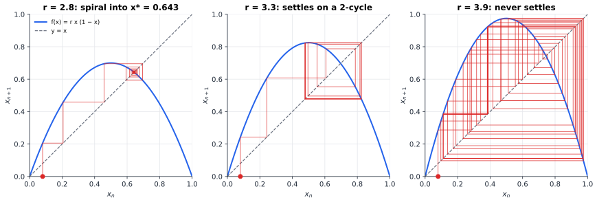
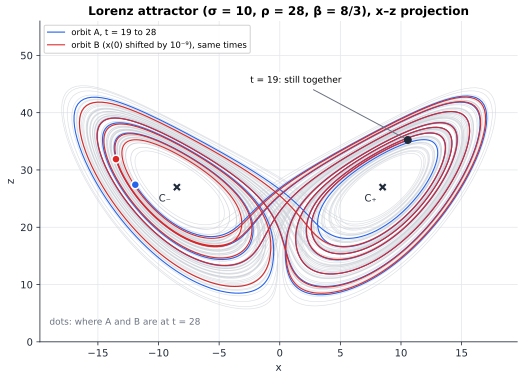
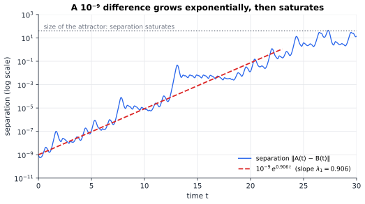

# Chapter 84 — Chaos Theory: When Tiny Changes Become Huge

[← Previous](83-dynamical-systems.md) · [Track I](README.md) · [Table of Contents](../../00-front/table-of-contents.md) · [Next →](85-bifurcations.md)

> **Level 2 · Track I — Dynamical Systems, Chaos, and Complexity**
> **Builds on:** [Ch. 83](83-dynamical-systems.md) (flows, fixed points, Poincaré–Bendixson), [Ch. 7](../../part-2-calculus/07-vector-calculus.md) (divergence), [Ch. 22](../../part-7-numerical-computational/22-numerical-methods.md) (§22.1 floating point, §22.9 Runge–Kutta), [Ch. 10](../../part-3-linear-algebra/10-eigenvalues-and-eigenvectors.md) · **Leads to:** [Ch. 85](85-bifurcations.md), [Ch. 87](87-network-science.md), [Ch. 88](88-complexity-science.md) · **Related:** [Ch. 73](../g-graphics-simulation/73-fractals.md), [Ch. 72](../g-graphics-simulation/72-physics-engines.md), [Ch. 45](../c-game-theory/45-evolutionary-games.md), [Ch. 97](../j-frontier/97-measure-theory.md)
> **Reading time:** ~30 min

## 84.1 The hook

In the winter of 1961 the meteorologist Edward Lorenz, at MIT, wanted to look again at a stretch of weather his computer had produced. His model was a dozen equations for a toy atmosphere, run on a Royal McBee LGP-30, a vacuum-tube machine the size of a desk that printed its results line by line. To save time he did not restart from the beginning. He typed in the state from the middle of an earlier printout and went for a coffee.

When he came back, the new run had first copied the old one and then wandered away from it. After a couple of simulated months the two weather histories had nothing to do with each other.

Nothing was broken. The computer stored six digits, the printout showed three. Lorenz had typed $0.506$ where the machine had held $0.506127$. A difference of one part in four thousand, smaller than any thermometer could measure, had grown until it was as large as the weather itself.

The model was **deterministic**: the same input always gave the same output. Yet it could not be predicted in practice, because the input could never be known exactly. If the real atmosphere behaves like this, Lorenz concluded, long-range forecasting is impossible in principle.

That raises the question this chapter answers: **if a deterministic system amplifies errors, how far ahead can you predict it, and what does it cost to see further?** The answer is a single number per system, and it is not kind. Ten times more precise measurements do not make the forecast ten times longer; they add a fixed amount of time, the same for every digit you pay for.

## 84.2 The big idea

### Stretch, fold, repeat

Watch a baker make puff pastry: roll the dough to twice its length (**stretch**), fold it back on itself (**fold**), repeat. Two flecks of flour a millimetre apart are two millimetres apart after one roll, four after two, and after ten would be a metre apart, except that the fold keeps bringing them back. After a dozen rounds their relative position is effectively random, though every step was deterministic.

That is the mechanism of chaos, in every chaotic system ever found:

- **Stretching** pulls nearby states apart exponentially. This is **sensitive dependence on initial conditions**.
- **Folding** keeps the motion bounded. Without the fold, stretching is just instability: a ball rolling off a hill, which is perfectly predictable.
- **Repetition** mixes. After enough rounds, a tiny region of initial states has been smeared over the whole space.

The rate of stretching is the key number. If errors grow like $\delta(t) \approx \delta_0 e^{\lambda t}$, the error reaches the size $\Delta$ of the whole attractor (where your forecast is worthless) at

$$
T_{\text{predict}} \approx \frac{1}{\lambda}\ln\frac{\Delta}{\delta_0}.
$$

The initial error sits inside a *logarithm*. Divide $\delta_0$ by ten and you gain only $(\ln 10)/\lambda$ extra time units. Exponential growth of error becomes logarithmic return on precision. That is the answer to the hook in outline; the rest of the chapter makes $\lambda$ precise and computes it.

### Why you need room to fold

[Ch. 83](83-dynamical-systems.md) proved that a flow in the plane cannot do this: by Poincaré–Bendixson every bounded planar orbit settles on a point, a cycle, or a chain of saddles. Orbits cannot cross, so in two dimensions there is no way to fold a sheet of trajectories back over itself. In three dimensions there is: trajectories can pass over and under one another, the way strands of pastry lie on top of each other after a fold. Three is the minimum for a chaotic flow.

Maps jump, so they need less room: a non-invertible map can be chaotic in one dimension (the logistic map folds an interval onto itself), an invertible one in two (the Hénon map of [Ch. 73](../g-graphics-simulation/73-fractals.md)).

## 84.3 The mathematics

### Sensitivity and the Lyapunov exponent

> [!definition] Sensitive dependence
> A map $f$ on a set $X$ has **sensitive dependence on initial conditions** if there is a $\Delta > 0$ such that for every $x \in X$ and every neighbourhood of $x$, however small, some $y$ in it has an orbit that eventually separates from the orbit of $x$ by more than $\Delta$: $\lvert f^n(x) - f^n(y)\rvert > \Delta$ for some $n$.

Sensitivity says errors grow; the Lyapunov exponent says how fast. Start with a one-dimensional map $x_{k+1} = f(x_k)$ and two nearby starting points, $x_0$ and $x_0 + \delta_0$. After $n$ steps, to first order,

$$
\delta_n \approx \big(f^n\big)'(x_0)\,\delta_0 .
$$

The chain rule turns the derivative of the $n$-fold composition into a product along the orbit:

$$
\big(f^n\big)'(x_0) = f'(x_{n-1})\,f'(x_{n-2})\cdots f'(x_0) = \prod_{k=0}^{n-1} f'(x_k).
$$

So the error is multiplied at each step by the local stretching factor $\lvert f'(x_k)\rvert$. Writing $\lvert\delta_n\rvert \approx e^{n\lambda}\lvert\delta_0\rvert$ and solving for $\lambda$:

> [!definition] Lyapunov exponent of a one-dimensional map
> $$
> \lambda(x_0) = \lim_{n\to\infty}\frac{1}{n}\ln\left\lvert\big(f^n\big)'(x_0)\right\rvert = \lim_{n\to\infty}\frac{1}{n}\sum_{k=0}^{n-1}\ln\lvert f'(x_k)\rvert .
> $$
> $\lambda < 0$: nearby orbits converge (a stable fixed point or cycle). $\lambda > 0$ on a bounded orbit: sensitive dependence, the signature of chaos.

The exponent is the **time-average of the logarithm of the stretching**. The logarithm is what makes it an average: stretching factors multiply, their logarithms add. For a stable fixed point $x^*$ the orbit sits at $x^*$, every term is $\ln\lvert f'(x^*)\rvert$, and $\lambda = \ln\lvert f'(x^*)\rvert < 0$, which is the stability theorem of [Ch. 83](83-dynamical-systems.md) in logarithmic dress.

For a flow $\dot{\mathbf{x}} = \mathbf{F}(\mathbf{x})$ the same idea applies to a small separation vector $\boldsymbol{\delta}$, which evolves by the linearised equation $\dot{\boldsymbol{\delta}} = \mathbf{J}(\mathbf{x}(t))\,\boldsymbol{\delta}$ along the orbit. The **largest Lyapunov exponent** is $\lambda_1 = \lim_{t\to\infty}\tfrac1t\ln\big(\lVert\boldsymbol{\delta}(t)\rVert/\lVert\boldsymbol{\delta}(0)\rVert\big)$ for a generic $\boldsymbol{\delta}(0)$. In $n$ dimensions there are $n$ exponents $\lambda_1 \ge \lambda_2 \ge \dots \ge \lambda_n$, the growth rates of lengths, areas, volumes and so on, the **Lyapunov spectrum**.

The horizon of §84.2 uses $\lambda_1$, and holds while the error is small enough for linearisation.

### A chaotic system you can solve exactly: the doubling map

Take $x \in [0, 1)$ and the map

$$
D(x) = 2x \bmod 1 .
$$

Write $x$ in binary, $x = 0.b_1 b_2 b_3\ldots$. Doubling shifts the binary point one place to the right, and "mod 1" throws away the digit that crosses it:

$$
D(0.b_1 b_2 b_3 b_4\ldots) = 0.b_2 b_3 b_4\ldots
$$

Everything about the dynamics can now be read off.

> [!theorem] The doubling map is chaotic
> (a) $D$ has Lyapunov exponent $\ln 2$ at every point. (b) It has sensitive dependence with $\Delta = 1/4$. (c) Its periodic points are dense in $[0, 1)$. (d) It has orbits that come arbitrarily close to every point.

*Proof.* (a) $D'(x) = 2$ wherever it is defined, so every term of the average is $\ln 2$.

(b) Take any $x$ and any $\varepsilon > 0$. Choose $n$ with $2^{-n} < \varepsilon$, and let $y$ be $x$ with its binary digit $n+1$ flipped, that is $y = x \pm 2^{-(n+1)}$ with no carry. Then $\lvert y - x\rvert < \varepsilon$, and after $n$ shifts the two points differ only in their first digit, so $\lvert D^n(y) - D^n(x)\rvert = \tfrac12 > \tfrac14$.

(c) A point whose binary expansion repeats with period $p$, such as $0.\overline{011}$, returns to itself after $p$ shifts. Given any $x$ and $n$, the repeating number made of the first $n$ digits of $x$ is within $2^{-n}$ of $x$. So periodic points are arbitrarily close to every point.

(d) Write down every finite binary string, in order of length, and concatenate them into one infinite expansion $z = 0.0\,1\,00\,01\,10\,11\,000\ldots$. Any target $x$ is approximated to $n$ digits by some block of $z$, and shifting $z$ to that block lands within $2^{-n}$ of $x$. $\blacksquare$

**Predicting the doubling map $n$ steps ahead requires knowing the initial condition to $n$ binary digits.** Each step consumes one bit you had and exposes one you never had: the exponent $\ln 2$ is exactly one bit per step.

Properties (b), (c) and (d) are Robert Devaney's three ingredients of chaos: sensitivity, dense periodic orbits and topological transitivity (some orbit visits everywhere). Notice the paradox in (c): the chaotic set is *packed* with periodic orbits, every one of them unstable, and a typical orbit wanders among them forever, never settling on any.

### The logistic map at $r = 4$ is the doubling map in disguise

The logistic map $x_{n+1} = r x_n(1 - x_n)$ on $[0, 1]$ is the textbook example of a non-invertible chaotic map: it stretches the interval and folds it in half. At $r = 4$ its exponent can be found exactly by a change of variables. Set

$$
x = \sin^2(\pi\theta),\qquad \theta \in [0, 1).
$$

Then

$$
4x(1 - x) = 4\sin^2(\pi\theta)\cos^2(\pi\theta) = \big(2\sin(\pi\theta)\cos(\pi\theta)\big)^2 = \sin^2(2\pi\theta) = \sin^2\big(\pi\,D(\theta)\big),
$$

the last step because $\sin^2$ has period $\pi$ in its argument, so dropping the integer part of $2\theta$ changes nothing. In words: **if $x$ corresponds to $\theta$, then $4x(1-x)$ corresponds to $D(\theta)$.** The logistic map at $r = 4$ and the doubling map are the same dynamical system seen through the lens $h(\theta) = \sin^2(\pi\theta)$. Such a change of variables is called a **conjugacy**: $f \circ h = h \circ D$.

A smooth conjugacy cannot change the long-run stretching rate, because $h'$ contributes at most a bounded factor at the start and the end of the orbit, which disappears when divided by $n$. (There is a fine print: $h'$ vanishes at $\theta = 0$ and $\tfrac12$, so the argument needs typical orbits to avoid lingering there, which they do.) So the logistic map at $r = 4$ has $\lambda = \ln 2 \approx 0.693$ too, and a numerical average of $\ln\lvert 4(1 - 2x_k)\rvert$ over $2\times 10^5$ iterates gives $0.6931$.



*Cobweb diagrams of the logistic map from $x_0 = 0.08$: go up to the curve, across to the diagonal, repeat. At $r = 2.8$ the orbit spirals into the fixed point $x^* = 1 - 1/r = 0.643$, where $f'(x^*) = 2 - r = -0.8$ (the alternation is the negative slope). At $r = 3.3$ it settles onto a cycle of two values. At $r = 3.9$ it never settles; its Lyapunov exponent is about $0.50$.*

How the logistic map gets from the tidy left panel to the chaotic right one, as $r$ is turned up, is a story of its own.

> [!mystery] The road from order to chaos has a speed limit
> Turn $r$ up slowly from $2.8$. At $r = 3$ the fixed point gives way to a 2-cycle; at $3.4495$ the 2-cycle gives way to a 4-cycle; then 8, 16, 32, faster and faster, until at $r \approx 3.5699$ the period is infinite and chaos begins. The gaps between successive doublings shrink by a ratio that tends to $4.6692\ldots$. Mitchell Feigenbaum found the same ratio in every one-humped map he tried, and experimenters later measured it in convecting fluids and electronic circuits. Why should one number govern systems that have nothing in common? The cascade itself is mapped out in [Ch. 85](85-bifurcations.md), and the reason for its universality is a renormalisation argument from [Ch. 92](../j-frontier/92-mathematical-physics.md).

### The Lorenz equations: a strange attractor

In 1963 Lorenz boiled a model of a convecting fluid down to three equations:

$$
\dot x = \sigma(y - x),\qquad \dot y = x(\rho - z) - y,\qquad \dot z = xy - \beta z,
$$

with the classic values $\sigma = 10$, $\rho = 28$, $\beta = 8/3$. Here $x$ measures the strength of the convective roll, $y$ the temperature difference between rising and sinking fluid, and $z$ the distortion of the vertical temperature profile. There are only two nonlinear terms, $xz$ and $xy$.

**Every equilibrium is unstable.** The origin has Jacobian eigenvalues $11.83$, $-2.67$, $-22.83$: a saddle. The other two equilibria are $C_\pm = \big(\pm\sqrt{\beta(\rho - 1)},\ \pm\sqrt{\beta(\rho-1)},\ \rho - 1\big) = (\pm 8.49, \pm 8.49, 27)$, each with eigenvalues $-13.85$ and $0.094 \pm 10.19j$: a spiral that unwinds slowly outward. Orbits spiral away from $C_+$ until they are flung over to spiral around $C_-$, then back, with an unpredictable number of turns each time.

**Yet orbits stay bounded,** and in fact they are squeezed onto a set of zero volume. That is a theorem you can prove in two lines.

> [!theorem] Volume contraction in the Lorenz system
> Let $V(t)$ be the volume of a region of initial states carried along by the flow. Then $\dot V = \int (\nabla\cdot\mathbf{F})\,dV$, and for the Lorenz equations
> $$
> \nabla\cdot\mathbf{F} = \frac{\partial\dot x}{\partial x} + \frac{\partial\dot y}{\partial y} + \frac{\partial\dot z}{\partial z} = -\sigma - 1 - \beta = -\frac{41}{3} \approx -13.67,
> $$
> so $V(t) = V(0)\,e^{-13.67\,t}$.

*Proof.* The rate at which a moving region's volume changes is the flux of the velocity field through its boundary, $\dot V = \oint_S \mathbf{F}\cdot\hat{\mathbf{n}}\,dS$, which by the divergence theorem ([Ch. 7](../../part-2-calculus/07-vector-calculus.md)) equals $\int (\nabla\cdot\mathbf{F})\,dV$. For Lorenz the divergence is the constant $-(\sigma + 1 + \beta)$, so $\dot V = -(\sigma + 1 + \beta)V$. $\blacksquare$

In one time unit any blob of states shrinks to $e^{-13.67} \approx 10^{-6}$ of its volume. Combined with boundedness, this means all orbits end on an **attractor** of zero volume. But it cannot be a fixed point (all are unstable), and it cannot be a cycle (nearby orbits separate). It is something new: a set that is locally like a stack of sheets, infinitely many of them, layered like folded pastry. Lorenz called it "an infinite complex of surfaces". It is now called a **strange attractor**: an attractor with sensitive dependence on initial conditions, and with fractal structure.



*The Lorenz attractor in the $x$–$z$ plane (grey), computed with RK4 at step $h = 0.005$. Orbits A and B started $10^{-9}$ apart. At $t = 19$ they are still indistinguishable on this scale; by $t = 28$ they are on different wings. The crosses are the unstable equilibria $C_\pm$.*



*The distance between orbits A and B on a logarithmic axis. Apart from wiggles (the stretching rate varies around the attractor), it follows a straight line of slope $\lambda_1 = 0.906$ until it reaches the size of the attractor at about $t = 27$, where it saturates: the fold.*

This is the hook's answer made quantitative. With $\lambda_1 \approx 0.906$, each factor of ten in initial precision buys $\ln 10/0.906 \approx 2.5$ time units. Starting $10^{-9}$ apart, the forecast fails near $t \approx \ln(40/10^{-9})/0.906 \approx 27$, as plotted. Lorenz's rounding error of about $1.3\times 10^{-4}$ would buy about 14 time units in this system; data a millionfold better would add just 15 more.

The full Lyapunov spectrum of the Lorenz attractor, computed by the method of §84.4, is $(0.906,\ 0,\ -14.57)$. The zero exponent belongs to the direction along the flow: shifting a point slightly forward in time along its own orbit neither grows nor shrinks. And the sum is $0.906 + 0 - 14.57 = -13.67$, the divergence, as it must be: the exponents are the growth rates of the principal axes of a small blob, and the volume is their product.

### The dimension of a strange attractor

Ch. 73 left a question for this chapter: why should chaotic attractors be fractals, and why can their dimension be predicted from the Lyapunov exponents?

A small ball of states near the attractor stretches at rate $\lambda_1 > 0$, keeps its length along the flow, and contracts at rate $\lvert\lambda_3\rvert$. Stretching makes the attractor at least two-dimensional, contraction makes it less than three-dimensional, and folding stacks the contracted sheets inside each other like the layers of a Cantor set. James Kaplan and James Yorke proposed in 1979 that the dimension balances the expanding directions against the contracting direction that just barely wins:

> [!definition] Kaplan–Yorke (Lyapunov) dimension
> If $\lambda_1 + \dots + \lambda_k \ge 0$ but $\lambda_1 + \dots + \lambda_{k+1} < 0$, then
> $$
> D_{KY} = k + \frac{\lambda_1 + \dots + \lambda_k}{\lvert\lambda_{k+1}\rvert}.
> $$

For Lorenz, $k = 2$ and $D_{KY} = 2 + 0.906/14.57 = 2.06$: a set barely thicker than a surface, which is why it *looks* like two sheets. For the Hénon map of Ch. 73 the exponents are $0.42$ and $-1.62$, so $D_{KY} = 1 + 0.42/1.62 = 1.26$, matching the box-counting dimension measured there. Kaplan and Yorke conjectured that $D_{KY}$ equals the attractor's information dimension for typical systems; it has been proved in some classes of systems and is believed far more widely.

### Can a simulation of chaos be trusted?

Every number in this chapter came from a computer, and every computed orbit is wrong. In double precision each RK4 step makes a relative error of about $10^{-16}$, and chaos amplifies it by $e^{0.906 t}$. By $t \approx 40$ the computed Lorenz orbit has no relation to the true orbit that starts from the same point. So why believe the pictures?

The answer is the **shadowing lemma**, proved by Dmitri Anosov and Rufus Bowen for systems that are *uniformly hyperbolic*: at every point of the invariant set, directions split cleanly into ones that stretch and ones that contract, at rates bounded away from zero.

> [!theorem] Shadowing lemma (stated)
> On a uniformly hyperbolic invariant set, for every $\varepsilon > 0$ there is a $\delta > 0$ such that every **$\delta$-pseudo-orbit** (a sequence with $\lVert x_{k+1} - f(x_k)\rVert < \delta$ at every step, which is what a computer produces) stays within $\varepsilon$ of some **true** orbit for all time.

So the computed orbit is not the orbit you asked for, but it is a faithful copy of an orbit from a slightly different start, and its statistics (time averages, exponents, the shape of the attractor) are the statistics of the real system. The doubling map is uniformly hyperbolic, so it is covered. The Lorenz and Hénon attractors are not: Lorenz's contains an equilibrium, and Hénon's has tangencies where stretching and contracting directions line up. For such systems shadowing has been proved only for long but finite stretches of time, with computer-assisted bounds. Warwick Tucker's 1999 proof that the Lorenz attractor really exists, answering Smale's 14th problem, was itself a rigorous computation of this kind.

> [!warning] Floating point can kill chaos outright
> Iterate the doubling map in double precision from $x_0 = 0.1234567$ and after 55 steps the computer returns exactly $0$, forever. Each doubling shifts a bit out of the 53-bit mantissa and shifts in a zero ([Ch. 22, §22.1](../../part-7-numerical-computational/22-numerical-methods.md)). Shadowing assumes small random-like errors, not arithmetic that discards information systematically. The logistic map at $r = 4$ survives, because rounding $4x(1-x)$ keeps generating new low-order bits.

### Recognising chaos

[Ch. 45](../c-game-theory/45-evolutionary-games.md) asked how you would recognise chaos in a population game; the same question arises for a circuit on a bench or a heartbeat on a monitor. Three tests, each with traps:

- **A positive largest Lyapunov exponent** on a bounded orbit (§84.4). The trap: noise also separates nearby trajectories, so on measured data the estimate must stay positive as you vary the embedding and time scale.
- **A broadband spectrum.** Periodic signals have line spectra ([Ch. 15](../../part-5-transforms/15-fourier-series.md)); chaos has a continuous one. The trap: so does noise. The spectrum can rule chaos out, never in.
- **Low-dimensional structure.** Plot a measured signal $s(t)$ against $s(t - \tau)$ and $s(t - 2\tau)$. Floris Takens proved in 1981 that these **delay coordinates** reconstruct a faithful copy of a deterministic attractor: chaos appears as a thin folded object, while noise fills the space.

## 84.4 The algorithm

The definition of $\lambda_1$ cannot be used literally: two orbits started close together separate until they saturate at the size of the attractor, after which their distance says nothing. Giancarlo Benettin and colleagues (1976) fixed this by **renormalising**: let the separation grow for a short time, record how much it grew, shrink it back to its original size along the same direction, and repeat.

```python
import numpy as np

def lorenz(u, s=10.0, r=28.0, b=8/3):
    x, y, z = u
    return np.array([s*(y - x), x*(r - z) - y, x*y - b*z])

def rk4(f, u, h):
    k1 = f(u); k2 = f(u + h/2*k1); k3 = f(u + h/2*k2); k4 = f(u + h*k3)
    return u + h/6*(k1 + 2*k2 + 2*k3 + k4)

def largest_lyapunov(f, u, h=0.01, d0=1e-8, steps_per_renorm=10, n_renorm=20000):
    for _ in range(2000):                      # discard the transient
        u = rk4(f, u, h)
    v = u + d0 * np.array([1.0, 0, 0])
    total = 0.0
    for _ in range(n_renorm):
        for _ in range(steps_per_renorm):
            u, v = rk4(f, u, h), rk4(f, v, h)
        d = np.linalg.norm(v - u)
        total += np.log(d / d0)                # growth since the last renormalisation
        v = u + (v - u) * (d0 / d)             # shrink back, keep the direction
    return total / (n_renorm * steps_per_renorm * h)

print(largest_lyapunov(lorenz, np.array([1.0, 1.0, 1.0])))   # about 0.91
```

**Why it works.** The separation stays tiny, so it obeys the linearised dynamics, and its direction swings toward the most-stretched one. The summed logarithms are the logarithm of the product in the definition, computed without ever letting the separation saturate.

**Cost and accuracy.** Twice the cost of one simulation; the estimate converges roughly like $1/\sqrt{T}$ in the averaging time $T$. With $T = 2000$ it gives $0.909$ against the accepted $0.906$. For the full spectrum, evolve $n$ separation vectors with the Jacobian and re-orthonormalise them by QR factorisation ([Ch. 24, §24.3](../../part-7-numerical-computational/24-computational-mathematics.md)); the logarithms of the diagonal of $\mathbf{R}$ accumulate the exponents.

**Failure modes.** If `d0` is too large the separation leaves the linear regime and the estimate is biased low; if it is near $10^{-16}$ relative to the state, rounding noise dominates. Too few steps between renormalisations wastes work; too many lets the separation saturate. And a transient that is not discarded measures the approach to the attractor, not the attractor.

## 84.5 The experiment

First, look at the logistic map and its second iterate. A 2-cycle of $f$ is a pair of fixed points of $f \circ f$ that are not fixed points of $f$.

```desmos-graph
left=0; right=1; bottom=0; top=1
---
y=3.3x(1-x)|blue
y=3.3(3.3x(1-x))(1-3.3x(1-x))|red
y=x|grey|dashed
```

*The logistic map $f$ (blue) and $f \circ f$ (red) at $r = 3.3$. The red curve crosses the diagonal four times: two of the crossings are the fixed points of $f$, the other two (near $0.479$ and $0.824$) are the 2-cycle in the cobweb figure. Change every $3.3$ to $2.8$, and to $3.9$, and watch the crossings appear and the hump steepen.*

Now scan the Lyapunov exponent of the logistic map across $r$. Where it is negative the map settles onto a stable cycle; where it is positive the orbit is chaotic.

```python
import numpy as np
import matplotlib.pyplot as plt

r_min, r_max = 2.8, 4.0     # zoom in: try 3.82, 3.86 (the period-3 window)
n_r = 1500                  # number of r values
n_transient = 1000          # iterations thrown away
n_avg = 4000                # iterations averaged

r = np.linspace(r_min, r_max, n_r)
x = np.full(n_r, 0.3)
for _ in range(n_transient):
    x = r * x * (1 - x)
lam = np.zeros(n_r)
for _ in range(n_avg):
    lam += np.log(np.abs(r * (1 - 2 * x)) + 1e-300)
    x = r * x * (1 - x)
lam /= n_avg

plt.plot(r, lam, lw=0.8)
plt.axhline(0, color="k", lw=0.8)
plt.axhline(np.log(2), color="r", ls="--", lw=0.8, label="ln 2")
plt.xlabel("r"); plt.ylabel("Lyapunov exponent λ"); plt.legend()
plt.ylim(-2.5, 1); plt.title("Logistic map: λ < 0 periodic, λ > 0 chaotic"); plt.show()
for rv in (2.8, 3.5, 3.7, 3.83, 3.9, 4.0):
    print(rv, round(float(np.interp(rv, r, lam)), 3))
```

Things to notice and try:

- At $r = 2.8$ the exponent is $\ln 0.8 = -0.223$, the stable fixed point's slope. At $r = 4$ it reaches $\ln 2$.
- The plot touches zero from below at $r = 3$ and $r = 3.4495$ (where cycles double) and dives toward $-\infty$ in between, at **superstable** values where the cycle passes through $x = \tfrac12$ and $f' = 0$.
- Above $3.5699$, chaos is interrupted by **windows** of negative exponent, the widest near $r = 3.83$ (period 3, with $\lambda \approx -0.37$). Zoom in on one. How many windows can you find, and how does their width change as you go?

## 84.6 The challenge

1. **Intuition.** A weather service improves its observations so that initial errors fall by a factor of 1000. If the forecast horizon was 7 days and errors grow exponentially with a doubling time of 2 days, how much longer is the horizon now? Explain why a forecaster would rather halve the doubling time's effect than buy better thermometers, and what that would even mean.

2. **Derivation.** The **tent map** is $T(x) = 2x$ for $x \le \tfrac12$ and $2 - 2x$ for $x > \tfrac12$. Compute its Lyapunov exponent. Then show that $T$ is conjugate to the logistic map at $r = 4$ via $x = \sin^2(\pi y/2)$, and explain why the conjugacy is consistent with both exponents being $\ln 2$.

3. **Implementation.** Extend the algorithm of §84.4 to the full Lyapunov spectrum of the Lorenz system using QR re-orthonormalisation. Check that the exponents sum to $-41/3$ and that the middle one tends to $0$. Then compute $D_{KY}$ as a function of $\rho$ from 25 to 40.

4. **Open investigation.** Take a chaotic signal you did not generate: a dripping tap timed with a microphone, a double pendulum filmed with a phone, or a published series of sunspot numbers. Build delay coordinates and estimate the largest Lyapunov exponent. How sensitive is your estimate to the delay, the embedding dimension, and noise? Can you convince a sceptic that the signal is chaos and not noise? For short, noisy data there is no agreed method.

## 84.7 Loose threads

The hook asked how far ahead an error-amplifying deterministic system can be predicted. The answer is $T \approx \lambda_1^{-1}\ln(\Delta/\delta_0)$: a horizon that grows only logarithmically with precision. For Lorenz's equations each extra digit buys $2.5$ time units, no more. The mechanism is stretching plus folding; the result, a strange attractor of zero volume and dimension $2.06$. The doubling map showed chaos as the loss of one bit per step, and shadowing explained why computed chaos still tells the truth about statistics.

What the chapter left open:

- **The route into chaos.** The Feigenbaum mystery above is mapped out in [Ch. 85](85-bifurcations.md).
- **Chaos and fractals.** Why $D_{KY}$ matches a box-counting dimension is a theorem only in special cases; the measure-theoretic notions of dimension it needs are in [Ch. 97](../j-frontier/97-measure-theory.md).
- **Chaos with many parts.** Turbulence and weather have millions of positive exponents; how such systems can still have predictable large-scale statistics is a theme of [Ch. 88](88-complexity-science.md).

> [!mystery] Why does the average exist at all?
> The Lyapunov exponent is a limit of averages along a single orbit. Why should that limit exist, and why should almost every starting point give the *same* number, when the orbits themselves are wildly different? For the doubling map you can almost see it: the binary digits of a typical number behave like fair coin flips. In general, the answer is the ergodic theorem, which equates time averages with averages over the attractor, and Oseledets' theorem, which guarantees the whole spectrum. Both are theorems of measure theory, in [Ch. 97](../j-frontier/97-measure-theory.md).

> [!mystery] Two chaotic circuits in lockstep
> Chaos amplifies every difference, so two chaotic systems, however alike, should drift apart. Yet Louis Pecora and Thomas Carroll showed in 1990 that two chaotic circuits, one driving the other through a single wire, can fall into perfect step and stay there, both still chaotic. How can coupling beat exponential divergence, how strong must it be, and what happens in a network of thousands of chaotic units? That is the synchronisation story of [Ch. 87](87-network-science.md).

## Further reading

- James Gleick, *Chaos: Making a New Science* (Viking, 1987). The history, including Lorenz's printout and Feigenbaum's numbers, told for a general reader.
- Edward N. Lorenz, "Deterministic nonperiodic flow", *Journal of the Atmospheric Sciences* 20 (1963), 130–141. The original paper, still readable.
- Steven H. Strogatz, *Nonlinear Dynamics and Chaos*, 2nd ed. (Westview, 2015), Chapters 9–10. The Lorenz equations and one-dimensional maps.
- Kathleen T. Alligood, Tim D. Sauer and James A. Yorke, *Chaos: An Introduction to Dynamical Systems* (Springer, 1996). Lyapunov exponents, conjugacies, fractal dimension and shadowing at an undergraduate level.
- Holger Kantz and Thomas Schreiber, *Nonlinear Time Series Analysis*, 2nd ed. (Cambridge University Press, 2004). Delay embedding and exponents from measured data, with all the traps.
