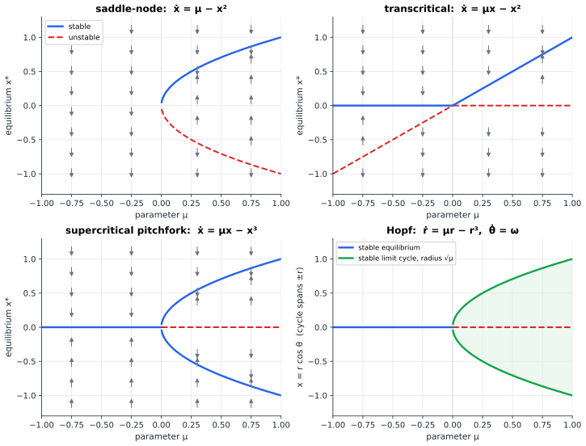
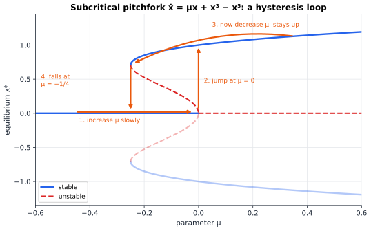
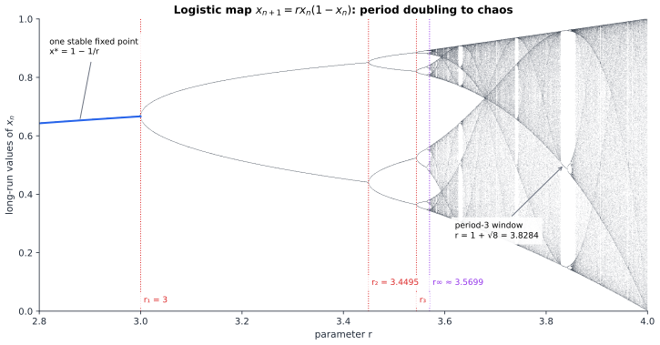

# Chapter 85 — Bifurcations: When Systems Change Their Nature

[← Previous](84-chaos-theory.md) · [Track I](README.md) · [Table of Contents](../../00-front/table-of-contents.md) · [Next →](86-cellular-automata.md)

> **Level 2 · Track I — Dynamical Systems, Chaos, and Complexity**
> **Builds on:** [Ch. 83](83-dynamical-systems.md) (fixed points, limit cycles), [Ch. 84](84-chaos-theory.md) (logistic map, Lyapunov exponents), [Ch. 6](../../part-2-calculus/06-multivariable-calculus.md) (implicit function theorem, Taylor series), [Ch. 22](../../part-7-numerical-computational/22-numerical-methods.md) (§22.4 Newton's method) · **Leads to:** [Ch. 86](86-cellular-automata.md), [Ch. 88](88-complexity-science.md), [Ch. 89](../j-frontier/89-pde-beyond-the-basics.md), [Ch. 92](../j-frontier/92-mathematical-physics.md) · **Related:** [Ch. 73](../g-graphics-simulation/73-fractals.md), [Ch. 25](../../part-7-numerical-computational/25-mathematical-modeling.md), [Ch. 11](../../part-4-differential-equations/11-ordinary-differential-equations.md)
> **Reading time:** ~30 min

## 85.1 The hook

A power line feeds a city. As evening comes and air conditioners switch on, the load rises, and the voltage at the city end sags a little, as it always does: current through the line's reactance drops some of the voltage before it arrives. Operators watch the voltage. At 50% of the line's maximum transfer it is at 97% of the sending voltage. At 90% it is still at 85%. Nothing alarming.

Then the load rises a few percent more, and the voltage does not sag a little more. It slides, and keeps sliding, and the protection trips. Voltage collapse of this kind has blacked out whole regions: France in December 1978 and Tokyo on a hot July afternoon in 1987 are textbook cases.

Right up to the edge, the system looked healthy: voltage acceptable, every eigenvalue in the left half-plane. Nothing in a snapshot of the state said "you are 2% from the cliff", because the cliff was not in the state. It was in the *parameter*, the load: past a critical value, the operating point simply ceased to exist.

The model is short. A source of voltage $E$ feeds a resistive load drawing power $P$ through a line of reactance $X$. The load voltage $V$ satisfies $E^2 = V^2 + (XP/V)^2$ (the line drop $XI$ is at right angles to $V$, and $I = P/V$), which rearranges to

$$
V^4 - E^2V^2 + X^2P^2 = 0
\quad\Longrightarrow\quad
\frac{V^2}{E^2} = \frac{1 \pm \sqrt{1 - (P/P_{\max})^2}}{2},\qquad P_{\max} = \frac{E^2}{2X}.
$$

For $P < P_{\max}$ there are two operating voltages, a high one (normal operation) and a low one. At $P = P_{\max}$ they merge at $V = E/\sqrt2$. Above it there are none. Plotted, this is the **nose curve** of power engineering, and it is the subject of this chapter in disguise.

The question: **can you see the cliff coming?** If the state looks fine right up to the edge, is there *any* measurable symptom of approaching it? There is, and it follows from one line of algebra about how equilibria are born and die.

## 85.2 The big idea

### Parameters move slowly; states move fast

Every model in Chapters 83 and 84 had knobs: damping $b$, Van der Pol's $\mu$, the logistic $r$, Lorenz's $\rho$. Turn a knob slowly and usually the phase portrait just deforms. Occasionally, at special values, it changes its *nature*: two fixed points collide and annihilate, a stable point throws off a cycle, a cycle doubles. These events are **bifurcations**.

Picture a ball in a valley of a landscape you are slowly tilting. Mostly the ball just shifts. But if the valley gets shallower as you tilt, its floor and rim eventually merge, the valley vanishes, and the ball rolls somewhere completely different, and tilting back a little will not undo it.

### The warning sign is in the restoring force

Just before the valley vanishes it is very flat, and a nudged ball rolls back slowly. That is the symptom: **recovery from small disturbances slows down as a bifurcation approaches**, called **critical slowing down**. Measure not where the state *is*, but how quickly it comes back when kicked. The recovery rate is an eigenvalue of the linearisation, and bifurcations happen where an eigenvalue reaches zero or a pair reaches the imaginary axis: the "non-hyperbolic, inconclusive" cases that [Ch. 11, §11.9](../../part-4-differential-equations/11-ordinary-differential-equations.md) set aside.

## 85.3 The mathematics

### Where bifurcations can happen

Consider a one-parameter family $\dot x = f(x, \mu)$ with $f$ smooth, and an equilibrium $x_0$ at $\mu_0$: $f(x_0, \mu_0) = 0$.

> [!theorem] Hyperbolic equilibria persist
> If $f_x(x_0, \mu_0) \neq 0$, then for $\mu$ near $\mu_0$ there is exactly one equilibrium $x^*(\mu)$ near $x_0$, it depends smoothly on $\mu$, and it has the same stability as $x_0$.

*Proof.* This is the implicit function theorem ([Ch. 6](../../part-2-calculus/06-multivariable-calculus.md)): $f(x, \mu) = 0$ with $f_x \neq 0$ can be solved for $x$ as a smooth function of $\mu$ near $(x_0, \mu_0)$, uniquely in a neighbourhood, with slope $dx^*/d\mu = -f_\mu/f_x$. Stability is decided by the sign of $f_x(x^*(\mu), \mu)$, which is continuous in $\mu$ and nonzero at $\mu_0$, so it keeps its sign nearby. $\blacksquare$

The same holds in $n$ dimensions with "$f_x \neq 0$" replaced by "the Jacobian has no eigenvalue on the imaginary axis". So **local bifurcations of equilibria happen only where the linearisation has an eigenvalue with zero real part.** There are two ways to get there: a real eigenvalue passing through $0$, or a complex pair crossing the imaginary axis. The first gives saddle-nodes, transcritical and pitchfork bifurcations; the second gives Hopf bifurcations.

### The saddle-node: creation from nothing

The simplest way for $f_x$ to vanish is the **saddle-node** (or **fold**) bifurcation, with normal form

$$
\dot x = \mu - x^2 .
$$

For $\mu < 0$ there are no equilibria; $\dot x < 0$ everywhere and every state drifts off to $-\infty$. For $\mu > 0$ there are two, $x^* = \pm\sqrt\mu$, and since $f_x = -2x^*$, the upper one is stable (eigenvalue $-2\sqrt\mu$) and the lower one unstable (eigenvalue $+2\sqrt\mu$). At $\mu = 0$ they merge into one half-stable point and annihilate.

Why should this cartoon matter? Because it is what *every* fold looks like up close. Suppose $f(x_0, \mu_0) = 0$, $f_x = 0$, but $f_{xx} \neq 0$ and $f_\mu \neq 0$ there. Taylor expanding,

$$
f(x, \mu) \approx f_\mu\,(\mu - \mu_0) + \tfrac12 f_{xx}\,(x - x_0)^2 ,
$$

and after shifting and scaling $x$ and $\mu$, this is $\mu - x^2$ (or $-\mu + x^2$). The nose curve has exactly this structure at $P = P_{\max}$: near the tip, $V$ differs from $E/\sqrt2$ by an amount proportional to $\pm\sqrt{P_{\max} - P}$. The square root is the fingerprint of a fold.

> [!theorem] Critical slowing down and the bottleneck
> For $\dot x = \mu - x^2$:
> (a) for $\mu > 0$, perturbations of the stable equilibrium decay like $e^{-t/\tau}$ with recovery time $\tau = 1/(2\sqrt\mu)$, which diverges as $\mu \to 0^+$;
> (b) for $\mu < 0$, a state takes time $\pi/\sqrt{-\mu}$ to pass from $x = +\infty$ to $x = -\infty$, almost all of it spent near $x = 0$, the "ghost" of the vanished equilibria.

*Proof.* (a) The linearisation at $x^* = \sqrt\mu$ is $\dot\eta = f_x\,\eta = -2\sqrt\mu\,\eta$, so $\eta(t) = \eta(0)e^{-2\sqrt\mu\, t}$.

(b) Separate variables, writing $\mu = -a^2$:

$$
T = \int_{+\infty}^{-\infty}\frac{dx}{\dot x} = \int_{+\infty}^{-\infty}\frac{dx}{-(a^2 + x^2)} = \int_{-\infty}^{\infty}\frac{dx}{a^2 + x^2} = \frac{1}{a}\Big[\arctan\frac{x}{a}\Big]_{-\infty}^{\infty} = \frac{\pi}{a} = \frac{\pi}{\sqrt{-\mu}} .
$$

The integrand is largest near $x = 0$, where $\dot x = \mu$ is tiny. Half the passage time is spent in $\lvert x\rvert < a$, an interval that shrinks to nothing as $\mu \to 0^-$. $\blacksquare$

Part (a) answers the hook. At $\mu = 0.01$ the recovery time is $5$; at $\mu = 0.0001$ it is $50$. The equilibrium moves only from $0.1$ to $0.01$, easy to miss, while the sluggishness grows tenfold, easy to measure from how the system recovers from the random kicks that loads give it all the time. Voltage-stability monitors use this idea in the form of the smallest eigenvalue or singular value of the power-flow Jacobian, which tends to zero at the nose. Part (b) says that just past the cliff the system lingers in the bottleneck, one reason a collapse can take seconds to minutes to unfold: a window for emergency action.



*Bifurcation diagrams: equilibria (and, for Hopf, the cycle amplitude) against the parameter $\mu$. Solid blue: stable; dashed red: unstable; grey arrows: the direction of flow. Saddle-node: a stable–unstable pair is created from nothing. Transcritical: two branches cross and exchange stability. Pitchfork: a symmetric equilibrium loses stability to two new stable ones. Hopf: a stable spiral gives birth to a limit cycle whose radius grows like $\sqrt\mu$.*

### Transcritical and pitchfork: when something forbids creation from nothing

Sometimes an equilibrium cannot disappear, because the model forbids it. Zero population, zero current or a perfectly upright beam are equilibria for *every* parameter value. Then the zero eigenvalue produces a different event.

- **Transcritical**, $\dot x = \mu x - x^2$: the branches $x = 0$ and $x = \mu$ cross at $\mu = 0$ and exchange stability. Laser and epidemic ($R_0 = 1$) thresholds have this form: below, "nothing happening" is stable; above, the nonzero state takes over.
- **Pitchfork**, $\dot x = \mu x - x^3$, needs a symmetry $x \to -x$. For $\mu > 0$ the symmetric state becomes unstable and two mirror-image stable states $\pm\sqrt\mu$ appear. A column buckles left or right, a powered-up flip-flop settles to 0 or 1, and imperfections too small to see decide which.

The cubic term $-x^3$ makes the pitchfork **supercritical**: the new states start at zero amplitude and grow smoothly. Flip its sign and the bifurcation turns **subcritical** and dangerous. The standard model is $\dot x = \mu x + x^3 - x^5$, in which the quintic term restrains the growth at large amplitude:



*The subcritical pitchfork $\dot x = \mu x + x^3 - x^5$. Raising $\mu$ past $0$ destabilises $x = 0$ with no nearby stable state to go to, so the system jumps to the large-amplitude branch. Lowering $\mu$ again does not bring it back at $0$: it stays up until the fold at $\mu = -1/4$, then falls. Between $-1/4$ and $0$ both states are stable: a **hysteresis** loop.*

The nonzero equilibria satisfy $\mu + x^2 - x^4 = 0$, so $x^2 = \big(1 \pm \sqrt{1 + 4\mu}\big)/2$, which exist only for $\mu \ge -1/4$: the jump-back point is itself a saddle-node. Hysteresis is a memory: in the overlap, the state depends on history, not just on the present value of the knob. A Schmitt trigger is built to have it; a buckling shell or a collapsing grid has it whether you like it or not.

### Hopf: the birth of a cycle

[Ch. 83](83-dynamical-systems.md) left a mystery: as Van der Pol's $\mu$ is turned down through zero the limit cycle vanishes, so how is it born? When a complex pair of eigenvalues crosses the imaginary axis, the linearisation turns from a stable spiral to an unstable one. The nonlinear terms decide what happens to the outward-spiralling orbits. In polar coordinates the normal form is

$$
\dot r = \mu r - r^3,\qquad \dot\theta = \omega .
$$

The angle just turns at rate $\omega$. The radius obeys a pitchfork-like equation on $r \ge 0$: for $\mu < 0$, $r = 0$ is the only equilibrium and it is stable; for $\mu > 0$ it is unstable, and $r^* = \sqrt\mu$ is a stable equilibrium of the radius, that is, a circular **limit cycle** of radius $\sqrt\mu$. Its stability follows from $\frac{d}{dr}(\mu r - r^3) = \mu - 3r^2 = -2\mu < 0$ at $r^* = \sqrt\mu$. Hopf's theorem (1942) says this is generic: when a pair crosses the axis with nonzero speed and a certain cubic coefficient (the **first Lyapunov coefficient**) is negative, a stable cycle of amplitude proportional to $\sqrt{\mu - \mu_c}$ is born, with period near $2\pi/\omega$.

> [!example] Oscillator start-up, and the Van der Pol mystery solved
> Take $\ddot x - (\mu - x^2)\dot x + x = 0$: the damping $-(\mu - x^2)$ is negative for small $x$ once $\mu > 0$. The linearisation at the origin has eigenvalues $\mu/2 \pm j\sqrt{1 - \mu^2/4}$, crossing the imaginary axis at $\mu = 0$ with $\omega = 1$. Averaging the energy balance over one cycle of $x \approx a\cos t$ gives $\dot a = \tfrac{a}{2}\big(\mu - a^2/4\big)$, a Hopf normal form with stable amplitude
> $$
> a^* = 2\sqrt\mu .
> $$
> Numerically, the cycle amplitude is $0.200$ at $\mu = 0.01$, $0.400$ at $\mu = 0.04$ and $0.632$ at $\mu = 0.1$, against $2\sqrt\mu = 0.2,\ 0.4,\ 0.632$.
>
> Now substitute $x = \sqrt\mu\,X$ (for $\mu > 0$). Every term picks up a factor $\sqrt\mu$, and the equation becomes $\ddot X - \mu(1 - X^2)\dot X + X = 0$: exactly the Van der Pol equation of Ch. 83. So Van der Pol's amplitude of 2 in $X$ is the amplitude $2\sqrt\mu$ in $x$. The cycle is born at zero size at $\mu = 0$ and grows like the square root; the way Van der Pol wrote the equation simply hides this by measuring amplitude in units that shrink with $\mu$.

This is how an electronic oscillator starts: past the gain where net damping changes sign, the amplitude grows from noise to a value proportional to the square root of the excess gain. Linear analysis tells you *whether* it starts, never *at what amplitude*, as the engineering note of [Ch. 11, §11.9](../../part-4-differential-equations/11-ordinary-differential-equations.md) warned.

If the first Lyapunov coefficient is positive the Hopf bifurcation is **subcritical**: an *unstable* cycle shrinks onto the equilibrium and the state jumps to whatever large-amplitude motion is available. Aircraft wing flutter can behave this way. So does the Lorenz system: at $\rho_H = \sigma(\sigma + \beta + 3)/(\sigma - \beta - 1) \approx 24.74$ the equilibria $C_\pm$ lose stability in a subcritical Hopf bifurcation, and there is nothing nearby to catch the orbit except the strange attractor of [Ch. 84](84-chaos-theory.md).

### Period doubling: the bifurcation that only maps can do

A map $x_{n+1} = f(x_n, r)$ has one more way to lose stability. Its fixed point is stable while $\lvert f'(x^*)\rvert < 1$ ([Ch. 83](83-dynamical-systems.md)), so stability can be lost at $f' = +1$ (a saddle-node or relative, as for flows) or at $f' = -1$, where orbits overshoot with ever-growing alternation. That is a **flip** or **period-doubling bifurcation**, and it creates a 2-cycle.

> [!theorem] The first period doubling of the logistic map
> For $f(x) = rx(1 - x)$, the fixed point $x^* = 1 - 1/r$ is stable for $1 < r < 3$ and loses stability at $r = 3$ with $f'(x^*) = -1$. For $r > 3$ there is a 2-cycle
> $$
> p, q = \frac{r + 1 \pm \sqrt{(r - 3)(r + 1)}}{2r},
> $$
> which is stable for $3 < r < 1 + \sqrt6 \approx 3.4495$.

*Proof.* At the fixed point $f'(x^*) = r(1 - 2x^*) = r\big(1 - 2 + 2/r\big) = 2 - r$, which lies in $(-1, 1)$ exactly when $1 < r < 3$, and equals $-1$ at $r = 3$.

A 2-cycle is a pair with $f(p) = q$, $f(q) = p$, $p \neq q$. Subtracting $q = rp(1 - p)$ from $p = rq(1 - q)$ gives $p - q = r(q - p)(1 - p - q)$, and dividing by $p - q \ne 0$ gives $p + q = (r + 1)/r$. Adding the two equations gives $p + q = r(p + q) - r(p^2 + q^2)$; substituting $p^2 + q^2 = (p + q)^2 - 2pq$ and $p + q = (r+1)/r$ gives $pq = (r + 1)/r^2$. So $p$ and $q$ are the roots of $r^2 z^2 - r(r + 1)z + (r + 1) = 0$, which is the formula above. They are real and distinct exactly when $(r - 3)(r + 1) > 0$, that is, $r > 3$.

The cycle is a fixed point of $f\circ f$, with multiplier $(f\circ f)'(p) = f'(q)f'(p) = r^2(1 - 2p)(1 - 2q)$ by the chain rule. Expanding with the values of $p + q$ and $pq$:

$$
r^2\big(1 - 2(p + q) + 4pq\big) = r^2 - 2r(r + 1) + 4(r + 1) = -r^2 + 2r + 4 .
$$

This equals $+1$ at $r = 3$ (the cycle is born from the fixed point) and decreases as $r$ grows; it reaches $-1$ when $r^2 - 2r - 5 = 0$, at $r = 1 + \sqrt6$. In between, its absolute value is below 1 and the cycle is stable. $\blacksquare$

At $r = 1 + \sqrt 6$ the 2-cycle's own multiplier hits $-1$, so it flips in turn and gives birth to a 4-cycle. Then 8, 16, 32: the **period-doubling cascade**.



*The long-run values of the logistic map for each $r$ (300 iterates plotted after 1000 discarded). One stable fixed point until $r_1 = 3$, a 2-cycle until $r_2 = 1 + \sqrt6$, then 4, 8, ..., accumulating at $r_\infty \approx 3.5699$. Beyond, chaos, interrupted by windows of periodic behaviour; the widest is the period-3 window that opens at $r = 1 + \sqrt8 \approx 3.8284$.*

The doublings come faster and faster. The first few happen at

| $n$ | $r_n$ (period $2^n$ born) | $\dfrac{r_n - r_{n-1}}{r_{n+1} - r_n}$ |
|---|---|---|
| 1 | 3.000000 | |
| 2 | 3.449490 | 4.751 |
| 3 | 3.544090 | 4.656 |
| 4 | 3.564407 | 4.668 |
| 5 | 3.568759 | 4.665 |
| $\infty$ | 3.569946 | $\delta = 4.6692\ldots$ |

(The last ratio uses $r_6 = 3.569692$.) The gaps shrink geometrically with ratio approaching **Feigenbaum's constant** $\delta = 4.6692$, so the infinitely many doublings fit into a finite interval and the period becomes infinite at $r_\infty$. Past $r_\infty$ the Lyapunov exponent of [Ch. 84](84-chaos-theory.md) turns positive (except in windows), and the orbit is chaotic.

Why does the cascade repeat? Look at $f \circ f$ near one point of the 2-cycle, just after it is born. It has a hump and a fixed point, and, flipped over and magnified, it looks like a small copy of $f$ itself near its own fixed point. As $r$ increases, the small copy goes through the same story as the original: its fixed point flips, which for $f$ is the birth of the 4-cycle. Then $f^4$ contains a smaller copy again, and so on. Each copy is the previous one rescaled by a factor that tends to $\alpha \approx -2.5029$ in $x$ and $\delta \approx 4.669$ in $r$. Feigenbaum turned this "copy of a copy" into an equation for the shape of the limiting map. This is where the story that [Ch. 73](../g-graphics-simulation/73-fractals.md) pointed to begins.

The period-3 window shows a different birth. At $r = 1 + \sqrt8$, the third iterate $f^3$ develops three new pairs of fixed points by saddle-node bifurcations: a stable 3-cycle and an unstable one, out of nothing, inside chaos. Just below $1 + \sqrt 8$ the orbit lingers near the ghost of the 3-cycle for long stretches, then bursts out into chaos and back: **intermittency**, the bottleneck of part (b) of the saddle-node theorem, seen in a map.

> [!mystery] Why the same 4.669 everywhere?
> The logistic map is not special. Any smooth map with a single quadratic hump, $\sin$, $x e^{r(1-x)}$, a fitted model of a dripping tap, produces the same ratio $\delta = 4.6692\ldots$ and the same rescaling $\alpha = -2.5029\ldots$. Albert Libchaber measured period doubling in convecting liquid helium in 1980 and found ratios consistent with $\delta$. The universality is explained by treating "take $f \circ f$ and rescale" as an operator on the space of all maps, and showing that it has a fixed point whose unstable eigenvalue is $\delta$. That renormalisation idea, borrowed from the physics of phase transitions, is the subject of [Ch. 92](../j-frontier/92-mathematical-physics.md).

## 85.4 The algorithm

Two computational tools find bifurcations, and they answer different questions.

**Brute force** (the bifurcation diagram above) iterates for each parameter value, discards a transient and plots what remains. It shows attractors, chaotic ones included, but never unstable branches, misses attractors your start is not attracted to, and blurs near bifurcations, where transients become very long.

**Continuation** follows a branch of equilibria $g(\mathbf{x}, \mu) = \mathbf{0}$, stable or not, by stepping $\mu$ and correcting with Newton's method ([Ch. 22, §22.4](../../part-7-numerical-computational/22-numerical-methods.md)), monitoring the Jacobian's eigenvalues for sign changes. Stepping $\mu$ naively fails at a fold, where the branch turns back. **Pseudo-arclength continuation** parametrises the curve by its arclength $s$ and treats $\mu$ as one more unknown. The code below traces the whole nose curve of §85.1, round the tip and down the lower branch, with $E = X = 1$ and load $p = P/P_{\max}$, so that $g(V, p) = V^4 - V^2 + p^2/4$.

```python
import numpy as np

def g(V, p):                       # equilibrium condition of the line + load, E = X = 1
    return V**4 - V**2 + p**2 / 4

def grad(V, p):
    return np.array([4*V**3 - 2*V, p / 2])        # (dg/dV, dg/dp)

def continuation(V, p, ds=0.02, steps=80):
    t = np.array([0.0, 1.0])                      # initial tangent (dV, dp): increase load
    out = [(p, V)]
    for _ in range(steps):
        Vp, pp = V + ds * t[0], p + ds * t[1]      # predictor: step along the tangent
        for _ in range(20):                       # corrector: Newton on g = 0 plus arclength
            G = np.array([g(Vp, pp), t[0]*(Vp - V) + t[1]*(pp - p) - ds])
            J = np.array([grad(Vp, pp), t])
            dV, dp = np.linalg.solve(J, -G)
            Vp, pp = Vp + dV, pp + dp
        gV, gp = grad(Vp, pp)
        t_new = np.array([-gp, gV]); t_new /= np.linalg.norm(t_new)
        if t_new @ t < 0: t_new = -t_new           # keep moving the same way round the curve
        if t_new[1] * t[1] < 0:
            print(f"fold: load p = {pp:.4f}, voltage V = {Vp:.4f}")
        V, p, t = Vp, pp, t_new
        out.append((p, V))
    return np.array(out)

curve = continuation(V=1.0, p=0.0)
print(curve[::10].round(3))
```

It reports the fold one step after passing it, at $p = 0.9986$, $V = 0.688$ (exact: $p = 1$, $V = 0.707$); bisecting on the sign change of $dp/ds$ pins it down. The augmented Jacobian (the gradient stacked on the tangent) stays invertible at the fold even though $\partial g/\partial V = 0$ there, which is the whole point. Each step costs one small linear solve per Newton iteration; for a grid model with $10^5$ buses the same method uses sparse solvers ([Ch. 24, §24.5](../../part-7-numerical-computational/24-computational-mathematics.md)). Packages such as AUTO and MatCont add automatic detection of Hopf points and continuation of periodic orbits.

## 85.5 The experiment

First the nose curve itself, both branches, with load on the horizontal axis as a fraction of $P_{\max}$ and voltage as a fraction of $E$.

```desmos-graph
left=0; right=1.2; bottom=0; top=1.1
---
y=\sqrt{\frac{1+\sqrt{1-x^{2}}}{2}}|blue|0<x<1
y=\sqrt{\frac{1-\sqrt{1-x^{2}}}{2}}|red|dashed|0<x<1
x=0.9|grey|dotted
(1,0.7071)|label:nose
```

*The nose curve: normal operation (blue) and the low-voltage branch (red) merge at the fold $p = 1$. Move the dotted line from $0.9$ toward $1$ and watch how little the blue voltage changes compared with how fast the gap to the red branch closes; that gap is proportional to $\sqrt{1 - p}$ near the tip.*

Now draw the logistic bifurcation diagram yourself, and zoom.

```python
import numpy as np
import matplotlib.pyplot as plt

r_min, r_max = 2.8, 4.0      # zoom: try 3.54, 3.575 or 3.82, 3.86
x_min, x_max = 0.0, 1.0      # and the matching x-range, e.g. 0.88, 0.90
n_r = 2000                   # parameter values
n_transient = 2000           # iterations discarded (raise it near bifurcations)
n_plot = 400                 # iterations plotted

r = np.linspace(r_min, r_max, n_r)
x = np.full(n_r, 0.5)
for _ in range(n_transient):
    x = r * x * (1 - x)
R, X = [], []
for _ in range(n_plot):
    x = r * x * (1 - x)
    keep = (x >= x_min) & (x <= x_max)
    R.append(r[keep]); X.append(x[keep])
plt.plot(np.concatenate(R), np.concatenate(X), ",k", alpha=0.3)
plt.xlim(r_min, r_max); plt.ylim(x_min, x_max)
plt.xlabel("r"); plt.ylabel("x"); plt.title("logistic map"); plt.show()
```

Things to try:

- Zoom into $3.54 \le r \le 3.575$, $0.88 \le x \le 0.90$. The picture repeats: a shrunken copy of the whole diagram. That is renormalisation made visible.
- Zoom into the period-3 window, $3.82 \le r \le 3.86$. Inside it, find a second period-doubling cascade (periods 6, 12, 24) and measure the first two ratios of its gaps. Are they close to $4.669$?
- Set `n_transient = 50`. Near $r = 3$ and $r = 3.4495$ the branches smear out: critical slowing, seen as a slow-to-settle transient.

## 85.6 The challenge

1. **Intuition.** A thermostat with hysteresis switches the heater on at $19\,^\circ$C and off at $21\,^\circ$C. Sketch its "bifurcation diagram" (heater state against temperature) and explain why the two thresholds play the role of the two folds in the subcritical pitchfork figure. What would happen with no hysteresis?

2. **Derivation.** For $\dot x = \mu - x^2 + \varepsilon x^3$ with small $\varepsilon > 0$, show that a second fold appears far from the origin, find its location to leading order in $\varepsilon$, and sketch the resulting S-shaped curve. Then show that the pitchfork $\dot x = \mu x - x^3$ with a small imperfection $h$, $\dot x = h + \mu x - x^3$, no longer has a pitchfork at all but a smooth branch and a separate fold, and find the curve in the $(\mu, h)$ plane where folds occur.

3. **Implementation.** Modify the continuation code to trace the equilibria of $\dot x = \mu x + x^3 - x^5$ (equilibrium condition only, as a curve in $(\mu, x)$) starting from $(\mu, x) = (0.5, 1.2)$ and moving toward smaller $\mu$. Detect both folds and record the sign of $\partial f/\partial x$ on each part of the curve. Compare with the hysteresis figure.

4. **Open investigation.** Critical slowing should be visible in noisy data as rising variance and rising lag-1 autocorrelation as a fold approaches. Simulate $dx = (\mu - x^2)\,dt + \sigma\,dW$ with $\mu$ decreasing slowly toward 0 (Euler–Maruyama, [Ch. 36](../b-probability-information/36-stochastic-processes.md)), and compute both indicators in a sliding window. How early, and how reliably, do they warn? How do false alarms depend on the window length, the noise level and the speed at which $\mu$ changes? For real ecosystems and climate records this remains an open, much-debated question.

## 85.7 Loose threads

The hook asked whether an approaching cliff can be detected while the state still looks healthy. It can: near a saddle-node the equilibrium moves only like $\sqrt\mu$, but recovery time grows like $1/(2\sqrt\mu)$. Bifurcations of equilibria happen only where an eigenvalue reaches the imaginary axis: a zero eigenvalue gives folds, transcritical and pitchfork bifurcations; a crossing pair gives Hopf's cycle of amplitude $\sqrt\mu$, which solved the Van der Pol mystery of Ch. 83. Maps can also flip, and the logistic map's flips cascade at a universal rate into chaos.

What the chapter left open:

- **Global bifurcations.** Cycles can also die by colliding with distant saddles (homoclinic bifurcations), which is how the Lorenz system's chaos is first assembled near $\rho \approx 13.9$; see Guckenheimer and Holmes below.
- **Two knobs at once.** With two parameters, curves of folds can meet at a **cusp**, the organising centre of hysteresis, and Hopf and fold curves can meet at points where cycles, tori and chaos are born together.
- **From local rules to global patterns.** In [Ch. 86](86-cellular-automata.md), the rule is discrete in space too, and changing one bit of the rule changes the world it creates.

> [!mystery] Tipping points in a noisy world
> Critical slowing is clean in a deterministic model, but real systems are noisy and their parameters drift while you watch. Ecologists have reported rising variance and autocorrelation before lakes flipped from clear to turbid, and climate scientists have searched for the same signals before abrupt changes in ice-core records. When do such signals warn reliably, when do they cry wolf, and can noise tip a system over the rim before the valley vanishes, with no warning at all? These questions are taken up in [Ch. 88](88-complexity-science.md).

> [!mystery] Bifurcations that draw pictures
> Every bifurcation in this chapter happened to a handful of numbers. Let the state be a whole field, a chemical concentration over a surface, and an instability can choose a *shape*: Alan Turing showed in 1952 that two chemicals that react and diffuse at different rates can bifurcate from a uniform grey into spots or stripes of a definite wavelength. Why does diffusion, which smooths everything, create patterns, and how is the wavelength selected? That is a bifurcation of a partial differential equation, in [Ch. 89](../j-frontier/89-pde-beyond-the-basics.md).

## Further reading

- Steven H. Strogatz, *Nonlinear Dynamics and Chaos*, 2nd ed. (Westview, 2015), Chapters 3, 8 and 10. Saddle-node, pitchfork and Hopf bifurcations and the logistic map, at the level of this chapter.
- Yuri A. Kuznetsov, *Elements of Applied Bifurcation Theory*, 4th ed. (Springer, 2023). Normal forms, the Hopf theorem with the Lyapunov coefficient, and numerical continuation.
- John Guckenheimer and Philip Holmes, *Nonlinear Oscillations, Dynamical Systems, and Bifurcations of Vector Fields* (Springer, 1983). The classic graduate text, including global bifurcations and the Lorenz system.
- Thierry Van Cutsem and Costas Vournas, *Voltage Stability of Electric Power Systems* (Springer, 1998). Nose curves, saddle-node bifurcations and collapse mechanisms in real grids.
- Marten Scheffer et al., "Early-warning signals for critical transitions", *Nature* 461 (2009), 53–59. Critical slowing down as a warning in ecology and climate.
