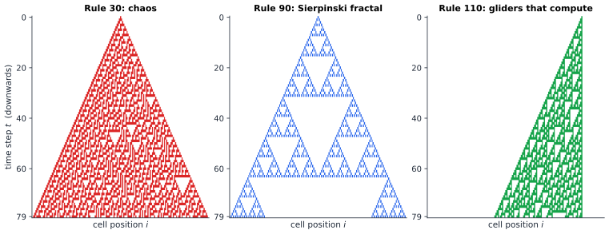
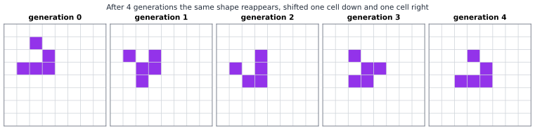

# Chapter 86 — Cellular Automata and Emergent Worlds

[← Previous](85-bifurcations.md) · [Track I](README.md) · [Table of Contents](../../00-front/table-of-contents.md) · [Next →](87-network-science.md)

> **Level 2 · Track I — Dynamical Systems, Chaos, and Complexity**
> **Builds on:** [Ch. 17](../../part-5-transforms/17-z-transforms.md#175-difference-equations), [Ch. 22](../../part-7-numerical-computational/22-numerical-methods.md#2210-numerical-solution-of-pdes), [Ch. 24](../../part-7-numerical-computational/24-computational-mathematics.md#241-algorithmic-thinking), [Ch. 83](83-dynamical-systems.md) · **Leads to:** [Ch. 87](87-network-science.md), [Ch. 88](88-complexity-science.md) · **Related:** [Ch. 30](../a-algorithms/30-limits-of-computation.md), [Ch. 73](../g-graphics-simulation/73-fractals.md), [Ch. 74](../g-graphics-simulation/74-procedural-generation.md), [Ch. 81](../h-cryptography-coding/81-pseudorandomness.md), [Ch. 84](84-chaos-theory.md)
> **Reading time:** ~25 min

## 86.1 The hook

Take a row of light bulbs, each either on or off. Once a second, every bulb looks at itself and its two immediate neighbours, and decides whether to be on or off in the next second. All bulbs use the same rule. There is no conductor, no memory beyond one second, no randomness, and nothing any bulb can see except three bits.

There are only $2^3=8$ possible neighbourhoods, and a rule is just a choice of on or off for each, so there are exactly $2^8=256$ such rules. You could print every one on a single sheet of paper. Surely, with so little to work with, the behaviour must be boring: everything dies out, or everything lights up, or some simple stripe repeats forever.

Start with a single bulb lit and run three of those rules. One draws a perfect fractal, the Sierpinski triangle, with no sign that anyone asked for it. One produces a pattern so disordered that its centre column was used for years as the random-number generator inside a commercial computer-algebra system. And one, which differs from its neighbours in the table by only a couple of bits, was proved in 2004 to be able to compute *anything any computer can compute*. Three bits of input per cell, and somewhere among the 256 rules sits a universal computer.

That is the paradox this chapter is about. How do rules that are purely local, tiny and deterministic produce patterns that are global, enormous and, in a precise sense, unpredictable? And if the rule is that simple, why can't we just *solve* it, the way we solve a linear difference equation?

## 86.2 The big idea

A **cellular automaton** (CA) is a dynamical system ([Ch. 83](83-dynamical-systems.md)) stripped to the bone. Space is a grid of cells. Time is a tick of a clock. Each cell holds one of a few states, and at every tick all cells update *simultaneously* by the same local rule, reading only the states in a small neighbourhood. That's the whole definition.

The analogy worth carrying is a stadium wave. Nobody in the crowd sees the wave. Each person follows one local rule ("stand up shortly after the person on your left stands, then sit down"), and a large-scale object, the wave, moves around the stadium at a definite speed, with a definite width, and survives collisions with stragglers. The wave isn't written anywhere in the rule. It is **emergent**: a pattern that belongs to the collective and has properties (speed, shape, persistence) that no individual has.

Cellular automata let us study emergence with nothing hidden. In a fluid or a brain we never know whether the interesting behaviour comes from details we left out. In a CA there are no details to leave out. If something interesting appears, the rule alone did it.


*Three elementary cellular automata started from one live cell. Each row is the whole world at one instant; time runs downwards. Rule 30 (left) looks random, rule 90 (centre) is the Sierpinski triangle, and rule 110 (right) grows a lattice of interacting structures that can be made to compute.*

Look at the figure the way a physicist looks at a bubble chamber. A one-dimensional CA leaves its entire history as a two-dimensional picture, the **space–time diagram**. Every pattern in that picture is something the rule did. The triangles in rule 90 nest inside one another forever; the speckle in rule 30 never settles; the diagonal stripes in rule 110 are moving particles, sometimes called *gliders*, that collide and either annihilate or create new ones.

Three intuitions carry the rest of the chapter.

1. **Locality limits speed.** A cell can only hear from its neighbours, so information moves at most one cell per tick. Every CA has a built-in speed of light, and the edges of the triangles above are exactly that light cone.
2. **Linearity makes things solvable.** Rule 90 says "new state = left XOR right". XOR is addition modulo 2, so rule 90 is a *linear* system, and linear systems obey superposition. That's why we will be able to predict its every cell exactly, in the same way we solve a linear difference equation with the Z-transform ([Ch. 17](../../part-5-transforms/17-z-transforms.md#175-difference-equations)).
3. **Nonlinearity plus locality breeds complexity.** Rule 30 is "left XOR (centre OR right)". That one OR breaks linearity, and with it every shortcut. Rule 110 goes further: its gliders are rich enough to store and process information.

## 86.3 The mathematics

### Elementary cellular automata

> [!definition] Elementary cellular automaton
> An **elementary cellular automaton** (ECA) is a map on configurations $x=(x_i)_{i\in\mathbb{Z}}$ with $x_i\in\{0,1\}$, given by
> $$
> x_i^{t+1}=f\left(x_{i-1}^{t},\,x_i^{t},\,x_{i+1}^{t}\right)
> $$
> for a fixed **local rule** $f:\{0,1\}^3\to\{0,1\}$, applied to every $i$ at once. On a finite ring of $n$ cells, indices are read modulo $n$ (periodic boundary).

Wolfram's numbering turns the rule into a byte. List the neighbourhoods in descending binary order, $111,110,\dots,000$, write the output bit under each, and read the eight output bits as a binary number. For rule 30:

| neighbourhood $(x_{i-1},x_i,x_{i+1})$ | 111 | 110 | 101 | 100 | 011 | 010 | 001 | 000 |
|---|---|---|---|---|---|---|---|---|
| new $x_i$ | 0 | 0 | 0 | 1 | 1 | 1 | 1 | 0 |

and $00011110_2=30$. Equivalently, bit $k$ of the rule number is the output for the neighbourhood whose binary value is $k$; that is exactly how the code in §86.4 reads it. In Boolean form, writing $\oplus$ for XOR,

$$
\begin{aligned}
\text{rule 30:}\quad & x_i^{t+1}=x_{i-1}\oplus\left(x_i\lor x_{i+1}\right),\\
\text{rule 90:}\quad & x_i^{t+1}=x_{i-1}\oplus x_{i+1},\\
\text{rule 110:}\quad & x_i^{t+1}=\left(x_i\oplus x_{i+1}\right)\lor\left(x_i\land\lnot x_{i-1}\right),
\end{aligned}
$$

each of which you can check against its eight-entry table in a minute (all three were checked by brute force).

Two symmetries cut the 256 rules down. Mirror reflection (swap left and right) and complementation (swap 0 and 1) map rules to rules with "the same" behaviour, and the 256 rules fall into 88 essentially different classes. Rule 110, for instance, is the mirror image of rule 124.

### Result 1: the speed of light

> [!theorem] Light cone
> If two configurations $x$ and $y$ agree on the cells $a\le i\le b$ at time $0$, then under any ECA they agree on $a+t\le i\le b-t$ at time $t$. Equivalently, the state of cell $i$ at time $t$ depends only on cells $i-t,\dots,i+t$ at time $0$.

*Proof.* Induction on $t$. The case $t=0$ is the hypothesis. If $x^t$ and $y^t$ agree on $[a+t,\,b-t]$, take any $i$ with $a+t+1\le i\le b-t-1$. Its neighbours $i-1,i,i+1$ all lie in $[a+t,\,b-t]$, so the local rule sees identical inputs and $x_i^{t+1}=y_i^{t+1}$. $\blacksquare$

That is why every pattern in the figure lives inside a triangle of slope one: a single live cell can't influence anything outside its cone. Rule 30 fills its cone entirely; rule 110 fills only the left half, because its rule happens to send information leftwards faster than rightwards. The same idea, a finite propagation speed set by the stencil, is the CFL condition for explicit PDE solvers ([Ch. 22](../../part-7-numerical-computational/22-numerical-methods.md#2210-numerical-solution-of-pdes)). A CA is, in a sense, a PDE solver that forgot to have a PDE.

### Result 2: rule 90 is Pascal's triangle in disguise

Rule 90 is linear over the two-element field $\mathbb{F}_2=\{0,1\}$ with addition $\oplus$. If $x$ and $y$ are two configurations, then applying rule 90 to $x\oplus y$ gives the XOR of the two separate results, because $(x_{i-1}\oplus y_{i-1})\oplus(x_{i+1}\oplus y_{i+1})=(x_{i-1}\oplus x_{i+1})\oplus(y_{i-1}\oplus y_{i+1})$. Superposition holds, so it is enough to understand one live cell.

Encode a configuration as a Laurent polynomial with coefficients in $\mathbb{F}_2$, $X(z)=\sum_i x_i z^i$, the same bookkeeping trick as a generating function or a Z-transform. Shifting left and right is multiplication by $z$ and $z^{-1}$, so one step of rule 90 is

$$
X^{t+1}(z)=\left(z+z^{-1}\right)X^{t}(z),\qquad\text{hence}\qquad X^{t}(z)=\left(z+z^{-1}\right)^{t}X^{0}(z).
$$

> [!theorem] The single-seed solution of rule 90
> Starting from one live cell at position $0$, cell $k$ is alive at time $t$ if and only if $t+k$ is even and $\binom{t}{(t+k)/2}$ is odd. The number of live cells at time $t$ is exactly
> $$
> N(t)=2^{s(t)},
> $$
> where $s(t)$ is the number of 1s in the binary expansion of $t$.

*Proof.* With $X^0=1$, the binomial theorem gives $X^t(z)=\sum_{m=0}^{t}\binom{t}{m}z^{2m-t}$ with coefficients read modulo 2. Setting $k=2m-t$ gives the first claim.

For the count, use the "freshman's dream", which is true in characteristic 2: $(a+b)^2=a^2+2ab+b^2=a^2+b^2$, and by repeating it, $(a+b)^{2^m}=a^{2^m}+b^{2^m}$. Write $t=2^{m_1}+2^{m_2}+\dots+2^{m_s}$ with distinct $m_1>m_2>\dots>m_s$. Then

$$
\left(z+z^{-1}\right)^{t}=\prod_{r=1}^{s}\left(z^{2^{m_r}}+z^{-2^{m_r}}\right).
$$

Expanding the product picks one of two signs from each factor, giving $2^s$ terms $z^{\pm2^{m_1}\pm2^{m_2}\pm\dots\pm2^{m_s}}$. These exponents are all distinct: two different sign choices first differ at some largest power $2^{m_r}$, which changes the sum by $2\cdot2^{m_r}=2^{m_r+1}$, while all smaller powers together can change it by at most $2(2^{m_r}-1)<2^{m_r+1}$. So no two terms cancel, and there are exactly $2^{s(t)}$ live cells. $\blacksquare$

So at $t=63=111111_2$ the row has $2^6=64$ live cells, and one tick later, at $t=64=1000000_2$, it collapses to just $2$: the two lonely seeds at the bottom of the centre panel. Summing over the first $2^n$ rows gives $3^n$ live cells in total (729 for the 64 rows drawn), which is precisely the self-similar counting of the Sierpinski triangle, whose fractal dimension $\log 3/\log 2\approx1.585$ you meet in [Ch. 73](../g-graphics-simulation/73-fractals.md). The fractal is the shadow of a binomial theorem.

> [!tip] Engineering note
> Linear CAs over $\mathbb{F}_2$ are the spatial cousins of linear-feedback shift registers. Built-in self-test circuits in VLSI chips use rule-90/150 hybrid automata as pattern generators, because each cell needs only one XOR gate and neighbours are physically adjacent, so the wiring is short.

### Result 3: worlds with no past

Run a CA forward and you get a future. Can you also run it backward? A configuration with no predecessor at all is called a **Garden of Eden**: it can be a starting state, but the rule can never *produce* it.

> [!theorem] Gardens of Eden for rule 90 on a ring
> On a ring of $n\ge3$ cells, rule 90 is not invertible. When $n$ is odd, exactly half of all $2^n$ configurations are Gardens of Eden; when $n$ is even, exactly three quarters are.

*Proof.* On the ring, rule 90 is a linear map $\mathbf{A}:\mathbb{F}_2^n\to\mathbb{F}_2^n$, $(\mathbf{A}x)_i=x_{i-1}\oplus x_{i+1}$. Its kernel is the set of $x$ with $x_{i-1}=x_{i+1}$ for all $i$, so the cells two apart agree. If $n$ is odd, stepping by 2 around the ring visits every cell, so all cells are equal: the kernel is $\{00\dots0,\,11\dots1\}$, of dimension 1. If $n$ is even, the even-indexed cells must all agree and the odd-indexed cells must all agree, independently, which gives four kernel elements, dimension 2. By rank–nullity ([Ch. 9](../../part-3-linear-algebra/09-vector-spaces-and-linear-transformations.md)), the image has dimension $n-1$ or $n-2$, so it contains $2^{n-1}$ or $2^{n-2}$ configurations. Everything outside the image is a Garden of Eden, a fraction $1/2$ or $3/4$. $\blacksquare$

Notice the logic: rule 90 is non-injective (two different states, like all-zeros and all-ones, both map to all-zeros), and *therefore* non-surjective. On a finite set that is trivial. The deep fact is that it stays true on infinite grids for every CA, linear or not:

> [!theorem] Moore–Myhill Garden-of-Eden theorem (stated)
> A cellular automaton on $\mathbb{Z}^d$ has Garden-of-Eden configurations if and only if it has two configurations that differ in finitely many cells but have the same image.

Conway's Game of Life has both, so it has Gardens of Eden, and people have found explicit ones. Information destruction (two pasts, one future) forces impossibility (some futures with no past). That trade-off is the discrete seed of the thermodynamic arrow of time.

### Two dimensions: the Game of Life

In 1970 John Conway designed a two-dimensional CA on the square grid, with each cell reading its eight surrounding neighbours. The rule, written B3/S23, is:

- a dead cell with exactly 3 live neighbours is **born**;
- a live cell with 2 or 3 live neighbours **survives**;
- every other cell is dead at the next tick.

Out of this come still lifes (a $2\times2$ block never changes), oscillators (three in a row flips between horizontal and vertical with period 2), and the famous **glider**: five cells that, after four generations, reproduce their own shape shifted one cell diagonally.


*A glider in Conway's Game of Life. The intermediate shapes are different, but generation 4 is generation 0 translated by one cell diagonally, so the glider travels at a quarter of the speed of light, $c/4$.*

Gliders carry information across the grid. A **glider gun** (found by Bill Gosper in 1970) emits one every 30 generations, and colliding streams of gliders can be arranged to behave like AND, OR and NOT gates, wires and memory. Assemble enough of them and Life simulates a universal Turing machine. People have since built, inside Life, a working digital clock, a Life simulator running Life, and a pattern that computes the primes.

### Wolfram's four classes and universality

Running all 256 elementary rules from random starts, Stephen Wolfram sorted their behaviour into four qualitative classes:

| class | behaviour | examples |
|---|---|---|
| I | everything converges to a uniform state | rule 0, rule 32 |
| II | settles into stable or periodic stripes | rule 4, rule 108 |
| III | chaotic, aperiodic, random-looking | rule 30, rule 45 |
| IV | localised structures that move and interact | rule 110, Life |

Classes I–III map onto ideas from [Ch. 83](83-dynamical-systems.md) and [Ch. 84](84-chaos-theory.md): fixed points, periodic orbits and chaos. Class III rules show sensitive dependence: flip one cell in rule 30 and the difference spreads rightwards at the full speed of light (one cell per tick) and leftwards at roughly a fifth of it, never healing. Class IV is new. It sits between order and chaos, and it is the class where computation lives.

> [!theorem] Universality of rule 110 (Cook, 2004; stated)
> With a suitable periodic background and finite initial pattern, rule 110 can simulate any Turing machine.

The proof shows that rule 110's gliders can emulate a *cyclic tag system*, a simple string-rewriting machine already known to be universal. It is long and ingenious, and its consequence is drastic. Universality plus the halting problem ([Ch. 30](../a-algorithms/30-limits-of-computation.md)) means that questions like "will this rule-110 pattern ever produce glider type X?" are **undecidable**: no algorithm answers them for all inputs. For such systems, there is in general no shortcut. The fastest way to learn what the automaton does in a million steps is to run it for a million steps. Wolfram calls this *computational irreducibility*.

That answers the hook's second question. We can solve rule 90 because it is linear: a closed form exists, and $N(t)=2^{s(t)}$ lets you jump to step $10^{100}$ instantly. We cannot solve rule 110, and not merely because nobody has been clever enough. If a general closed form existed, it would decide the halting problem.

> [!mystery] Is rule 30 really random?
> Rule 30's centre column starts $1,1,0,1,1,1,0,0,1,1,\dots$ and over the first 1000 steps it is 1 about 48% of the time, as a fair coin would be. Every statistical test anyone has run on it passes. Yet nobody has proved that the column is not eventually periodic, that 0s and 1s each occur with limiting frequency $\tfrac12$, or that computing the $n$th bit requires about $n$ steps of work. Wolfram offered prizes for each of the three in 2019, and they remain unclaimed. What it would even *mean* to prove "random-looking" is the subject of [Ch. 81](../h-cryptography-coding/81-pseudorandomness.md), where randomness is defined by what no efficient algorithm can tell apart.

### When the averages lie: mean-field theory

Here is a tempting shortcut. Pretend each cell of Life is independently alive with probability $p$. Then a dead cell is born with probability $\binom83p^3(1-p)^5$, a live cell survives with probability $\binom82p^2(1-p)^6+\binom83p^3(1-p)^5$, and the density obeys a one-dimensional map

$$
p_{t+1}=F(p_t)=84\,p_t^3(1-p_t)^6+56\,p_t^4(1-p_t)^5.
$$

This **mean-field** map has a stable fixed point at $p^*\approx0.370$ (with $F'(p^*)\approx-0.08$, so convergence is fast) and an unstable threshold at $p\approx0.192$ below which it predicts extinction. Now actually run Life from a random 35% soup. The density does not settle near 37%; it falls below 10% within about a hundred generations and keeps sinking for thousands more, to roughly 3% (on a $300\times300$ torus): scattered blocks, blinkers and the odd glider. Mean-field theory is wrong by an order of magnitude.

The error is the independence assumption. Live cells in Life are strongly *correlated*: they cluster into small structures with empty space between them. The whole point of emergence is that the parts are not independent, so any theory that averages them away throws away the phenomenon. You will meet the same failure, and the same partial rescue, in network epidemics ([Ch. 87](87-network-science.md)) and in critical phenomena ([Ch. 88](88-complexity-science.md)).

## 86.4 The algorithm

### Updating a whole world at once

The only subtle point in simulating a CA is the word *simultaneously*. If you update cells one by one in a loop, overwriting as you go, cell $i+1$ sees the *new* value of cell $i$ and you are simulating a different system. Always compute the next configuration from a frozen copy of the current one.

With NumPy the freeze comes for free: build the neighbourhood index for every cell in one vectorised expression and look the answers up in the rule table.

```python
import numpy as np

def eca_step(x, rule):
    table = np.array([(rule >> k) & 1 for k in range(8)], dtype=np.uint8)
    left, right = np.roll(x, 1), np.roll(x, -1)      # periodic ring
    return table[4 * left + 2 * x + right]           # neighbourhood -> bit k of rule

def life_step(G):
    n = sum(np.roll(np.roll(G, a, 0), b, 1)
            for a in (-1, 0, 1) for b in (-1, 0, 1)) - G   # live-neighbour count
    return ((n == 3) | ((G == 1) & (n == 2))).astype(np.uint8)
```

`4*left + 2*x + right` is the neighbourhood read as a 3-bit binary number $k$, so `table[k]` is bit $k$ of the rule number, exactly Wolfram's convention. For Life, the neighbour count is a sum of eight shifted copies of the grid; equivalently, a 2-D convolution with a $3\times3$ kernel of ones whose centre is zero, which is the same stencil idea as a finite-difference Laplacian.

### Cost and tricks

One step costs $O(N)$ for $N$ cells, so $T$ steps cost $O(NT)$, and there is no way around this for irreducible rules. Engineers still find huge constant factors:

- **Bit packing.** Store 64 cells in one machine word and apply the Boolean formula for the rule with word-wide AND, OR and XOR. Rule 90 becomes `(x << 1) ^ (x >> 1)` and processes 64 cells per instruction.
- **Activity lists.** In Life most of the grid is empty and stays empty. Only cells next to a change can change, so track the active region.
- **HashLife.** Bill Gosper's algorithm memoises the evolution of quadtree blocks: a $2^k\times2^k$ block determines its own centre $2^{k-2}$ generations later (light cone again!), and since repetitive patterns reuse the same blocks, it can leap billions of generations ahead for structured patterns. On random soup it gains nothing, which is computational irreducibility showing its teeth.

### Failure cases

> [!warning] The boundary is part of the rule
> A periodic ring of $n$ cells is a *different dynamical system* from the infinite line. Once the light cone wraps around (after about $n/2$ steps for a single seed), the two sides interfere and the picture changes. Rule 90 on a ring of $2^m$ cells dies completely at $t=2^{m-1}$: by the freshman's dream, $(z+z^{-1})^{2^{m-1}}=z^{2^{m-1}}+z^{-2^{m-1}}$, and on the ring $z^{2^m}=1$, so the two terms are the same cell and cancel. Fixed-zero boundaries give yet another system. Always state the boundary condition, and make the grid much wider than the light cone if you want the infinite-line behaviour.

Other pitfalls: using signed `int8` and overflowing neighbour counts (fine for Life, since the maximum is 8, but not for automata with many states); and drawing conclusions from a single random seed, when classes III and IV can look alike for a few hundred steps.

## 86.5 The experiment

### Part 1: your own space–time diagrams

Run this script, then change the knobs at the top.

```python
import numpy as np
import matplotlib.pyplot as plt

RULE   = 30        # try 90, 110, 184, 54, 73, 45, 150
WIDTH  = 301       # number of cells (periodic ring)
STEPS  = 200       # number of time steps
RANDOM = False     # True: random start; False: single live cell
SEED   = 1

table = np.array([(RULE >> k) & 1 for k in range(8)], dtype=np.uint8)
rng = np.random.default_rng(SEED)
x = rng.integers(0, 2, WIDTH).astype(np.uint8) if RANDOM else np.zeros(WIDTH, np.uint8)
if not RANDOM:
    x[WIDTH // 2] = 1

rows = [x]
for _ in range(STEPS - 1):
    x = table[4 * np.roll(x, 1) + 2 * x + np.roll(x, -1)]
    rows.append(x)
grid = np.array(rows)

centre = grid[:, WIDTH // 2]
print(f"rule {RULE}: final density {grid[-1].mean():.3f}, "
      f"centre column mean {centre.mean():.3f}")

plt.figure(figsize=(8, 5))
plt.imshow(grid, cmap="Greys", interpolation="nearest", aspect="auto")
plt.title(f"Rule {RULE}")
plt.xlabel("cell")
plt.ylabel("time")
plt.show()
```

Things to try:

- Set `RULE = 90` and `WIDTH = 256` and watch the Sierpinski triangle wrap around and annihilate at $t=128$, as the warning above predicts.
- Set `RANDOM = True` and compare rules 30 and 110. Rule 110's background settles into a periodic texture with gliders sliding over it; rule 30 never settles.
- Rule 184 is a traffic model: a 1 is a car that moves right if the cell ahead is empty. Start random with density below and above $\tfrac12$ and look for traffic jams that move *backwards*.
- Flip one bit of a random start (`x[WIDTH//2] ^= 1` on a second copy) and plot the XOR of the two runs: that is the CA's version of the butterfly effect from [Ch. 84](84-chaos-theory.md).

### Part 2: the mean-field map for Life

The density map from §86.3 is a one-dimensional iterated map, so a cobweb picture tells you everything the mean-field theory believes.

```desmos-graph
left=0; right=0.6; bottom=0; top=0.6
---
y=84x^{3}(1-x)^{6}+56x^{4}(1-x)^{5}|blue
y=x|black|dashed
(0.192,0.192)|label:unstable threshold
(0.370,0.370)|label:stable density
```

*Mean-field density map $p_{t+1}=F(p_t)$ for the Game of Life (blue) against the diagonal. The blue curve crosses the diagonal at the two fixed points marked. The real Life soup ends near 3%, far below the stable point the curve predicts.*

The polynomial is "born with exactly 3" plus "survive with 2 or 3". Change the rule and watch the fixed points move. HighLife (B36/S23) adds birth on 6 neighbours: add the term `28x^{6}(1-x)^{3}`, which is the probability $(1-x)$ that the cell was dead times $\binom86x^6(1-x)^2$. Or try "Seeds" (B2/S, every live cell dies), whose map is just $(1-x)\binom82x^2(1-x)^6=28x^2(1-x)^7$. Ask each time: does the mean-field prediction match what the real automaton does? Run the Life step from §86.4 to find out.

## 86.6 The challenge

1. **Intuition.** Without running any code, predict what rule 0, rule 255, rule 204 and rule 51 do from any starting configuration. (Hint: write out the eight-entry tables.) Then explain in one sentence why rule 184, the traffic rule, must conserve the number of 1s, and why no rule that conserves 1s can ever be in Wolfram's class I unless the density is 0 or 1.
2. **Derivation.** Rule 150 is $x_i^{t+1}=x_{i-1}\oplus x_i\oplus x_{i+1}$. Show that it is linear over $\mathbb{F}_2$, write its single-seed evolution as $\left(z^{-1}+1+z\right)^tX^0(z)$, and prove that the number of live cells at time $2^m$ is exactly 3. Then decide, for rings of $n$ cells, for which $n$ rule 150 is invertible, by computing its kernel as in Result 3.
3. **Implementation.** Write a program that classifies all 88 inequivalent elementary rules automatically. From 20 random starts on a ring of 400 cells, run 1000 steps and compute (a) the final density, (b) whether the configuration has become periodic in time, and (c) the spreading speed of a single flipped bit. Use these numbers to sort the rules into Wolfram's four classes, and list the rules your program cannot confidently place.
4. **Open investigation.** Search the space of two-dimensional "Life-like" rules (each is a pair of sets B/S of neighbour counts, so there are $2^{18}=262144$ of them) for rules that support a glider. Starting from random soups of density 0.3, how often do spontaneously moving objects appear? Is there a simple statistic of the rule (the number of birth conditions, the mean-field fixed point, the rate of density decay) that predicts whether gliders exist? Nobody has a clean criterion.

## 86.7 Loose threads

The chapter showed that tiny local rules can be solvable (rule 90), random-looking (rule 30) or universal (rule 110 and Life), and that mean-field averaging fails precisely where things get interesting. It skipped three big questions on purpose.

> [!mystery] Does computation live at the edge of chaos?
> Class IV sits between frozen order (classes I and II) and seething disorder (class III). In 1990 Chris Langton parametrised rules by $\lambda$, the fraction of neighbourhoods that map to a live state, and claimed that complex, computation-capable behaviour clusters near a critical $\lambda$, the way a magnet is most responsive at its critical temperature. Others reran the experiments and disputed the conclusion. Is there a phase transition in "rule space", and is it where adaptive systems, from cells to brains, tune themselves? The idea of self-tuned criticality returns in [Ch. 88](88-complexity-science.md), and whether it holds up is still argued.

> [!mystery] Can a cellular automaton be a fluid?
> Put particles on a hexagonal lattice, let them hop and collide by a few local rules that conserve number and momentum, and average over large blocks. In 1986 Frisch, Hasslacher and Pomeau showed that the averages obey the Navier–Stokes equations of fluid dynamics, even though nothing in the rules mentions viscosity or pressure. Why do the conservation laws and the lattice symmetry alone fix the continuum equations, and why does a square lattice give the *wrong* answer? That passage from discrete microscopic rules to continuum PDEs is a theme of [Ch. 92](../j-frontier/92-mathematical-physics.md).

Other threads:

- **Undecidability, made precise.** The claim that rule 110 has undecidable long-term behaviour rests on the halting problem and on reductions between machines, which [Ch. 30](../a-algorithms/30-limits-of-computation.md) builds from scratch.
- **Procedural worlds.** Game designers use CAs (for instance, "a wall survives if 4 or more of its 8 neighbours are walls") to carve caves from noise in a few passes: [Ch. 74](../g-graphics-simulation/74-procedural-generation.md).
- **From grids to networks.** A CA lives on a lattice where every cell has the same neighbours. Real systems, from power grids to social networks, have wildly uneven neighbourhoods, and the same local-rule thinking on an irregular graph is the subject of [Ch. 87](87-network-science.md).
- **Reversible worlds.** Some CAs are invertible, so no information is ever lost. Physics at the microscopic level is reversible too. Whether reversible CAs can still be universal (they can) and what that has to do with the energy cost of computation is a story about Landauer's principle that [Ch. 33](../b-probability-information/33-information-theory.md) starts.

## Further reading

- S. Wolfram, *A New Kind of Science*, Wolfram Media, 2002 (free online). The exhaustive, opinionated catalogue of elementary rules and the four classes.
- M. Cook, "Universality in elementary cellular automata," *Complex Systems* 15 (2004), 1–40. The rule-110 proof.
- E. R. Berlekamp, J. H. Conway and R. K. Guy, *Winning Ways for Your Mathematical Plays*, vol. 4, 2nd ed., A K Peters, 2004. Includes the construction of a universal computer in Life.
- O. Martin, A. M. Odlyzko and S. Wolfram, "Algebraic properties of cellular automata," *Communications in Mathematical Physics* 93 (1984), 219–258. Rule 90 and its relatives done properly with polynomials over $\mathbb{F}_2$.
- N. Johnston and D. Greene, *Conway's Game of Life: Mathematics and Construction*, 2022 (free online). A modern, rigorous tour of Life's engineering.
