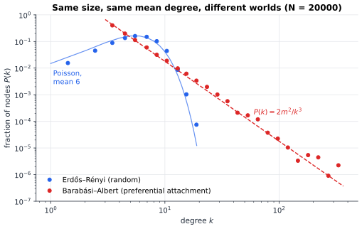
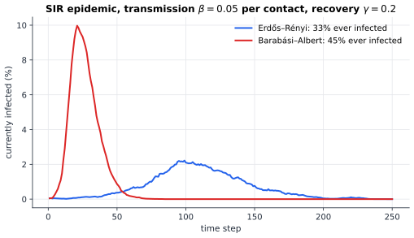
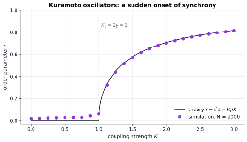

# Chapter 87 — Network Science: The Shape of Complex Systems

[← Previous](86-cellular-automata.md) · [Track I](README.md) · [Table of Contents](../../00-front/table-of-contents.md) · [Next →](88-complexity-science.md)

> **Level 2 · Track I — Dynamical Systems, Chaos, and Complexity**
> **Builds on:** [Ch. 11](../../part-4-differential-equations/11-ordinary-differential-equations.md#119-systems-of-differential-equations), [Ch. 19](../../part-6-probability-statistics/19-probability.md#199-expectation-and-variance), [Ch. 27](../a-algorithms/27-graph-theory.md), [Ch. 34](../b-probability-information/34-random-walks-and-markov-chains.md) · **Leads to:** [Ch. 88](88-complexity-science.md), [Ch. 90](../j-frontier/90-spectral-theory.md) · **Related:** [Ch. 10](../../part-3-linear-algebra/10-eigenvalues-and-eigenvectors.md), [Ch. 45](../c-game-theory/45-evolutionary-games.md), [Ch. 86](86-cellular-automata.md)
> **Reading time:** ~25 min

## 87.1 The hook

On average, your friends have more friends than you do.

This is not a statement about you. It is true for most people in almost every social network ever measured, from Facebook to high-school friendships to sexual-contact surveys. It sounds like a statistical insult, and it is a theorem, one we will prove in five lines.

Here is a second puzzle with the same root. Two cities each have a million people, and in both, the average person has six close contacts. A new virus arrives in each, with identical biology: same chance of passing per contact, same recovery time. In one city the outbreak fizzles. In the other it infects nearly half the population. Nothing differs except *who is connected to whom*.

And a third. On a summer evening in Southeast Asia, thousands of male fireflies in a single tree begin to flash in unison. Nobody conducts them. Each firefly only adjusts its rhythm slightly toward the flashes it sees. Below a certain level of mutual influence, nothing happens; the tree twinkles at random. Above it, synchrony appears suddenly and spreads through the tree.

Three phenomena, one lesson. Once many parts interact, the **pattern of connections** is itself a variable, often the most important one. The question for this chapter: what can mathematics say about a system when you know the shape of its network but not the details of its parts?

## 87.2 The big idea

[Chapter 27](../a-algorithms/27-graph-theory.md) treated a graph as a fixed object to be searched: find the shortest path, the best matching, the communities. Network science asks a different question. Real networks have millions of nodes, nobody designed them, and they grow and change. So instead of studying one graph, we study **families of random graphs** with the right statistics, and ask which large-scale properties are almost certain.

The single most revealing statistic is the **degree distribution** $P(k)$: the fraction of nodes with exactly $k$ links. Two networks can share size and mean degree and still be different worlds.


*Two networks of 20,000 nodes, both with mean degree 6. In the random (Erdős–Rényi) network, degrees cluster tightly around 6 and nobody has more than 18 links. In the preferential-attachment (Barabási–Albert) network, the distribution is a straight line on log–log axes, a power law, and the best-connected node has 365 links.*

Picture the two as road maps. The Erdős–Rényi network is like rural roads: every village has a handful of connections and no village is special. The Barabási–Albert network is like an airline map: most airports have a few routes, and a few hubs have hundreds. In the second kind there is no "typical" scale, which is why it is called **scale-free**.

Three intuitions follow and organise the rest of the chapter.

1. **Thresholds are everywhere.** Add links to a sparse random network one by one and nothing much happens, until suddenly a single connected "giant component" spans the network. The same arithmetic governs whether a disease, a rumour or a power-grid failure spreads: an epidemic is a giant component of infections.
2. **Hubs dominate.** If you reach a node by following a link, you are more likely to land on a hub, simply because hubs have more links pointing at them. That one bias explains the friendship paradox and why scale-free networks are so vulnerable to epidemics.
3. **Coupling creates collective rhythm.** Oscillators that each nudge each other weakly can, above a critical coupling, lock into synchrony. Like the giant component, it appears abruptly at a threshold.

## 87.3 The mathematics

### Random networks and the giant component

> [!definition] Erdős–Rényi random graph
> $G(n,p)$ has $n$ nodes, and each of the $\binom n2$ possible edges is present independently with probability $p$. Its mean degree is $c=(n-1)p$. For large $n$ with $c$ fixed, the degree of a node is $\operatorname{Binomial}(n-1,p)\approx\operatorname{Poisson}(c)$:
> $$
> P(k)=e^{-c}\frac{c^k}{k!}.
> $$

The Poisson limit is the law of rare events from [Ch. 19](../../part-6-probability-statistics/19-probability.md#196-probability-distributions). Its variance equals its mean, so with $c=6$ almost all degrees lie between 1 and 13.

The key fact about sparse random graphs is that they are **locally tree-like**: short loops are rare, because closing a loop of length $\ell$ needs an unlikely extra edge, with probability about $c/n$. Near any node, the network looks like a branching family tree. That turns global connectivity into a branching-process calculation.

> [!theorem] The giant component
> In $G(n,c/(n-1))$ with $n\to\infty$, let $S$ be the fraction of nodes in the largest connected component. Then $S$ is the largest solution in $[0,1]$ of
> $$
> S=1-e^{-cS}.
> $$
> For $c\le1$ the only solution is $S=0$ (all components are small); for $c>1$ there is a unique solution with $S>0$, a **giant component** containing a finite fraction of all nodes.

*Derivation.* Let $u$ be the probability that a node is *not* in the giant component. A node avoids the giant component exactly when every one of its neighbours does, and in a tree-like network the neighbours' fates are independent. A node of degree $k$ therefore avoids it with probability $u^k$, and averaging over the Poisson degree,

$$
u=\sum_{k=0}^{\infty}e^{-c}\frac{c^k}{k!}u^k=e^{-c}e^{cu}=e^{-c(1-u)}.
$$

(For Poisson degrees, the number of *further* neighbours of a node reached along an edge is again $\operatorname{Poisson}(c)$, so the same $u$ appears on both sides.) Writing $S=1-u$ gives $S=1-e^{-cS}$.

Now look at the right-hand side $h(S)=1-e^{-cS}$. It is increasing and concave, with $h(0)=0$, $h'(0)=c$ and $h(1)<1$. If $c\le1$, concavity puts $h(S)<cS\le S$ for every $S>0$, so the curve lies below the diagonal and only $S=0$ works. If $c>1$, the curve starts *above* the diagonal (slope $c>1$) and ends below it, so it crosses exactly once more in $(0,1)$. $\blacksquare$

The solution rises steeply: $S\approx0.583$ at $c=1.5$, $0.797$ at $c=2$, and $0.997$ at $c=6$. (A simulation of $n=100{,}000$ nodes at $c=2$ gives $0.797$.) The transition at $c=1$ is a genuine **phase transition**, like water freezing: as $c$ crosses 1, the size of the largest cluster jumps from a vanishing fraction to a finite one. You will watch it happen in the experiment.

The tree-like picture also explains why random networks are **small worlds**. From a typical node, about $c$ nodes are one step away, $c^2$ two steps away, and $c^\ell$ at distance $\ell$. These run out of network when $c^\ell\approx n$, so typical distances are

$$
\ell\approx\frac{\ln n}{\ln c}.
$$

For $n=20{,}000$ and $c=6$ this gives $5.5$, and the network in the figure has mean distance $5.8$. Distances grow only *logarithmically* with size: that is the "six degrees of separation" phenomenon, explained by nothing more than branching.

### Result 2: the friendship paradox

Pick a random node and look at its degree: on average, $\langle k\rangle$. Now pick a random *edge* and follow it to one of its ends. A node with $k$ links is the end of $k$ edges, so it is reached with probability proportional to $k$. The degree of a node reached along an edge has distribution $kP(k)/\langle k\rangle$, and its mean is

$$
\langle k\rangle_{\text{neighbour}}=\sum_k k\cdot\frac{kP(k)}{\langle k\rangle}=\frac{\langle k^2\rangle}{\langle k\rangle}.
$$

> [!theorem] Friendship paradox
> In any network, the mean degree of a node reached by following a random edge is at least the mean degree of a random node:
> $$
> \frac{\langle k^2\rangle}{\langle k\rangle}=\langle k\rangle+\frac{\operatorname{Var}(k)}{\langle k\rangle}\ \ge\ \langle k\rangle,
> $$
> with equality only when every node has the same degree.

*Proof.* $\langle k^2\rangle=\langle k\rangle^2+\operatorname{Var}(k)$ ([Ch. 19](../../part-6-probability-statistics/19-probability.md#199-expectation-and-variance)). Divide by $\langle k\rangle>0$, and use $\operatorname{Var}(k)\ge0$, with equality only for constant $k$. $\blacksquare$

The size of the paradox is the variance. For the random network in the figure, $\langle k\rangle=6$ and $\langle k^2\rangle/\langle k\rangle=7.0$: your friends have one more friend than you. For the scale-free network with the *same* mean degree, $\langle k^2\rangle/\langle k\rangle=19.5$: your friends have more than three times as many friends as you. The hubs are hiding in everyone's friend list.

> [!tip] Engineering note
> The paradox is a sampling tool. To find well-connected nodes without knowing the network, pick random nodes and ask each for *a random neighbour*. During outbreaks, monitoring the friends of randomly chosen people detects epidemics earlier than monitoring the people themselves, and "acquaintance immunisation" (vaccinate a random friend of a random person) protects a scale-free population far better than random vaccination.

### Result 3: where power laws come from

The Erdős–Rényi model can never produce a hub with 365 links: the Poisson tail falls faster than exponentially. In 1999 Barabási and Albert proposed a mechanism with two ingredients that real networks (the web, citations, airline routes) clearly have: **growth** and **preferential attachment**, "the rich get richer".

> [!definition] Barabási–Albert model
> Start with a few connected nodes. At each time step add one new node with $m$ edges, and attach each edge to an existing node $i$ with probability proportional to its degree, $k_i/\sum_jk_j$.

> [!theorem] Degree exponent of the BA model
> In the continuum (mean-field) approximation, the BA model produces a degree distribution $P(k)\approx2m^2/k^3$ for $k\ge m$: a power law with exponent 3.

*Derivation.* After $t$ steps there are about $t$ nodes and $mt$ edges, so $\sum_jk_j=2mt$. Treat $k_i$ as a continuous function of time. Node $i$ gains links from each of the $m$ new edges with probability $k_i/(2mt)$, so

$$
\frac{dk_i}{dt}=m\cdot\frac{k_i}{2mt}=\frac{k_i}{2t},\qquad k_i(t_i)=m,
$$

a separable ODE with solution $k_i(t)=m\sqrt{t/t_i}$, where $t_i$ is the node's birth time. Old nodes are big; that's the whole mechanism. A node has degree below $k$ exactly when it was born late enough: $k_i(t)<k\iff t_i>m^2t/k^2$. Birth times are uniform on $[0,t]$, so

$$
P(k_i<k)=1-\frac{m^2}{k^2},\qquad P(k)=\frac{d}{dk}P(k_i<k)=\frac{2m^2}{k^3}.
$$

$\blacksquare$

The dashed line in the figure is $2m^2/k^3$ with $m=3$, and the simulated network sits right on it. The important consequence is the second moment. With $P(k)\propto k^{-3}$, $\langle k^2\rangle\approx\int_m^{k_{\max}}k^2\cdot2m^2k^{-3}\,dk=2m^2\ln(k_{\max}/m)$, which grows without bound as the network grows. For exponents between 2 and 3, common in real networks, it grows like a power of $n$. **The variance of a scale-free network is effectively infinite.** Every result below that depends on $\langle k^2\rangle$ changes character.

> [!mystery] Are real networks actually scale-free?
> Power laws are easy to see and hard to prove. A straight line on a log–log plot is weak evidence: log-normal and stretched-exponential distributions mimic it over two decades. In 2019 Broido and Clauset fitted nearly a thousand real networks with careful likelihood tests and found strong power laws in only a small minority, setting off a fierce debate that is not settled. How would you even test the claim? The tools (maximum-likelihood fits, goodness-of-fit and likelihood-ratio tests) are in [Ch. 20](../../part-6-probability-statistics/20-statistical-analysis.md); the verdict on the world's networks is still an open question.

### Contagion: an epidemic is a giant component

The simplest epidemic model on a network is **SIR**: each node is Susceptible, Infected or Recovered. An infected node passes the infection along each of its edges with some probability per unit time, and recovers (permanently immune) at some rate. The well-mixed version, where everyone meets everyone, is the classic system of ODEs $\dot S=-\beta SI$, $\dot I=\beta SI-\gamma I$, $\dot R=\gamma I$ ([Ch. 11](../../part-4-differential-equations/11-ordinary-differential-equations.md#119-systems-of-differential-equations)), with its famous threshold $R_0=\beta/\gamma>1$. On a network, the threshold moves.

Collapse the timing into one number: the **transmissibility** $T$, the probability that an infected node infects a given neighbour before recovering. Then an outbreak is just a random subgraph: keep each edge with probability $T$, and the people eventually infected are the component of the kept-edge network that contains patient zero. A large epidemic is possible exactly when the kept-edge network has a giant component.

Now use the friendship-paradox calculation. Follow the infection down an edge to a newly infected node. That node was reached along an edge, so its mean degree is $\langle k^2\rangle/\langle k\rangle$; one of its edges leads back to where the infection came from, which leaves $\langle k^2\rangle/\langle k\rangle-1$ onward edges, each transmitting with probability $T$. In a tree-like network the infection is a branching process with mean offspring

$$
R=T\,\frac{\langle k^2\rangle-\langle k\rangle}{\langle k\rangle},
$$

and a branching process survives with positive probability exactly when its mean offspring exceeds 1. So the **epidemic threshold** is

$$
T_c=\frac{\langle k\rangle}{\langle k^2\rangle-\langle k\rangle}.
$$

For a Poisson network with mean $c$, $\langle k^2\rangle=c^2+c$, so $T_c=1/c$, which is the giant-component condition again with $c$ replaced by $Tc$. For the two networks in the figure: $T_c\approx0.167$ for the random network and $T_c\approx0.054$ for the scale-free one.


*The same disease on the two networks of the first figure (ten random initial cases, one realisation each). Per step, an infected node infects each susceptible neighbour with probability 0.05 and recovers with probability 0.2, giving transmissibility $T\approx0.208$. On the random network $R\approx1.25$ and the outbreak smoulders; on the scale-free network $R\approx3.9$ and it explodes through the hubs, peaks around step 20, and reaches 45% of nodes.*

That is the answer to the two-cities puzzle in the hook. Same biology, same average contacts, different variance. And for a scale-free network with exponent at most 3, $\langle k^2\rangle\to\infty$ as the network grows, so $T_c\to0$: **there is no epidemic threshold at all**. However weakly a pathogen spreads, a large enough scale-free network can sustain it, because the hubs act as amplifiers. Pastor-Satorras and Vespignani pointed this out in 2001 for computer viruses, which had puzzled everyone by persisting for years at low prevalence. The cure follows from the same algebra: target the hubs, the nodes that make $\langle k^2\rangle$ large.

> [!mystery] The threshold is an eigenvalue
> The formula $T_c=\langle k\rangle/(\langle k^2\rangle-\langle k\rangle)$ only uses the degree distribution, as if the network were otherwise random. For a *particular* network, with its clustering, communities and correlations, a different number controls the threshold: the largest eigenvalue $\lambda_{\max}$ of the adjacency matrix $\mathbf{A}$, with the threshold near $T\lambda_{\max}=1$. For the random network above $\lambda_{\max}\approx7.17$, close to $\langle k^2\rangle/\langle k\rangle=7.0$; for the scale-free one $\lambda_{\max}\approx22.6$ versus $19.5$. Why should the top eigenvalue of a matrix of 0s and 1s decide whether a disease dies out, and what does its eigenvector say about *where* to vaccinate? The Perron–Frobenius theory behind it is in [Ch. 90](../j-frontier/90-spectral-theory.md).

### Synchronisation: the Kuramoto model

Now replace "infected or not" by a phase. Give each node an oscillator with angle $\theta_i$ and its own natural frequency $\omega_i$, drawn from a distribution $g(\omega)$ that is symmetric about 0 (we can always rotate to a frame where the mean frequency is 0). Each oscillator speeds up or slows down toward the others:

$$
\frac{d\theta_i}{dt}=\omega_i+\frac{K}{N}\sum_{j=1}^{N}\sin\left(\theta_j-\theta_i\right).
$$

This is Kuramoto's model (1975), here on the complete graph; on a general network the sum runs over neighbours. To measure synchrony, average the oscillators as unit phasors in the complex plane, exactly as in a phasor diagram for AC circuits:

$$
r\,e^{j\psi}=\frac1N\sum_{j=1}^{N}e^{j\theta_j}.
$$

The **order parameter** $r\in[0,1]$ is the length of the average phasor: $r\approx0$ when phases are scattered, $r=1$ when all oscillators point the same way.

Multiply the definition by $e^{-j\theta_i}$ and take imaginary parts: $r\sin(\psi-\theta_i)=\frac1N\sum_j\sin(\theta_j-\theta_i)$. So the model becomes

$$
\frac{d\theta_i}{dt}=\omega_i+Kr\sin\left(\psi-\theta_i\right).
$$

Each oscillator feels *only the mean field*: a pull of strength $Kr$ toward the collective phase $\psi$. This is the feedback at the heart of synchrony. More order means a stronger pull, and a stronger pull creates more order.

Suppose a steady state exists with constant $r$ and $\psi=0$. An oscillator with $\lvert\omega_i\rvert\le Kr$ can sit at the fixed point $\sin\theta_i=\omega_i/(Kr)$: it is **locked**. One with $\lvert\omega_i\rvert>Kr$ drifts forever. By symmetry of $g$ the drifting ones contribute nothing to the average phasor, while a locked oscillator with $\omega=Kr\sin\theta$ contributes $\cos\theta$. Changing variables from $\omega$ to $\theta$ gives the **self-consistency equation**

$$
r=\int_{-\pi/2}^{\pi/2}\cos\theta\;g\left(Kr\sin\theta\right)Kr\cos\theta\,d\theta=Kr\int_{-\pi/2}^{\pi/2}\cos^2\theta\;g\left(Kr\sin\theta\right)d\theta.
$$

$r=0$ always solves it (incoherence). A nonzero solution branches off when, dividing by $r$ and letting $r\to0$, $1=Kg(0)\int_{-\pi/2}^{\pi/2}\cos^2\theta\,d\theta=Kg(0)\pi/2$. That is

$$
K_c=\frac{2}{\pi g(0)}.
$$

For the Lorentzian distribution $g(\omega)=\gamma/\left(\pi(\omega^2+\gamma^2)\right)$, $g(0)=1/(\pi\gamma)$, so $K_c=2\gamma$, and the integral can be done exactly to give $r=\sqrt{1-K_c/K}$ for $K>K_c$.


*Simulated order parameter (purple, 2,000 oscillators with Lorentzian frequencies, $\gamma=0.5$) against the exact large-$N$ theory (black). Below $K_c=1$ the phases stay scattered and $r$ is only finite-size noise of order $1/\sqrt N$; above it, synchrony switches on with the square-root shape of a pitchfork bifurcation ([Ch. 85](85-bifurcations.md)).*

The fireflies, the pacemaker cells of your heart, the generators of a power grid and the pedestrians who made London's Millennium Bridge sway on its opening day in 2000 all follow this script: a population of slightly different oscillators, a coupling that grows with the order it produces, and a threshold.

> [!warning] Self-consistency is not stability
> The argument above found a *candidate* steady state. It did not show that the incoherent state $r=0$ is stable below $K_c$, nor that the partially locked state is stable above it, and for $N=\infty$ both questions turn out to be surprisingly delicate. The simulation agrees with the theory, but agreement is evidence, not proof.

## 87.4 The algorithm

### Building random networks without $O(n^2)$ work

Naively, $G(n,p)$ needs a coin flip for each of $\binom n2$ pairs, which for $n=10^6$ is $5\times10^{11}$ flips. Instead, draw the *number* of edges $M\sim\operatorname{Binomial}(\binom n2,p)$, then draw $M$ random pairs. This costs $O(n+M)$, produces a handful of self-loops and duplicate edges (which you discard; there are $O(1)$ of them in expectation), and is how the figure's networks were made.

For preferential attachment, the trick is a list in which every node appears once per unit of degree. Choosing a uniformly random entry of that list *is* choosing a node with probability proportional to degree, so each new edge costs $O(1)$.

```python
def barabasi_albert(n, m, rng):
    repeated, edges, targets = [], [], list(range(m))
    for new in range(m, n):
        edges += [(new, t) for t in targets]
        repeated += targets + [new] * m          # one entry per unit of degree
        chosen = set()
        while len(chosen) < m:                   # m distinct targets
            chosen.add(repeated[rng.integers(len(repeated))])
        targets = list(chosen)
    return edges
```

The **configuration model** is the general tool: choose any degree sequence $k_1,\dots,k_n$, give node $i$ exactly $k_i$ "stubs", shuffle all stubs and pair them up. It produces a random network with exactly the degrees you asked for and nothing else, which makes it the natural null model for testing whether a real network's structure is more than its degrees.

### Simulating dynamics on networks

Store the adjacency matrix in sparse form (only the $2M$ nonzeros). One step of discrete-time SIR is then one sparse matrix–vector product: $\mathbf{A}\mathbf{i}$ counts each node's infected neighbours $n_i$, and a susceptible node is infected with probability $1-(1-\beta)^{n_i}$. Cost: $O(n+M)$ per step. For exact continuous-time dynamics, treat the epidemic as a continuous-time Markov chain ([Ch. 36](../b-probability-information/36-stochastic-processes.md)) and use the Gillespie algorithm, which draws an exponential waiting time and jumps directly from one event to the next.

For Kuramoto on the complete graph, never evaluate the double sum, which costs $O(N^2)$. Compute the order parameter $r e^{j\psi}$ in $O(N)$ and use the mean-field form; one Euler step is

```python
z = np.exp(1j * theta).mean()                       # r * exp(j psi)
theta += dt * (omega + K * np.abs(z) * np.sin(np.angle(z) - theta))
```

### Failure cases

- **Stochastic die-out.** Even above threshold, an epidemic started from one case can die in the first few generations by bad luck; for a branching process the extinction probability is the smallest root of a generating-function equation. Always average over many seeds and report the *conditional* size of large outbreaks separately.
- **Finite-size rounding.** At $c=1$ or $T=T_c$, the "transition" in a finite network is smeared over a window that shrinks only like a power of $n$. Theory is a limit; simulations live at finite $n$.
- **Stiffness and time step.** Oscillators with huge natural frequencies (the Lorentzian has heavy tails) rotate fast; an Euler step that is fine for the locked core can alias for them. They don't affect $r$ much because they drift anyway, but check by halving `dt`.
- **The hub cutoff.** In a scale-free network of size $n$ the largest degree grows like $\sqrt n$ (for exponent 3), so $\langle k^2\rangle$ grows like $\ln n$, slowly. A scale-free network of a few thousand nodes can look as if it has a threshold.

## 87.5 The experiment

### Part 1: watch the giant component appear

The equation $S=1-e^{-cS}$ is an implicit curve in the $(c,S)$ plane, and Desmos draws implicit curves directly. Here $x$ plays the role of the mean degree $c$ and $y$ the giant-component fraction $S$.

```desmos-graph
left=0; right=5; bottom=-0.05; top=1.05
---
y=1-e^{-xy}|blue
x=1|grey|dashed
y=1-e^{-1.25y}|red|dashed
(2,0.797)|label:c = 2
```

*The blue curve is the solution set of $S=1-e^{-cS}$: the trivial branch $S=0$ and the giant branch that leaves it at $c=1$. The red dashed line asks the same question at the single value $c=1.25$, the $Tc$ of the random-network epidemic: its height, about 0.37, is the predicted final epidemic size there.*

Change `1.25` in the red line to `0.9` (it collapses onto $y=0$: no outbreak), then to `3`. Replace the blue equation by `y=1-e^{-2xy}` and explain why the transition moves to $x=0.5$.

### Part 2: an epidemic on a network you design

This script builds a configuration-model network with either Poisson or power-law degrees, then runs SIR on it. It uses only NumPy.

```python
import numpy as np
import matplotlib.pyplot as plt

N, BETA, GAMMA, STEPS = 20000, 0.05, 0.2, 300
DEGREES = "powerlaw"      # "poisson" or "powerlaw"
rng = np.random.default_rng(0)

if DEGREES == "poisson":
    k = rng.poisson(6, N)
else:                     # Pareto tail, exponent ~3, minimum degree 3
    k = np.floor(3 * (1 - rng.random(N)) ** (-1 / 2)).astype(int)
k[0] += k.sum() % 2       # total number of stubs must be even
stubs = rng.permutation(np.repeat(np.arange(N), k))
u, v = stubs[0::2], stubs[1::2]
keep = u != v             # drop self-loops
u, v = u[keep], v[keep]
print(f"mean degree {k.mean():.2f}, <k^2>/<k> {np.mean(k**2)/k.mean():.1f}, max {k.max()}")

S = np.ones(N, bool); I = np.zeros(N, bool)
first = rng.choice(N, 10, replace=False); S[first] = False; I[first] = True
curve = []
for t in range(STEPS):
    n_inf = np.bincount(u[I[v]], minlength=N) + np.bincount(v[I[u]], minlength=N)
    new = S & (rng.random(N) < 1 - (1 - BETA) ** n_inf)
    rec = I & (rng.random(N) < GAMMA)
    S &= ~new
    I = (I | new) & ~rec
    curve.append(I.mean())

print(f"ever infected: {1 - S.mean():.1%}")
plt.plot(100 * np.array(curve))
plt.xlabel("time step"); plt.ylabel("infected (%)")
plt.title(f"SIR on a {DEGREES} network"); plt.show()
```

Things to try:

- Switch `DEGREES` between `"poisson"` and `"powerlaw"`. The printout shows $\langle k^2\rangle/\langle k\rangle$; predict from $T_c$ which network will have an outbreak before you look at the plot.
- Lower `BETA` to 0.02. Transmissibility drops to about $0.09$, below the Poisson threshold $1/6$: the Poisson network should stay clean while the power-law one may still burn.
- **Vaccinate the hubs.** Before the loop, set `S[np.argsort(k)[-N//20:]] = False` to immunise the best-connected 5%. Then try 5% chosen at random. Then try "acquaintance immunisation": pick 5% of random nodes and vaccinate one random *neighbour* of each. Which works, and why does the friendship paradox predict it?
- Change the Pareto exponent: `-1/2` gives $P(k)\propto k^{-3}$; `-1/1.5` gives $k^{-2.5}$, with an even fatter tail.

## 87.6 The challenge

1. **Intuition.** Ten people stand in a ring, each holding hands with the two people next to them, so everyone has degree 2. Is there a friendship paradox? Now add one person in the middle who holds a ribbon to all ten. Without calculating, say whether the paradox appears, who feels it, and how strongly. Then explain why random vaccination is a poor strategy in this network.
2. **Derivation.** Generalise the giant-component argument to any degree distribution. Let $G_0(x)=\sum_kP(k)x^k$ and $G_1(x)=G_0'(x)/G_0'(1)$. Show that the probability $u$ that an edge does not lead to the giant component satisfies $u=G_1(u)$, that $S=1-G_0(u)$, and that a giant component exists exactly when $\langle k^2\rangle>2\langle k\rangle$ (the Molloy–Reed criterion). Check that you recover $S=1-e^{-cS}$ for Poisson degrees.
3. **Implementation.** Simulate the Kuramoto model on an Erdős–Rényi network (the sum runs over neighbours only, divided by the mean degree) with $N=1000$ and Lorentzian frequencies of width $\gamma=0.5$. Plot $r$ against $K$ for mean degrees 4, 10 and 50, and compare with the complete-graph curve. How sparse can the network be before synchrony needs much more coupling?
4. **Open investigation.** Take a scale-free network and give each oscillator a natural frequency *equal to its degree*. Increase $K$ slowly from 0, record $r$, then decrease $K$ slowly back to 0. Reports in the literature describe "explosive synchronisation", a sudden jump with hysteresis, in this setup. Can you reproduce it? How does the jump depend on the degree exponent and on the network size? Is there a correlation between frequency and degree weaker than equality that still produces it? There is no complete theory.

## 87.7 Loose threads

This chapter used two ideas over and over: networks look like trees locally, so branching processes predict thresholds; and following edges biases you toward hubs, so the second moment $\langle k^2\rangle$ controls everything. We took the degree distribution as the whole story and the complete graph as the arena for synchrony. Both choices hid a lot.

> [!mystery] Why does incoherence stay incoherent?
> Below $K_c$ the Kuramoto order parameter decays to zero. Yet if you linearise the infinite-$N$ model around the incoherent state, the spectrum has no decaying eigenvalues at all, only a continuous spectrum sitting exactly on the imaginary axis. Something other than ordinary exponential stability is pulling $r$ to zero: a phase-mixing effect first found for waves in plasmas, called Landau damping. How can a system relax without any damping mechanism, and why do the same mathematics describe galaxies and plasmas? That is a story for [Ch. 92](../j-frontier/92-mathematical-physics.md).

Other threads:

- **Communities and centrality.** Real networks are not uniformly random: they have dense communities and important nodes. Detecting communities with the eigenvectors of the graph Laplacian, and measuring importance by eigenvector centrality and PageRank, is in [Ch. 27](../a-algorithms/27-graph-theory.md) and [Ch. 34](../b-probability-information/34-random-walks-and-markov-chains.md).
- **Robustness and attack.** Remove random nodes from a scale-free network and the giant component survives almost to the end; remove the hubs and it shatters after a few per cent. This is percolation on networks, and the Molloy–Reed machinery from challenge 2 predicts both numbers.
- **Clustering and small worlds.** Social networks have many triangles (your friends know each other), which random graphs lack. Watts and Strogatz showed in 1998 that rewiring a few links of a lattice keeps the triangles but collapses the distances. Triangles break the tree-like assumption behind every threshold in this chapter.
- **Games on networks.** Cooperation survives in the prisoner's dilemma far more easily when players interact only with neighbours on a network: [Ch. 45](../c-game-theory/45-evolutionary-games.md).
- **From networks to complexity.** Thresholds, feedback through a mean field and the sudden appearance of collective order recur everywhere in [Ch. 88](88-complexity-science.md), which asks whether they share one explanation.

## Further reading

- M. E. J. Newman, *Networks*, 2nd ed., Oxford University Press, 2018. The standard textbook; generating functions, epidemics and the configuration model done carefully.
- A.-L. Barabási, *Network Science*, Cambridge University Press, 2016 (free online). Visual and readable, from the author of preferential attachment.
- R. Pastor-Satorras, C. Castellano, P. Van Mieghem and A. Vespignani, "Epidemic processes in complex networks," *Reviews of Modern Physics* 87 (2015), 925–979.
- S. H. Strogatz, "From Kuramoto to Crawford: exploring the onset of synchronization in populations of coupled oscillators," *Physica D* 143 (2000), 1–20.
- S. H. Strogatz, *Sync: The Emerging Science of Spontaneous Order*, Hyperion, 2003. Fireflies, hearts and bridges for a general reader.
- A. D. Broido and A. Clauset, "Scale-free networks are rare," *Nature Communications* 10 (2019), 1017.
