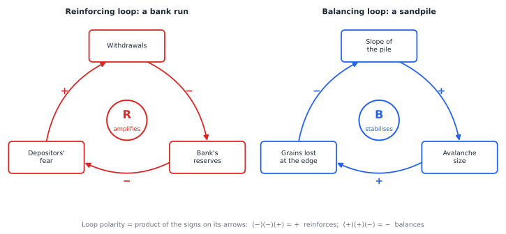
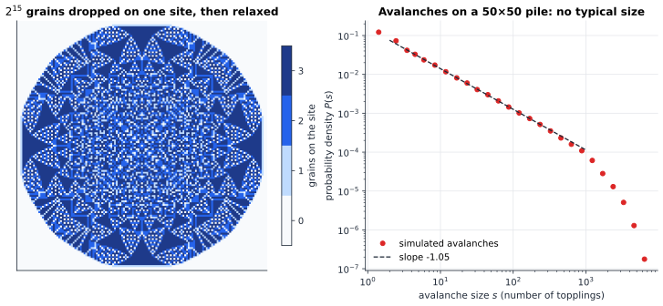
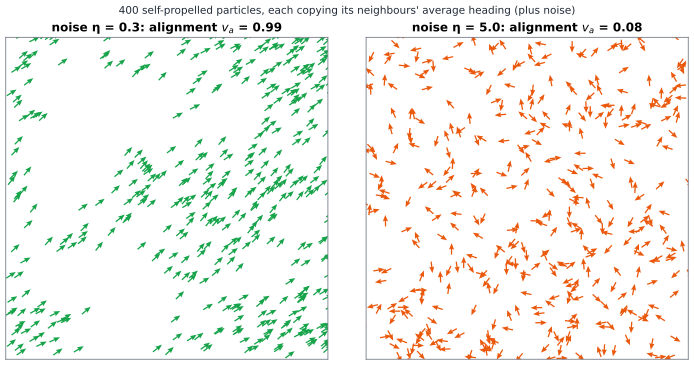

# Chapter 88 — Complexity Science: When the Whole Exceeds the Parts

[← Previous](87-network-science.md) · [Track I](README.md) · [Table of Contents](../../00-front/table-of-contents.md) · [Next →](../j-frontier/README.md)

> **Level 2 · Track I — Dynamical Systems, Chaos, and Complexity**
> **Builds on:** [Ch. 14](../../part-5-transforms/14-laplace-transforms.md#149-applications-to-circuits-and-control), [Ch. 25](../../part-7-numerical-computational/25-mathematical-modeling.md), [Ch. 34](../b-probability-information/34-random-walks-and-markov-chains.md), [Ch. 86](86-cellular-automata.md), [Ch. 87](87-network-science.md) · **Leads to:** [Track J](../j-frontier/README.md), [Ch. 92](../j-frontier/92-mathematical-physics.md), [Ch. 98](../j-frontier/98-mathematical-research.md) · **Related:** [Ch. 45](../c-game-theory/45-evolutionary-games.md), [Ch. 51](../d-optimization/51-optimal-control.md), [Ch. 85](85-bifurcations.md)
> **Reading time:** ~25 min

## 88.1 The hook

Shortly after 3 p.m. on 14 August 2003, a heavily loaded transmission line in northern Ohio sagged in the summer heat and touched a tree that should have been trimmed. The line tripped, exactly as its protection was designed to do. Its current shifted to neighbouring lines, which grew hotter and sagged in turn. An alarm program in the local control room had silently stalled, so the operators did not see what was happening. Over the next hour more lines tripped, each one pushing load onto the rest, until shortly after 4 p.m. the cascade swept across the north-eastern United States and Ontario in about seven minutes. Some 50 million people lost power.

Nothing in that story is exotic. Every component did what it was built to do. The grid had redundancy precisely so that losing one line would not matter, and usually it doesn't. Almost every day, somewhere, a line trips and nothing happens. Very occasionally, the same small event takes down a continent.

Engineers who collected decades of blackout records found something stranger still. Plot how often blackouts of each size occur and there is no "typical" blackout. Small ones are common and big ones are rare, but the frequency falls off slowly, roughly like a power of the size, so that the catastrophic events are far more likely than a bell curve would ever allow. Earthquakes, forest fires, stock-market crashes and extinctions in the fossil record show the same heavy-tailed signature.

Why would systems as different as power grids and the Earth's crust share the statistics of their disasters? And why would a system built to be stable organise itself, without anyone intending it, to the brink of collapse?

## 88.2 The big idea

"More is different," wrote the physicist Philip Anderson in 1972. Knowing everything about one water molecule tells you nothing about waves, whirlpools or ice. Knowing one neuron tells you nothing about a thought. **Complexity science** studies systems of many interacting parts whose collective behaviour has properties the parts don't have. Three words organise the field.

**Emergence** is the appearance of large-scale patterns from local interactions, as with the gliders of [Ch. 86](86-cellular-automata.md) and the synchrony of [Ch. 87](87-network-science.md). An emergent pattern can be described by its own laws (a glider moves at $c/4$; a flock has a mean heading) without reference to the parts.

**Self-organisation** is emergence without a designer or a leader. A flock of starlings has no commander, an ant colony has no architect, and a market has no central planner, yet each produces coordinated structure. The organising force is the interactions themselves.

**Feedback** is the mechanism. When an effect circles back to influence its own cause, the loop either amplifies (positive, or *reinforcing*, feedback) or damps (negative, or *balancing*, feedback). Engineers know feedback from control theory ([Ch. 14](../../part-5-transforms/14-laplace-transforms.md#149-applications-to-circuits-and-control)), where a balancing loop holds a motor at its set speed. In complex systems the loops are not designed, there are many of them, and they interact.


*Causal-loop diagrams. Each arrow carries a sign: $+$ if more of the cause means more of the effect, $-$ if it means less. In a bank run (left), withdrawals drain reserves, falling reserves raise fear, and fear causes more withdrawals: two minus signs and a plus multiply to a reinforcing loop. In a sandpile (right), a steeper pile makes larger avalanches, which spill more grains off the edge, which lowers the slope: a balancing loop.*

The analogy for the whole chapter is a sandpile on a table. Drop sand grains one at a time on a pile. At first the pile just grows. As it steepens, grains start to slide, small avalanches at first, occasionally large ones that spill sand over the edge. Eventually the pile reaches a slope it cannot exceed: add more sand and it sheds, on average, exactly what you add. At that point the pile is **critical**. Most grains do nothing; a few trigger slides that run across the entire pile. Nobody tuned the slope. The balancing loop in the figure found it.

That is the big idea of **self-organised criticality** (Bak, Tang and Wiesenfeld, 1987): slowly driven systems with thresholds and dissipation can drive *themselves* to a critical state, where events of all sizes occur and the size distribution is a power law. It is a candidate answer to the hook. The grid is loaded by growing demand (the slow drive), protected by trips (the threshold), and repaired and upgraded after failures (the dissipation). Its own feedback loops may push it to the edge.

## 88.3 The mathematics

### Feedback in one line

Take a quantity $x$ and a loop that returns a fraction $g$ of any change to the input on the next round, so that a small deviation evolves as $\delta_{t+1}=g\,\delta_t$, and $\delta_t=g^t\delta_0$. The **loop gain** $g$ is the product of the gains around the loop, which is why the *signs* on a causal-loop diagram multiply. If $g>0$ the loop is reinforcing, if $g<0$ it is balancing, and the deviation dies out exactly when $\lvert g\rvert<1$. (For a balancing loop with $g<-1$, the correction overshoots by more than the error, and the system oscillates with growing amplitude: the mechanism behind the bullwhip effect in supply chains and an over-tuned thermostat.) This is the scalar case of the stability theory in [Ch. 17](../../part-5-transforms/17-z-transforms.md#177-discrete-time-system-analysis).

In a complex system the gain is not fixed. It depends on the state, and the state depends on the gain. That loop-of-loops is what lets a system *find* its own critical point, and the cleanest place to see it is a pile of sand.

### The Abelian sandpile

> [!definition] Bak–Tang–Wiesenfeld (Abelian) sandpile
> Each site of an $L\times L$ grid holds $z_i\in\{0,1,2,\dots\}$ grains. A site with $z_i\ge4$ is **unstable** and **topples**: it loses 4 grains and each of its four neighbours gains one. Grains sent off the edge of the grid are lost. A configuration with all $z_i\le3$ is **stable**. The dynamics: add one grain at a random site, then topple unstable sites until the configuration is stable. The total number of topplings is the **avalanche size** $s$.

Two things need proof before this is even a well-defined model. Does an avalanche always stop? And when several sites are unstable at once, does it matter which one topples first?

> [!theorem] Avalanches are finite
> On a finite grid with grains lost at the boundary, every avalanche ends after finitely many topplings.

*Proof.* Suppose some avalanche never ends. There are finitely many sites, so some site $a$ topples infinitely often. Each of its topplings gives a grain to each neighbour, so every neighbour of $a$ receives infinitely many grains; a site that topples only finitely often can only gain grains from some point on, never lose them, so its height would grow without bound and it would have to topple again. Hence every neighbour of $a$ also topples infinitely often, and by repeating the argument, so does every site of the connected grid, including a boundary site. But each toppling of a boundary site throws at least one grain off the grid, permanently, while the total number of grains is finite and only decreases during an avalanche. Infinitely many such losses are impossible. $\blacksquare$

> [!theorem] The Abelian property
> The final stable configuration, and the number of times each site topples, do not depend on the order in which unstable sites are toppled.

*Proof sketch.* The local step is that two topplings **commute**. Suppose sites $a$ and $b$ are both unstable. Toppling $a$ can only *add* grains to $b$, so $b$ is still unstable afterwards, and vice versa. Toppling a site is the same as subtracting a fixed vector $\Delta_a$ (minus 4 at $a$, plus 1 at each neighbour) from the configuration, and vector subtraction commutes: toppling $a$ then $b$ and toppling $b$ then $a$ both give $z-\Delta_a-\Delta_b$. So any two legal toppling sequences can be rearranged into one another by swapping neighbouring steps, provided both are finite. That each order is finite is the previous theorem. The full argument (a "least action" principle: any legal toppling sequence topples each site at most as often as any other sequence that reaches a stable configuration) turns the local swap into the global statement. $\blacksquare$

The name *Abelian* comes from this commutativity. Write $S_a$ for "add a grain at $a$ and stabilise". Then $S_aS_b=S_bS_a$: the order in which grains arrive doesn't matter either. It is a startlingly strong property for a model of disasters, and it is the key to every exact result about the sandpile.


*Left: $2^{15}=32{,}768$ grains placed on one site of a large grid and toppled to stability. The result is a disc of radius about 70 sites filled with intricate, self-similar structure, though the rule is just "four grains, topple". Right: dropping grains one at a time at random sites of a $50\times50$ pile, after it has reached its steady state, gives avalanches whose sizes follow a straight line on log–log axes for three decades, until the finite pile cuts them off.*

Two facts in the figure deserve emphasis. In the driven pile, the mean height settles at about 2.1 grains per site, *whatever the initial condition*. Start empty, and the pile fills up until it gets there; start overfull, and the first avalanches shed the excess. That is the balancing loop made precise. And at that height the avalanches have no typical size: on this pile the distribution falls roughly like $s^{-1.05}$, and the largest avalanche toppled sites more than seven thousand times.

### Result 3: why criticality means power laws

What does "critical" mean? Think of an avalanche as a **branching process**: each toppling sends grains to neighbours, and each of them may topple in turn. If each toppling triggers on average $\mu$ further topplings, avalanches die out quickly for $\mu<1$ (subcritical), can run forever for $\mu>1$ (supercritical), and sit on the knife edge for $\mu=1$. The pile's feedback loop pushes $\mu$ toward 1 from both sides: below it, grains accumulate and the pile steepens, raising $\mu$; above it, huge avalanches dump grains off the edge, lowering $\mu$.

The simplest critical branching process can be solved exactly, and it shows where the power law comes from.

> [!theorem] Total size of a critical binary branching process
> Each event independently has either 0 or 2 offspring events, with probability $\tfrac12$ each. The probability that the total number of events is $s=2n+1$ is
> $$
> P(s)=\frac{C_n}{2^{2n+1}},\qquad C_n=\frac{1}{n+1}\binom{2n}{n},
> $$
> and for large $s$,
> $$
> P(s)\approx\sqrt{\frac{2}{\pi}}\;s^{-3/2}.
> $$

*Proof.* A finished avalanche is a tree in which every node has 0 or 2 children: a *full binary tree*. A full binary tree with $n$ internal nodes (those with two children) has $n+1$ leaves, so $2n+1$ nodes in all. Each internal node has probability $\tfrac12$ (it chose "2") and each leaf has probability $\tfrac12$ (it chose "0"), independently, so each particular tree has probability $2^{-(2n+1)}$. The number of full binary trees with $n$ internal nodes is the Catalan number $C_n$ (a standard count: splitting at the root gives $C_n=\sum_{i=0}^{n-1}C_iC_{n-1-i}$, the recurrence that defines the Catalan numbers, solved with a generating function in the style of [Ch. 28](../a-algorithms/28-combinatorics.md)). Multiplying gives $P(s)=C_n2^{-(2n+1)}$.

For the asymptotics, Stirling's formula gives $\binom{2n}{n}\approx4^n/\sqrt{\pi n}$, so $C_n\approx4^n/(\sqrt\pi\,n^{3/2})$ and

$$
P(s)\approx\frac{1}{2\sqrt\pi\,n^{3/2}}=\frac{1}{2\sqrt\pi}\left(\frac{s}{2}\right)^{-3/2}=\sqrt{\frac2\pi}\;s^{-3/2},
$$

using $n\approx s/2$. $\blacksquare$

(Check: at $s=101$ the exact value is $7.80\times10^{-4}$ and the asymptotic formula gives $7.86\times10^{-4}$.) Two features of this answer are worth staring at. The probabilities add up to 1, so every avalanche ends; but the mean avalanche size $\sum_s s\,P(s)$ diverges, because $s\cdot s^{-3/2}=s^{-1/2}$ is not summable. *Every avalanche is finite and the average avalanche is infinite.* That is the mathematical signature of criticality, and the reason risk calculations based on averages fail for heavy-tailed systems.

Move off criticality and the power law acquires a cutoff. With "2 offspring" probability $p\ne\tfrac12$, the same counting gives $P(s)=C_np^n(1-p)^{n+1}$, and since $C_n\approx4^n/(\sqrt\pi n^{3/2})$, the factor $(4p(1-p))^n$ appears. Because $4p(1-p)<1$ whenever $p\ne\tfrac12$, it decays exponentially: small avalanches still look like a power law, but there is now a typical largest size. Only at the critical point does the cutoff disappear. You will drag this cutoff around in the experiment.

The exponent $\tfrac32$ is the **mean-field** value, exact for branching on a tree, or for sandpiles in high dimensions. The two-dimensional sandpile has different exponents, because avalanches there fold back and revisit sites. Simulations put them near the $1.05$ in the figure for small piles, drifting with size, and nobody has computed them exactly.

> [!mystery] What is the sandpile's hidden algebra?
> The Abelian property says that adding grains are commuting operations. Restrict them to the *recurrent* configurations, the ones the driven pile keeps returning to, and they form a finite **group**, with an identity element that is itself a striking fractal picture. The number of elements of this group equals the number of spanning trees of the grid, which in turn is the determinant of a reduced graph Laplacian. Why should a toy model of avalanches know how many spanning trees a graph has? The group structure is the language of [Ch. 56](../e-abstract-math/56-abstract-algebra.md), and the Laplacian is the matrix of [Ch. 27](../a-algorithms/27-graph-theory.md); putting them together to count trees is a theorem you'll have to hunt down.

### Self-organisation without a leader: flocking

A sandpile organises itself in *time*, toward a critical state. Flocks organise themselves in *space and direction*. In 1995 Tamás Vicsek and colleagues proposed the simplest model of collective motion.

> [!definition] Vicsek model
> $N$ particles move in a periodic box at constant speed $v$. At each step, particle $i$ adopts the average heading of all particles within distance $r$ of it (itself included), plus noise:
> $$
> \theta_i(t+1)=\operatorname{Arg}\left(\sum_{\lVert\mathbf{x}_j-\mathbf{x}_i\rVert<r}e^{j\theta_j(t)}\right)+\eta\,\xi_i(t),\qquad \mathbf{x}_i(t+1)=\mathbf{x}_i(t)+v\begin{pmatrix}\cos\theta_i(t+1)\\ \sin\theta_i(t+1)\end{pmatrix},
> $$
> with $\xi_i$ independent and uniform on $\left[-\tfrac12,\tfrac12\right]$. The **alignment** is $v_a=\left\lvert\frac1N\sum_ie^{j\theta_i}\right\rvert$.

The alignment $v_a$ is the same average phasor as the Kuramoto order parameter of [Ch. 87](87-network-science.md), and the logic is similar: a feedback between individual headings and the local average. The new ingredient is that the network of who-sees-whom is not fixed; it is rebuilt every step by the motion itself. Aligned neighbours travel together and stay neighbours, which strengthens their alignment. That is a reinforcing loop, and the noise is the dissipation that opposes it.


*The Vicsek model with 400 particles in a $10\times10$ box (interaction radius 1, speed 0.03) after 600 steps. At low noise (left) a single flock forms with almost perfect alignment, $v_a=0.99$, from random initial headings. At high noise (right) headings stay disordered and $v_a=0.08$, close to the $1/\sqrt{N}=0.05$ expected for random directions.*

Between the two panels lies a phase transition at a critical noise $\eta_c$ that depends on the density. Nobody in the flock knows the heading of the flock, and no particle is special. Order is a collective property, decided by a competition between the reinforcing loop of alignment and the randomising effect of noise.

### Adaptive systems

In a sandpile and a flock the rules are fixed. In an **adaptive** system the parts change their rules in response to what the collective does, and the collective is made of those changing rules. Markets, immune systems, ecosystems and traffic are all of this kind.

The classic toy is Brian Arthur's El Farol bar problem (1994). One hundred people decide independently each week whether to go to a bar. The evening is pleasant if fewer than 60 go, and unpleasant otherwise. There is no correct prediction that everybody can follow: if everyone believes "few will go", everyone goes, and the belief is falsified. Arthur gave each agent a small bag of rules of thumb ("same as last week", "average of the last four weeks", "mirror image of last week around 50") and let each agent use whichever rule had recently predicted best. Attendance never settles, but it fluctuates around 60. The comfortable capacity is found by nobody and enforced by nobody: it emerges from a balancing loop between collective attendance and individual strategy choice.

The mathematics of adaptive populations, where strategies that do well become more common, is evolutionary game theory and the replicator equation of [Ch. 45](../c-game-theory/45-evolutionary-games.md). Its phenomena are new: no equilibrium may exist, the system may cycle forever, and the "rules of the game" are themselves an outcome of the game.

> [!warning] Emergence is not magic
> It is tempting to treat "emergent" as an explanation. It is a description. The gliders of Life, the power law of the sandpile and the order of the flock are all *consequences* of their rules and can be derived, simulated or bounded. What makes them emergent is that they are not visible in any single part's rule and are best described in a new vocabulary. Whenever you read that something "emerges", ask: from which interactions, through which feedback, and what would make it fail?

## 88.4 The algorithm

### Toppling a sandpile

There are two ways to relax a sandpile, and the Abelian property says they give the same answer.

**Parallel toppling** topples every unstable site at once, and can even topple a site several times in one sweep: a site with $z$ grains topples $\lfloor z/4\rfloor$ times. With NumPy this is a few array operations per sweep:

```python
def stabilise(z):
    """Relax a sandpile; grains falling off the edge are lost. Returns grid and avalanche size."""
    total = 0
    while True:
        t = z // 4                    # topplings at each site this sweep
        if not t.any():
            return z, total
        total += int(t.sum())
        z = z - 4 * t
        z[1:, :] += t[:-1, :]         # each toppling sends one grain to each neighbour
        z[:-1, :] += t[1:, :]
        z[:, 1:] += t[:, :-1]
        z[:, :-1] += t[:, 1:]
```

Sequential toppling with a **stack** of unstable sites does the same work site by site, and is faster when avalanches are small. Either way, the cost of an avalanche is proportional to its size, which for a critical pile is heavy-tailed: most grains cost nothing, and a few cost a large fraction of the pile. Placing $N$ grains on one site is much worse than $N$ separate drops, because the resulting disc has radius about $\sqrt N$ and every grain must be passed outward across it. For the figure's $2^{15}$ grains that is about 19 million single topplings, which the parallel version performs in about 6,000 sweeps.

### Flocks in linear time

A naive Vicsek step compares every pair of particles, $O(N^2)$. Because the interaction radius $r$ is fixed, divide the box into cells of side $r$ and only compare particles in the same or adjacent cells. Each step then costs $O(N)$ at fixed density, which is the same **cell-list** idea used in molecular dynamics and physics engines ([Ch. 72](../g-graphics-simulation/72-physics-engines.md)).

### Failure cases

- **Transients.** A sandpile started empty spends thousands of grains just filling up. Measuring avalanches before it reaches its steady state (the figure discarded the first 10,000 grains) mixes two different statistics.
- **Fitting power laws by straight lines.** A least-squares line through a log–log histogram is biased, depends on the binning and ignores the cutoff. It is good enough for a picture, not for a claim. Use maximum-likelihood estimators and compare against alternative distributions.
- **Finite size.** Every simulated power law ends at a cutoff set by the system size. The honest test of criticality is **finite-size scaling**: check that the cutoff moves as a power of $L$ as you simulate $L=25,50,100,200$.

## 88.5 The experiment

### Part 1: the knife edge of criticality

On log–log axes, the size distribution of a branching process with "2 offspring" probability $p$ is a straight line of slope $-\tfrac32$ times an exponential cutoff. With $x=\log_{10}s$ and $y=\log_{10}P(s)$, the large-$s$ approximation from §88.3 reads

```desmos-graph
left=0; right=4; bottom=-8; top=0
---
y=\log(0.5\cdot2^{1.5}/\sqrt{\pi})-1.5x|black|dashed
y=\log(0.45\cdot2^{1.5}/\sqrt{\pi})-1.5x+(10^{x}/2)\log(4\cdot0.55\cdot0.45)|red
y=\log(0.5\cdot2^{1.5}/\sqrt{\pi})-1.5x+(10^{x}/2)\log(4\cdot0.5\cdot0.5)|blue
```

*Log–log avalanche-size distributions. Blue (critical, $p=0.5$) lies exactly on the dashed power law of slope $-1.5$; red ($p=0.55$, so each event triggers on average 1.1 more) bends down sharply after a few hundred events. A supercritical avalanche that has grown that large almost never stops, so large *finite* avalanches are rare; about 18% of these avalanches run forever.*

The formula is $P(s)\approx(1-p)\,2^{1.5}\pi^{-1/2}s^{-3/2}\left(4p(1-p)\right)^{s/2}$. Change `0.55` and `0.45` in the red line together to `0.51` and `0.49` and watch the cutoff move out to the right; the typical largest avalanche grows like $1/(p-\tfrac12)^2$. Then swap the two numbers in the red line, giving $p=0.45$ and $1-p=0.55$ (a subcritical process). The curve is nearly the same: on a log–log plot, sub- and supercritical processes look alike, and only the critical one has no scale at all.

### Part 2: grow your own critical pile

```python
import numpy as np
import matplotlib.pyplot as plt

L, GRAINS, BURN = 40, 40000, 8000      # pile size, grains to drop, grains to discard
rng = np.random.default_rng(0)
z = np.zeros((L, L), dtype=int)
sizes, heights = [], []

for g in range(GRAINS):
    i, j = rng.integers(0, L, 2)
    z[i, j] += 1
    s = 0
    while (t := z // 4).any():         # parallel toppling until stable
        s += t.sum()
        z -= 4 * t
        z[1:, :] += t[:-1, :]; z[:-1, :] += t[1:, :]
        z[:, 1:] += t[:, :-1]; z[:, :-1] += t[:, 1:]
    heights.append(z.mean())
    if g >= BURN and s > 0:
        sizes.append(s)

sizes = np.array(sizes)
print(f"final mean height {z.mean():.3f}, avalanches {len(sizes)}, largest {sizes.max()}")
bins = np.logspace(0, np.log10(sizes.max()), 25)
h, e = np.histogram(sizes, bins=bins)
c = np.sqrt(e[1:] * e[:-1]); ok = h > 0
fig, (a, b) = plt.subplots(1, 2, figsize=(10, 4))
a.plot(heights); a.set_xlabel("grains dropped"); a.set_ylabel("mean height")
b.loglog(c[ok], h[ok] / np.diff(e)[ok] / len(sizes), "o")
b.set_xlabel("avalanche size s"); b.set_ylabel("P(s)")
plt.show()
```

Things to try:

- The left plot shows the pile filling up and then *stopping* at a height near 2.1 by itself. Start instead from `z = 3 * np.ones((L, L), dtype=int)` (overfull and fragile). Where does it end up?
- Double `L` and compare the largest avalanche. A critical system's cutoff should grow with its size; a non-critical one would not.
- **Break the criticality.** Add dissipation inside the pile: after each toppling sweep, remove each grain with a small probability (for example `z -= (rng.random((L, L)) < 0.001) & (z > 0)` inside the `while` loop). The balancing loop now has a second exit, the pile settles lower, and the power law acquires a cutoff that no longer depends on `L`.
- Make sites topple only when they hold 5 grains while still sending out 4 (change `z // 4` to `z // 5` but keep `z -= 4 * t`). Where does the height settle now, and is the avalanche distribution still a power law?

## 88.6 The challenge

1. **Intuition.** A thermostat heats a room when it is below 20 °C, but the heater takes ten minutes to warm up and ten minutes to cool down. Draw the causal-loop diagram, mark the signs, and explain why the room temperature oscillates instead of settling, even though the loop is balancing. Then name one real complex system in which a delay turns a balancing loop into a source of boom-and-bust cycles.
2. **Derivation.** For the branching process with offspring 0 or 2 (probability $1-p$ and $p$), let $q$ be the probability that an avalanche is finite. Show that $q=(1-p)+pq^2$, solve it, and prove that $q=1$ for $p\le\tfrac12$ and $q=(1-p)/p$ for $p>\tfrac12$. Then show that the mean size of a finite avalanche is $1/(1-2p)$ for $p<\tfrac12$, and explain what its divergence at $p=\tfrac12$ means for anyone trying to estimate risk from past averages.
3. **Implementation.** Use the experiment's sandpile code to test the Abelian property directly. Start from one stable configuration, add 50 grains at 50 chosen sites, and stabilise after each grain. Then add the same 50 grains in a random different order, and finally add all 50 at once and stabilise once. Check that all three final configurations are identical and that the *total* number of topplings is the same in all three cases. Then break the property: make toppling send grains only to the right and down neighbours, and see whether order now matters.
4. **Open investigation.** Build the El Farol bar model: 100 agents, threshold 60, each with $k$ random predictors chosen from a pool (for example weighted averages of the last few weeks), each using its recently most accurate predictor. Measure the mean and variance of attendance as you change $k$, the pool and the memory. Does attendance always hover near 60? When does it fluctuate wildly, and is there a "critical" amount of strategic diversity at which the fluctuations are largest? There is no complete theory.

## 88.7 Loose threads

This chapter offered a three-part vocabulary (emergence, self-organisation, feedback), one exactly solvable mechanism (the critical branching process and its $s^{-3/2}$ law), and two famous models (the sandpile and the flock). The real excitement is in what it left unresolved.

> [!mystery] How can a flock beat the theorem that forbids it?
> In two dimensions, a magnet made of spins that align with their neighbours cannot have true long-range order at any positive temperature: thermal fluctuations always win at long distances (the Mermin–Wagner theorem). The Vicsek flock looks like the same system, alignment plus noise, yet simulations of huge flocks show genuine long-range order: particles at opposite ends of a very large flock agree on a heading. The difference is that Vicsek particles *move*, and moving carries information about orientation across the flock faster than diffusion could. In 1995 John Toner and Yuhai Tu built a continuum theory of flocks, the "hydrodynamics of active matter", to explain it. How motion defeats an equilibrium theorem is a question for [Ch. 92](../j-frontier/92-mathematical-physics.md).

> [!mystery] Is the brain poised at criticality?
> In 2003 John Beggs and Dietmar Plenz recorded bursts of activity in slices of rat cortex and found "neuronal avalanches" whose sizes followed a power law with exponent close to $\tfrac32$, the critical branching value derived in this chapter. A critical brain would have maximal dynamic range and information transmission, which makes the hypothesis attractive. But power laws can arise in many ways that have nothing to do with criticality, subsampling a network can create or destroy them, and twenty years of experiments have not settled whether the brain tunes itself to a critical point, hovers near one, or neither. This is an open problem; how researchers go about attacking such a question is the subject of [Ch. 98](../j-frontier/98-mathematical-research.md).

Other threads:

- **The edge of chaos, revisited.** [Ch. 86](86-cellular-automata.md) asked whether computation concentrates at a transition between order and chaos. Self-organised criticality is a mechanism by which a system could *put itself* there. Whether adaptive systems in fact evolve toward criticality is part of the same unresolved debate.
- **From feedback loops to control.** A causal-loop diagram is a qualitative transfer-function block diagram. Making it quantitative, with gains, delays and stability margins, is the engineering of [Ch. 14](../../part-5-transforms/14-laplace-transforms.md#149-applications-to-circuits-and-control); choosing the feedback to optimise performance is [Ch. 51](../d-optimization/51-optimal-control.md).
- **Cascades on networks.** The 2003 blackout spread along a network, not a grid. Combining the thresholds of this chapter with the degree distributions of [Ch. 87](87-network-science.md) gives models of cascading failure in which hubs are both the network's strength and its weak point.

## Further reading

- P. Bak, *How Nature Works: The Science of Self-Organized Criticality*, Copernicus, 1996. The founder's passionate, contestable case.
- P. Bak, C. Tang and K. Wiesenfeld, "Self-organized criticality: an explanation of the 1/f noise," *Physical Review Letters* 59 (1987), 381–384.
- D. Dhar, "Theoretical studies of self-organized criticality," *Physica A* 369 (2006), 29–70. The Abelian sandpile, its group and its exact results.
- T. Vicsek, A. Czirók, E. Ben-Jacob, I. Cohen and O. Shochet, "Novel type of phase transition in a system of self-driven particles," *Physical Review Letters* 75 (1995), 1226–1229.
- M. Mitchell, *Complexity: A Guided Tour*, Oxford University Press, 2009. A clear, broad and honest introduction.
- W. B. Arthur, "Inductive reasoning and bounded rationality," *American Economic Review* 84 (1994), 406–411. The El Farol bar problem.
- I. Dobson, B. A. Carreras, V. E. Lynch and D. E. Newman, "Complex systems analysis of series of blackouts: cascading failure, critical points, and self-organization," *Chaos* 17 (2007), 026103.
