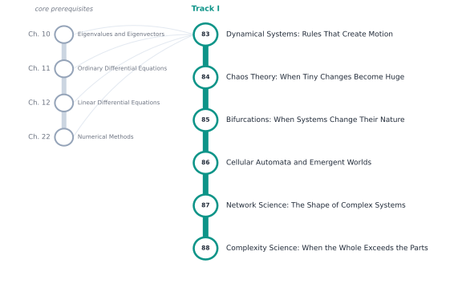

# Track I — Dynamical Systems, Chaos, and Complexity

[← Table of Contents](../../00-front/table-of-contents.md) · [Start: Ch. 83 →](83-dynamical-systems.md)

> **Level 2 — Specializations.** Tools for epidemics, ecosystems, power grids, neural networks, traffic, and emergent behavior in games.

*Suggested reading order for Track I. The grey stations on the left are the core chapters it leans on.*

## Before you start

This track assumes you are comfortable with these core chapters:

- Ch. 10 — [Eigenvalues and Eigenvectors](../../part-3-linear-algebra/10-eigenvalues-and-eigenvectors.md)
- Ch. 11 — [Ordinary Differential Equations](../../part-4-differential-equations/11-ordinary-differential-equations.md)
- Ch. 12 — [Linear Differential Equations](../../part-4-differential-equations/12-linear-differential-equations.md)
- Ch. 22 — [Numerical Methods](../../part-7-numerical-computational/22-numerical-methods.md)

## Chapters

| Ch. | Chapter | What it explores |
|---|---|---|
| 83 | [Dynamical Systems: Rules That Create Motion](83-dynamical-systems.md) | State spaces, fixed points, stability, phase portraits. |
| 84 | [Chaos Theory: When Tiny Changes Become Huge](84-chaos-theory.md) | Sensitivity, Lyapunov exponents, strange attractors. |
| 85 | [Bifurcations: When Systems Change Their Nature](85-bifurcations.md) | Stability transitions, bifurcation diagrams, nonlinear behavior. |
| 86 | [Cellular Automata and Emergent Worlds](86-cellular-automata.md) | Local rules, global patterns, computational universality. |
| 87 | [Network Science: The Shape of Complex Systems](87-network-science.md) | Random networks, scale-free networks, contagion, synchronization. |
| 88 | [Complexity Science: When the Whole Exceeds the Parts](88-complexity-science.md) | Emergence, self-organization, feedback, adaptive systems. |

Every chapter follows the same arc: **the hook** (a puzzle or a failure), **the big idea**, **the mathematics**, **the algorithm**, **the experiment** you can run, **the challenge**, and **loose threads**: the questions the chapter deliberately leaves open.
