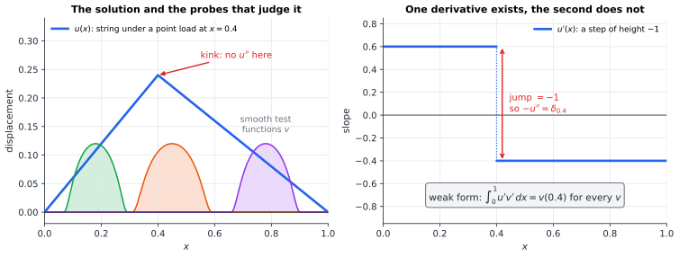
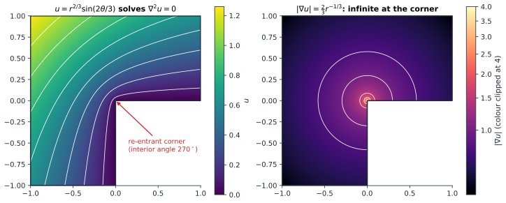
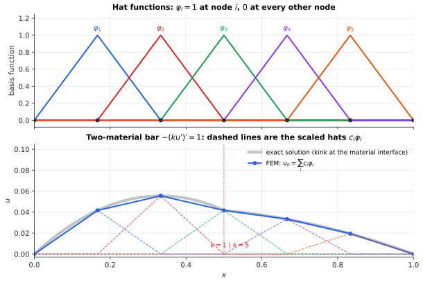

# Chapter 89 — Partial Differential Equations Beyond the Basics

[← Previous](README.md) · [Track J](README.md) · [Table of Contents](../../00-front/table-of-contents.md) · [Next →](90-spectral-theory.md)

> **Level 3 · Track J — Mathematics at the Frontier**
> **Builds on:** [Ch. 13](../../part-4-differential-equations/13-partial-differential-equations.md), [Ch. 22](../../part-7-numerical-computational/22-numerical-methods.md), [Ch. 61](../e-abstract-math/61-functional-analysis.md) · **Leads to:** [Ch. 90](90-spectral-theory.md), [Ch. 91](91-inverse-problems.md), [Ch. 92](92-mathematical-physics.md) · **Related:** [Ch. 36](../b-probability-information/36-stochastic-processes.md), [Ch. 52](../d-optimization/52-dynamic-programming.md), [Ch. 60](../e-abstract-math/60-real-analysis.md), [Ch. 75](../g-graphics-simulation/75-computational-geometry.md)
> **Reading time:** ~30 min

## 89.1 The hook

Stretch a guitar string between two pegs and press it down with one fingertip. The string takes the shape of a tent: two straight segments meeting at a sharp corner under your finger. Every physicist in the world agrees this is the correct shape. Now ask what equation it solves.

The textbook answer is the equation of a loaded string, $-T u''(x) = f(x)$, with tension $T$ and load density $f$. But the tent has no second derivative at the corner. The slope jumps from one value to another, so $u''$ simply does not exist there. And the load of a fingertip is not a function at all: it is all concentrated at one point, a Dirac delta. The "solution" fails to be twice differentiable, the "data" fails to be a function, and yet nothing about the physics is in doubt.

This is not a curiosity. Look around an engineering office:

- A bar made of two materials glued together, copper on the left and steel on the right, carrying heat. The temperature is continuous, but its slope jumps at the glue line because the conductivity jumps. The heat equation $-(k u')'=f$ of [§13.4](../../part-4-differential-equations/13-partial-differential-equations.md#134-heat-equation) has no classical solution.
- An L-shaped room, or an L-shaped bracket under load. Near the inside corner the stress, which is a derivative of the displacement, is *infinite*. The solution exists; its gradient does not stay bounded.
- A shock wave in a supersonic flow: the density jumps across a surface. A traffic jam forms on a motorway: the car density jumps. Neither "solution" is even continuous.

Meanwhile, every serious engineering simulation code (structural analysis, electromagnetics, chip thermal design, crash testing) solves PDEs with exactly these features, on millions of unknowns, every day, and gets the right answer. What do those codes know that §13.3's separation of variables doesn't?

> **What does it mean for a function that can't be differentiated to *solve* a differential equation, and how can that weaker meaning be the foundation of the most successful numerical method in engineering?**

The answer is a shift of viewpoint that took mathematics from Riemann (1850s) to Sobolev (1930s) to Lax, Milgram and the engineers of the 1950s and 60s to complete. It is also the doorway to some of the hardest open problems in mathematics.

## 89.2 The big idea

**Judge a function by what it does to probes, not by its value at points.** You cannot evaluate $u''$ at the corner of the tent. But you can ask a gentler question. Take any smooth "probe" function $v(x)$, a bump that vanishes at both ends of the string, and compute the integral $\int u''v\,dx$. Integrate by parts once:

$$
-\int_0^1 u''\,v\,dx = \int_0^1 u'\,v'\,dx \qquad (v(0)=v(1)=0).
$$

The right-hand side only needs **one** derivative of $u$, and the tent has one: its slope is a step function, perfectly integrable. So we *define* "$u$ solves $-u''=f$" to mean

$$
\int_0^1 u'\,v'\,dx=\int_0^1 f\,v\,dx\quad\text{for every probe } v.
$$

The derivative has been moved off the rough unknown and onto the smooth probe. For the point load at $x=a$ the right side is just $v(a)$, and the tent passes this test. A function that passes it is a **weak solution**.



*A weak solution is tested by integrals against smooth probes $v$, never at single points. The tent has a slope everywhere except one point, and that is enough to make $\int u'v'=v(0.4)$ meaningful and true.*

**An analogy: a referee who only watches replays averaged over a few seconds.** A classical solution must be correct at every instant. A weak solution must be correct on average over every window, however small. A function can fail at isolated instants and still pass every averaged check, and for physics that is exactly right, because no instrument measures at a mathematical point.

**The second idea: the solution is the cheapest shape.** The weak equation is also the condition for a minimum. The string settles into the shape that minimizes its total energy, stretching energy minus the work done by the load:

$$
E(v) = \tfrac12\int_0^1 (v')^2\,dx - \int_0^1 f v\,dx .
$$

The energy only involves $v'$, never $v''$. So the natural home for the problem is the space of functions with **finite energy**: square-integrable functions with square-integrable first derivatives. That space, the **Sobolev space** $H^1$, was promised in [Ch. 61](../e-abstract-math/61-functional-analysis.md)'s loose threads. It is a Hilbert space, so all the geometry of projection and orthogonality is available. Solving the PDE becomes "find the closest point" in a Hilbert space.

**The third idea: regularity is earned, not assumed.** Once a weak solution exists, you can ask how smooth it actually is. Often it is perfectly smooth and the whole detour was a formality. Sometimes, near a corner, a material interface or a shock, it is not, and knowing exactly *how* rough it is tells you how fast your simulation will converge. The modern theory of PDEs is largely this two-step programme: **first existence of a weak solution, then regularity**.

## 89.3 The mathematics

We work with the model boundary-value problem: find $u$ on $(0,1)$ with

$$
-(k(x)\,u')' = f \ \text{ on } (0,1),\qquad u(0)=u(1)=0,
$$

where the conductivity (or stiffness) satisfies $0<k_{\min}\le k(x)\le k_{\max}$. Everything below extends, with harder analysis but the same ideas, to $-\nabla\cdot(k\nabla u)=f$ on a domain $\Omega\subset\mathbb{R}^d$.

### Sobolev spaces

> [!definition] The space $H^1_0(0,1)$
> A function $u\in L^2(0,1)$ has a **weak derivative** $w\in L^2(0,1)$ if $\int_0^1 u\,\varphi'\,dx=-\int_0^1 w\,\varphi\,dx$ for every smooth $\varphi$ vanishing near $0$ and $1$. We write $u'=w$. The **Sobolev space** $H^1(0,1)$ is the set of $u\in L^2$ with a weak derivative in $L^2$, with inner product $\langle u,v\rangle_{H^1}=\int(uv+u'v')\,dx$. The subspace $H^1_0$ contains those with $u(0)=u(1)=0$.

For the tent, the weak derivative is the step function, and the definition just says integration by parts still works when one factor has a corner. A function with a *jump* has no weak derivative in $L^2$: its derivative would have to be a delta. So $H^1$ functions in one dimension can have corners but not jumps. In fact they are always continuous, and here is the one-line reason. For $x<y$, by Cauchy–Schwarz ([§9.8](../../part-3-linear-algebra/09-vector-spaces-and-linear-transformations.md#98-inner-products)),

$$
\lvert u(y)-u(x)\rvert = \Big\lvert\int_x^y u'\,dt\Big\rvert \le \sqrt{y-x}\;\lVert u'\rVert_{L^2}.
$$

Finite energy forces Hölder continuity with exponent $\tfrac12$. This is the simplest **Sobolev embedding theorem**. It is also where dimension starts to matter: in two dimensions the function $u=\ln\ln(1/r)$ near the origin has finite energy, $\int\lvert\nabla u\rvert^2=2\pi\int dr/(r\ln^2(1/r))<\infty$, yet it is unbounded. A finite-energy membrane can have an infinitely tall spike. And conversely, the 2-D point-load solution $\ln(1/r)$ has *infinite* energy, $2\pi\int dr/r=\infty$: in a plane, a pin-point load is not an $H^1$ problem at all.

### The weak formulation

Multiply the PDE by $v\in H^1_0$, integrate, and move one derivative across. The boundary term $[k u' v]_0^1$ vanishes because $v$ does. This gives the problem we will actually solve.

> [!definition] Weak solution
> $u\in H^1_0(0,1)$ is a **weak solution** if
> $$
> a(u,v)=F(v)\quad\text{for all } v\in H^1_0,\qquad a(u,v)=\int_0^1 k\,u'v'\,dx,\quad F(v)=\int_0^1 f v\,dx .
> $$

Two quick facts justify the name. If $u$ is a classical $C^2$ solution, it is a weak solution: that is the integration by parts we just did. Conversely, if a weak solution happens to be $C^2$ (and $k$ is $C^1$), then integrating back gives $\int(-(ku')'-f)\,v=0$ for all $v$, and a continuous function orthogonal to every probe is zero. So nothing is lost when solutions are smooth, and something is gained when they are not. For the two-material bar, the weak form automatically enforces the physically correct interface condition: the *flux* $k u'$ is continuous across the glue line even though $u'$ jumps.

### Existence and uniqueness

> [!theorem] Existence and uniqueness of the weak solution
> If $0<k_{\min}\le k\le k_{\max}$ and $f\in L^2(0,1)$, there is exactly one $u\in H^1_0$ with $a(u,v)=F(v)$ for all $v\in H^1_0$. It is also the unique minimizer of $E(v)=\tfrac12a(v,v)-F(v)$ over $H^1_0$, and $\lVert u'\rVert_{L^2}\le \lVert f\rVert_{L^2}/k_{\min}$.

*Proof.* **Step 1, a Poincaré inequality.** For $v\in H^1_0$, $v(0)=0$, so the embedding estimate with $x=0$ gives $\lvert v(y)\rvert\le\sqrt y\,\lVert v'\rVert\le\lVert v'\rVert$. Squaring and integrating over $y\in(0,1)$:

$$
\lVert v\rVert_{L^2}\le \lVert v'\rVert_{L^2}.
$$

(The sharp constant is $1/\pi$; you will see why in [Ch. 90](90-spectral-theory.md).)

**Step 2, a new inner product.** Define $\langle u,v\rangle_a=a(u,v)=\int k u'v'$. It is symmetric and bilinear, and $\langle v,v\rangle_a\ge k_{\min}\lVert v'\rVert^2\ge \tfrac{k_{\min}}{2}\lVert v\rVert_{H^1}^2$ by Step 1, so it is positive definite. It is also bounded above by $k_{\max}\lVert v\rVert^2_{H^1}$, so the "energy norm" $\lVert v\rVert_a=\sqrt{a(v,v)}$ is equivalent to the $H^1$ norm and $H^1_0$ is complete under it: a Hilbert space.

**Step 3, Riesz.** $F$ is linear, and bounded in the energy norm: $\lvert F(v)\rvert\le\lVert f\rVert\,\lVert v\rVert\le\lVert f\rVert\,\lVert v'\rVert\le \lVert f\rVert\,\lVert v\rVert_a/\sqrt{k_{\min}}$. By the Riesz representation theorem ([Ch. 61](../e-abstract-math/61-functional-analysis.md)), every bounded linear functional on a Hilbert space is an inner product with a unique element: there is exactly one $u$ with $\langle u,v\rangle_a=F(v)$ for all $v$. That is the weak equation. Taking $v=u$ gives $k_{\min}\lVert u'\rVert^2\le\lVert f\rVert\lVert u'\rVert$, the stated bound.

**Step 4, minimum energy.** For any $w\in H^1_0$,

$$
E(u+w)=E(u)+\underbrace{\big[a(u,w)-F(w)\big]}_{=0}+\tfrac12 a(w,w)\;\ge\;E(u),
$$

with equality only if $a(w,w)=0$, that is $w=0$. ∎

Notice what did the work: not a formula, but geometry. The solution is the Riesz representer of the load, equivalently the point of $H^1_0$ that minimizes energy. Existence came from **completeness**. This is exactly where Dirichlet and Riemann went wrong in the 1850s. They "proved" existence for Laplace's equation by saying an energy bounded below must attain its minimum. Weierstrass gave a counterexample in 1870, an energy whose infimum is never attained in the space of smooth functions, and the "Dirichlet principle" was discredited for thirty years until Hilbert rescued it in 1900. The fix is to minimize over a complete space, $H^1$, and then prove the minimizer is smooth. That second step is the regularity theory.

For non-symmetric problems (add a convection term $b u'$) the form $a$ is no longer an inner product, and the **Lax–Milgram theorem** (1954) replaces Riesz: if $a$ is bounded and coercive, $a(v,v)\ge\alpha\lVert v\rVert^2$, the weak problem is still uniquely solvable.

### The point load, and Green's function

For $f=\delta_a$ the load is $F(v)=v(a)$. It is bounded on $H^1_0$ in one dimension, since $\lvert v(a)\rvert\le\lVert v'\rVert$, so the theorem applies even though $\delta_a\notin L^2$. The solution is the tent, which is the Green's function of [§11.8](../../part-4-differential-equations/11-ordinary-differential-equations.md#118-boundary-value-problems):

$$
G(x,a)=\begin{cases} x(1-a), & x\le a,\\ a(1-x), & x\ge a.\end{cases}
$$

Check: $G'$ is $1-a$ to the left of $a$ and $-a$ to the right, a jump of $-1$. Using $v(0)=v(1)=0$,

$$
\int_0^1 G'v'\,dx=(1-a)\big[v(a)-v(0)\big]-a\big[v(1)-v(a)\big]=(1-a)v(a)+a\,v(a)=v(a).
$$

The tent passes every test.

### Boundary conditions: essential and natural

The weak form sorts boundary conditions into two kinds, a distinction that classical theory ([§13.2](../../part-4-differential-equations/13-partial-differential-equations.md#132-boundary-and-initial-conditions)) never makes.

Suppose the right end is not clamped but has a prescribed flux, $k(1)u'(1)=g$. Do *not* require $v(1)=0$. The boundary term from integration by parts is now $k(1)u'(1)v(1)=g\,v(1)$, and the weak problem becomes: find $u$ with $u(0)=0$ such that

$$
\int_0^1 k u'v'\,dx=\int_0^1 f v\,dx+g\,v(1)\quad\text{for all } v \text{ with } v(0)=0.
$$

The Dirichlet condition $u(0)=0$ had to be built into the space: it is **essential**. The Neumann condition never appears as a constraint at all; a weak solution that is smooth satisfies it automatically, because any mismatch $k(1)u'(1)-g$ would show up against probes with $v(1)\neq0$. It is **natural**. In mechanics, displacements are essential and forces are natural; in electrostatics, potentials are essential and surface charges are natural.

### Regularity: how smooth is the weak solution?

> [!theorem] Elliptic regularity (stated)
> If $k$ is smooth and $f\in H^m$ ($m$ derivatives in $L^2$), the weak solution lies in $H^{m+2}$: it gains two derivatives over the data. On a domain $\Omega\subset\mathbb{R}^d$ the same holds in the interior, and up to the boundary if the boundary is smooth or the domain is convex.

In one dimension you can see it directly: $ku'=-\int f+C$ is one derivative smoother than $f$, and $u$ one more. The interesting cases are where the hypotheses fail:

- **Jumping coefficients.** The two-material bar has $u\in H^1$ but $u\notin H^2$: $u'$ jumps at the interface. Regularity is limited by the material, not by the load.
- **Corners.** On the L-shaped domain, $u=r^{2/3}\sin(2\theta/3)$ is harmonic, vanishes on the two edges meeting at the re-entrant corner, and has $\lvert\nabla u\rvert=\tfrac23 r^{-1/3}$, which blows up. It lies in $H^1$ but not $H^2$. Generally, a corner of interior angle $\omega$ produces a singularity $r^{\pi/\omega}$, which is rougher than smooth exactly when $\omega>\pi$.



*A perfectly smooth boundary value (zero) and a perfectly smooth equation (Laplace) still give an infinite gradient, purely because of geometry. Structural engineers know this as stress concentration at an inside corner, which is why such corners are rounded off with a fillet.*

> [!mystery] Two derivatives for free, but only in the linear world
> For $-\nabla\cdot(k\nabla u)=f$ with smooth $k$ the theorem gives two derivatives for free. What if $k(x)$ is merely bounded and measurable, with no continuity at all, like a random composite? Then no derivatives are free, and in 1957–58 De Giorgi and Nash independently proved that weak solutions are *still* Hölder continuous, solving Hilbert's 19th problem. For *systems* of equations, such as elasticity, De Giorgi himself found a counterexample in 1968. For the 3-D Navier–Stokes equations, Leray proved in 1934 that weak solutions exist for all time. Whether they stay smooth, or whether a smooth flow can develop a singularity in finite time, is one of the seven Clay Millennium Problems, and it is open.

### Other ways to be a solution

Integration by parts needs the equation to be in "divergence form", so that a derivative can be moved onto $v$. Two important families are not.

**Viscosity solutions.** The Hamilton–Jacobi–Bellman equation of [Ch. 52](../d-optimization/52-dynamic-programming.md) is nonlinear in $u'$. The simplest example is $\lvert u'\rvert=1$ on $(-1,1)$ with $u(\pm1)=0$: the travel time to the nearest exit, walking at unit speed. The true answer is $u=1-\lvert x\rvert$, with a kink in the middle. But the zigzag $\tfrac12-\big\lvert\lvert x\rvert-\tfrac12\big\rvert$ also has $\lvert u'\rvert=1$ everywhere except at three kinks, and so do infinitely many others. "Almost everywhere" is far too weak. Crandall and Lions (1983) found the right test: at a kink, compare $u$ against smooth functions $\varphi$ that touch it from above or from below, and demand an inequality on $\varphi'$ there. The kink of $1-\lvert x\rvert$ points upward and can only be touched from above, where the test passes. The zigzag's downward kink at $0$ is touched from below by $\varphi\equiv0$, where $\lvert\varphi'\rvert-1=-1<0$ violates the required inequality. So among all the almost-everywhere solutions exactly one survives, and it is the one obtained as the limit of $\lvert u'\rvert-1=\varepsilon u''$ as the "viscosity" $\varepsilon\to0$.

**Probabilistic solutions.** The harmonic function with boundary values $g$ is $u(\mathbf{x})=E[g(\mathbf{W}_\tau)]$: start a Brownian motion at $\mathbf{x}$ and average $g$ over the point where it first exits ([Ch. 36](../b-probability-information/36-stochastic-processes.md)). This needs no derivatives of $u$ at all, and it is the seed of Monte Carlo PDE solvers that work in hundreds of dimensions, where no grid could ever fit.

## 89.4 The algorithm

The weak formulation is not only a theory. Replace "for all $v$ in an infinite-dimensional space" by "for all $v$ in a finite-dimensional subspace" and you have an algorithm. This is the **Galerkin method**, and with the right subspace it is the **finite element method** (FEM).

**Step 1: choose a subspace.** Split $[0,1]$ into elements $[x_{i-1},x_i]$ of width $h$. Let $V_h$ be the continuous functions that are linear on every element and vanish at the ends. Its natural basis is the **hat functions**: $\varphi_i$ equals $1$ at node $x_i$, $0$ at every other node, and is linear in between. Each hat lives on just two elements.



*The FEM approximation is a sum of hats, $u_h=\sum_i c_i\varphi_i$, so its coefficients are its nodal values. With six elements the polygon already sits on the exact curve at every node.*

**Step 2: ask the weak equation only of the probes in $V_h$.** Write $u_h=\sum_j c_j\varphi_j$ and demand $a(u_h,\varphi_i)=F(\varphi_i)$ for each $i$. That is a linear system

$$
\mathbf{A}\mathbf{c}=\mathbf{b},\qquad A_{ij}=\int_0^1 k\,\varphi_i'\varphi_j'\,dx,\qquad b_i=\int_0^1 f\varphi_i\,dx .
$$

The **stiffness matrix** $\mathbf{A}$ is symmetric positive definite, because it is the Gram matrix of the energy inner product ([§10.6](../../part-3-linear-algebra/10-eigenvalues-and-eigenvectors.md#106-positive-definite-matrices)). It is also sparse: $A_{ij}=0$ unless the hats $i$ and $j$ overlap. For $k=1$ and uniform $h$ it is $\tfrac1h\operatorname{tridiag}(-1,2,-1)$, the same matrix as the finite-difference scheme of [§22.10](../../part-7-numerical-computational/22-numerical-methods.md#2210-numerical-solution-of-pdes). The two methods agree on easy problems and part company on hard ones: FEM handles jumping coefficients, curved boundaries, unstructured meshes and Neumann conditions with no special effort.

**Step 3: assemble element by element.** Real codes never form $A_{ij}$ by thinking about pairs of hats. They loop over elements, compute a small element matrix, and add it into the global one:

```python
import numpy as np

def fem_1d(k, f, n):
    """Linear finite elements for -(k u')' = f on (0,1), u(0) = u(1) = 0."""
    x = np.linspace(0, 1, n + 1)
    A = np.zeros((n + 1, n + 1)); b = np.zeros(n + 1)
    for e in range(n):                       # loop over elements [x_e, x_{e+1}]
        h = x[e + 1] - x[e]; mid = 0.5 * (x[e] + x[e + 1])
        Ke = k(mid) / h * np.array([[1, -1], [-1, 1]])   # element stiffness
        Fe = f(mid) * h / 2 * np.array([1, 1])           # element load (midpoint rule)
        idx = [e, e + 1]
        A[np.ix_(idx, idx)] += Ke; b[idx] += Fe
    inner = slice(1, n)                      # Dirichlet: drop the boundary nodes
    u = np.zeros(n + 1)
    u[inner] = np.linalg.solve(A[inner, inner], b[inner])
    return x, u

k = lambda x: 1.0 if x < 0.5 else 5.0       # two materials, interface at x = 0.5
f = lambda x: 1.0
x, u = fem_1d(k, f, 8)
print(np.round(u, 5))
```

With eight elements the output at $x=0.5$ is $0.04167$, which is the exact value $1/24$. In fact all nine nodal values are exact. That is not luck, and the reason is worth a proof.

> [!theorem] Galerkin orthogonality and Céa's lemma
> The FEM solution satisfies $a(u-u_h,v_h)=0$ for every $v_h\in V_h$, and therefore
> $$
> \lVert u-u_h\rVert_a=\min_{v_h\in V_h}\lVert u-v_h\rVert_a .
> $$

*Proof.* Subtract $a(u_h,v_h)=F(v_h)$ from $a(u,v_h)=F(v_h)$, which holds because $V_h\subset H^1_0$. For any $v_h$, split $u-u_h=(u-v_h)+(v_h-u_h)$, where the second piece lies in $V_h$:

$$
\lVert u-u_h\rVert_a^2=a(u-u_h,u-v_h)+\underbrace{a(u-u_h,v_h-u_h)}_{=0}\le\lVert u-u_h\rVert_a\,\lVert u-v_h\rVert_a .
$$

Divide by $\lVert u-u_h\rVert_a$. ∎

So FEM is an **orthogonal projection** in the energy inner product: it finds the best approximation the subspace can offer, in exactly the sense of [§9.9](../../part-3-linear-algebra/09-vector-spaces-and-linear-transformations.md#99-projection). The error is then a pure approximation question: how well can piecewise-linear functions approximate $u$? For $u\in H^2$ the interpolant has energy error $O(h)$, so FEM converges like $h$. For a rougher $u$ it converges more slowly, and regularity theory tells you precisely how slowly.

The nodal exactness follows too, for $k=1$. The Green's function $G_i=G(\cdot,x_i)$ is a tent with its kink at a node, so it lies in $V_h$. Since $a(G_i,w)=w(x_i)$ for every $w$, Galerkin orthogonality gives $u(x_i)-u_h(x_i)=a(G_i,u-u_h)=0$. In one dimension FEM is exact at the nodes (when the load integrals are exact). In two dimensions Green's function has a logarithmic spike and no mesh contains it, so this miracle is lost.

**Cost and failure modes.**

- Assembly costs $O(n)$. The sparse SPD system can be solved by banded Cholesky in $O(n)$ in 1-D, and by preconditioned conjugate gradients or multigrid ([§24.4](../../part-7-numerical-computational/24-computational-mathematics.md#244-iterative-solvers)) in higher dimensions. Multigrid is optimal: $O(n)$ for $n$ unknowns.
- The condition number of $\mathbf{A}$ grows like $h^{-2}$. Fine meshes need good iterative solvers, not better pivoting.
- **Mesh quality.** In 2-D and 3-D the constant in "error $\le C\,h$" depends on element shape. Triangles with an angle near $180^\circ$, or the flat "sliver" tetrahedra of [Ch. 75](../g-graphics-simulation/75-computational-geometry.md), make $C$ enormous: the gradient of a linear function on a nearly degenerate element is wildly sensitive to its nodal values (the maximum-angle condition of Babuška and Aziz, 1976). That is why mesh generators fight so hard to remove slivers.
- **Locking.** For nearly incompressible materials (rubber) or thin plates, low-order elements become artificially stiff and the computed displacement is far too small, however fine the mesh. Coercivity holds, but with a constant that degenerates with the physical parameter. Mixed and discontinuous Galerkin methods were invented to escape this.

## 89.5 The experiment

**When does a corner have finite energy?** The function $u=x^{\alpha}-x$ vanishes at $0$ and $1$. Its energy $\int_0^1(u')^2\,dx$ is finite exactly when $\int x^{2\alpha-2}\,dx$ converges at $0$, that is when $\alpha>\tfrac12$. Change the exponent $0.6$ in both lines to $0.51$, then $0.5$, then $0.4$, and watch the derivative (red) shoot up near $x=0$.

```desmos-graph
left=-0.05; right=1.05; bottom=-1.5; top=3
---
y=x^{0.6}-x|blue|0<x<1
y=0.6x^{0.6-1}-1|red|0<x<1
y=0|black|dashed
```

*$u=x^{0.6}-x$ (blue) is continuous and vanishes at both ends; its slope (red) is infinite at $x=0$ but square-integrable. Below $\alpha=\tfrac12$ the energy is infinite and $u$ leaves $H^1$.*

**Regularity controls convergence.** This script solves $-u''=f$ by FEM with the exact solution $u=x^\alpha-x$, then measures the energy error $\lVert u'-u_h'\rVert$ as the mesh is halved. To keep the code short, the load integrals are computed exactly by integrating by parts against the known $u$.

```python
import numpy as np

alpha = 2 / 3                        # knob: try 3, 1.5, 0.75, 0.6, 0.51
u  = lambda x: x**alpha - x          # exact solution, u(0) = u(1) = 0
du = lambda x: alpha * x**(alpha - 1) - 1

def fem(n):
    """Linear FEM for -u'' = f on (0,1); returns nodes and nodal values."""
    x = np.linspace(0, 1, n + 1); h = 1 / n
    A = (2 * np.eye(n - 1) - np.eye(n - 1, k=1) - np.eye(n - 1, k=-1)) / h
    # load b_i = int f phi_i = int u' phi_i'  (exact, by integration by parts)
    b = (2 * u(x[1:-1]) - u(x[:-2]) - u(x[2:])) / h
    U = np.zeros(n + 1); U[1:-1] = np.linalg.solve(A, b)
    return x, U

def energy_error(x, U, m=400):
    """|| u' - u_h' ||_L2, with a graded quadrature in every element."""
    err2 = 0.0
    t = (np.arange(m) + 0.5) / m
    for i in range(len(x) - 1):
        s = x[i] + (x[i + 1] - x[i]) * t**3           # cluster points near x[i]
        w = (x[i + 1] - x[i]) * 3 * t**2 / m
        slope = (U[i + 1] - U[i]) / (x[i + 1] - x[i])
        err2 += np.sum((du(s) - slope)**2 * w)
    return np.sqrt(err2)

prev = None
print("   n    energy error   rate")
for n in [8, 16, 32, 64, 128, 256]:
    x, U = fem(n)
    e = energy_error(x, U)
    rate = "" if prev is None else f"{np.log2(prev / e):6.3f}"
    print(f"{n:4d}   {e:.4e}   {rate}")
    prev = e
print("nodal error:", np.abs(U - u(x)).max())   # a 1-D surprise
```

For the smooth case $\alpha=3$ the rate column reads $1.000$: halving $h$ halves the error. For $\alpha=\tfrac23$ (the L-shaped corner exponent) it reads $0.167$: halving $h$ cuts the error by only $11\%$, and going from 8 to 256 elements improves it from $0.41$ to $0.23$. The rate is $\alpha-\tfrac12$ exactly, a number set by the regularity of the solution and by nothing else. Meanwhile the last line prints a nodal error around $10^{-15}$: the FEM solution is exact at the nodes, as proved in §89.4, and all of the error lives between them. Knobs to turn:

- Set `alpha` to $0.51$. The method still converges, at a rate of $0.01$. Would you notice convergence at all?
- Replace the uniform mesh by a graded one, `x = np.linspace(0, 1, n + 1)**3`, which crowds nodes toward the singularity (you will need to rewrite `A` and `b` element by element, as in §89.4). How much of the optimal rate comes back?
- Try `alpha = 1.5`. The solution is in $H^1$ but not quite $H^2$. What rate do you observe, and does the column settle?

## 89.6 The challenge

1. **Intuition.** Which of these belong to $H^1(-1,1)$: the tent $1-\lvert x\rvert$; the step $\operatorname{sign}(x)$; $\lvert x\rvert^{1/3}$; $\lvert x\rvert^{2/3}$? For each one that fails, say in a sentence which physical quantity would be infinite if it were the displacement of a string.
2. **Derivation.** Write the weak form of the pure Neumann problem $-u''=f$ on $(0,1)$, $u'(0)=u'(1)=0$, over the whole of $H^1(0,1)$. Show that a solution can exist only if $\int_0^1f\,dx=0$, and that it is then unique up to an added constant. Interpret the condition for a heat-conducting rod with insulated ends.
3. **Implementation.** Solve $\nabla^2u=0$ on the L-shaped domain of §89.3 with boundary values taken from $u=r^{2/3}\sin(2\theta/3)$, using linear triangles or the five-point stencil of [§22.10](../../part-7-numerical-computational/22-numerical-methods.md#2210-numerical-solution-of-pdes). Measure the maximum error and the energy error for $h=2^{-3},\dots,2^{-7}$ and report the observed rates. Then refine only near the corner and see whether the rate recovers.
4. **Open investigation.** For $u=x^{\alpha}-x$, design an *adaptive* method: after each solve, estimate the error on every element (for instance, from the jump in $u_h'$ between neighbours) and split the worst elements. Plot error against the number of elements $N$ for uniform refinement and for your adaptive rule, for several $\alpha$. Does your rule reach the rate $N^{-1}$ of a smooth problem? Is there a grading that is optimal for every $\alpha$ at once, or must the mesh know the singularity?

## 89.7 Loose threads

The weak formulation turned a PDE into a question of Hilbert-space geometry, existence into the Riesz theorem, and numerical solution into orthogonal projection. Regularity theory told us when the weak solution is secretly classical, and when corners and material interfaces leave it rough. Two more clues are still on the table.

> [!mystery] Frequencies that are always too high
> The same hat-function machinery computes vibration frequencies: replace $\mathbf{A}\mathbf{c}=\mathbf{b}$ by the generalized eigenproblem $\mathbf{A}\mathbf{c}=\lambda\mathbf{M}\mathbf{c}$, with the mass matrix $M_{ij}=\int\varphi_i\varphi_j$. For a string with ten elements the first three computed eigenvalues are $9.95$, $40.79$ and $95.58$, against the exact $\pi^2=9.87$, $4\pi^2=39.48$ and $9\pi^2=88.83$. Every one is too high, and they stay too high on every mesh you try. Why can a Galerkin eigenvalue never undershoot? The answer is the min–max characterization of eigenvalues in [Ch. 90](90-spectral-theory.md), which is also where the Poincaré constant $1/\pi$ comes from.

> [!mystery] Running the problem backwards
> This chapter assumed you know the material, $k(x)$, and want the temperature $u$. A thermal camera gives you the opposite: $u$ measured on the surface, with noise, and the material unknown. Can $k$ be recovered at all? In one dimension the answer is a qualified yes. For a 3-D body probed only by voltages and currents on its skin, which is electrical impedance tomography, it is the **Calderón problem**, and how unstable its solution is turns out to be the central difficulty. That is where [Ch. 91](91-inverse-problems.md) begins.

Further pointers:

- **Variational principles.** The energy $E(v)$ was a special case of an action functional. Why physics is so full of quantities that nature minimizes, and what symmetries of the functional tell you, is in [Ch. 92](92-mathematical-physics.md).
- **Weak derivatives need Lebesgue.** "Square-integrable" and "almost everywhere" quietly used the Lebesgue integral. The full construction of Sobolev spaces as complete spaces needs [Ch. 97](97-measure-theory.md).
- **High dimensions.** The random-walker formula of §89.3 has no grid. Its error depends on the number of samples, not the dimension, which is why Monte Carlo ([Ch. 38](../b-probability-information/38-monte-carlo.md)) and, more recently, neural-network PDE solvers are being pushed into dimensions where FEM is hopeless. Proving when those neural solvers converge is active research.

## Further reading

- L. C. Evans, *Partial Differential Equations*, 2nd ed., AMS, 2010. The standard graduate text: Sobolev spaces, weak solutions, regularity and viscosity solutions in one coherent story.
- S. C. Brenner and L. R. Scott, *The Mathematical Theory of Finite Element Methods*, 3rd ed., Springer, 2008. Céa's lemma, interpolation estimates and mesh conditions, done carefully.
- G. Strang and G. Fix, *An Analysis of the Finite Element Method*, 2nd ed., Wellesley-Cambridge, 2008. The classic bridge between engineers' FEM and the mathematics behind it.
- M. G. Crandall, H. Ishii and P.-L. Lions, "User's guide to viscosity solutions of second order partial differential equations", *Bulletin of the AMS* 27 (1992), 1–67. The definitive introduction to the theory sketched in §89.3.
- C. L. Fefferman, "Existence and smoothness of the Navier–Stokes equation", Clay Mathematics Institute problem description, 2000. The official statement of the open problem, readable after this chapter.
