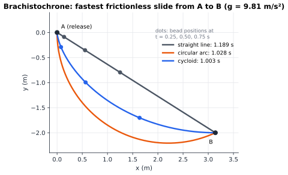

# Chapter 92 — Mathematical Physics: The Structure Behind Nature

[← Previous](91-inverse-problems.md) · [Track J](README.md) · [Table of Contents](../../00-front/table-of-contents.md) · [Next →](93-tensor-mathematics.md)

> **Level 3 · Track J — Mathematics at the Frontier**
> **Builds on:** [Ch. 6](../../part-2-calculus/06-multivariable-calculus.md) (§6.11 Lagrange multipliers), [Ch. 11](../../part-4-differential-equations/11-ordinary-differential-equations.md), [Ch. 51](../d-optimization/51-optimal-control.md), [Ch. 59](../e-abstract-math/59-differential-geometry.md) · **Leads to:** [Ch. 93](93-tensor-mathematics.md), [Ch. 95](95-representation-theory.md), [Ch. 90](90-spectral-theory.md) · **Related:** [Ch. 72](../g-graphics-simulation/72-physics-engines.md), [Ch. 38](../b-probability-information/38-monte-carlo.md), [Ch. 56](../e-abstract-math/56-abstract-algebra.md), [Ch. 61](../e-abstract-math/61-functional-analysis.md), [Ch. 84](../i-dynamical-systems/84-chaos-theory.md)
> **Reading time:** ~30 min

## 92.1 The hook

In June 1696 Johann Bernoulli published a challenge "to the sharpest mathematicians in the world". Two points $A$ and $B$ sit at different heights, with $B$ lower and off to the side. A bead slides without friction along a wire from $A$ to $B$, pulled only by gravity. What shape of wire gets it there fastest?

The straight line is the shortest path, but it is not the fastest. Take $B$ to be $\pi$ metres to the right of $A$ and 2 metres below it. On the straight wire the bead takes **1.189 s**. Bend the wire into a circular arc that starts vertically and the bead wins, at **1.028 s**: it plunges first, builds up speed, and spends that speed on the longer route. The best wire of all takes **1.003 s**. It is a **cycloid**, the curve traced by a point on the rim of a rolling wheel. Newton is said to have solved it overnight and replied anonymously; Bernoulli recognised the lion "by his claw".



*Three wires from A to B. The dots mark where each bead is after 0.25, 0.50 and 0.75 s. The cycloid bead drops steeply, gains speed early, and arrives first even though its wire is longer than the straight line.*

The puzzle is old, but the idea inside it shaped the next three centuries of physics. The answer to "which *curve* is best?" is a differential equation, and nature seems to answer such questions all the time. Light crossing from air into water bends so as to minimise its travel time (Fermat). A planet follows the orbit that makes a certain integral, the **action**, stationary (Maupertuis, Euler, Lagrange, Hamilton). A clock in free fall follows the path through spacetime along which it ticks the most (Einstein).

Then, in 1918, Emmy Noether found something that is still astonishing. Once a law of motion is written as "make this integral stationary", every **continuous symmetry** of the integral hands you a **conserved quantity** for free. Laws that don't change from one day to the next force energy to be conserved. Laws that are the same everywhere force momentum to be conserved. Laws that look the same in every direction force angular momentum to be conserved.

> **Why should a symmetry, a statement about what does *not* matter, produce a number that never changes?**

This chapter answers that question. It also follows the same structure into phase space, where it explains why some numerical integrators run stably for billions of steps, and to the edge of quantum mechanics.

## 92.2 The big idea

**Idea 1: optimise over whole paths, not numbers.** In calculus you minimise a function of a few numbers by setting a derivative to zero ([§6.11](../../part-2-calculus/06-multivariable-calculus.md#611-lagrange-multipliers)). In the calculus of variations the unknown is a *whole function* $y(x)$, and the thing to minimise is a **functional**, a number computed from the entire curve, such as the bead's travel time. The trick is the same as in ordinary calculus. Wiggle the curve slightly, by $\varepsilon\,\eta(x)$, and demand that the first-order change vanish for *every* wiggle $\eta$. Because the wiggle is arbitrary, the condition holds at each point separately and becomes a differential equation.

**Idea 2: a symmetry is a wiggle that costs nothing.** Suppose moving the entire experiment 1 cm to the left changes nothing. That shift is a wiggle of the path that leaves the integral exactly unchanged, at every instant and not only to first order. Feed this special wiggle into the stationarity condition and it does not produce an equation for the path. It produces a statement that some combination of positions and velocities has zero time derivative. The symmetry is spent on buying a conservation law.

**Idea 3: phase space is a place where volume is sacred.** Hamilton rewrote mechanics using positions $q$ *and* momenta $p$ as equal partners. A state of the system is then a point in **phase space**, and the motion is a flow of that space. For a pendulum the flow runs along the level curves of the energy $H(q,p)$: closed ovals while it swings, wavy lines while it spins over the top, and the **separatrix** between them.


*Pendulum phase space. Every trajectory runs along a level set of $H$. A disc of initial states (orange) is carried by the exact flow and sheared into crescents (purple at $t=2$, teal at $t=4$), but its area stays at 0.322 to six digits. This is Liouville's theorem.*

An analogy: phase-space flow is like stirring paint into honey. You can stretch a blob into an arbitrarily thin thread, but never compress it. Facts as different as "a Hamiltonian system has no attractors" and the success of Hamiltonian Monte Carlo follow from this one incompressibility.

## 92.3 The mathematics

### The Euler–Lagrange equation

Let $q(t)\in\mathbb{R}^n$ be a path with fixed endpoints $q(t_0)=q_0$ and $q(t_1)=q_1$, and let

$$
S[q]=\int_{t_0}^{t_1} L\big(q(t),\dot q(t),t\big)\,dt
$$

for a smooth function $L$, the **Lagrangian**.

> [!theorem] Euler–Lagrange equations
> If $q$ makes $S$ stationary among all smooth paths with the same endpoints, then for each $i=1,\dots,n$
> $$
> \frac{d}{dt}\frac{\partial L}{\partial \dot q_i}-\frac{\partial L}{\partial q_i}=0 .
> $$

*Proof.* Take any smooth $\eta(t)$ with $\eta(t_0)=\eta(t_1)=0$ and compare $q$ with $q+\varepsilon\eta$. Differentiating under the integral sign,

$$
\frac{d}{d\varepsilon}S[q+\varepsilon\eta]\Big|_{\varepsilon=0}=\int_{t_0}^{t_1}\sum_i\Big(\frac{\partial L}{\partial q_i}\eta_i+\frac{\partial L}{\partial \dot q_i}\dot\eta_i\Big)dt .
$$

Integrate the second term by parts. The boundary term $\big[\sum_i \tfrac{\partial L}{\partial\dot q_i}\eta_i\big]_{t_0}^{t_1}$ vanishes because $\eta$ vanishes at both ends, which leaves

$$
0=\int_{t_0}^{t_1}\sum_i\Big(\frac{\partial L}{\partial q_i}-\frac{d}{dt}\frac{\partial L}{\partial \dot q_i}\Big)\eta_i\,dt\quad\text{for every admissible }\eta .
$$

If the bracket were nonzero at some time $t^*$ in some component, say positive, it would stay positive on a small interval around $t^*$. Choose $\eta_i$ to be a smooth bump supported inside that interval and every other component zero: the integral would then be positive, a contradiction. (This step is called the *fundamental lemma of the calculus of variations*.) $\blacksquare$

**Newton from a single function.** For a particle of mass $m$ in a potential $V(q)$, take $L=T-V=\tfrac12 m\lVert\dot q\rVert^2-V(q)$. Then $\partial L/\partial\dot q=m\dot q$ and $\partial L/\partial q=-\nabla V$, so the Euler–Lagrange equation reads $m\ddot q=-\nabla V$: Newton's second law. The **principle of stationary action** packs mechanics into one scalar function, and it works in *any* coordinates. Write $L$ in polar angles or a robot arm's joint angles, and the same recipe gives correct equations of motion without resolving a single force.

**The brachistochrone, briefly.** With $y$ measured downward, a bead starting from rest has speed $\sqrt{2gy}$ by energy conservation, so the travel time is

$$
T[y]=\int_0^{X}\frac{\sqrt{1+y'^2}}{\sqrt{2gy}}\,dx .
$$

The integrand $F(y,y')$ does not depend on $x$. For such integrands the Euler–Lagrange equation has a first integral, the **Beltrami identity** $F-y'\,\partial F/\partial y'=\text{const}$, which here reduces to $y(1+y'^2)=2r$ for a constant $r$. Substituting $x=r(\theta-\sin\theta)$, $y=r(1-\cos\theta)$ solves it: a cycloid. The bead's parameter turns out to be proportional to time, $\theta=t\sqrt{g/r}$, so reaching the bottom of an arch takes $\pi\sqrt{r/g}$, which is 1.003 s for $r=1$ m. The Beltrami identity is our first conservation law from a symmetry. The integrand did not care about $x$, and something was conserved.

### Noether's theorem

Now make that observation general. A **one-parameter symmetry** of $L$ is a smooth family of transformations $q\mapsto q+\varepsilon K(q)+O(\varepsilon^2)$, generated by a vector field $K$, under which the Lagrangian does not change to first order:

$$
\frac{d}{d\varepsilon}L\big(q+\varepsilon K(q),\ \dot q+\varepsilon\,\tfrac{d}{dt}K(q)\big)\Big|_{\varepsilon=0}=\sum_i\Big(\frac{\partial L}{\partial q_i}K_i+\frac{\partial L}{\partial\dot q_i}\frac{dK_i}{dt}\Big)=0 .
$$

Define the **momentum** conjugate to $q_i$ as $p_i=\partial L/\partial\dot q_i$.

> [!theorem] Noether's theorem (point symmetries)
> If $K$ generates a symmetry of $L$, then along every solution of the Euler–Lagrange equations the quantity
> $$
> Q=\sum_i p_i\,K_i(q)=\sum_i \frac{\partial L}{\partial\dot q_i}K_i(q)
> $$
> is constant in time.

*Proof.* Differentiate $Q$ along a solution and use the product rule:

$$
\frac{dQ}{dt}=\sum_i\Big(\frac{d}{dt}\frac{\partial L}{\partial\dot q_i}\Big)K_i+\sum_i\frac{\partial L}{\partial\dot q_i}\frac{dK_i}{dt}.
$$

By the Euler–Lagrange equation the first bracket equals $\partial L/\partial q_i$. What remains is exactly the left-hand side of the symmetry condition, which is zero. $\blacksquare$

That is the whole proof. The answer to the hook's question is now visible. The Euler–Lagrange equation says *forces equal the rate of change of momentum*. The symmetry condition says *the force along the direction $K$ is cancelled by the way momentum feeds into $K$*. Put together, the momentum along $K$ has nothing left to change it.

> [!example] The three classical conservation laws
> - **Translation.** $N$ particles with $L=\sum_a\tfrac12 m_a\lVert\dot{\mathbf{x}}_a\rVert^2-V$, where $V$ depends only on differences $\mathbf{x}_a-\mathbf{x}_b$. Shifting every particle by $\varepsilon\hat{\mathbf{e}}$ leaves $L$ unchanged, so $K=(\hat{\mathbf{e}},\dots,\hat{\mathbf{e}})$ and $Q=\hat{\mathbf{e}}\cdot\sum_a m_a\dot{\mathbf{x}}_a$. Total momentum is conserved.
> - **Rotation.** In the plane, rotating by $\varepsilon$ moves $(x,y)$ by $\varepsilon(-y,x)$. If $V$ depends only on distances, $Q=p_x(-y)+p_y x=m(x\dot y-y\dot x)$. Angular momentum is conserved, which is Kepler's equal-area law.
> - **Time translation.** If $L$ has no explicit $t$, define the **energy function** $h=\sum_i p_i\dot q_i-L$. Then $dh/dt=-\partial L/\partial t=0$ (differentiate and use Euler–Lagrange, exactly as above). For $L=T-V$ with $T$ quadratic in $\dot q$, $h=T+V$. Energy is conserved.

Time translation needs the slightly larger version of the theorem that allows $t$ to move too, but the computation is the same in spirit. The theorem also runs in reverse: in Hamiltonian form below, a conserved quantity *generates* a symmetry. The dictionary is two-way.

> [!warning] Not every conservation law is Noether's
> Noether needs an action. Friction has none, which is why a damped oscillator has a time-independent law and still loses energy. Discrete symmetries such as reflections give selection rules rather than conserved numbers ([Ch. 95](95-representation-theory.md)).

### Hamilton's equations and the incompressible flow

The **Legendre transform** trades velocities for momenta. Assuming $p=\partial L/\partial\dot q$ can be solved for $\dot q$, define the **Hamiltonian**

$$
H(q,p)=\sum_i p_i\dot q_i-L(q,\dot q),
$$

which is the energy function $h$ written in terms of $(q,p)$. Computing $dH$ in two ways, and using the Euler–Lagrange equation, gives **Hamilton's equations**:

$$
\dot q_i=\frac{\partial H}{\partial p_i},\qquad \dot p_i=-\frac{\partial H}{\partial q_i}.
$$

For the pendulum, with unit mass, length and $g$, $L=\tfrac12\dot q^2+\cos q$, $p=\dot q$, and $H=\tfrac12p^2-\cos q$. Two immediate consequences follow. First, $dH/dt=\sum_i(H_{q_i}\dot q_i+H_{p_i}\dot p_i)=\sum_i(H_{q_i}H_{p_i}-H_{p_i}H_{q_i})=0$, so trajectories stay on level sets, as in the figure. Second, and deeper:

> [!theorem] Liouville's theorem
> Let $\Phi_t$ be the flow of Hamilton's equations on $\mathbb{R}^{2n}$. For any region $D$ of phase space, $\operatorname{vol}(\Phi_t(D))=\operatorname{vol}(D)$ for all $t$.

*Proof.* Write the equations as $\dot z=F(z)$ with $z=(q,p)$ and $F=(\partial H/\partial p,\,-\partial H/\partial q)$. Its divergence is

$$
\nabla\cdot F=\sum_i\Big(\frac{\partial^2 H}{\partial q_i\partial p_i}-\frac{\partial^2 H}{\partial p_i\partial q_i}\Big)=0 .
$$

Let $J(t)=\partial\Phi_t(z_0)/\partial z_0$ be the Jacobian matrix of the flow. Differentiating $\dot z=F(z)$ with respect to the initial condition gives the linear equation $\dot J=DF(z(t))\,J$ with $J(0)=\mathbf{I}$. For any matrix solution of such an equation, $\frac{d}{dt}\det J=\operatorname{tr}(DF)\det J$ (Jacobi's formula; it follows from $\det(\mathbf{I}+h\mathbf{A})=1+h\operatorname{tr}\mathbf{A}+O(h^2)$). Since $\operatorname{tr}DF=\nabla\cdot F=0$, $\det J(t)=1$ for all $t$, and the change-of-variables formula gives $\operatorname{vol}(\Phi_t(D))=\int_D\lvert\det J\rvert\,dz_0=\operatorname{vol}(D)$. $\blacksquare$

The Hamiltonian flow preserves more than volume. Its Jacobian satisfies $J^\mathsf{T}\boldsymbol{\Omega}J=\boldsymbol{\Omega}$, with $\boldsymbol{\Omega}=\begin{pmatrix}\mathbf{0}&\mathbf{I}\\-\mathbf{I}&\mathbf{0}\end{pmatrix}$. Such a map is called **symplectic**. Geometrically, it preserves the sum of the oriented areas that any small 2-dimensional patch projects onto the $n$ planes $(q_i,p_i)$. In one degree of freedom "symplectic" and "area-preserving" coincide, which is the version you met in [§72.3](../g-graphics-simulation/72-physics-engines.md#symplectic-euler-preserves-area). In more dimensions it is far stronger: Gromov's **non-squeezing theorem** (1985) forbids a symplectic map from squeezing a ball of radius $r$ into a cylinder $\{q_1^2+p_1^2<R^2\}$ with $R<r$, which a merely volume-preserving map could do.

### Brackets, and the doorway to quantum mechanics

For any observable $f(q,p)$, the chain rule and Hamilton's equations give $\dot f=\{f,H\}$, where the **Poisson bracket** is

$$
\{f,g\}=\sum_i\Big(\frac{\partial f}{\partial q_i}\frac{\partial g}{\partial p_i}-\frac{\partial f}{\partial p_i}\frac{\partial g}{\partial q_i}\Big),\qquad \{q_i,p_j\}=\delta_{ij}.
$$

Noether's theorem now becomes beautifully symmetric. $\{Q,H\}=0$ says both that $Q$ is conserved along the flow of $H$, and (because the bracket is antisymmetric) that $H$ is unchanged along the flow generated by $Q$, which is the symmetry. Momentum generates translations; angular momentum generates rotations; the Hamiltonian generates time evolution.

Dirac noticed that quantum mechanics keeps this algebra but replaces numbers by operators. The bracket $\{f,g\}$ becomes the commutator $[\hat f,\hat g]/(j\hbar)$, so $\{q,p\}=1$ becomes

$$
\hat X\hat P-\hat P\hat X=j\hbar\,\hat{I}.
$$

[Ch. 61](../e-abstract-math/61-functional-analysis.md) showed that no pair of *matrices* satisfies this, by taking traces. Could bounded operators on an infinite-dimensional Hilbert space do it? **Wielandt's argument** (1949) says no, in four lines. Suppose $XP-PX=c\,I$ with $c\neq0$ and $X,P$ bounded. By induction, $XP^n-P^nX=nc\,P^{n-1}$ for every $n\ge1$. (Check it: $XP^{n+1}-P^{n+1}X=(XP^n-P^nX)P+P^n(XP-PX)=nc\,P^n+c\,P^n$.) Taking norms,

$$
n\lvert c\rvert\,\lVert P^{n-1}\rVert\le 2\lVert X\rVert\,\lVert P\rVert\,\lVert P^{n-1}\rVert .
$$

If $P^{n-1}\neq0$ for every $n$, dividing gives $n\le 2\lVert X\rVert\lVert P\rVert/\lvert c\rvert$ for all $n$, which is absurd. If instead $P^{m}=0$ for some $m$, the identity with $n=m$ gives $mc\,P^{m-1}=0$, so $P^{m-1}=0$; descending one power at a time eventually gives $c\,I=0$, again absurd. $\blacksquare$ Position and momentum *must* be unbounded operators, with all the delicacy of domains that [Ch. 61](../e-abstract-math/61-functional-analysis.md) warned about. The **Stone–von Neumann theorem** (1931) then says that, once the relation is stated in the robust exponentiated form $e^{ja\hat X}e^{jb\hat P}=e^{-jab\hbar}e^{jb\hat P}e^{ja\hat X}$, every irreducible solution is unitarily equivalent to the familiar one: $\hat X$ multiplies $\psi(x)$ by $x$ and $\hat P=-j\hbar\,d/dx$. In this sense quantum mechanics of a particle is *unique*.

**The uncertainty principle is Cauchy–Schwarz.** Here is the signal-processing version promised in [Ch. 76](../g-graphics-simulation/76-signal-processing-audio-visual.md). Let $x(t)$ be a smooth signal with $\int\lvert x\rvert^2dt=1$, centred so that its mean time and mean frequency are zero, and decaying fast enough that $t\lvert x(t)\rvert^2\to0$ as $\lvert t\rvert\to\infty$. Define $\sigma_t^2=\int t^2\lvert x\rvert^2dt$ and $\sigma_\omega^2=\frac{1}{2\pi}\int\omega^2\lvert X(\omega)\rvert^2d\omega$, which equals $\int\lvert x'(t)\rvert^2dt$ by Parseval's theorem ([§16.7](../../part-5-transforms/16-fourier-transforms.md#167-energy-spectral-density)), since $x'$ has transform $j\omega X$. Integrating by parts,

$$
1=\int\lvert x\rvert^2dt=-\int t\,\frac{d}{dt}\lvert x\rvert^2\,dt=-2\operatorname{Re}\int t\,x^*x'\,dt\le 2\Big(\int t^2\lvert x\rvert^2dt\Big)^{1/2}\Big(\int\lvert x'\rvert^2dt\Big)^{1/2}.
$$

So $\sigma_t\sigma_\omega\ge\tfrac12$, or $\sigma_t\sigma_f\ge 1/(4\pi)$ with $f=\omega/2\pi$. Equality in Cauchy–Schwarz needs $x'=-\lambda t\,x$ for a real $\lambda>0$, whose solution is the Gaussian $e^{-\lambda t^2/2}$. Replace $\omega$ by $p/\hbar$ (a wavefunction's frequency is its momentum) and the same lines give Heisenberg's $\sigma_x\sigma_p\ge\hbar/2$. The physics is the Fourier transform. The quantum part is only the claim that a particle *is* a wave.

> [!mystery] Why does nature extremise anything?
> A thrown ball does not try out paths and pick the best one, so why is mechanics a variational problem at all? Feynman's answer is that in quantum mechanics a particle takes *every* path, each weighted by the phase $e^{jS/\hbar}$. Paths far from stationary action cancel each other out, like a rapidly oscillating integrand, and only the neighbourhood of the classical path survives as $\hbar\to0$. The trouble is that the "integral over all paths" has never been defined as a genuine integral in most cases of physical interest. For four-dimensional gauge theories, making it rigorous is the Yang–Mills existence and mass gap problem, one of the Clay Millennium Prize problems, and it is still **open**.

## 92.4 The algorithm

Liouville's theorem says the exact flow preserves area. An integrator that shares this property inherits much of the flow's long-term behaviour. The **Störmer–Verlet** or **leapfrog** method, for $H=\tfrac12p^2+V(q)$, is three shears: half a kick, a drift, and half a kick.

```python
import numpy as np

def H(q, p):                      # pendulum, g/l = 1, unit mass and length
    return 0.5 * p**2 - np.cos(q)

def euler(q, p, h):               # explicit Euler: uses old q and old p
    return q + h * p, p - h * np.sin(q)

def leapfrog(q, p, h):            # Stormer-Verlet: kick, drift, kick
    p = p - 0.5 * h * np.sin(q)
    q = q + h * p
    p = p - 0.5 * h * np.sin(q)
    return q, p

for step in (euler, leapfrog):
    q, p, h = 1.0, 0.0, 0.1
    E0, worst = H(q, p), 0.0
    for n in range(100_000):      # 10,000 time units, about 1,500 swings
        q, p = step(q, p, h)
        worst = max(worst, abs(H(q, p) - E0))
    print(f"{step.__name__:9s} max |H - H0| = {worst:.2e}, final q = {q:.3f}")
```

Both methods cost about one force evaluation per step, since leapfrog's closing half-kick can be reused as the next step's opening one. Explicit Euler gains energy on every swing. Within four swings the pendulum is spinning over the top, and by the end the maximum energy error is about 330 and $q$ has wound round to $-1.9\times10^5$ rad. Leapfrog's energy error never exceeds $1.1\times10^{-3}$ over the whole run. It does not drift; it oscillates.

**Why it works.** Each substep is a shear of phase space: a kick changes $p$ by an amount that depends only on $q$, and a drift changes $q$ by an amount that depends only on $p$. Each shear has Jacobian determinant 1 and is symplectic, so their composition is too. The scheme is also **time-reversible**: run it with $-h$ from the end and you retrace the steps exactly. **Backward error analysis** (Benettin–Giorgilli 1994, Hairer–Lubich 1997) then gives the deep explanation of the shadow energy from [Ch. 72](../g-graphics-simulation/72-physics-engines.md). A symplectic method applied to an analytic Hamiltonian $H$ is, up to an error of order $e^{-c/h}$, the *exact* flow of a modified Hamiltonian $\tilde H=H+h^2H_2+h^4H_4+\dots$, and the error stays exponentially small for times up to order $e^{c/h}$. The method conserves $\tilde H$ almost exactly, so it stays within $O(h^2)$ of the true energy surface for exponentially long times. For the harmonic oscillator, $H=\tfrac12(p^2+q^2)$, the series sums in closed form: leapfrog conserves $\tilde H=\tfrac12p^2+\tfrac12(1-h^2/4)q^2$ *exactly*, which you can check in two lines.

**Hamiltonian Monte Carlo.** This answers the question left open in [Ch. 38](../b-probability-information/38-monte-carlo.md). To sample from a density $\pi(q)\propto e^{-U(q)}$, add a fake Gaussian momentum and set $H=U(q)+\tfrac12\lVert p\rVert^2$:

```text
HMC step from q:
    draw p ~ N(0, I)
    (q*, p*) = L leapfrog steps of size h from (q, p) on H
    accept q* with probability min(1, exp(H(q, p) - H(q*, p*)))
```

Three properties of leapfrog make this rule exactly correct. *Volume preservation* removes any Jacobian factor from the acceptance ratio. *Reversibility* (flip $p$ at the end) makes the proposal symmetric, as Metropolis needs. And the *small energy error* keeps acceptance near 1 even for long trajectories that cross the whole distribution. RK4 would need a Jacobian correction it cannot compute cheaply. For a product target in $d$ dimensions, the leapfrog energy error adds up over the coordinates, and keeping the acceptance rate fixed requires $h\propto d^{-1/4}$ (Beskos et al., 2013). That is the $d^{1/4}$ cost quoted in Ch. 38.

**Failure cases.** Leapfrog is only second order and needs $h\omega<2$ for an oscillator of frequency $\omega$. Naive adaptive step sizes destroy its symplectic structure, and stiff or dissipative systems need other tools ([§22.11](../../part-7-numerical-computational/22-numerical-methods.md#2211-stability-and-convergence)).

## 92.5 The experiment

**Phase portraits by hand.** Every curve below is a level set $\tfrac12p^2-\cos q=E$ of the pendulum Hamiltonian, with $x$ for $q$ and $y$ for $p$. The dashed grey ellipse is the small-angle approximation $\tfrac12p^2+\tfrac12q^2-1=E$ at the same energy $E=-0.5$.

```desmos-graph
left=-7; right=7; bottom=-3.2; top=3.2
---
\frac{y^2}{2}-\cos(x)=-0.5|blue
\frac{y^2}{2}+\frac{x^2}{2}-1=-0.5|grey|dashed
\frac{y^2}{2}-\cos(x)=0.5|blue
\frac{y^2}{2}-\cos(x)=1|red
\frac{y^2}{2}-\cos(x)=2|green
(3.14159,0)|label:unstable equilibrium
```

*Level sets of the pendulum Hamiltonian. Blue: swinging; red: the separatrix; green: spinning over the top. The dashed ellipse is the linearised pendulum.*

Things to change:

- Change both $-0.5$ values to $-0.9$, then to $0.5$. The ellipse and the true orbit agree for small swings and come apart as the energy approaches the separatrix. This is why a pendulum clock's period depends on its amplitude.
- Change the red level from $1$ to $0.99$ and to $1.01$. A tiny change of energy changes the *kind* of motion. Near the separatrix the period becomes infinite, and this is where chaos first appears once the pendulum is pushed periodically.

**Find the brachistochrone by brute force.** This script never mentions cycloids or Euler–Lagrange. It cuts the wire into 40 straight segments, computes the exact travel time down each one (constant acceleration, so the time is length divided by mean speed), and moves the heights of the joints downhill in travel time.

```python
import numpy as np

g, X, Y, N = 9.81, np.pi, -2.0, 40       # gravity, end point (X, Y), number of segments
x = np.linspace(0, X, N + 1)

def travel_time(y_inner):                # y_inner: (..., N-1) heights of the inner nodes
    y_inner = np.atleast_2d(y_inner)
    ends = np.ones((len(y_inner), 1))
    y = np.hstack([0 * ends, y_inner, Y * ends])
    v = np.sqrt(2 * g * np.maximum(-y, 0))           # speed from energy conservation
    L = np.hypot(np.diff(x), np.diff(y, axis=1))     # segment lengths
    return np.sum(2 * L / (v[:, :-1] + v[:, 1:]), axis=1)   # constant acceleration per segment

y = np.linspace(0, Y, N + 1)[1:-1]                   # start from the straight line
print(f"straight line : {travel_time(y)[0]:.4f} s")
eps, E = 1e-6, np.eye(N - 1)
for it in range(20000):                              # plain gradient descent
    grad = (travel_time(y + eps * E) - travel_time(y - eps * E)) / (2 * eps)
    y -= 0.02 * grad / max(1.0, np.abs(grad).max())
print(f"optimised path: {travel_time(y)[0]:.4f} s, lowest point y = {y.min():.3f}")
print(f"cycloid theory: {np.pi * np.sqrt(1 / g):.4f} s (radius 1)")
```

It starts at 1.1890 s on the straight line and settles at 1.0051 s, within 0.2% of the cycloid's 1.0030 s. The remaining gap is the cost of using 40 straight pieces. Things to change:

- Set `X = 2*np.pi`, so that $B$ is far to the side. The optimiser now dips *below* $B$, to about $y=-2.49$, and climbs back up to it, in 1.4846 s. The exact cycloid (radius 1.275 m) bottoms out at $-2.55$ and takes 1.4804 s. Going downhill past your destination can be the fastest way to reach it.
- Increase `N` to 80 and watch the gap to theory shrink.
- Replace `2 * L / (v[:, :-1] + v[:, 1:])` by `L` and the same code finds the *shortest* path, the straight line. One functional per question.

## 92.6 The challenge

1. **Intuition.** A bead slides on a frictionless *helical* wire wound around a vertical axis, under gravity. Which of energy, vertical momentum and angular momentum about the axis are conserved? Now let the helix rotate about its axis at a constant rate. Which symmetry has been lost, and what conserved quantity takes the place of energy?
2. **Derivation.** For a particle in a central potential, $L=\tfrac12m(\dot r^2+r^2\dot\phi^2)-V(r)$, derive the Euler–Lagrange equations, use Noether to eliminate $\dot\phi$, and reduce the motion to a one-dimensional problem with an effective potential. Then derive the Beltrami identity $F-y'F_{y'}=\text{const}$ for an integrand $F(y,y')$ and show that it gives $y(1+y'^2)=\text{const}$ for the brachistochrone.
3. **Implementation.** Write a leapfrog integrator for the Kepler problem, $H=\tfrac12\lVert\mathbf{p}\rVert^2-1/\lVert\mathbf{q}\rVert$, starting on an orbit of eccentricity 0.6. Over 1,000 orbits, plot the energy error and the angular-momentum error for leapfrog and for RK4 at matched cost. Explain why leapfrog conserves angular momentum *exactly* (to rounding), while its energy merely oscillates.
4. **Open investigation.** Build the HMC sampler of §92.4 for a $d$-dimensional standard Gaussian. For $d=10,100,1000$, find the step size $h$ that gives an acceptance rate of about 65%, and test how $h$ scales with $d$. Then repeat for a strongly correlated target such as Neal's funnel, where no single step size works everywhere. Can you design a position-dependent step or mass matrix that keeps the sampler exactly correct? (Riemannian-manifold HMC is one answer, and its cost is a live research question.)

## 92.7 Loose threads

**The clock in orbit.** The GPS mystery of [Ch. 59](../e-abstract-math/59-differential-geometry.md) is a variational principle too. A free-falling clock follows the path through spacetime that makes its own elapsed time, the **proper time** $\tau$, stationary. In a weak gravitational potential $\Phi$ and at speed $v\ll c$,

$$
d\tau\approx\Big(1+\frac{\Phi}{c^2}-\frac{v^2}{2c^2}\Big)dt,\qquad\text{so}\qquad -mc^2\!\int d\tau\approx\int\Big(\tfrac12mv^2-m\Phi\Big)dt-mc^2\!\int dt .
$$

Stationary proper time is stationary Newtonian action, with $L=T-V$. The same formula also gives the GPS clock rates. With $GM=3.986\times10^{14}\ \mathrm{m^3/s^2}$, Earth's radius 6,371 km and the orbital radius 26,561 km, the potential term makes the satellite clock gain $45.7\ \mu$s per day, and its orbital speed of 3.87 km/s makes it lose $7.2\ \mu$s per day. The net 38.5 μs per day is what the satellites correct for. As for *which* curvature matter controls: the Einstein equations $G_{\mu\nu}=\frac{8\pi G}{c^4}T_{\mu\nu}$ tie the **Ricci** part of the curvature, which governs how a small ball of test particles changes its *volume*, to energy and momentum. The remaining **Weyl** part is free: it carries tides and gravitational waves through empty space. "Why that one" has a Noether answer. Energy–momentum conservation, $\nabla_\mu T^{\mu\nu}=0$, comes from the symmetry of physics under shifts of spacetime position. It can only be consistent if the geometric side is automatically divergence-free too. Lovelock proved (1971) that in four dimensions $G_{\mu\nu}$, plus a cosmological-constant term, is the *only* divergence-free symmetric tensor built from the metric and its first two derivatives. It is also what you get by applying Euler–Lagrange to the Einstein–Hilbert action $\int R\sqrt{-g}\,d^4x$. The curvature tensors themselves, and why they are tensors at all, are in [Ch. 93](93-tensor-mathematics.md).

**Itô or Stratonovich?** This is the physics answer to the mystery from [Ch. 36](../b-probability-information/36-stochastic-processes.md). If the noise's correlation time is the *only* small timescale, the white-noise limit is Stratonovich (Wong–Zakai), natural for a circuit driven by thermal noise. Itô is right when the noise is non-anticipating by construction: a trader cannot react to tomorrow's price change. With *two* small timescales, such as a Brownian particle's inertia and its noise's correlation time, the limit depends on their ratio and can be neither convention (Kupferman, Pavliotis and Stuart, 2004); colloids diffusing near a wall show the resulting drift, matching the "anti-Itô" convention (Volpe et al., 2010).

> [!mystery] Do the tori survive?
> A pendulum, a planet around a single sun, and any system with as many independent conserved quantities as degrees of freedom is **integrable**. Its phase space is foliated by invariant tori, and motion on each torus is perfectly regular. Add Jupiter's pull on the Earth and the extra conserved quantities are gone. Does the solar system then stay regular? Kolmogorov, Arnold and Moser proved that *most* tori survive a small enough perturbation, the ones whose frequencies are "sufficiently irrational", while the rest dissolve into thin layers of chaos. How irrational is sufficient, and what happens between the survivors, is the subject of [Ch. 84](../i-dynamical-systems/84-chaos-theory.md).

> [!mystery] What is an electron, mathematically?
> Noether turned each continuous symmetry into a conserved number. Wigner (1939) went much further. In quantum theory, the symmetry group of spacetime acts on the space of states by unitary operators, and an *elementary particle* is an **irreducible** piece of that action. Mass and spin, including the half-integer spin no classical object has, then come out as labels of the irreducible pieces, not as extra assumptions. Why the rotation group has a "double cover" that allows spin $\tfrac12$, and how to classify irreducible representations at all, are the subject of [Ch. 95](95-representation-theory.md).

**Why a quantum verifier cannot be rewound.** The zero-knowledge proofs of [Ch. 82](../h-cryptography-coding/82-zero-knowledge-proofs.md) copy a party's state and run it twice. Quantum states cannot be copied, and the reason is one line of linear algebra. Quantum evolution is a unitary, hence linear and inner-product-preserving, map $U$. Suppose some $U$ cloned every state, $U(\psi\otimes\chi_0)=\psi\otimes\psi$, using a fixed blank state $\chi_0$. Taking inner products of the results for two unit states $\psi,\varphi$ gives $\langle\varphi,\psi\rangle=\langle\varphi,\psi\rangle^2$. So $\langle\varphi,\psi\rangle$ is 0 or 1: only states that are identical or perfectly distinguishable can be cloned, never a general superposition (Wootters–Zurek and Dieks, 1982). A classical memory can be copied freely, because a classical state is a point, not a vector in a space of superpositions. In quantum theory every state is such a vector, which is what makes copying impossible and measurement disturbing.

Two other threads go elsewhere. Pontryagin's costate in [Ch. 51](../d-optimization/51-optimal-control.md) is the momentum of a variational problem, and the Hamilton–Jacobi–Bellman equation of [Ch. 52](../d-optimization/52-dynamic-programming.md) is the Hamilton–Jacobi equation of mechanics in disguise. Replacing paths $q(t)$ by fields $u(x,t)$ turns Euler–Lagrange into the wave and Maxwell equations, whose spectra are the business of [Ch. 90](90-spectral-theory.md).

## Further reading

- V. I. Arnold, *Mathematical Methods of Classical Mechanics*, 2nd ed., Springer, 1989. The classic geometric treatment: variational principles, symplectic manifolds, KAM theory. Demanding and unforgettable.
- D. E. Neuenschwander, *Emmy Noether's Wonderful Theorem*, 2nd ed., Johns Hopkins University Press, 2017. Noether's theorem from first principles, with history and many worked examples.
- E. Hairer, C. Lubich and G. Wanner, *Geometric Numerical Integration*, 2nd ed., Springer, 2006. The definitive book on symplectic integrators and backward error analysis.
- R. M. Neal, "MCMC using Hamiltonian dynamics", in *Handbook of Markov Chain Monte Carlo*, CRC Press, 2011. The clearest introduction to HMC, with practical advice.
- B. C. Hall, *Quantum Theory for Mathematicians*, Springer, 2013. Unbounded operators, the Stone–von Neumann theorem and the uncertainty principle, done properly.
