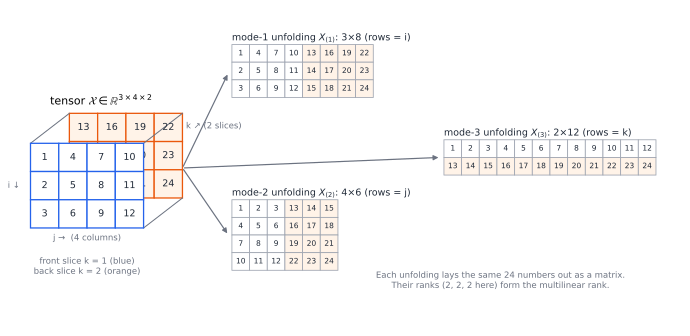

# Chapter 93 — Tensor Mathematics and Multilinear Algebra

[← Previous](92-mathematical-physics.md) · [Track J](README.md) · [Table of Contents](../../00-front/table-of-contents.md) · [Next →](94-algebraic-geometry.md)

> **Level 3 · Track J — Mathematics at the Frontier**
> **Builds on:** [Ch. 10](../../part-3-linear-algebra/10-eigenvalues-and-eigenvectors.md) (§10.7 SVD), [Ch. 99](../e-abstract-math/99-abstract-linear-algebra.md), [Ch. 59](../e-abstract-math/59-differential-geometry.md) · **Leads to:** [Ch. 94](94-algebraic-geometry.md), [Ch. 95](95-representation-theory.md), [Ch. 98](98-mathematical-research.md) · **Related:** [Ch. 26](../a-algorithms/26-the-mathematics-of-algorithms.md), [Ch. 92](92-mathematical-physics.md), [Ch. 62](../e-abstract-math/62-category-theory.md)
> **Reading time:** ~30 min

## 93.1 The hook

Multiply two $2\times2$ matrices the way you learned at school:

$$
\begin{pmatrix}a_{11}&a_{12}\\a_{21}&a_{22}\end{pmatrix}\begin{pmatrix}b_{11}&b_{12}\\b_{21}&b_{22}\end{pmatrix}=\begin{pmatrix}a_{11}b_{11}+a_{12}b_{21}&a_{11}b_{12}+a_{12}b_{22}\\a_{21}b_{11}+a_{22}b_{21}&a_{21}b_{12}+a_{22}b_{22}\end{pmatrix}.
$$

That takes eight multiplications. For more than a century nobody seriously asked whether eight was necessary. In 1969 Volker Strassen, trying to *prove* that it was, found seven:

$$
\begin{aligned}
M_1&=(a_{11}+a_{22})(b_{11}+b_{22}), & M_2&=(a_{21}+a_{22})\,b_{11}, & M_3&=a_{11}(b_{12}-b_{22}),\\
M_4&=a_{22}(b_{21}-b_{11}), & M_5&=(a_{11}+a_{12})\,b_{22}, & M_6&=(a_{21}-a_{11})(b_{11}+b_{12}),\\
M_7&=(a_{12}-a_{22})(b_{21}+b_{22}), & &
\end{aligned}
$$

and then $c_{11}=M_1+M_4-M_5+M_7$, $c_{12}=M_3+M_5$, $c_{21}=M_2+M_4$, $c_{22}=M_1-M_2+M_3+M_6$. Expand and check: every unwanted cross term cancels. Applied recursively to blocks, saving one multiplication in eight turns $n^3$ into $n^{2.807}$ ([Ch. 26](../a-algorithms/26-the-mathematics-of-algorithms.md)).

Two years later Winograd proved that seven is optimal for $2\times2$. For $3\times3$ matrices the best known algorithm (Laderman, 1976) uses 23 multiplications, the best lower bound is 19, and **nobody knows the true answer**. It is a question about 81 numbers that half a century of effort, and a reinforcement-learning system, has not settled.

The surprise this chapter builds on is that "how many multiplications?" is not really a question about algorithms. It asks for the **rank** of a certain three-dimensional array of zeros and ones. For a two-dimensional array, a matrix, rank is the most tractable number in linear algebra: Gaussian elimination computes it in a fraction of a second. Add a third index and computing rank becomes NP-hard, best approximations can fail to exist, and the answer can depend on whether you allow complex numbers.

> **Why does one extra index turn the easiest problem in linear algebra into one of the hardest?**

## 93.2 The big idea

**A matrix is a sum of outer products.** The singular value decomposition ([§10.7](../../part-3-linear-algebra/10-eigenvalues-and-eigenvectors.md#107-singular-value-decomposition)) writes any matrix as $\mathbf{M}=\sum_k\sigma_k\mathbf{u}_k\mathbf{v}_k^\mathsf{T}$. Each term $\mathbf{u}\mathbf{v}^\mathsf{T}$ is the simplest possible matrix: every row is a multiple of the same row. The **rank** is the fewest such terms you need. Truncating the sum after $r$ terms gives the best rank-$r$ approximation (Eckart–Young), which is how a picture can be stored as a handful of vectors.


*A $32\times32$ picture is a sum of outer products. Each term (top) is a "plaid" of one column pattern times one row pattern. Four of them reproduce the house to within 0.8%, and eleven reproduce it exactly: its rank is 11.*

**A tensor is a cube of numbers, and the same idea applies.** An array $\mathcal{X}$ with entries $x_{ijk}$ is a third-order tensor. The simplest cube is an outer product of three vectors, $(\mathbf{a}\otimes\mathbf{b}\otimes\mathbf{c})_{ijk}=a_ib_jc_k$. The **rank** of $\mathcal{X}$ is again the fewest such terms that sum to it. You can also slice the cube and lay the slices side by side, in three different ways. These **unfoldings** are ordinary matrices, and matrix tools apply to them.



*A $3\times4\times2$ tensor and its three unfoldings. Each unfolding keeps one index as the row index and merges the other two into the column index.*

The catch is that no unfolding tells you the tensor's rank. Each unfolding is a different "shadow" of the cube, and the cube can be far more complicated than any of its shadows.

**An analogy for the tensor product.** Suppose you want to multiply a vector by a vector and get *something*, demanding nothing except that the product be linear in each factor. The tensor product $\mathbf{v}\otimes\mathbf{w}$ is the most honest answer: it remembers that bilinearity and nothing else. Every other bilinear product (the dot product, the cross product, matrix multiplication, the determinant of a pair of columns) is obtained from it by one linear map. It is the universal "blank form" on which every bilinear operation is written.

## 93.3 The mathematics

### Multilinear maps and the tensor product

Let $V$ and $W$ be vector spaces over a field $K$ with bases $e_1,\dots,e_m$ and $f_1,\dots,f_n$. A map $B:V\times W\to X$ is **bilinear** if it is linear in each argument when the other is held fixed. Bilinear maps are *not* linear maps on $V\times W$: for example $B(2v,2w)=4B(v,w)$, not $2B(v,w)$. [Ch. 99](../e-abstract-math/99-abstract-linear-algebra.md#multilinear-forms) asked for a single space that converts them into linear maps. Here it is.

> [!definition] Tensor product (concrete form)
> $V\otimes W$ is the vector space with basis the $mn$ symbols $e_i\otimes f_j$. For $v=\sum_iv_ie_i$ and $w=\sum_jw_jf_j$, define $v\otimes w=\sum_{i,j}v_iw_j\,e_i\otimes f_j$.

The map $(v,w)\mapsto v\otimes w$ is bilinear by construction. In coordinates an element of $V\otimes W$ is an $m\times n$ array, and $v\otimes w$ is the outer product $\mathbf{v}\mathbf{w}^\mathsf{T}$.

> [!theorem] Universal property
> For every bilinear map $B:V\times W\to X$ there is exactly one *linear* map $\tilde B:V\otimes W\to X$ with $\tilde B(v\otimes w)=B(v,w)$ for all $v,w$.

*Proof.* Existence: a linear map may be prescribed freely on a basis, so define $\tilde B(e_i\otimes f_j)=B(e_i,f_j)$ and extend linearly. Then, by bilinearity of $B$,

$$
\tilde B(v\otimes w)=\sum_{i,j}v_iw_j\,\tilde B(e_i\otimes f_j)=\sum_{i,j}v_iw_j\,B(e_i,f_j)=B\Big(\sum_iv_ie_i,\sum_jw_jf_j\Big)=B(v,w).
$$

Uniqueness: any such $\tilde B$ is forced to take the value $B(e_i,f_j)$ on each $e_i\otimes f_j$, and these elements form a basis. $\blacksquare$

The theorem also explains why the construction does not really depend on the bases. Any two spaces with the universal property are identified by a unique isomorphism that respects $\otimes$, by the standard argument of [Ch. 62](../e-abstract-math/62-category-theory.md). Two consequences matter constantly.

**Most tensors are not products.** In coordinates $v\otimes w$ is a rank-1 matrix, so a general element of $V\otimes W$ is a *sum* $\sum_k v_k\otimes w_k$. The fewest terms needed is the matrix rank. In quantum mechanics, where the state space of two systems is $\mathcal{H}_1\otimes\mathcal{H}_2$, a state that is not a single product is called **entangled**.

**Linear maps are tensors, and upper and lower indices are vectors and covectors.** The map $\varphi\otimes w\mapsto\big(v\mapsto\varphi(v)\,w\big)$ is an isomorphism $V^*\otimes W\cong\operatorname{Hom}(V,W)$, so a matrix *is* a tensor with one covector slot and one vector slot. Now change basis in $V$ by $e'_a=\sum_iA^i_{\ a}e_i$. Components of a vector $v=\sum_iv^ie_i=\sum_av'^ae'_a$ must transform by the *inverse* matrix, $v'^a=\sum_i(A^{-1})^a_{\ i}v^i$. Components of a covector, $\varphi_a=\varphi(e'_a)=\sum_iA^i_{\ a}\varphi_i$, transform by $A$ itself. Physicists record the difference by writing vector indices up and covector indices down. An element of $V^{\otimes r}\otimes(V^*)^{\otimes s}$ has $r$ upper and $s$ lower indices, and its components pick up one factor of $A^{-1}$ per upper index and one factor of $A$ per lower index. On a manifold, with $A$ the Jacobian of a coordinate change, this is exactly the "one Jacobian factor per index" rule for the metric in [Ch. 59](../e-abstract-math/59-differential-geometry.md). A tensor in the physicist's sense is an element of a tensor product, and the transformation law is what that looks like in coordinates.

### Rank, and matrix multiplication as a tensor

For three spaces, $U\otimes V\otimes W$ has basis $e_i\otimes f_j\otimes g_k$, its elements are $I\times J\times K$ arrays, and the **rank** of $\mathcal{T}$ is the least $R$ with

$$
\mathcal{T}=\sum_{r=1}^{R}\mathbf{u}_r\otimes\mathbf{v}_r\otimes\mathbf{w}_r .
$$

This is the **CP decomposition** (canonical polyadic, also called CANDECOMP/PARAFAC). Write $\operatorname{vec}\mathbf{A}$ for the $n^2$ entries of $\mathbf{A}$ as one vector. Matrix multiplication $\mathbf{C}=\mathbf{A}\mathbf{B}$ is a bilinear map $K^{n^2}\times K^{n^2}\to K^{n^2}$, and by the universal property it corresponds to a tensor $\mathcal{M}_n$ with $n^2\times n^2\times n^2$ entries. Its entry is 1 at position $\big((a,b),(b,c),(a,c)\big)$, because $a_{ab}b_{bc}$ contributes to $c_{ac}$, and 0 elsewhere.

> [!theorem] Multiplications = rank
> $n\times n$ matrices can be multiplied by a bilinear algorithm that uses $R$ multiplications if and only if $\operatorname{rank}\mathcal{M}_n\le R$.

*Proof.* A bilinear algorithm forms $R$ products $m_r=(\mathbf{u}_r\cdot\operatorname{vec}\mathbf{A})(\mathbf{v}_r\cdot\operatorname{vec}\mathbf{B})$ and outputs $\operatorname{vec}\mathbf{C}=\sum_r m_r\mathbf{w}_r$. Read off the coefficient of $a_\alpha b_\beta$ in the $\gamma$-th output. The algorithm computes $c_\gamma=\sum_{\alpha,\beta}(\mathcal{M}_n)_{\alpha\beta\gamma}a_\alpha b_\beta$ exactly when

$$
(\mathcal{M}_n)_{\alpha\beta\gamma}=\sum_{r=1}^{R}(\mathbf{u}_r)_\alpha(\mathbf{v}_r)_\beta(\mathbf{w}_r)_\gamma\quad\text{for all }\alpha,\beta,\gamma,
$$

that is, when $\mathcal{M}_n=\sum_r\mathbf{u}_r\otimes\mathbf{v}_r\otimes\mathbf{w}_r$. Conversely, any such decomposition *is* an algorithm, with the vectors as its coefficients. $\blacksquare$

The schoolbook method is the decomposition of $\mathcal{M}_2$ into its eight nonzero entries. Strassen's is a decomposition into seven rank-1 terms. For instance $M_1$ is $\mathbf{u}_1=\mathbf{v}_1=(1,0,0,1)$ (that is, $a_{11}+a_{22}$ and $b_{11}+b_{22}$), and since $M_1$ appears in $c_{11}$ and $c_{22}$, $\mathbf{w}_1=(1,0,0,1)$. Winograd's theorem says $\operatorname{rank}\mathcal{M}_2=7$. How such a finite rank becomes the asymptotic exponent $\omega\le\log_n R$ is proved in [Ch. 98](98-mathematical-research.md).

### Where matrix intuition breaks

For matrices, the set of matrices of rank at most $r$ is closed: a limit of rank-$r$ matrices has rank at most $r$, because rank is detected by the vanishing of $(r+1)\times(r+1)$ minors, which are continuous functions. For tensors this fails.

> [!theorem] A tensor that rank-2 tensors approximate arbitrarily well
> Let $\mathbf{a},\mathbf{b}$ be linearly independent and $\mathcal{W}=\mathbf{a}\otimes\mathbf{a}\otimes\mathbf{b}+\mathbf{a}\otimes\mathbf{b}\otimes\mathbf{a}+\mathbf{b}\otimes\mathbf{a}\otimes\mathbf{a}$. Then $\mathcal{W}$ has rank 3, yet it is the limit of the rank-2 tensors
> $$
> \mathcal{T}_\varepsilon=\frac{1}{\varepsilon}\Big[(\mathbf{a}+\varepsilon\mathbf{b})^{\otimes3}-\mathbf{a}^{\otimes3}\Big]\qquad\text{as }\varepsilon\to0 .
> $$

*Proof of the limit.* Expand $(\mathbf{a}+\varepsilon\mathbf{b})^{\otimes3}$ by multilinearity into eight terms. The $\varepsilon^0$ term is $\mathbf{a}^{\otimes3}$, which cancels. The three $\varepsilon^1$ terms, divided by $\varepsilon$, are exactly $\mathcal{W}$. What remains is $\varepsilon(\mathbf{a}\otimes\mathbf{b}\otimes\mathbf{b}+\mathbf{b}\otimes\mathbf{a}\otimes\mathbf{b}+\mathbf{b}\otimes\mathbf{b}\otimes\mathbf{a})+\varepsilon^2\mathbf{b}^{\otimes3}\to0$. With orthonormal $\mathbf{a},\mathbf{b}$, $\lVert\mathcal{T}_\varepsilon-\mathcal{W}\rVert=\varepsilon\sqrt{3+\varepsilon^2}$. That $\mathcal{W}$ itself has rank 3, not 2, takes a short but careful argument; see de Silva and Lim (2008). $\blacksquare$

Look at the price of the approximation. The two rank-1 terms have norm about $1/\varepsilon$ each, and they nearly cancel. This is the **degeneracy** that makes CP fitting so treacherous. If you ask for the best rank-2 approximation of $\mathcal{W}$, there is none. The error can be made as small as you like, but never zero, and the factors blow up as you try. The least $r$ such that $\mathcal{T}$ is a limit of rank-$r$ tensors is called its **border rank**. The record exponents for matrix multiplication since 1979 have all come from border rank.

The other differences from matrices are just as stark:

| property | matrices | tensors of order $\ge3$ |
|---|---|---|
| computing rank | Gaussian elimination, polynomial time | NP-hard (Håstad 1990) |
| best rank-$r$ approximation | always exists (Eckart–Young) | may not exist |
| rank over $\mathbb{R}$ vs $\mathbb{C}$ | the same | can differ |
| rank of a random array | full, $\min(m,n)$, with probability 1 | several "typical" ranks may each have positive probability |
| maximum rank | $\min(m,n)$ | can exceed every side length |

For instance, a random real $2\times2\times2$ tensor with Gaussian entries has rank 2 with probability $\pi/4\approx0.785$ and rank 3 otherwise. Over $\mathbb{C}$ it has rank 2 with probability 1. The dividing line is the sign of a single polynomial in the eight entries, Cayley's hyperdeterminant. Its exact role is a matter for [Ch. 94](94-algebraic-geometry.md).

> [!mystery] Which tensors have border rank $r$?
> The tensors of border rank at most $r$ form a closed set cut out by polynomial equations: it is an algebraic variety, called a **secant variety**. Its equations certify lower bounds. If such a polynomial does not vanish on $\mathcal{M}_n$, then $\mathcal{M}_n$ needs more than $r$ terms, even approximately. Finding those polynomials is how Landsberg proved in 2006 that the border rank of $\mathcal{M}_2$ is also 7. For general $n$, nobody knows the equations, and proving that $\mathcal{M}_n$ has border rank much larger than $n^2$ is wide open. The language of varieties and ideals that this program needs starts in [Ch. 94](94-algebraic-geometry.md).

### Answer from Chapter 59: the Riemann curvature tensor

[Ch. 59](../e-abstract-math/59-differential-geometry.md) asked how an ant can compute the Gaussian curvature $K=\kappa_1\kappa_2$ from the metric alone. Here is the tensor answer. Carry a tangent vector $\mathbf{v}$ by parallel transport around a tiny loop spanned by two coordinate directions $\mu,\nu$, with coordinate area $\delta A$. It returns changed by $\delta v^\rho\approx-R^\rho_{\ \sigma\mu\nu}v^\sigma\,\delta A$ (the sign depends on the orientation convention), where

$$
R^\rho_{\ \sigma\mu\nu}=\partial_\mu\Gamma^\rho_{\nu\sigma}-\partial_\nu\Gamma^\rho_{\mu\sigma}+\sum_\lambda\big(\Gamma^\rho_{\mu\lambda}\Gamma^\lambda_{\nu\sigma}-\Gamma^\rho_{\nu\lambda}\Gamma^\lambda_{\mu\sigma}\big).
$$

Three facts carry the argument.

1. **It is a tensor.** The Christoffel symbols $\Gamma$ are *not* tensors: they can be made zero at any one point by a clever choice of coordinates. Yet the combination above transforms with one Jacobian factor per index. It can be written without coordinates as $R(X,Y)Z=\nabla_X\nabla_YZ-\nabla_Y\nabla_XZ-\nabla_{[X,Y]}Z$, a failure of covariant derivatives to commute. So if it vanishes in one chart it vanishes in all, and it is a property of the geometry, not of the coordinates.
2. **It is built from the metric alone.** The $\Gamma$'s come from first derivatives of $g_{ij}$, so $R$ needs nothing but $g$ and its first two derivatives. An insider can compute it.
3. **On a surface it is one number.** With all indices lowered, $R_{\rho\sigma\mu\nu}$ is antisymmetric in $(\rho,\sigma)$ and in $(\mu,\nu)$, symmetric under swapping the two pairs, and satisfies a cyclic identity. In $n$ dimensions these symmetries leave $n^2(n^2-1)/12$ independent components, which is 1, 6 and 20 for $n=2,3,4$. On a surface the single component is $R_{1212}=K\,(g_{11}g_{22}-g_{12}^2)$, so

$$
K=\frac{R_{1212}}{\det g},
$$

which depends only on $g$. That is the Theorema Egregium, and the reason behind Gauss's "page of brute calculation". The six components in three dimensions and the twenty in four are why one number no longer suffices there, and why Einstein's equations constrain only part of the curvature ([Ch. 92](92-mathematical-physics.md)).

## 93.4 The algorithm

**Alternating least squares (CP-ALS).** Fitting $\mathcal{T}\approx\sum_r\mathbf{u}_r\otimes\mathbf{v}_r\otimes\mathbf{w}_r$ is a nonconvex problem in all the factors at once. If you freeze $\mathbf{V}=[\mathbf{v}_1\cdots\mathbf{v}_R]$ and $\mathbf{W}$, however, the model is *linear* in $\mathbf{U}$, and minimising the squared error over $\mathbf{U}$ is an ordinary least-squares problem ([§9.11](../../part-3-linear-algebra/09-vector-spaces-and-linear-transformations.md#911-least-squares-approximation)). Its normal equations have a pleasantly small matrix:

$$
\mathbf{U}\,\big[(\mathbf{V}^\mathsf{T}\mathbf{V})\ast(\mathbf{W}^\mathsf{T}\mathbf{W})\big]=\mathbf{G},\qquad G_{ir}=\sum_{j,k}T_{ijk}V_{jr}W_{kr},
$$

where $\ast$ is the entrywise product of two $R\times R$ matrices. (The left side is $\mathbf{U}$ times the Gram matrix of the columns of the Khatri–Rao product of $\mathbf{W}$ and $\mathbf{V}$.) Cycle through $\mathbf{U}$, $\mathbf{V}$, $\mathbf{W}$ and repeat:

```python
import numpy as np

def cp_als(T, R, iters=500, lam=0.0, seed=0):
    rng = np.random.default_rng(seed)
    U, V, W = (rng.standard_normal((s, R)) for s in T.shape)
    reg = lam * np.eye(R)
    for _ in range(iters):
        U = np.einsum('ijk,jr,kr->ir', T, V, W) @ np.linalg.inv((V.T @ V) * (W.T @ W) + reg)
        V = np.einsum('ijk,ir,kr->jr', T, U, W) @ np.linalg.inv((U.T @ U) * (W.T @ W) + reg)
        W = np.einsum('ijk,ir,jr->kr', T, U, V) @ np.linalg.inv((U.T @ U) * (V.T @ V) + reg)
    return U, V, W
```

Each sweep costs $O(IJKR)$ for the three contractions plus $O(R^3)$ for the small solves. The error never increases from one update to the next, because each update is an exact minimisation over its block.

**The Tucker form and the HOSVD.** A different decomposition gives up the minimal number of terms in exchange for stability. Take the SVD of each unfolding, keep the leading $r_1,r_2,r_3$ left singular vectors as $\mathbf{Q}_1,\mathbf{Q}_2,\mathbf{Q}_3$, and project: $\mathcal{G}=\mathcal{T}\times_1\mathbf{Q}_1^\mathsf{T}\times_2\mathbf{Q}_2^\mathsf{T}\times_3\mathbf{Q}_3^\mathsf{T}$, so that $\mathcal{T}\approx\mathcal{G}\times_1\mathbf{Q}_1\times_2\mathbf{Q}_2\times_3\mathbf{Q}_3$. This is the **higher-order SVD** (De Lathauwer, De Moor and Vandewalle, 2000). It is computed by three ordinary SVDs, is never degenerate, and its error is within a factor $\sqrt3$ of the best possible for those sizes. The triple $(r_1,r_2,r_3)$ of unfolding ranks is the **multilinear rank**, computable in polynomial time, unlike the CP rank. In the figure of §93.2 it is $(2,2,2)$. The price is a dense core $\mathcal{G}$ of size $r_1r_2r_3$, which grows exponentially with the number of indices. Tensor trains, also called matrix product states, are the modern fix for that.

**Failure cases.**

- *Wrong $R$.* Nothing in ALS tells you the rank. Too small and the fit stalls; too large and the factors become non-unique and can drift.
- *Degeneracy.* When the best rank-$R$ approximation does not exist, as for $\mathcal{W}$, ALS drives pairs of factors to infinity with opposite signs while the error creeps down. The small ridge term `lam` in the code is the usual cure: it penalises large factors and keeps the problem well posed.
- *Swamps.* ALS can spend thousands of sweeps on a plateau where the error barely moves, then suddenly converge. Line searches, damped Gauss–Newton (Levenberg–Marquardt) and random restarts all help, but no method is guaranteed to work.
- *Uniqueness, the good news.* Unlike a matrix factorisation, which can always be rotated ($\mathbf{U}\mathbf{V}^\mathsf{T}=(\mathbf{U}\mathbf{Q})(\mathbf{V}\mathbf{Q})^\mathsf{T}$), a CP decomposition is usually *unique* up to scaling and reordering of its terms. Kruskal's theorem (1977) gives a sufficient condition. This is why chemists can separate the spectra of overlapping fluorescent compounds from a three-way array, and why psychometricians invented PARAFAC in the first place.

## 93.5 The experiment

**Rediscover Strassen.** This script builds the $4\times4\times4$ tensor $\mathcal{M}_2$ and asks CP-ALS for decompositions of rank 8, 7 and 6, from ten random starting points each. The regulariser starts at $10^{-3}$ and fades out.

```python
import numpy as np

n = 2                                           # multiply n x n matrices
T = np.zeros((n * n, n * n, n * n))             # matrix multiplication tensor
for a in range(n):
    for b in range(n):
        for c in range(n):
            T[a * n + b, b * n + c, a * n + c] = 1   # c_ac += a_ab * b_bc

def cp_als(T, R, iters=3000, lam=1e-3, seed=0):
    rng = np.random.default_rng(seed)
    U, V, W = (rng.standard_normal((s, R)) for s in T.shape)
    for _ in range(iters):                      # each update is a linear least-squares solve
        U = np.einsum('ijk,jr,kr->ir', T, V, W) @ np.linalg.inv((V.T @ V) * (W.T @ W) + lam * np.eye(R))
        V = np.einsum('ijk,ir,kr->jr', T, U, W) @ np.linalg.inv((U.T @ U) * (W.T @ W) + lam * np.eye(R))
        W = np.einsum('ijk,ir,jr->kr', T, U, V) @ np.linalg.inv((U.T @ U) * (V.T @ V) + lam * np.eye(R))
        lam *= 0.995                            # fade out the regulariser
    approx = np.einsum('ir,jr,kr->ijk', U, V, W)
    return np.linalg.norm(T - approx)

for R in (8, 7, 6):
    errs = [cp_als(T, R, seed=s) for s in range(10)]
    print(f"rank {R}: best residual over 10 starts = {min(errs):.2e}, "
          f"successes = {sum(e < 1e-3 for e in errs)}/10")
```

On a typical run, rank 8 and rank 7 succeed from all ten starts, with residuals around $3\times10^{-9}$. Rank 6 fails every time, and the residual sticks at about $1.0$. By de Groote's theorem (1978), every rank-7 decomposition is Strassen's algorithm in disguise, transformed by the symmetries of $\mathcal{M}_2$, so the script keeps rediscovering Strassen with messier real coefficients. Things to change:

- Print the factor matrices of a rank-7 solution and compute $\mathbf{U}^\mathsf{T}\mathbf{U}$. The columns are not orthogonal, unlike the SVD's. Can you rescale them to recover entries near $0,\pm1$?
- Set `n = 3` and try `R = 23`, Laderman's count. Plain ALS usually stalls with a residual of a few percent. Add restarts, longer runs or a slower fade of `lam`, and see whether you can reach Laderman. Nobody knows whether `R = 22` is possible.
- Set `lam = 0` from the start and watch some rank-7 runs blow up or crawl: that is degeneracy and swamps in action.

**Border rank in one picture.** For $\mathcal{T}_\varepsilon$ in §93.3 with orthonormal $\mathbf{a},\mathbf{b}$, the blue curve is the approximation error $\varepsilon\sqrt{3+\varepsilon^2}$ and the red curve is the size $(1+\varepsilon^2)^{3/2}/\varepsilon$ of each rank-1 term, with $x$ playing the role of $\varepsilon$.

```desmos-graph
left=0; right=1; bottom=0; top=12
---
y=x\sqrt{3+x^2}|blue
y=\frac{(1+x^2)^{1.5}}{x}|red
y=3|grey|dashed
```

*As $\varepsilon\to0$ the error (blue) vanishes while the two rank-1 terms (red) blow up. The dashed line at 3 is the total size of the honest rank-3 decomposition: three unit terms.*

Change the blue curve to $y=x^2$ to see what a second-order error would look like. Then try to invent a family whose error falls like $\varepsilon^2$ while its terms grow only like $1/\varepsilon$. (Hint: combine $(\mathbf{a}+\varepsilon\mathbf{b})^{\otimes3}$ and $(\mathbf{a}-\varepsilon\mathbf{b})^{\otimes3}$.)

## 93.6 The challenge

1. **Intuition.** Explain without computation why every unfolding of a rank-$R$ tensor has matrix rank at most $R$. Then explain why the converse fails: the three unfoldings of $\mathcal{W}$ all have rank 2, yet $\mathcal{W}$ has rank 3.
2. **Derivation.** Prove that $V^*\otimes W\to\operatorname{Hom}(V,W)$, $\varphi\otimes w\mapsto(v\mapsto\varphi(v)w)$, is an isomorphism for finite-dimensional spaces, and that under it the rank of a tensor equals the rank of the linear map. Then show that the contraction $V^*\otimes V\to K$, $\varphi\otimes v\mapsto\varphi(v)$, corresponds to the trace, which gives a basis-free proof that the trace is basis-independent.
3. **Implementation.** Write the HOSVD of §93.4 and apply it to a $64\times64\times3$ colour image, or to a stack of 30 frames of a slowly changing synthetic video. Compare its storage and error with a separate SVD of each frame and with CP-ALS at equal storage. Which wins, and why?
4. **Open investigation.** For random real $2\times2\times2$ tensors the probability of rank 2 is $\pi/4$. Estimate by simulation the probabilities of each typical rank for random real $3\times3\times2$, $2\times2\times3$ and $3\times3\times3$ tensors, by deciding rank with a numerical test of your choice. How reliable is your test near the boundary between ranks, and can you find a closed form for any of these probabilities?

## 93.7 Loose threads

Two more mysteries lead beyond this chapter.

> [!mystery] What do the symmetries of $V^{\otimes n}$ decompose into?
> The space $V\otimes V$ splits into symmetric tensors ($T_{ij}=T_{ji}$) and antisymmetric ones ($T_{ij}=-T_{ji}$). The determinant forms of [Ch. 99](../e-abstract-math/99-abstract-linear-algebra.md) live in the fully antisymmetric part of $V^{\otimes n}$. For three or more factors these two pieces no longer account for everything, and the leftover parts are indexed by **Young diagrams**. Schur–Weyl duality says that the general linear group acting on each factor and the permutation group shuffling the factors split $V^{\otimes n}$ into irreducible pieces in perfectly matched pairs. Why the pieces are counted by partitions of $n$, and why those same pieces label the particle states of [Ch. 92](92-mathematical-physics.md), is the subject of [Ch. 95](95-representation-theory.md).

> [!mystery] Twenty-two multiplications?
> The rank of $\mathcal{M}_3$ lies between 19 and 23, For $4\times4$ the classic count is Strassen applied twice, 49; AlphaTensor found 47 in arithmetic modulo 2, and the true rank is unknown. A single tensor of $9\times9\times9=729$ zeros and ones has resisted fifty years of human ingenuity and machine search. Settling its rank is an **open problem**. How finite gadgets like this feed the exponent $\omega$, and how researchers attack such problems, is in [Ch. 98](98-mathematical-research.md).

The tensors of physics have also not been exhausted. The stress tensor of elasticity, the electromagnetic field tensor $F_{\mu\nu}$ and the curvature tensors above are all elements of tensor products of a tangent space and its dual. In each case, the symmetries of the tensor (symmetric, antisymmetric, the curvature identities) decide how many independent numbers the physics contains. Machine learning uses "tensor" more loosely, for any multi-index array, but its successes with low-rank structure are real: CP and tensor-train factorisations compress the weight arrays of neural networks, and attention layers are bilinear maps in disguise. Whether *generic* data have low tensor rank, and why the hard cases of the table in §93.3 rarely bite in practice, is an active research area with few theorems.

## Further reading

- T. G. Kolda and B. W. Bader, "Tensor decompositions and applications", *SIAM Review* 51 (2009), 455–500. The standard survey: notation, unfoldings, CP, Tucker and algorithms. Start here.
- J. M. Landsberg, *Tensors: Geometry and Applications*, AMS, 2012. Rank, border rank and secant varieties, with matrix multiplication as the running example.
- V. de Silva and L.-H. Lim, "Tensor rank and the ill-posedness of the best low-rank approximation problem", *SIAM J. Matrix Anal. Appl.* 30 (2008). The theorem behind $\mathcal{W}$.
- C. J. Hillar and L.-H. Lim, "Most tensor problems are NP-hard", *Journal of the ACM* 60 (2013).
- A. Fawzi et al., "Discovering faster matrix multiplication algorithms with reinforcement learning", *Nature* 610 (2022). AlphaTensor.
- P. Bürgisser, M. Clausen and M. A. Shokrollahi, *Algebraic Complexity Theory*, Springer, 1997. The definitive treatment of bilinear complexity.
