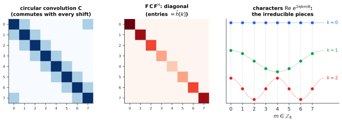
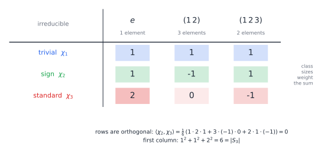
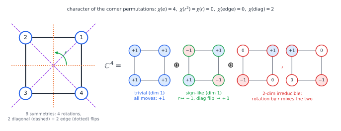

# Chapter 95 — Representation Theory: Making Abstract Symmetry Concrete

[← Previous](94-algebraic-geometry.md) · [Track J](README.md) · [Table of Contents](../../00-front/table-of-contents.md) · [Next →](96-mathematical-economics.md)

> **Level 3 · Track J — Mathematics at the Frontier**
> **Builds on:** [Ch. 9](../../part-3-linear-algebra/09-vector-spaces-and-linear-transformations.md), [Ch. 10](../../part-3-linear-algebra/10-eigenvalues-and-eigenvectors.md), [Ch. 15](../../part-5-transforms/15-fourier-series.md), [Ch. 56](../e-abstract-math/56-abstract-algebra.md), [Ch. 99](../e-abstract-math/99-abstract-linear-algebra.md) · **Leads to:** [Ch. 92](92-mathematical-physics.md), [Ch. 93](93-tensor-mathematics.md), [Ch. 94](94-algebraic-geometry.md) · **Related:** [Ch. 62](../e-abstract-math/62-category-theory.md), [Ch. 90](90-spectral-theory.md), [Ch. 79](../h-cryptography-coding/79-error-correcting-codes.md)
> **Reading time:** ~30 min

## 95.1 The hook

In 1978 John McKay, a group theorist at Concordia University, was reading a paper on number theory and noticed a coefficient. The paper was about the **$j$-function**, a function of a complex variable studied since the nineteenth century, which has a series expansion beginning

$$
j(q)=\frac1q+744+196884\,q+21493760\,q^2+864299970\,q^3+\cdots
$$

McKay knew the number $196883$ from a completely different world. It was the smallest dimension in which the **Monster**, the largest sporadic finite simple group ([Ch. 56](../e-abstract-math/56-abstract-algebra.md)), with about $8\times10^{53}$ elements, can act by rotations without acting trivially. He wrote to John Thompson, who checked the next coefficient:

$$
\begin{aligned}
196884 &= 1+196883,\\
21493760 &= 1+196883+21296876,\\
864299970 &= 2\cdot 1+2\cdot196883+21296876+842609326 .
\end{aligned}
$$

Every number on the right is the dimension of one of the Monster's "irreducible representations". A function from complex analysis, which knows nothing about groups, was spelling out the building blocks of the biggest exceptional symmetry object in mathematics. John Conway called this **monstrous moonshine**, meaning crazy talk.

To even say what these numbers *are* you need one idea. A group is an abstract table of how symmetries combine. A **representation** turns each symmetry into a matrix, so that combining symmetries becomes multiplying matrices. Then the full power of linear algebra (eigenvalues, traces, change of basis) can be aimed at the group. And just as a signal splits into sine waves that cannot be split further, a representation splits into irreducible pieces. The Monster has exactly $194$ of them, and the smallest non-trivial one has dimension $196883$.

You've already met a representation without being told. The DFT of [Ch. 15](../../part-5-transforms/15-fourier-series.md#computing-coefficients-numerically-the-dft) turns every circular convolution into a diagonal matrix. Why? Not because of some property of $e^{j\theta}$. It's because convolution commutes with shifting, and the shifts form a group. This chapter explains that sentence, and it shows that the same reasoning works for the symmetries of a square, of a molecule, or of the Monster.

## 95.2 The big idea

Take a symmetric object, say four equal masses at the corners of a square joined by identical springs. You want its vibration modes. The honest way is to write the $8\times8$ stiffness matrix and find its eigenvectors ([§10.8](../../part-3-linear-algebra/10-eigenvalues-and-eigenvectors.md#108-modal-analysis)). The clever way is to notice that the square has eight symmetries (four rotations, four reflections). The stiffness matrix commutes with all of them, because rotating the square and then letting it vibrate is the same as letting it vibrate and then rotating it.

Here is the key fact. **If a matrix commutes with a group of symmetries, then it cannot mix vectors that transform in genuinely different ways under the group.** So you first sort the space of motions into "transformation types", the irreducible representations, and the matrix becomes block-diagonal *before you compute anything about it*. The symmetry does the work.

The analogy is a prism. White light enters, and the prism sorts it by frequency because a prism treats every frequency differently but each one consistently. A group splits a vector space by "symmetry type" in the same way. For the cyclic group of shifts the types are exactly the frequencies, which is why Fourier analysis is the representation theory of $\mathbb{Z}_n$.

Two more ideas make the theory practical:

1. **Characters.** The trace of a matrix doesn't change under change of basis. So the function $g\mapsto\operatorname{tr}\rho(g)$, the **character**, is a basis-free fingerprint of a representation. Remarkably, it determines the representation completely.
2. **Orthogonality.** The characters of the irreducible representations are orthonormal vectors, in the same way that sampled sinusoids are. So to find how many times a type appears, you take an inner product, just like computing a Fourier coefficient.

## 95.3 The mathematics

Throughout, $G$ is a finite group and vector spaces are over $\mathbb{C}$. Groups, homomorphisms and conjugacy were set up in [Ch. 56](../e-abstract-math/56-abstract-algebra.md); invariant subspaces and direct sums in [Ch. 99](../e-abstract-math/99-abstract-linear-algebra.md).

> [!definition] Representation, subrepresentation, irreducible
> A **representation** of $G$ on a finite-dimensional space $V$ is a homomorphism $\rho:G\to\operatorname{GL}(V)$, so $\rho(gh)=\rho(g)\rho(h)$ and $\rho(e)=\mathbf{I}$. Its **dimension** is $\dim V$.
> A subspace $W\subseteq V$ is **invariant** if $\rho(g)W\subseteq W$ for all $g$. The representation is **irreducible** if its only invariant subspaces are $\{0\}$ and $V$.
> Two representations are **equivalent** if some invertible $\mathbf{P}$ satisfies $\mathbf{P}\rho(g)\mathbf{P}^{-1}=\rho'(g)$ for every $g$, the same change of basis for all of them at once.
> The **character** is $\chi_\rho(g)=\operatorname{tr}\rho(g)$. It is constant on conjugacy classes, since $\operatorname{tr}(\mathbf{A}\mathbf{B}\mathbf{A}^{-1})=\operatorname{tr}\mathbf{B}$.

Three examples to hold on to:

- **The trivial representation:** $\rho(g)=1$ for all $g$, on $\mathbb{C}^1$.
- **Permutation representations:** if $G$ permutes a set $X$, let $\rho(g)$ be the permutation matrix on $\mathbb{C}^X$. Its character $\chi(g)$ counts the points of $X$ that $g$ fixes. The **regular representation** is the case $X=G$, with $G$ acting on itself by left multiplication.
- **Characters of $\mathbb{Z}_n$:** for each $k=0,\dots,n-1$, the map $\chi_k(m)=e^{2\pi jkm/n}$ is a homomorphism $\mathbb{Z}_n\to\mathbb{C}^\times$, a one-dimensional representation.

### Result 1: everything breaks into irreducibles

> [!theorem] Maschke's theorem
> If $W$ is an invariant subspace of a representation $V$ of a finite group, then $W$ has an invariant complement $W'$, with $V=W\oplus W'$. Hence every representation is a direct sum of irreducible ones.

*Proof.* Start with any inner product $\langle\cdot,\cdot\rangle_0$ on $V$ and average it over the group:

$$
\langle \mathbf{u},\mathbf{v}\rangle=\frac1{\lvert G\rvert}\sum_{g\in G}\langle\rho(g)\mathbf{u},\rho(g)\mathbf{v}\rangle_0 .
$$

This is again an inner product (a positive sum of inner products). It is **invariant**: replacing $\mathbf{u},\mathbf{v}$ by $\rho(h)\mathbf{u},\rho(h)\mathbf{v}$ turns $\rho(g)$ into $\rho(gh)$, and as $g$ runs over $G$ so does $gh$, so the sum is unchanged. Every $\rho(h)$ is therefore unitary for $\langle\cdot,\cdot\rangle$.

Let $W'=W^\perp$ for this inner product. If $\mathbf{w}'\in W'$ and $\mathbf{w}\in W$, then

$$
\langle\rho(h)\mathbf{w}',\mathbf{w}\rangle=\langle\mathbf{w}',\rho(h)^{-1}\mathbf{w}\rangle=\langle\mathbf{w}',\rho(h^{-1})\mathbf{w}\rangle=0,
$$

since $\rho(h^{-1})\mathbf{w}\in W$. So $\rho(h)\mathbf{w}'\in W'$, and $W'$ is invariant. Repeat inside $W$ and $W'$. Dimensions drop each time, so the process ends with irreducible pieces. ∎

The averaging trick is the whole proof, and it is also where finiteness was used: we divided by $\lvert G\rvert$. For the group $\mathbb{Z}$ acting on $\mathbb{C}^2$ by powers of $\left[\begin{smallmatrix}1&1\\0&1\end{smallmatrix}\right]$, the line spanned by $(1,0)$ is invariant and has no invariant complement. That is the Jordan block of [Ch. 99](../e-abstract-math/99-abstract-linear-algebra.md) refusing to split.

### Result 2: Schur's lemma, the engine

> [!theorem] Schur's lemma
> Let $V,W$ be irreducible representations and $\mathbf{T}:V\to W$ a linear map with $\mathbf{T}\rho_V(g)=\rho_W(g)\mathbf{T}$ for all $g$ (an **intertwiner**).
> (a) Either $\mathbf{T}=0$ or $\mathbf{T}$ is invertible; so if $V$ and $W$ are not equivalent, $\mathbf{T}=0$.
> (b) If $V=W$, then $\mathbf{T}=\lambda\mathbf{I}$ for some scalar $\lambda$.

*Proof.* (a) The kernel of $\mathbf{T}$ is invariant: if $\mathbf{T}\mathbf{v}=0$ then $\mathbf{T}\rho_V(g)\mathbf{v}=\rho_W(g)\mathbf{T}\mathbf{v}=0$. By irreducibility it is $\{0\}$ or $V$. Likewise the image is invariant in $W$, so it is $\{0\}$ or $W$. If $\mathbf{T}\neq0$ the kernel is $\{0\}$ and the image is $W$, so $\mathbf{T}$ is invertible.

(b) Over $\mathbb{C}$, $\mathbf{T}$ has an eigenvalue $\lambda$ ([Ch. 10](../../part-3-linear-algebra/10-eigenvalues-and-eigenvectors.md)). Then $\mathbf{T}-\lambda\mathbf{I}$ is also an intertwiner, and it isn't invertible. By (a) it is zero. ∎

Here is the engineering payoff, the precise form of the big idea:

> [!theorem] Symmetric operators are block-diagonal
> Suppose $V=V_1\oplus\cdots\oplus V_r$ with the $V_i$ irreducible and pairwise inequivalent, and $\mathbf{K}$ commutes with every $\rho(g)$. Then $\mathbf{K}$ maps each $V_i$ into itself and acts on it as a scalar $\lambda_i$. In other words, the $V_i$ are eigenspaces of $\mathbf{K}$, found without knowing $\mathbf{K}$.

*Proof.* Let $\pi_i$ be the projection onto $V_i$ along the other pieces. It commutes with $\rho(g)$ because each piece is invariant. The map $\pi_i\mathbf{K}\vert_{V_k}:V_k\to V_i$ is an intertwiner. By Schur (a) it vanishes for $i\ne k$, so $\mathbf{K}V_k\subseteq V_k$. By Schur (b) it is a scalar for $i=k$. ∎

When some irreducible type appears $m$ times, the same argument gives an $m\times m$ block, which is still a huge saving. The square of springs has an $8$-dimensional configuration space. Symmetry splits it into pieces of dimension at most $2$, with the $2$-dimensional type appearing twice. You are left with one $2\times2$ eigenproblem and a few scalars, instead of an $8\times8$ one.

### Result 3: Fourier analysis is the case $G=\mathbb{Z}_n$

> [!theorem] The DFT diagonalises every shift-invariant operator
> Let $\mathbf{S}$ be the cyclic shift on $\mathbb{C}^n$ and $\mathbf{C}$ any matrix with $\mathbf{C}\mathbf{S}=\mathbf{S}\mathbf{C}$. Then each vector $\mathbf{f}_k=(e^{2\pi jkm/n})_{m=0}^{n-1}$ is an eigenvector of $\mathbf{C}$. The matrices commuting with $\mathbf{S}$ are exactly the circular convolutions $\mathbf{x}\mapsto h\circledast\mathbf{x}$, and the eigenvalue on $\mathbf{f}_k$ is the DFT coefficient $\hat h[k]=\sum_m h[m]e^{-2\pi jkm/n}$.

*Proof.* Write $(\mathbf{S}\mathbf{x})[m]=x[m-1]$, indices mod $n$. Then $\mathbf{S}\mathbf{f}_k=e^{-2\pi jk/n}\mathbf{f}_k$. The $n$ eigenvalues $e^{-2\pi jk/n}$ are distinct, so each eigenspace of $\mathbf{S}$ is the line through $\mathbf{f}_k$. These lines are the $n$ one-dimensional representations of $\mathbb{Z}_n$, pairwise inequivalent, so the block-diagonal theorem says $\mathbf{C}\mathbf{f}_k=\lambda_k\mathbf{f}_k$. (You can also see it directly: $\mathbf{C}\mathbf{S}\mathbf{f}_k=\mathbf{S}\mathbf{C}\mathbf{f}_k$ says $\mathbf{C}\mathbf{f}_k$ is again an eigenvector of $\mathbf{S}$ with the same eigenvalue.)

If $\mathbf{C}$ commutes with $\mathbf{S}$, set $h=\mathbf{C}\boldsymbol{\delta}$, the image of the unit impulse. Every $\mathbf{x}=\sum_k x[k]\mathbf{S}^k\boldsymbol\delta$, so $\mathbf{C}\mathbf{x}=\sum_k x[k]\mathbf{S}^k h=h\circledast\mathbf{x}$. Finally, $(h\circledast\mathbf{f}_k)[m]=\sum_i h[i]e^{2\pi jk(m-i)/n}=\hat h[k]\,f_k[m]$. ∎



*Figure 95.1 — Convolution on $\mathbb{Z}_8$ commutes with shifts, so in the basis of characters (right) it becomes diagonal (middle). The convolution theorem of [§16.5](../../part-5-transforms/16-fourier-transforms.md#165-convolution-and-multiplication) is Schur's lemma for an abelian group.*

For an abelian group every irreducible representation is one-dimensional (by Schur (b), each $\rho(g)$ commutes with everything, so it is a scalar, and every line is invariant). For a non-abelian group some irreducibles must be bigger, and "frequencies" become small matrices. That is the only genuinely new phenomenon, and it is where the theory gets its depth.

### Characters and the character table

The following facts follow from Schur's lemma by averaging intertwiners over the group. We state them; Serre's book in the reading list proves them in about ten pages.

> [!theorem] Character theory of a finite group
> Define $\langle\chi,\psi\rangle=\frac1{\lvert G\rvert}\sum_{g}\chi(g)\overline{\psi(g)}$.
> 1. The irreducible characters $\chi_1,\dots,\chi_r$ are orthonormal: $\langle\chi_i,\chi_k\rangle=\delta_{ik}$.
> 2. Their number $r$ equals the number of conjugacy classes of $G$.
> 3. If $V\cong\bigoplus_i V_i^{\oplus m_i}$, then $m_i=\langle\chi_V,\chi_i\rangle$. So two representations with the same character are equivalent.
> 4. The regular representation contains each $V_i$ exactly $d_i=\dim V_i$ times, so $\sum_i d_i^2=\lvert G\rvert$.

Fact 4 is a quick consequence of fact 3. The regular character is $\lvert G\rvert$ at $e$ and $0$ elsewhere (only the identity fixes a group element under left multiplication). So $m_i=\frac1{\lvert G\rvert}\lvert G\rvert\,\overline{\chi_i(e)}=d_i$, and comparing dimensions gives $\lvert G\rvert=\sum_i d_i\cdot d_i$.

**Example: $S_3$.** The symmetric group on three letters has $6$ elements in three classes: the identity, three transpositions, two 3-cycles. So it has three irreducibles, and $d_1^2+d_2^2+d_3^2=6$ forces dimensions $1,1,2$. Two are easy: the trivial character, and the sign of a permutation. For the third, $S_3$ permutes the corners of a triangle, giving a $3$-dimensional permutation representation with character $(3,1,0)$ (fixed points). It contains the trivial representation once (the all-ones vector), and what remains is the $2$-dimensional rotations-and-reflections of the triangle's plane, with character $(3,1,0)-(1,1,1)=(2,0,-1)$.



*Figure 95.2 — The character table of $S_3$. Rows are orthonormal once each column is weighted by its class size, and the first column's squares add up to the group order.*

**Example: the square, $D_4$.** The eight symmetries fall into five classes: $\{e\}$, $\{r^2\}$, $\{r,r^3\}$, the two edge flips, and the two diagonal flips. So there are five irreducibles, and $8=1+1+1+1+2^2$. Let $D_4$ permute the four corners. A diagonal flip fixes two corners and everything else except $e$ fixes none, so the character is $4$ at $e$, $2$ on diagonal flips and $0$ elsewhere. Taking inner products with the five irreducible characters gives multiplicities $1,0,1,0,1$: the corner space is trivial $\oplus$ one sign-like line $\oplus$ the $2$-dimensional irreducible.



*Figure 95.3 — The eight symmetries of the square act on functions of its corners. The space splits into three pieces. Any symmetric operator, such as a spring network's stiffness matrix, must respect this split.*

### Why one matrix is tame and two are wild

[Ch. 99](../e-abstract-math/99-abstract-linear-algebra.md) left a puzzle. One linear map $T$ on $V$, up to change of basis, is classified by Jordan form. Two maps $S,T$ changed by the *same* basis have no such list. Representation theory explains the difference by changing what we represent. A single $T$ is a representation of the polynomial ring $\mathbb{C}[x]$ (let $x$ act as $T$). That ring is a principal ideal domain, and the structure theorem for its modules is exactly the Jordan form: the indecomposable pieces are the Jordan blocks, one family per eigenvalue and size.

A pair $(S,T)$ is a representation of the free algebra $\mathbb{C}\langle x,y\rangle$, in which $xy\ne yx$. Every finite-dimensional algebra is a quotient of a free algebra, and with a little coding one can embed the representations of *any* finite-dimensional algebra (triples, quadruples of matrices, anything) into pairs. A classification of pairs would therefore contain every other classification problem of linear algebra. That is what **wild** means. Drozd proved in 1979 that every finite-dimensional algebra is either *tame* (indecomposables come in finitely many one-parameter families in each dimension) or wild, never both.

The sharpest picture uses **quivers**, directed graphs with a vector space at each vertex and a matrix on each arrow. Gabriel's theorem (1972) says that a connected quiver has only finitely many indecomposable representations exactly when its underlying graph is one of the Dynkin diagrams $A_n$, $D_n$, $E_6$, $E_7$, $E_8$. Two vertices joined by two arrows, Kronecker's "pencils of matrices" $\lambda\mathbf{A}+\mu\mathbf{B}$, are tame. One vertex with two loops, our pair $(S,T)$, is wild.

> [!mystery] The same five letters, everywhere
> The list $A_n, D_n, E_6, E_7, E_8$ that decides which quivers are classifiable is also the list of simple Lie algebras with one root length, of the finite subgroups of $\operatorname{SU}(2)$ (the symmetries of the Platonic solids, doubled), and of the simplest singular points of surfaces, such as $x^2+y^3+z^5=0$. The **McKay correspondence** links the last two through representations. Why should a polynomial singularity know about the icosahedron? The geometry of resolving singularities is in [Ch. 94](94-algebraic-geometry.md).

## 95.4 The algorithm

Given a representation as a list of matrices, how do you split it? Character theory turns the job into inner products and projections.

```
decompose(G, rho, irreducible characters chi_1..chi_r):
    chi = [trace(rho(g)) for g in G]                 # O(|G| d)
    for each i:
        m_i = (1/|G|) * sum_g chi(g) * conj(chi_i(g))  # multiplicity
        P_i = (d_i/|G|) * sum_g conj(chi_i(g)) * rho(g) # projector, O(|G| d^2)
        V_i-part = column space of P_i               # dimension m_i * d_i
```

The projector formula $\mathbf{P}_i=\frac{d_i}{\lvert G\rvert}\sum_g\overline{\chi_i(g)}\,\rho(g)$ comes from the same averaging as Maschke's proof. It commutes with every $\rho(h)$, so by Schur it is a scalar on each irreducible piece, and orthogonality makes that scalar $1$ on type $i$ and $0$ on every other type. For $G=\mathbb{Z}_n$ this is exactly the DFT: $\mathbf{P}_k$ projects onto the $k$-th frequency.

Costs and pitfalls:

- **Group size.** The sums run over $\lvert G\rvert$ elements. For $S_{10}$ that is $3.6$ million matrices. Summing over conjugacy classes (character values are constant on them) helps for multiplicities, though not for projectors.
- **Fast transforms.** The FFT computes all $n$ projections of $\mathbb{Z}_n$ in $O(n\log n)$ by exploiting the subgroup chain $\mathbb{Z}_n\supset\mathbb{Z}_{n/2}\supset\cdots$. Clausen, Diaconis and Rockmore built analogous fast Fourier transforms for $S_n$ and other non-abelian groups, and they are used to analyse ranked data such as elections and preference surveys.
- **Finding the character table.** If you don't know the $\chi_i$, the Burnside–Dixon–Schneider algorithm finds them as simultaneous eigenvectors of class-multiplication matrices, which is linear algebra again. Computer algebra systems (GAP, Magma) store tables for thousands of groups, including the Monster's $194\times194$ table.
- **Numerical stability.** Floating-point projectors have rank only approximately $m_id_i$. Use an SVD with a tolerance ([§10.7](../../part-3-linear-algebra/10-eigenvalues-and-eigenvectors.md#107-singular-value-decomposition)) rather than Gaussian elimination to extract the subspace.

## 95.5 The experiment

The script builds the eight $4\times4$ permutation matrices of $D_4$ acting on corners, computes the character, and finds multiplicities and projector ranks for all five irreducibles. Then it checks that the DFT diagonalises a random circulant matrix.

```python
import numpy as np

# D4 acting on the 4 corners of a square (corners 0,1,2,3 counter-clockwise)
def perm_matrix(p):                      # p[i] = where corner i goes
    P = np.zeros((4, 4)); P[p, range(4)] = 1; return P

r = perm_matrix([1, 2, 3, 0])            # rotate by 90 degrees
s = perm_matrix([0, 3, 2, 1])            # flip in the diagonal through corner 0
group = [np.linalg.matrix_power(r, k) @ f for k in range(4) for f in (np.eye(4), s)]

chi = np.array([np.trace(g) for g in group])          # character of this rep
print("character of corner rep:", chi)

# characters of the 5 irreducibles, element by element (same order as `group`)
signs_r = np.array([(-1) ** k for k in range(4) for _ in (0, 1)])
is_flip = np.array([f for _ in range(4) for f in (0, 1)])
diag = np.array([k % 2 == 0 for k in range(4) for _ in (0, 1)]) & (is_flip == 1)
irreps = {
    "A1 trivial": np.ones(8),
    "A2 (flips -1)": np.where(is_flip, -1, 1),
    "B1 (r -1, diag +1)": np.where(is_flip, np.where(diag, 1, -1), signs_r),
    "B2 (r -1, edge +1)": np.where(is_flip, np.where(diag, -1, 1), signs_r),
    "E  (2-dim)": np.array([np.trace(np.linalg.matrix_power(np.array([[0, -1], [1, 0]]), k)) * (1 - f)
                            for k in range(4) for f in (0, 1)]),
}
for name, x in irreps.items():
    mult = np.dot(chi, x) / len(group)                 # <chi, chi_i>
    P = sum(xi * g for xi, g in zip(x, group)) * x[0] / len(group)
    print(f"{name:20s} multiplicity {mult:+.0f}   projector rank {np.linalg.matrix_rank(P)}")

# Fourier on Z_n: any matrix commuting with the cyclic shift is diagonalised by the DFT
n = 8
h = np.random.default_rng(1).normal(size=n)          # try your own filter here
C = np.array([[h[(i - k) % n] for k in range(n)] for i in range(n)])
F = np.fft.fft(np.eye(n)) / np.sqrt(n)
D = F @ C @ F.conj().T
print("largest off-diagonal entry:", np.abs(D - np.diag(np.diag(D))).max())
print("diagonal equals fft(h):", np.allclose(np.diag(D), np.fft.fft(h)))
```

Running it prints multiplicities $1,0,1,0,1$ with projector ranks $1,0,1,0,2$, and an off-diagonal residue around $10^{-16}$. Things to change:

- **Act on edges instead of corners.** Replace `r` and `s` by the permutations of the four edges (number them so edge $i$ joins corners $i$ and $i+1$). Predict the character, and therefore the decomposition, before you run it. Which irreducible swaps in?
- **Act on motions.** Build the $8\times8$ representation on corner displacements $(\Delta x_i,\Delta y_i)$: each symmetry permutes the corners *and* rotates each displacement vector, so it is a Kronecker product of a permutation and a $2\times2$ rotation. Show that its character is the product of the two characters, and decompose it. You have just predicted the mode shapes of the spring square of §95.2.
- **Break the symmetry.** Make one entry of `h` depend on position (a non-circulant matrix). Watch the off-diagonal residue jump from $10^{-16}$ to order one.

## 95.6 The challenge

1. **Intuition.** A matrix commutes with all eight symmetries of the square. Without computing anything, how many distinct eigenvalues can it have on the corner space $\mathbb{C}^4$ at most? Why might it have fewer?
2. **Derivation.** Show that the number of one-dimensional representations of a finite group $G$ equals $\lvert G/[G,G]\rvert$, where $[G,G]$ is the subgroup generated by all commutators $ghg^{-1}h^{-1}$. Check your formula on $S_3$ and $D_4$.
3. **Implementation.** Write code that, given generating permutations of a group, produces all its elements and its conjugacy classes, and then finds the dimensions of its irreducibles from $\sum d_i^2=\lvert G\rvert$ together with the number of classes. Run it on the rotation group of the cube (order $24$), and decide whether these two constraints alone always pin down the dimensions.
4. **Open investigation.** Take a random walk on $S_n$ by repeatedly swapping two random cards of a deck. Diaconis and Shahshahani used the characters of $S_n$ to show that the walk mixes after about $\frac12 n\ln n$ swaps. Simulate the distance to uniform for $n=6,8,10$ and look for a sudden "cutoff". Is there a general way to predict from a group's character table alone when a random walk on it shows a cutoff? This is a research question, and no general answer is known.

## 95.7 Loose threads

The hook asked why a function from complex analysis spells out the dimensions of the Monster's representations. We've built the dictionary for even asking. A representation is a group written in matrices. Maschke's averaging splits every representation into irreducibles. Schur's lemma says symmetric operators are scalars on each irreducible type, which is why Fourier analysis diagonalises convolution and why symmetry predicts mode shapes. And characters, orthogonal like sinusoids, count the pieces.

Moonshine itself needed far more. Conway and Norton conjectured in 1979 that the $j$-function is the "graded dimension" of an infinite-dimensional representation $V^\natural=V_0\oplus V_1\oplus V_2\oplus\cdots$ of the Monster, and that replacing dimensions by traces of other elements gives other classical functions. Frenkel, Lepowsky and Meurman constructed $V^\natural$ in 1988 from the Leech lattice. Richard Borcherds proved the conjecture in 1992 using a "no-ghost theorem" borrowed from string theory, and won a Fields Medal.

> [!mystery] Why does string theory know about the Monster?
> Borcherds' proof works, but many mathematicians feel it explains *how* rather than *why*. $V^\natural$ is the state space of a two-dimensional quantum field theory, and the Monster is its symmetry group. Newer "umbral" and "Mathieu" moonshines link other sporadic groups to other functions (one discovered in 2010 from the K3 surfaces of string theory), and for most of them the representations have been shown to exist without anyone writing them down. A conceptual reason why sporadic groups and modular functions are linked remains an open problem. Symmetry in physics, the doorway to this story, is in [Ch. 92](92-mathematical-physics.md).

We also stayed with finite groups. For the circle group $\mathbb{R}/2\pi\mathbb{Z}$ the irreducibles are $e^{jk\theta}$, and decomposing functions into them is the Fourier series of [Ch. 15](../../part-5-transforms/15-fourier-series.md). For the line $\mathbb{R}$ there is a continuum of characters $e^{j\omega t}$, and you get the Fourier transform. For the rotation group $\operatorname{SO}(3)$ the irreducibles have dimensions $1,3,5,7,\dots$, and they are the spherical harmonics behind atomic orbitals and antenna radiation patterns.

> [!mystery] Fourier analysis on groups that do not commute
> For a compact group such as $\operatorname{SO}(3)$, the Peter–Weyl theorem says the matrix entries of the irreducible representations form an orthonormal basis of $L^2(G)$, a non-commutative Fourier series. For non-compact, non-abelian groups such as the Lorentz group of relativity, the unitary irreducibles (the ones quantum mechanics needs) are infinite-dimensional and the "spectrum" can have continuous parts. How a spectrum can be partly a list and partly a continuum, and what an operator's spectrum even is, is the business of [Ch. 90](90-spectral-theory.md).

Further out lies the **Langlands program**, a web of conjectures, proved only in pieces, predicting that representations of symmetry groups of number fields correspond to automorphic functions generalising the $j$-function. Wiles' proof of Fermat's Last Theorem was one corner of it. And tensor products of representations, which is how two spin-$\tfrac12$ particles combine into spin $0$ and spin $1$, are taken up in [Ch. 93](93-tensor-mathematics.md).

## Further reading

- J.-P. Serre, *Linear Representations of Finite Groups*, Springer GTM 42, 1977. Part I proves all of character theory in about thirty pages.
- W. Fulton and J. Harris, *Representation Theory: A First Course*, Springer GTM 129, 1991. Examples first, from $S_3$ to Lie groups.
- P. Diaconis, *Group Representations in Probability and Statistics*, IMS Lecture Notes 11, 1988. Card shuffling, ranked data and fast Fourier transforms on groups.
- M. Ronan, *Symmetry and the Monster*, Oxford University Press, 2006. A popular history of the classification and moonshine.
- T. Gannon, *Moonshine beyond the Monster*, Cambridge University Press, 2006. The research-level survey of moonshine and its links to physics.
