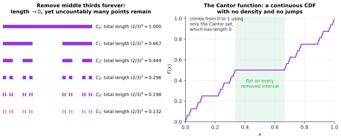

# Chapter 97 — Measure Theory and Modern Probability

[← Previous](96-mathematical-economics.md) · [Track J](README.md) · [Table of Contents](../../00-front/table-of-contents.md) · [Next →](98-mathematical-research.md)

> **Level 3 · Track J — Mathematics at the Frontier**
> **Builds on:** [Ch. 5](../../part-2-calculus/05-integral-calculus.md), [Ch. 19](../../part-6-probability-statistics/19-probability.md), [Ch. 31](../b-probability-information/31-probability-science-of-uncertainty.md), [Ch. 36](../b-probability-information/36-stochastic-processes.md), [Ch. 60](../e-abstract-math/60-real-analysis.md) · **Leads to:** [Ch. 98](98-mathematical-research.md), [Ch. 89](89-pde-beyond-the-basics.md) · **Related:** [Ch. 35](../b-probability-information/35-bayesian-inference.md), [Ch. 55](../d-optimization/55-optimal-transport.md), [Ch. 61](../e-abstract-math/61-functional-analysis.md), [Ch. 73](../g-graphics-simulation/73-fractals.md), [Ch. 80](../h-cryptography-coding/80-coding-meets-information-theory.md)
> **Reading time:** ~30 min

## 97.1 The hook

Throw an ideal dart at the interval $[0,1]$, so that every point is equally likely. What is the probability that it lands *exactly* on $0.5$?

It must be zero. If it were some $\varepsilon>0$, the same would be true for every point, and a million points would already carry total probability $10^6\varepsilon$, which exceeds $1$ once $\varepsilon>10^{-6}$. So every single point has probability $0$, and yet the dart lands *somewhere*, with probability $1$. Zero plus zero plus zero, uncountably many times, makes one.

Fine, you say: probabilities add for countably many disjoint events, not uncountably many. Then the rationals in $[0,1]$, which are countable, have total probability $0+0+\cdots=0$. The dart almost surely misses every rational, even though rationals are dense and lie between any two points it could hit.

Now two harder questions.

**Can every set of points be given a probability?** Not "every set you can describe", but *every* subset of $[0,1]$. Surely the dart either lands in a set or it doesn't, so "the probability it lands in $S$" should mean something for every $S$.

**Can a fair game be beaten?** Bet $1$ on a fair coin. If you lose, double the stake; stop at the first win. You stop with probability $1$, and when you stop you are up exactly $1$. Your fortune is a fair game (a martingale, [Ch. 36](../b-probability-information/36-stochastic-processes.md)), so its expectation should stay $0$. Yet it ends at $1$ with certainty.

The first question has the answer **no**, and the proof is half a page. The second has the answer "only if you have infinite credit", but saying precisely *why* requires rebuilding probability. In 1933 Andrei Kolmogorov did exactly that, by declaring that probability *is* a measure: a rule that assigns sizes to a carefully chosen family of sets. This chapter shows why the family has to be chosen, and what the rebuilding buys: a strong law of large numbers that needs only a mean, a precise version of "you can't beat a fair game", distributions with no density and no jumps, and a notion of dimension for wild sets.

## 97.2 The big idea

The Riemann integral of [Ch. 5](../../part-2-calculus/05-integral-calculus.md) slices the *domain* into thin strips and adds height × width. Lebesgue sliced the *range* instead ([§60.3](../e-abstract-math/60-real-analysis.md#603-the-mathematics)). For each height $y$, ask "how big is the set of $x$ where $f(x)>y$?", and add up those sizes over all heights:

$$
\int f\,dm=\int_0^\infty m\{x: f(x)>y\}\,dy\qquad(f\ge0).
$$

A banker counting a pile of coins does the same: rather than going through the coins in the order they lie (Riemann), she sorts them by denomination and multiplies each value by how many coins have it (Lebesgue). The order of the coins no longer matters, only the *size* of each set $\{f>y\}$. That is why the Lebesgue integral copes with functions that jump about wildly.

![Left: a curve on [0,1] approximated by 12 vertical blue bars. Right: the same curve with horizontal green slices; a red dashed level y and, on the x-axis, the red set where f exceeds y](../../images/ch97-riemann-vs-lebesgue.svg)

*Figure 97.1 — Riemann versus Lebesgue. The Lebesgue integral needs only one thing, the size $m\{f>y\}$ of each "level set", however scattered that set is.*

So everything rests on measuring sets. A **measure** is a size function that adds up correctly over countably many disjoint pieces. A **probability** is a measure with total size $1$. A **random variable** is a function whose level sets can be measured, and its **expectation** is its Lebesgue integral. The family of sets we are allowed to measure, a **$\sigma$-algebra**, turns out to be more than a technicality: in probability it represents *information*. "The sets I can decide after seeing the first $n$ coin tosses" is a $\sigma$-algebra, and a gambler's strategy may only use that one. This is how measure theory solves the doubling puzzle.

## 97.3 The mathematics

> [!definition] $\sigma$-algebra, measure, probability space
> A **$\sigma$-algebra** on a set $\Omega$ is a family $\mathcal{F}$ of subsets that contains $\Omega$ and is closed under complements and countable unions.
> A **measure** is a map $\mu:\mathcal{F}\to[0,\infty]$ with $\mu(\varnothing)=0$ and **countable additivity**: $\mu\big(\bigcup_k A_k\big)=\sum_k\mu(A_k)$ for disjoint $A_1,A_2,\ldots\in\mathcal{F}$.
> A **probability space** $(\Omega,\mathcal{F},P)$ is a measure space with $P(\Omega)=1$ (Kolmogorov, 1933). A **random variable** is a function $X:\Omega\to\mathbb{R}$ with $\{X\le t\}\in\mathcal{F}$ for every $t$, and $E[X]=\int_\Omega X\,dP$.

Countable additivity gives continuity for free. If $A_1\subseteq A_2\subseteq\cdots$, then writing $\bigcup A_n$ as the disjoint union of the rings $A_n\setminus A_{n-1}$ gives $\mu(\bigcup A_n)=\lim\mu(A_n)$. Almost every limit theorem in probability starts from this one line.

### Result 1: you cannot measure every set

> [!theorem] Vitali (1905)
> There is no function $\mu$ defined on *all* subsets of the circle $[0,1)$ (with addition mod $1$) that is countably additive, invariant under rotation, and has $\mu([0,1))=1$.

*Proof.* Call $x\sim y$ if $x-y$ is rational. This splits $[0,1)$ into equivalence classes, each a rotated copy of $\mathbb{Q}\cap[0,1)$. Using the axiom of choice, pick exactly one point from each class, and call the resulting set $V$. For each rational $q\in[0,1)$ let $V_q=V+q \pmod 1$.

The sets $V_q$ are disjoint: if $v+q\equiv v'+q'$ with $v,v'\in V$, then $v\sim v'$, so $v=v'$ (one point per class) and $q=q'$. They cover $[0,1)$: any $x$ is equivalent to some $v\in V$, and $x-v\equiv q$ for a rational $q$. So $[0,1)$ is the disjoint union of countably many rotated copies of $V$. If $\mu$ existed, rotation invariance would make all $\mu(V_q)$ equal to $\mu(V)$, and countable additivity would give

$$
1=\mu([0,1))=\sum_{q}\mu(V_q)=\sum_{q}\mu(V)\in\{0,\infty\}.
$$

Contradiction. ∎

This is why probability needs $\sigma$-algebras: we must give up measuring *some* sets. The good news (Carathéodory's extension theorem) is that we lose nothing we care about. Length on intervals extends uniquely to a countably additive measure on the **Borel** $\sigma$-algebra, the smallest one containing all intervals, which includes every set you can build from intervals by countably many unions, intersections and complements. Vitali's set needed the axiom of choice to exist at all, which answers the question [Ch. 60](../e-abstract-math/60-real-analysis.md) left open. Solovay showed in 1970 that, if one gives up full choice (and assumes a large cardinal is consistent), it is consistent that *every* set of reals is Lebesgue measurable.

The same extension builds infinite coin-tossing. Write the dart's position in binary, $x=0.b_1b_2b_3\ldots$. Under Lebesgue measure the digits $b_k$ are independent fair coin flips. So "an infinite sequence of fair tosses" and "a uniform point of $[0,1]$" are the same probability space. The strong law of large numbers for coins becomes **Borel's normal number theorem** (1909): Lebesgue-almost every real number has, in its binary expansion, half its digits equal to $1$. Kolmogorov's **extension theorem** generalises this. Any consistent family of finite-dimensional distributions comes from one probability measure on the space of whole paths, and that is how Brownian motion is constructed. The Gaussian finite-dimensional distributions of [Ch. 36](../b-probability-information/36-stochastic-processes.md) define a measure on paths, and a further argument (Kolmogorov's continuity criterion, or Lévy's explicit series of tent functions) shows that the paths can be taken continuous. The resulting **Wiener measure** puts probability $1$ on paths that are differentiable nowhere.

> [!mystery] One ball becomes two
> Vitali's set is a mild warning. In 1924 Banach and Tarski cut a solid ball into five pieces and, using only rotations and translations, reassembled them into *two* balls each identical to the original. The pieces are non-measurable, so no volume is violated, because none is assigned. In one or two dimensions this is impossible: a finitely additive, motion-invariant "area" exists on every subset of the plane. The difference is that the rotation group of space contains a free group, and the plane's doesn't. Why that algebraic fact breaks geometry, and what it says about the axiom of choice, is in [Ch. 68](../f-logic-foundations/68-paradoxes-and-limits.md).

### Result 2: big sets of size zero, and the dimension between

Build the **Cantor set** $C$: from $[0,1]$ remove the open middle third $(\tfrac13,\tfrac23)$, then the middle third of each remaining piece, and so on forever. After $n$ steps $2^n$ intervals of length $3^{-n}$ remain.

> [!theorem] The Cantor set is uncountable and has measure zero
> $m(C)=0$, yet $C$ has as many points as $[0,1]$. Its Hausdorff dimension is at most $\log2/\log3\approx0.6309$ (in fact exactly this).

*Proof.* $C$ is contained in the $n$-th stage, which has length $(2/3)^n\to0$, so $m(C)=0$. A point lies in $C$ exactly when it has a ternary expansion $0.t_1t_2t_3\ldots$ using only the digits $0$ and $2$. Mapping $t_k\mapsto t_k/2$ turns that into a binary expansion, a surjection from $C$ onto $[0,1]$. So $C$ is uncountable.

For dimension, define the $s$-dimensional **Hausdorff measure** $\mathcal{H}^s(A)=\lim_{\delta\to0}\inf\sum_i(\operatorname{diam}U_i)^s$, the infimum taken over countable covers of $A$ by sets $U_i$ of diameter at most $\delta$. The **Hausdorff dimension** is the value of $s$ at which $\mathcal{H}^s$ drops from $\infty$ to $0$. Cover $C$ by its $2^n$ stage-$n$ intervals:

$$
\mathcal{H}^s_{3^{-n}}(C)\le 2^n\,(3^{-n})^s=\left(\frac{2}{3^{s}}\right)^{n}.
$$

For $s>\log2/\log3$ the base is below $1$ and the bound tends to $0$, so $\mathcal{H}^s(C)=0$. Hence $\dim_H C\le\log2/\log3$. The matching lower bound spreads mass evenly over $C$ and shows that no cover can do much better. ∎

So Hausdorff measure interpolates between counting ($s=0$), length ($s=1$) and area ($s=2$). It also answers [Ch. 73](../g-graphics-simulation/73-fractals.md). A set can have zero area and still have $\mathcal{H}^s>0$ for every $s<2$, so dimension $2$ does not require area. Shishikura proved that the boundary of the Mandelbrot set has Hausdorff dimension $2$. Whether it has positive area as well is still an open problem. Box counting uses covers by equal-sized boxes. Hausdorff dimension lets the sizes vary, so it can be smaller, for instance $0$ for the countable set $\{0,1,\tfrac12,\tfrac13,\ldots\}$, whose box dimension is $\tfrac12$.

Now spread probability evenly over $C$. Choose fair bits $b_k$ and set $X=\sum_k 2b_k/3^k$. Its CDF $F$ is the **Cantor function** (Figure 97.2). It is continuous, so $X$ has no atoms: $P(X=x)=0$ for every $x$. But $F$ is flat on every removed interval, so $F'=0$ almost everywhere and $X$ has no density either, since $\int F'=0\ne1$. Discrete or continuous with a density, the dichotomy of [§19.7](../../part-6-probability-statistics/19-probability.md#197-probability-density-and-mass-functions), is not the whole story.



*Figure 97.2 — The Cantor set and its distribution function. All the probability lives on a set of length zero, but no single point carries any of it.*

The **Lebesgue decomposition theorem** says this is the only other possibility. Every probability distribution on $\mathbb{R}$ is uniquely a mixture of a discrete part, an absolutely continuous part (one with a density), and a **singular continuous** part like the Cantor distribution. The **Radon–Nikodym theorem** says when a density exists: $\mu$ has a density $d\mu/dm$ exactly when $m(A)=0$ forces $\mu(A)=0$. Likelihood ratios in statistics, change of measure in finance and the Wasserstein couplings of [Ch. 55](../d-optimization/55-optimal-transport.md) are all Radon–Nikodym derivatives.

### Convergence, made precise

The monotone and dominated convergence theorems were stated in [§60.3](../e-abstract-math/60-real-analysis.md#603-the-mathematics). Measure theory adds an important distinction between kinds of convergence of random variables:

- **almost surely:** $P(X_n\to X)=1$;
- **in probability:** $P(\lvert X_n-X\rvert>\varepsilon)\to0$ for every $\varepsilon$;
- **in $L^1$:** $E\lvert X_n-X\rvert\to0$;
- **in distribution:** CDFs converge at continuity points (the central limit theorem's kind).

Almost-sure convergence implies convergence in probability, but not conversely. Sweep an indicator of width $1/k$ repeatedly across $[0,1]$ (widths $1,\tfrac12,\tfrac12,\tfrac13,\tfrac13,\tfrac13,\dots$). The probability of being hit tends to $0$, yet every point is hit infinitely often, so the sequence converges at *no* point.

**Kolmogorov's strong law.** Let $X_1,X_2,\ldots$ be independent with the same distribution. Then $\bar X_n\to\mu$ almost surely **if and only if** $E\lvert X_1\rvert<\infty$ and $\mu=E[X_1]$. If $E\lvert X_1\rvert=\infty$, then $\limsup\lvert\bar X_n\rvert=\infty$ almost surely. [Ch. 31](../b-probability-information/31-probability-science-of-uncertainty.md) proved the law with four moments. The proof with one moment **truncates**: let $Y_k=X_k\mathbf{1}\{\lvert X_k\rvert\le k\}$. Then

$$
\sum_k P(X_k\ne Y_k)=\sum_k P(\lvert X_1\rvert>k)\le E\lvert X_1\rvert<\infty,
$$

so by Borel–Cantelli only finitely many $X_k$ differ from $Y_k$, and it suffices to study the $Y_k$. These are bounded, with $\sum_k\operatorname{Var}(Y_k)/k^2<\infty$ (a short computation), and a maximal inequality then gives convergence of $\sum(Y_k-EY_k)/k$, which turns into convergence of averages by Kronecker's lemma. Etemadi (1981) found a proof that needs only pairwise independence. Everything happens on the single probability space of infinite sequences, which is why the measure-theoretic setting is not optional.

### Result 3: you cannot beat a fair game, unless you can

Information enters through $\sigma$-algebras. A **filtration** $\mathcal{F}_0\subseteq\mathcal{F}_1\subseteq\cdots$ lists what is known at each time. For coin tossing, $\mathcal{F}_n$ consists of the events decided by the first $n$ tosses.

> [!definition] Conditional expectation, martingale, stopping time
> Given $X$ with $E\lvert X\rvert<\infty$ and a sub-$\sigma$-algebra $\mathcal{G}$, the **conditional expectation** $E[X\mid\mathcal{G}]$ is the (almost surely unique) $\mathcal{G}$-measurable $Y$ with $E[Y\mathbf{1}_A]=E[X\mathbf{1}_A]$ for every $A\in\mathcal{G}$. It exists by Radon–Nikodym. When $E[X^2]<\infty$ it is the orthogonal projection of $X$ onto the $\mathcal{G}$-measurable variables ([§9.9](../../part-3-linear-algebra/09-vector-spaces-and-linear-transformations.md#99-projection)), the best guess of $X$ from the information in $\mathcal{G}$.
> A **martingale** is a sequence $M_n$, each $\mathcal{F}_n$-measurable and integrable, with $E[M_{n+1}\mid\mathcal{F}_n]=M_n$.
> A **stopping time** is a random time $\tau$ with $\{\tau\le n\}\in\mathcal{F}_n$: you decide to stop using only the past.

> [!theorem] Optional stopping (bounded version)
> If $M$ is a martingale and $\tau\le N$ is a bounded stopping time, then $E[M_\tau]=E[M_0]$.

*Proof.* Write the stopped value as a sum of the increments you were present for:

$$
M_\tau=M_0+\sum_{k=1}^{N}\mathbf{1}\{\tau\ge k\}\,(M_k-M_{k-1}).
$$

The event $\{\tau\ge k\}$ is the complement of $\{\tau\le k-1\}$, so it lies in $\mathcal{F}_{k-1}$. Conditioning on $\mathcal{F}_{k-1}$, the indicator is known and comes outside:

$$
E\big[\mathbf{1}\{\tau\ge k\}(M_k-M_{k-1})\big]=E\big[\mathbf{1}\{\tau\ge k\}\,E[M_k-M_{k-1}\mid\mathcal{F}_{k-1}]\big]=0 .
$$

Sum the finitely many terms. ∎

The doubling strategy has an **unbounded** stopping time, and that is the only place it slips through. Its stopped fortune $M_{n\wedge\tau}$ is $1$ with probability $1-2^{-n}$ and $-(2^n-1)$ with probability $2^{-n}$. That has mean exactly $0$ for every $n$, by the theorem. As $n\to\infty$ it converges almost surely to $1$, yet its mean stays $0$. This is precisely the escaping-mass spike of [§60.3](../e-abstract-math/60-real-analysis.md#603-the-mathematics): a loss of about $2^n$ on an event of probability $2^{-n}$, which no integrable function dominates. The general theorem says $E[M_\tau]=E[M_0]$ whenever $\tau<\infty$ almost surely and the stopped process $\{M_{n\wedge\tau}\}$ is **uniformly integrable** (for example, dominated by one integrable variable). A sufficient condition is $E[\tau]<\infty$ together with bounded increments. Doubling has $E[\tau]=2$, but its increments are unbounded. With any finite credit line, the strategy is a bounded stopping time and the game is fair again.

> [!theorem] Martingale convergence (Doob)
> If a martingale satisfies $\sup_nE\lvert M_n\rvert<\infty$, then $M_n$ converges almost surely to a finite limit $M_\infty$. If the martingale is uniformly integrable (for instance, bounded), then $M_n\to M_\infty$ in $L^1$ as well, and $M_n=E[M_\infty\mid\mathcal{F}_n]$.

The idea of Doob's proof is that a martingale which oscillated forever would have to cross some band $[a,b]$ infinitely often. Buying at $a$ and selling at $b$ would then be a winning strategy against a fair game, and an "upcrossing inequality" bounds the expected number of crossings by $\sup E\lvert M_n\rvert/(b-a)$. The doubling fortune is a warning here too: $E\lvert M_{n\wedge\tau}\rvert<2$, so it converges almost surely (to $1$), but not in $L^1$.

Martingale convergence is how polar codes ([Ch. 80](../h-cryptography-coding/80-coding-meets-information-theory.md)) are proved to work. Follow a random path down Arıkan's recursion, choosing the "better" or "worse" synthetic channel by a fair coin at each level. The capacity $I_n\in[0,1]$ of the channel you reach is a bounded martingale, because each split preserves average capacity. So $I_n$ converges almost surely, and in particular $I_{n+1}-I_n\to0$. But a split changes the capacity by an amount that is zero *only* when the capacity is already $0$ or $1$. (For the erasure channel this is exact: the split sends $I$ to $I^2$ or $2I-I^2$.) So the limit is $0$ or $1$ almost surely: almost every channel polarises to useless or perfect, and by the martingale property the fraction that become perfect is the original capacity.

**Bernstein–von Mises, stated properly.** For a smooth, identifiable model with finitely many parameters, true parameter $\theta_0$ and a prior with continuous positive density near $\theta_0$,

$$
\big\lVert\,\Pi(\cdot\mid X_1,\ldots,X_n)-\mathcal{N}\big(\hat\theta_n,\,(nI(\theta_0))^{-1}\big)\big\rVert_{\mathrm{TV}}\;\to\;0\quad\text{in }P_{\theta_0}\text{-probability},
$$

where $\hat\theta_n$ is the maximum-likelihood estimate and TV is total variation distance between measures. Every word in it ("in probability", "total variation", the conditional law $\Pi$) is measure-theoretic. Under misspecification, which was the question of [Ch. 35](../b-probability-information/35-bayesian-inference.md), Kleijn and van der Vaart (2012) showed that the posterior still becomes Gaussian, centred at the KL-closest parameter $\theta^*$. But its covariance is the inverse Hessian of the KL divergence, not the "sandwich" covariance of $\hat\theta_n$, so credible sets have the wrong frequentist coverage.

**Carleson's theorem**, finally, now has its precise form. If $\int_0^{2\pi}\lvert f\rvert^2<\infty$, the Fourier partial sums $S_Nf(x)$ converge to $f(x)$ for all $x$ outside a Lebesgue-null set (Carleson, 1966; Hunt extended it to $L^p$, $p>1$). For $L^1$ it fails badly: Kolmogorov built an integrable function whose Fourier series diverges almost everywhere (1923), and then one where it diverges everywhere (1926).

> [!mystery] Carleson in two dimensions
> For a function on the torus $[0,2\pi)^2$ there is no single "partial sum": you must choose which frequencies $(k_1,k_2)$ to keep. Keep a growing square, $\max(\lvert k_1\rvert,\lvert k_2\rvert)\le N$, and Carleson's theorem extends (Fefferman, Sjölin, 1971). Keep a growing disc, $k_1^2+k_2^2\le R^2$, the most natural choice, and nobody knows whether the partial sums of every square-integrable function converge almost everywhere. Fefferman's 1971 theorem that the disc is a bad Fourier multiplier on $L^p$ for $p\ne2$ shows how strange discs are, but the $L^2$ question is **open**.

## 97.4 The algorithm

A computer never sees a non-measurable set, so measure theory's algorithms are about integrals, and the Lebesgue view gives a practical one. To integrate $f\ge0$ against a measure $\mu$ that you can sample from, draw $X_1,\ldots,X_n\sim\mu$, sort the values $f(X_i)$, and integrate the layer-cake formula $\int_0^\infty\mu\{f>y\}\,dy$ using the empirical fractions. Sorting and summing collapses this to the ordinary Monte Carlo average:

```
layer_cake(f, sample, n):
    v = sort([f(sample()) for _ in range(n)])            # O(n log n)
    # mu{f > y} is estimated by the fraction of v above y; integrate over y
    total = 0; prev = 0
    for i, y in enumerate(v):                            # between consecutive values
        total += (y - prev) * (n - i) / n                # height of slice * measure of level set
        prev = y
    return total                                         # equals mean(v) exactly
```

The telescoping identity "slice integral = sample mean" is why Monte Carlo ([Ch. 38](../b-probability-information/38-monte-carlo.md)) is Lebesgue integration in disguise. It never needs $f$ to be continuous, only measurable, and its error is $\sigma/\sqrt n$ whatever the dimension, whereas a Riemann grid's error degrades with dimension.

Two more computational facts:

- **Sampling singular distributions.** The Cantor variable is generated digit by digit, $X=\sum_k2b_k/3^k$. With $k$ digits the error is at most $3^{-k}$, so $40$ digits already reach the limit of double precision. Its CDF, the Cantor function, is computed the same way: read ternary digits until the first $1$, then convert the $2$s before it to binary $1$s.
- **Computing Hausdorff dimension.** There is no general algorithm. For self-similar sets satisfying a separation condition, Moran's equation $\sum_ir_i^s=1$ gives the dimension (for $C$: $2\cdot3^{-s}=1$). For sets like the Mandelbrot boundary, numerical box counting gives only an estimate, and here it estimates a different quantity. Rigorous computer-assisted bounds on Hausdorff dimensions, for example of Julia sets, are an active research area.

## 97.5 The experiment

The script below tests three claims of this chapter: doubling with a credit limit is a fair game, the Cantor variable has no density and no atoms, and a bounded stopping time cannot beat a random walk.

```python
import numpy as np
rng = np.random.default_rng(0)

# 1. The doubling gambler with a credit limit: at most K losses in a row can be covered.
K, trials = 10, 200_000                  # try K = 3, 10, 20
flips = rng.random((trials, K)) < 0.5    # True = win
first_win = np.where(flips.any(axis=1), flips.argmax(axis=1), K)
# stake 2^t at round t; win at round t nets +1, losing all K rounds nets -(2^K - 1)
gain = np.where(first_win < K, 1.0, -(2.0 ** K - 1))
print(f"K={K}: P(ruin) = {np.mean(gain < 0):.5f}, mean gain = {gain.mean():+.4f} "
      f"(+-{gain.std() / np.sqrt(trials):.4f})")

# 2. A random variable with no density and no atoms: X = sum 2*b_k / 3^k, b_k fair bits.
depth, n = 40, 200_000
bits = rng.integers(0, 2, size=(n, depth))
X = (2 * bits / 3.0 ** np.arange(1, depth + 1)).sum(axis=1)
print("mean, variance:", X.mean().round(4), X.var().round(4), " (theory 1/2 and 1/8)")
print("fraction landing in the removed middle third (1/3, 2/3):", np.mean((X > 1/3) & (X < 2/3)))
for L in [1, 3, 6]:                      # cover the support by 2^L intervals of length 3^-L
    cells = np.unique(np.floor(X * 3 ** L))
    print(f"level {L}: occupied cells {len(cells)} = 2^{L}, total length {len(cells) / 3 ** L:.4f}")

# 3. Optional stopping: a bounded stopping time cannot beat a fair game.
walk = np.cumsum(rng.choice([-1, 1], size=(trials, 50)), axis=1)
hit = np.argmax(walk >= 3, axis=1)                       # first time the walk reaches +3 ...
tau = np.where((walk >= 3).any(axis=1), hit, 49)         # ... or step 50, whichever comes first
print("E[M_tau] with tau <= 50:", walk[np.arange(trials), tau].mean().round(3))
```

With the seed above, $K=10$ gives a ruin frequency near $2^{-10}\approx0.00098$ and a mean gain of $-0.08\pm0.07$, consistent with $0$. The Cantor variable has mean $0.5004$ and variance $0.1254$ (theory $\tfrac12$ and $\tfrac18$), never lands in the removed middle third, and occupies exactly $2^L$ of the $3^L$ cells at level $L$. The stopped walk averages $-0.011$, again consistent with $0$. Things to change:

- **Raise $K$ to $20$.** Ruin becomes a one-in-a-million event. Run it several times: most runs show a mean gain of nearly $+1$, and the rare run that contains a ruin shows a huge loss. The expectation is $0$, but the *typical* outcome is $+1$. That gap is exactly the failure of uniform integrability.
- **Remove the cap of 50 steps** in part 3 (let the walk run $5000$ steps). The proportion of walks that reach $+3$ climbs towards $1$, the mean of $M_\tau$ climbs towards $3$, and optional stopping stops applying.
- **Change the Cantor rule** to digits from $\{0,1,2\}$ chosen with probabilities $(p,0,1-p)$, or to base $5$ keeping two digits. Predict the dimension of the support from Moran's equation, and estimate it from the cell counts as $\log(\text{cells})/(L\log3)$.

## 97.6 The challenge

1. **Intuition.** A friend says: "Probability zero means impossible." Using the dart, the rationals and the Cantor set, explain why measure theory distinguishes "probability zero" from "impossible", and why it has to.
2. **Derivation.** Show that the Cantor distribution has mean $\tfrac12$ and variance $\tfrac18$, using only its self-similarity: $X\overset{d}{=}\tfrac{2b}{3}+\tfrac{X'}{3}$, where $b$ is a fair bit independent of the copy $X'$.
3. **Implementation.** Simulate the "sweeping indicator" sequence of §97.3 on a grid of $10^4$ points. Show numerically that $P(\lvert X_n\rvert>0)\to0$ while every grid point is hit infinitely often. Then find a subsequence that converges almost surely, as a theorem of Riesz guarantees.
4. **Open investigation.** Take a random fractal: start with $[0,1]$, split every interval into thirds, and keep each third independently with probability $p$. For which $p$ does the limit set survive, and what is its dimension when it does? Then repeat in 2-D with squares (Mandelbrot's percolation), and explore numerically for which $p$ the surviving set contains a path crossing the square. The exact critical $p$ for crossing is not known.

## 97.7 Loose threads

The hook asked whether every set can be given a probability, and whether a fair game can be beaten. Measure theory says no to the first, because Vitali's set breaks any countably additive, translation-invariant size. So probability lives on a $\sigma$-algebra, and that sacrifice costs nothing we can describe. To the second it says "not with finite credit". A fair game stays fair at every bounded stopping time. The doubling strategy wins only by putting a loss of $2^n$ on an event of probability $2^{-n}$, the same escaping mass that breaks $\lim\int=\int\lim$. Along the way the $\sigma$-algebra turned into information, the Cantor set gave a distribution with neither density nor atoms, and Hausdorff measure gave dimensions between the integers.

What we did not tell you:

- **Stochastic integrals.** Brownian paths have infinite length on every interval, so $\int H_t\,dB_t$ cannot be a Riemann–Stieltjes integral. Itô defined it as an $L^2$ limit, and its isometry $E[(\int H\,dB)^2]=E\int H^2\,dt$ is a statement about measures on path space. The resulting calculus, and its link between diffusions and PDEs, is taken up in [Ch. 89](89-pde-beyond-the-basics.md).
- **$L^p$ spaces.** Identify functions that agree almost everywhere, and the integrable functions form a complete normed space $L^1$, the square-integrable ones a Hilbert space $L^2$. This is the quotient promised in [Ch. 99](../e-abstract-math/99-abstract-linear-algebra.md), and the setting of [Ch. 61](../e-abstract-math/61-functional-analysis.md).
- **Weak convergence.** The central limit theorem and the Wasserstein distances of [Ch. 55](../d-optimization/55-optimal-transport.md) are about convergence of *measures*, not of random variables. Prokhorov's theorem says when a family of measures has convergent subsequences.

> [!mystery] When the parameter is a whole function
> Bernstein–von Mises makes Bayesians and frequentists agree, but only for finitely many parameters. In 1999 David Freedman showed that in a simple infinite-dimensional model (estimating a whole function observed in white noise), the posterior can be asymptotically Gaussian yet give credible sets with frequentist coverage tending to zero. Castillo and Nickl (2013–14) recovered versions of the theorem in carefully chosen weaker norms. Which nonparametric questions a posterior answers honestly, and how to choose priors so that it does, is a current research frontier, of exactly the kind [Ch. 98](98-mathematical-research.md) is about.

## Further reading

- J. S. Rosenthal, *A First Look at Rigorous Probability Theory*, 2nd ed., World Scientific, 2006. Short and friendly: measure-theoretic probability for readers who have seen calculus.
- D. Williams, *Probability with Martingales*, Cambridge University Press, 1991. Measure theory built towards martingale convergence and optional stopping.
- R. Durrett, *Probability: Theory and Examples*, 5th ed., Cambridge University Press, 2019 (free online). The standard graduate text, including Kolmogorov's and Etemadi's strong laws.
- K. Falconer, *Fractal Geometry: Mathematical Foundations and Applications*, 3rd ed., Wiley, 2014. Hausdorff measure and dimension, with the Cantor set worked in full.
- A. W. van der Vaart, *Asymptotic Statistics*, Cambridge University Press, 1998. Chapter 10 states and proves Bernstein–von Mises.
