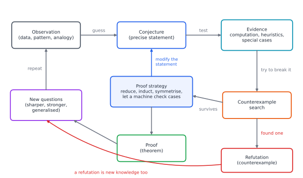
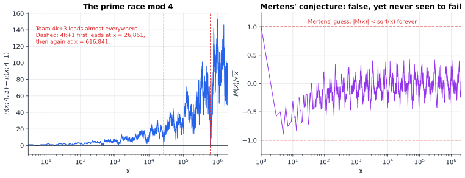
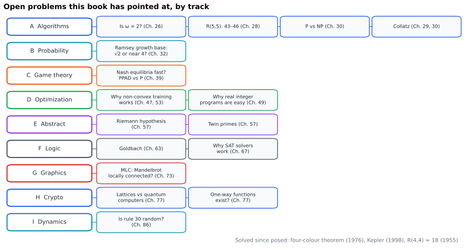

# Chapter 98 — Mathematical Research: How New Mathematics Is Created

[← Previous](97-measure-theory.md) · [Track J](README.md) · [Table of Contents](../../00-front/table-of-contents.md) · [Next →](../../00-front/table-of-contents.md)

> **Level 3 · Track J — Mathematics at the Frontier**
> **Builds on:** [Ch. 63](../f-logic-foundations/63-think-like-a-mathematician.md), [Ch. 28](../a-algorithms/28-combinatorics.md), [Ch. 26](../a-algorithms/26-the-mathematics-of-algorithms.md), [Ch. 57](../e-abstract-math/57-number-theory.md) · **Leads to:** every open thread in this book (Figure 98.3), and the ones nobody has written down yet · **Related:** [Ch. 27](../a-algorithms/27-graph-theory.md), [Ch. 30](../a-algorithms/30-limits-of-computation.md), [Ch. 32](../b-probability-information/32-counting-random-worlds.md), [Ch. 67](../f-logic-foundations/67-formal-verification.md), [Ch. 68](../f-logic-foundations/68-paradoxes-and-limits.md), [Ch. 73](../g-graphics-simulation/73-fractals.md)
> **Reading time:** ~30 min

## 98.1 The hook

Line up the odd primes and split them into two teams. Team Three takes the primes that leave remainder 3 when divided by 4: $3, 7, 11, 19, 23, 31,\dots$ Team One takes those that leave remainder 1: $5, 13, 17, 29, 37, 41,\dots$ Now run a race. At each $x$, count how many primes up to $x$ each team has. Call the counts $\pi(x;4,3)$ and $\pi(x;4,1)$.

Team Three is ahead at $x=3$, and still ahead or level at $x=100$, $1000$, $10{,}000$. Chebyshev noticed this in 1853. An experimental scientist would be entitled, by $x=20{,}000$, to announce a law of nature: *the $4k+3$ primes always lead*.

The law fails at $x=26{,}861$, a prime of the form $4k+1$, where Team One goes ahead by a single prime, for two integers. Then Team Three is back in front until $x=616{,}841$. In the first ten million integers, Team One is in the lead at only $3{,}406$ values of $x$. And yet in 1914 J. E. Littlewood proved that the lead changes hands **infinitely often**.

A second race is even crueller. The prime-counting function $\pi(x)$ is approximated by the logarithmic integral $\operatorname{li}(x)=\int_0^x dt/\ln t$, and in every table anyone has ever computed, $\pi(x)<\operatorname{li}(x)$. At $x=10^7$ the gap is $339$ primes. The inequality has been checked by computer for every $x$ up to $10^{19}$. Littlewood's same 1914 paper proved that it is false: $\pi(x)-\operatorname{li}(x)$ also changes sign infinitely often. Nobody has ever seen a single crossing. The first one is known to lie somewhere between $10^{19}$ and about $1.4\times10^{316}$.

So here is the question this last chapter is about. If a pattern can survive ten quintillion checks and still be false, **how does anyone ever come to know anything new in mathematics?** Where do conjectures come from, how do you decide which ones to believe, how do you hunt for the counterexample that would kill one, and what does it take to turn one into a theorem?

Chapter after chapter of this book ended with a `[!mystery]` pointing here: the exponent $\omega$ of [Ch. 26](../a-algorithms/26-the-mathematics-of-algorithms.md), $R(5,5)$ in [Ch. 28](../a-algorithms/28-combinatorics.md) and [Ch. 32](../b-probability-information/32-counting-random-worlds.md), the four-colour proof of [Ch. 27](../a-algorithms/27-graph-theory.md), the Mandelbrot set of [Ch. 73](../g-graphics-simulation/73-fractals.md), the zeta zeros of [Ch. 57](../e-abstract-math/57-number-theory.md). Nobody can resolve them. This chapter shows how each is being attacked, with methods you could use yourself.

## 98.2 The big idea

**Research is a loop, not a ladder.** Textbooks, this one included, present mathematics as a ladder of definitions, theorems and proofs, each rung resting on the last. That is the shape of finished mathematics. Mathematics in the making has the shape of Figure 98.1.


*Figure 98.1 — The conjecture lifecycle. Both exits, proof and refutation, lead back to new questions; the loop has no final state.*

1. **Observation.** A pattern in a table, a simulation, an analogy between fields, or a proof that works "too well".
2. **Conjecture.** The pattern stated precisely enough to be false. "Primes like remainder 3" is a mood; "$\pi(x;4,3)\ge\pi(x;4,1)$ for all $x$" is a conjecture.
3. **Evidence.** Computation, special cases, heuristic models, consistency with other conjectures.
4. **Counterexample search.** You try hard to break it. Most conjectures die here, and that is a success: a counterexample is a theorem too.
5. **Proof strategy.** If it survives, look for a reason: reduce, strengthen for induction, exploit symmetry, or cut it to finitely many cases for a machine.
6. **New questions.** A proof shows what else is true; a refutation asks what the *right* statement was.

**Evidence is not uniform.** Think like a detective. Ten thousand witnesses who all saw the suspect in the same café prove less than one fingerprint, because the witnesses are correlated. The checks of $\pi(x)<\operatorname{li}(x)$ up to $10^{19}$ are ten quintillion correlated witnesses, all dominated by the same slowly varying terms. A **heuristic model**, which explains *why* a pattern should hold and how large the deviations should be, is worth more than any number of checks; Result 3 shows one predicting a counterexample nobody has seen.

**The frontier is a literature.** Before you spend a month on a pattern, you find out whether it is known (OEIS), who has worked on it (MathSciNet, zbMATH) and what the latest attempt looks like (arXiv); when you have a proof, you may ask a machine to check it (Lean, Coq, Isabelle). Section 98.4 makes this a procedure.

In this chapter the `[!mystery]` callouts change meaning. Elsewhere they pointed to a chapter holding the answer. Here the honest answer is: **nobody knows yet.**

## 98.3 The mathematics

### Four kinds of statement

> [!definition] The vocabulary of research
> - A **conjecture** is a precise, falsifiable statement believed but not proved.
> - A **counterexample** to $\forall n\,P(n)$ is a single $n$ with $\neg P(n)$. One settles the matter forever.
> - A **heuristic** is an argument that would be a proof if an unproved modelling assumption held, typically "these quantities behave like independent random variables".
> - A **certificate** is a finite object, cheap to check, that implies the claim: a colouring, a factorization, a proof file. Finding it may be hard; checking it is easy (the NP idea of [Ch. 30](../a-algorithms/30-limits-of-computation.md), as a research method).

Research is largely the art of converting one kind of statement into another. Each result below shows one conversion, on a problem the book left open.

### Result 1: symmetry turns a search into a proof

[Ch. 28](../a-algorithms/28-combinatorics.md) introduced Ramsey numbers: $R(s,t)$ is the smallest $N$ such that every red/blue colouring of the edges of the complete graph $K_N$ contains a red $K_s$ or a blue $K_t$. It stated $R(4,4)=18$. To prove $R(4,4)>17$ you must exhibit a colouring of $K_{17}$ with no monochromatic $K_4$: a certificate. A blind search is hopeless, since there are $2^{136}$ colourings. But the right colouring can be found by thinking instead of searching, and then *checked* by thinking too.

> [!definition] The Paley graph $P_{17}$
> The **quadratic residues** modulo $17$ are the non-zero squares: $Q=\{1,2,4,8,9,13,15,16\}$, exactly half of the 16 non-zero residues. Join $u,v\in\{0,1,\dots,16\}$ by a red edge if $u-v\in Q$, and by a blue edge otherwise.

The colouring is well defined because $-1\equiv16=4^2$ is a square, so $u-v\in Q$ if and only if $v-u\in Q$.

> [!theorem] Theorem 98.1 (Greenwood–Gleason, 1955)
> $P_{17}$ contains no red $K_4$ and no blue $K_4$. Hence $R(4,4)\ge18$.

*Proof.* We use three facts about $Q$, all checkable from the list: $Q$ is closed under multiplication; the product of two non-residues is a residue; and $3\notin Q$. (The non-zero residues mod 17 form a cyclic group of order 16, and $Q$ is its subgroup of index 2, which gives the first two facts.)

*Step 1: the graph looks the same from every red edge.* For $a\in Q$ and any $b$, the map $f(x)=ax+b$ sends a red edge to a red edge, because $f(u)-f(v)=a(u-v)$ and $Q$ is closed under multiplication. Now take any red edge $\{u,v\}$. Since $v-u\in Q$, so is its inverse, and $g(x)=(x-u)/(v-u)$ is such a map, with $g(u)=0$ and $g(v)=1$. So if a red $K_4$ exists, there is one containing the vertices $0$ and $1$.

*Step 2: the two other vertices of that $K_4$ are red neighbours of both $0$ and $1$.* Those are the $x$ with $x\in Q$ and $x-1\in Q$. Running through $Q$: $x=2,9,16$ qualify (as $1,8,15\in Q$), while $1,4,8,13,15$ do not (as $0,3,7,12,14\notin Q$). So the candidates are $\{2,9,16\}$.

*Step 3: no two candidates are joined in red.* Their differences are $9-2=7$, $16-9=7$ and $16-2=14$, none of which lies in $Q$. So there is no red $K_4$.

*Step 4: the blue graph is a copy of the red one.* Multiply every vertex by the non-residue $3$. A blue edge has $u-v\notin Q$, so $3(u-v)$ is a product of two non-residues, hence in $Q$: blue edges become red. A blue $K_4$ would become a red $K_4$, which Step 3 excluded. $\blacksquare$

A brute-force check of all $\binom{17}{4}=2380$ four-vertex subsets agrees. But the proof never examined 2380 cases: symmetry collapsed them to *one* ("cliques through 0 and 1"), then to a three-element set. Combined with the recursive bound $R(4,4)\le R(3,4)+R(4,3)=9+9=18$, the value $R(4,4)=18$ is settled.

**Why the same idea stalls at $R(5,5)$.** The best known colouring for the next case, found by Exoo in 1989, is a colouring of $K_{42}$ with no monochromatic $K_5$, so $R(5,5)\ge43$. No Paley graph does as well, and no one has found structure that gives $K_{43}$. On the other side, proving $R(5,5)\le N$ means showing that *every* one of the $2^{\binom N2}$ colourings fails; for $N=43$ that is $2^{903}$, a 272-digit number. The upper bound came down from 49 (1995) to 48 (2018) to 46 (Angeltveit and McKay, 2024), each step mixing linear-programming bounds with huge, carefully organised computer searches. McKay and Radziszowski found 656 colourings of $K_{42}$ with no monochromatic $K_5$, found no more, and *conjectured* that $R(5,5)=43$: a conjecture built on a search that came up empty, exactly the kind of evidence the hook warned about.

Paul Erdős liked to say that if hostile aliens demanded $R(5,5)$ on pain of destroying the Earth, we should marshal every computer and mathematician and try to find it. If they demanded $R(6,6)$ (known only to lie between 102 and the 160s), we should try to destroy the aliens.

> [!mystery] Is $R(5,5)=43$?
> Everyone expects it; nobody can prove it. Asymptotically, $(\sqrt2)^k<R(k,k)$ by [Ch. 32](../b-probability-information/32-counting-random-worlds.md)'s random colourings, and $R(k,k)<(4-\varepsilon)^k$ only since 2023 (Campos, Griffiths, Morris and Sahasrabudhe), later about $3.8^k$. Whether the true base is $\sqrt2$, near $4$, or between is an **open problem**. No chapter of any book contains the answer.

### Result 2: one finite gadget, an asymptotic theorem

[Ch. 26](../a-algorithms/26-the-mathematics-of-algorithms.md) left a number hanging: the exponent $\omega$ of matrix multiplication, defined as the infimum of all $\tau$ such that two $n\times n$ matrices can be multiplied in $O(n^\tau)$ arithmetic operations. Reading the input forces $\omega\ge2$; the schoolbook method gives $\omega\le3$. The key to every improvement since 1969 is the following conversion of a *finite* fact into an *asymptotic* bound.

> [!definition] Bilinear algorithm
> A **bilinear algorithm** for $k\times k$ matrices with $r$ multiplications computes $r$ products
> $$
> m_\ell=\Big(\sum_{i,j}\alpha^{(\ell)}_{ij}a_{ij}\Big)\Big(\sum_{i,j}\beta^{(\ell)}_{ij}b_{ij}\Big),\qquad \ell=1,\dots,r,
> $$
> and then each entry $c_{ij}$ of $\mathbf{C}=\mathbf{A}\mathbf{B}$ as a fixed linear combination of $m_1,\dots,m_r$, with constant coefficients $\alpha,\beta,\gamma$. It must never use $a_{ij}b_{kl}=b_{kl}a_{ij}$.

Strassen's 1969 algorithm is a bilinear algorithm with $k=2$, $r=7$.

> [!theorem] Theorem 98.2
> If there is a bilinear algorithm for $k\times k$ matrices with $r$ multiplications, then $\omega\le\log_k r$.

*Proof.* Because the algorithm never commutes a factor of $\mathbf{A}$ past a factor of $\mathbf{B}$, it is an identity in any ring, in particular in the ring of $m\times m$ matrices. So an $n\times n$ product with $n=k^t$ can be computed by splitting each matrix into a $k\times k$ grid of blocks of size $n/k$, forming the $r$ block products recursively, and combining them with a fixed number $c$ of block additions, each costing $(n/k)^2$ operations. The operation count satisfies

$$
T(n)=r\,T(n/k)+c\,(n/k)^2,\qquad T(1)=1.
$$

Unrolling it, as in the recursion tree of [Ch. 26](../a-algorithms/26-the-mathematics-of-algorithms.md):

$$
T(k^t)=r^t+c\sum_{i=1}^{t} r^{\,i-1}\,k^{2(t-i)}=r^t+\frac{c}{r}\,k^{2t}\sum_{i=1}^{t}\Big(\frac{r}{k^2}\Big)^{i}.
$$

If $r>k^2$ the geometric sum is at most $\frac{r/k^2}{r/k^2-1}(r/k^2)^t$, so $T(k^t)\le C\,r^t=C\,n^{\log_k r}$ for a constant $C$. (If $r\le k^2$ the bound is $O(n^2\log n)$, which is even better; in fact $r<k^2$ is impossible.) For general $n$, pad the matrices with zeros up to the next power $k^t$ with $n\le k^t<kn$; this multiplies the cost by at most $k^{\log_k r}=r$, a constant. Hence $T(n)=O(n^{\log_k r})$, and $\omega\le\log_k r$. $\blacksquare$

With $k=2$, $r=7$ this gives $\omega\le\log_27\approx2.807$. The theorem turns an asymptotic question into *finite* puzzles: for each $k$, what is the smallest $r$? For $k=3$ the record is Laderman's $r=23$ (1976), giving only $\log_323\approx2.854$; beating Strassen needs $r\le21$, since $3^{2.807}\approx21.85$. The best lower bound is 19, and nobody knows whether 20, 21 or 22 are possible. In 2022 a reinforcement-learning search (AlphaTensor) found a $4\times4$ algorithm with 47 multiplications, valid in arithmetic modulo 2: $\log_447\approx2.777$, a certificate humans had missed for fifty years.

The records come from elsewhere: since Coppersmith and Winograd (1990, $\omega<2.376$), from approximate ("border rank") versions of Theorem 98.2 applied to large, cleverly chosen tensors. The 2024 record is $\omega<2.3714$, improvements now arriving in the fourth decimal place.

> [!mystery] Is $\omega=2$?
> Many experts believe so, partly because the group-theoretic approach of Cohn and Umans (2003) would give $\omega=2$ if certain combinatorial objects exist. But the method behind every record since 1990, applied to the tensors used so far, provably cannot go below about $2.3$. Reaching $2$ needs an idea nobody has had: an **open problem**, answered in no chapter.

### Result 3: a heuristic that predicted a counterexample nobody has seen

Return to the hook. Why should anyone believe Littlewood rather than the tables? The cleanest illustration is a third race, from [Ch. 63](../f-logic-foundations/63-think-like-a-mathematician.md): the **Mertens function**

$$
M(x)=\sum_{n\le x}\mu(n),
$$

where the Möbius function $\mu(n)$ is $0$ if $n$ has a repeated prime factor, and $(-1)^k$ if $n$ is a product of $k$ distinct primes. So $\mu(6)=1$, $\mu(30)=-1$, $\mu(12)=0$. In 1897 Mertens conjectured $\lvert M(x)\rvert<\sqrt x$ for all $x>1$. Figure 98.2 shows why: our computation gives $\max\lvert M(x)\rvert/\sqrt x=0.472$ over $1000\le x\le10^7$, and the inequality has been verified up to $10^{16}$.


*Figure 98.2 — Two patterns that survive every table and are still false. Left: $\pi(x;4,3)-\pi(x;4,1)$, first negative at $x=26{,}861$. Right: $M(x)/\sqrt x$, which never comes near the dashed lines below $10^{16}$, yet must cross them eventually.*

Here is the heuristic. Pretend that, on the squarefree integers, the signs $\mu(n)=\pm1$ are independent fair coin flips. Then $M(x)$ is a random walk ([Ch. 34](../b-probability-information/34-random-walks-and-markov-chains.md)) with one step for each squarefree $n\le x$. About $6/\pi^2\approx0.608$ of all integers are squarefree, so

$$
E\big[M(x)\big]=0,\qquad \operatorname{Var}\big[M(x)\big]\approx\frac{6}{\pi^2}\,x,\qquad\text{so}\qquad \frac{M(x)}{\sqrt x}\ \text{is typically of size}\ \sqrt{6/\pi^2}\approx0.78.
$$

So far the model agrees with Mertens: deviations of order $\sqrt x$. But a random walk does more than fluctuate at scale $\sqrt n$. The **law of the iterated logarithm** says that a walk $S_n$ of fair $\pm1$ steps satisfies, with probability one,

$$
\limsup_{n\to\infty}\frac{S_n}{\sqrt{2n\ln\ln n}}=1 .
$$

Since $\sqrt{\ln\ln n}\to\infty$, the ratio $S_n/\sqrt n$ is unbounded. In the model, $\lvert M(x)\rvert/\sqrt x$ eventually exceeds $1$, and $10$, and any bound you name. The heuristic predicts that Mertens is wrong, and why the tables cannot see it: $\sqrt{\ln\ln x}$ is $1.90$ at $x=10^{16}$ and only $2.28$ at $x=10^{80}$.

The heuristic is not a proof ($\mu$ is not random), but it pointed the right way. In 1985 Odlyzko and te Riele proved $\limsup M(x)/\sqrt x>1.06$ without finding any $x$: they computed 2000 zeros of the zeta function to about 100 digits and showed, through an explicit formula, that $M(x)/\sqrt x$ must swing beyond $\pm1$ somewhere. The first counterexample is known only to be smaller than roughly $e^{10^{33}}$.

The same random model gives a sharper statement that *is* believed, and that is equivalent to the biggest open problem in the book:

> [!theorem] Theorem 98.3 (von Koch, 1901; Littlewood, 1912; stated without proof)
> The Riemann hypothesis is true if and only if $M(x)=O\big(x^{1/2+\varepsilon}\big)$ for every $\varepsilon>0$. Equivalently, if and only if $\lvert\pi(x)-\operatorname{li}(x)\rvert=O\big(\sqrt x\ln x\big)$.

So the Riemann hypothesis, a statement about complex zeros ([Ch. 57](../e-abstract-math/57-number-theory.md), [Ch. 18](../../part-5-transforms/18-complex-analysis.md)), says the Möbius signs cancel like coin flips, up to a factor $x^\varepsilon$. Mertens asked for too much (no $x^\varepsilon$, constant exactly 1) and died; the coin-flip version survives. The prime race is governed by similar zeros: Rubinstein and Sarnak (1994) showed, assuming a generalised Riemann hypothesis and a hypothesis on the zeros, that Team Three leads on a set of logarithmic density $0.9959$. So strong a bias is why the counterexample came late; a bias short of 1 is why it came at all.

> [!mystery] Where is the first crossing of $\pi(x)$ and $\operatorname{li}(x)$?
> Littlewood proved it exists. Skewes (1933) gave the first explicit bound, about $10^{10^{10^{34}}}$, assuming the Riemann hypothesis. Modern work has located a region of crossings below about $1.4\times10^{316}$, but whether an earlier one exists between $10^{19}$ and there is **unknown**. So is the Riemann hypothesis itself: more than ten trillion zeros lie on the line $\operatorname{Re}\{s\}=\tfrac12$, and no proof is in sight.

### Proofs no human reads

Results 1 and 2 used symmetry and recursion to *avoid* computation. When it cannot be avoided, a new question arises: what does it mean to trust a proof?

- **The four-colour theorem** ([Ch. 27](../a-algorithms/27-graph-theory.md)), Appel and Haken, 1976, has the shape *unavoidability plus reducibility*: every planar map contains one of a finite list of configurations, and each one on the list can be removed and its colouring restored. The list had nearly two thousand entries, and checking them took about 1200 hours of computer time. Robertson, Sanders, Seymour and Thomas cut it to 633 in 1996; Gonthier checked the entire proof in the Coq proof assistant in 2005.
- **The Kepler conjecture** on sphere packing (Hales, 1998) left its referees "99% certain"; Hales's Flyspeck project answered with a formal proof in 2014.
- **Boolean Pythagorean triples.** Heule, Kullmann and Marek (2016) showed by a SAT solver ([Ch. 30](../a-algorithms/30-limits-of-computation.md)) that $\{1,\dots,7824\}$ can be 2-coloured with no monochromatic $a^2+b^2=c^2$ and $\{1,\dots,7825\}$ cannot. The impossibility certificate was 200 terabytes, checked by a formally verified checker.

The trusted part shrinks: nobody trusts a 200-terabyte search, but people trust a small checker, which trusts a small set of logical rules ([Ch. 65](../f-logic-foundations/65-mathematical-logic.md), [Ch. 66](../f-logic-foundations/66-type-theory-curry-howard.md)). In 2022 the Lean community completed Peter Scholze's *Liquid Tensor Experiment*, formalising a cutting-edge theorem; in 2023 the proof of the polynomial Freiman–Ruzsa conjecture was formalised about three weeks after it appeared. Formal verification ([Ch. 67](../f-logic-foundations/67-formal-verification.md)) now checks new theorems, not just old ones.

## 98.4 The algorithm

### A counterexample hunter

Most of research is not proof. It is disciplined searching. Here is the skeleton every serious conjecture-tester shares.

```text
HUNT(P, N):                       # test "P(n) holds for all n <= N"
    build the data incrementally   # sieve, recurrence, running sum: never recompute from scratch
    for n = 1 .. N:
        update the running quantity Q(n)
        if not P(n):
            output certificate (n and the data that refutes P); stop
        if Q(n) sets a record (max, min, closest approach):
            log (n, Q(n))          # the records are the real result
    report: "no counterexample below N"; plus the record table
```

The record table matters more than the verdict. "No counterexample below $10^7$" is weak; "the closest approach was $0.472$ at $x=2803$, and records grow like $\sqrt{\ln\ln x}$" is a measurement you can compare with a heuristic.

**Complexity.** The sieve of Eratosthenes (and the Möbius sieve below) costs $O(N\ln\ln N)$ time and $O(N)$ memory, and memory runs out first. A **segmented sieve** works in blocks of about $\sqrt N$, cutting memory to $O(\sqrt N)$. The great records ($\pi(x)<\operatorname{li}(x)$ to $10^{19}$, Goldbach to $4\times10^{18}$) add distributed computing and analytic methods that count primes without listing them.

**Failure cases.**

- *Floating point.* $\operatorname{li}(10^{19})\approx2.3\times10^{17}$ carries an absolute rounding error of tens in double precision. Harmless while $\operatorname{li}(x)-\pi(x)\approx10^8$, fatal near a crossing, where rounding decides the sign. Use exact integers, or interval arithmetic.
- *Unrepresentative ranges.* Biases like the prime race's live on a logarithmic scale: going from $10^4$ to $10^5$ is one more decade, not "ten times the evidence".
- *The law of small numbers* (Richard Guy): there are not enough small numbers for the demands made of them. Chords joining $n$ points on a circle cut it into $1,2,4,8,16$ regions for $n=1,\dots,5$, and then $31$.

### Exploring the literature

A procedure, in the order a working mathematician uses it:

1. **OEIS** (oeis.org). If your problem produces integers, paste in the first ten. The On-Line Encyclopedia of Integer Sequences holds more than 370,000 sequences with formulas, references and code. Type $1,2,4,8,16,31$ and you get A000127, its closed form $\binom n4+\binom n2+1$, and a century of references. Many "new" patterns turn out to be known within a minute.
2. **Name the objects.** Search with the field's names, not yours: "Paley graph", "tensor rank", "Chebyshev bias". Surveys give them to you.
3. **MathSciNet** (Mathematical Reviews, from 1940) and **zbMATH Open** (free since 2021) review nearly every research paper, classified by subject (MSC 05 combinatorics, 11 number theory, 37 dynamics). Their real power is the *citation graph*: find one good paper, read who cited it, and walk forward in time to the current state of the problem.
4. **arXiv** (arxiv.org), since 1991, holds preprints, often years before publication: `math.CO`, `math.NT`, `math.DS`, `cs.CC`. Every record in this chapter since 2018 appeared there first. Preprints are not refereed: strong evidence, not theorems.
5. **Proof assistants.** Lean's `mathlib`, Coq and Isabelle hold hundreds of thousands of formalised results: what is truly established, in exact form, ready to build on.
6. **Ask people.** MathOverflow, a seminar, an email to the author of the closest paper. A precise, well-prepared question usually gets an answer.

## 98.5 The experiment

The script below runs the hook's prime race and the Mertens test side by side, with the record-keeping of the hunter. It reproduces the numbers quoted in this chapter in a few seconds.

```python
import numpy as np
import matplotlib.pyplot as plt

N = 10**7            # how far to look (try 10**6, then 10**8 if you have the memory)
q, a, b = 4, 3, 1    # race between primes = a (mod q) and primes = b (mod q); try (3,2,1), (8,3,1)

sieve = np.ones(N + 1, dtype=bool); sieve[:2] = False
for i in range(2, int(N**0.5) + 1):
    if sieve[i]:
        sieve[i*i::i] = False
p = np.nonzero(sieve)[0]

step = np.zeros(N + 1, dtype=np.int64)
step[p[p % q == a]] += 1
step[p[p % q == b]] -= 1
lead = np.cumsum(step)                       # pi(x;q,a) - pi(x;q,b)
losing = np.nonzero(lead < 0)[0]
print(f"team {a} (mod {q}) ahead or level at {N + 1 - len(losing):,} of {N + 1:,} values of x")
print("first x where team", b, "leads:", losing[0] if len(losing) else "none below N")

mu = np.ones(N + 1, dtype=np.int64); mu[0] = 0   # Moebius function by a sieve
for r in p:
    mu[r::r] *= -1
    if r * r <= N:
        mu[r*r::r*r] = 0
M = np.cumsum(mu)
x = np.arange(1, N + 1)
ratio = M[1:] / np.sqrt(x)
big = np.abs(ratio[999:]).argmax() + 1000
print(f"max |M(x)|/sqrt(x) for 1000 <= x <= N: {abs(ratio[big - 1]):.3f} at x = {big:,}")

xs = np.unique(np.geomspace(10, N, 5000).astype(int))
fig, ax = plt.subplots(1, 2, figsize=(11, 4))
ax[0].semilogx(xs, lead[xs]); ax[0].axhline(0, color="k", lw=0.8)
ax[0].set_title(f"pi(x;{q},{a}) - pi(x;{q},{b})")
ax[1].semilogx(xs, M[xs] / np.sqrt(xs)); ax[1].axhline(1, ls="--", color="r"); ax[1].axhline(-1, ls="--", color="r")
ax[1].set_title("M(x)/sqrt(x)")
plt.show()
```

With the default knobs it prints that Team Three is ahead or level at $9{,}996{,}595$ of the $10{,}000{,}001$ values $0\le x\le10^7$, that Team One first leads at $26{,}861$, and that $\max\lvert M(x)\rvert/\sqrt x=0.472$ at $x=2803$. Things to change:

1. **Set `q, a, b = 3, 2, 1`.** No lead change below $10^7$. Conclude nothing: the first one (Bays and Hudson, 1978) is at $x=608{,}981{,}813{,}029$, beyond any array your laptop can hold.
2. **Set `q, a, b = 8, 3, 1`**, then `(8, 5, 1)` and `(8, 7, 1)`. Chebyshev's bias says the non-squares $3,5,7$ should beat the square $1$. By how much?
3. **Change `N`** between $10^6$ and $10^8$ (the last needs about 6 GB). The Mertens record barely moves; compare it with $\sqrt{\ln\ln N}$.
4. **Replace the Möbius signs by coin flips**: put `mu[mu != 0] = np.random.choice([-1, 1], size=np.count_nonzero(mu))` just before `M = np.cumsum(mu)`. Over twenty seeds, how often does the walk cross $\pm1$ below $10^7$? That is Result 3's heuristic, made empirical.

## 98.6 The challenge

1. **Intuition.** $\pi(x)<\operatorname{li}(x)$ holds up to $10^{19}$ and is false; ten trillion zeta zeros lie on the critical line, and most mathematicians believe the Riemann hypothesis. Explain, without formulas, why the second body of evidence counts for more. What would make you stop believing it?
2. **Derivation.** (a) Show that the Paley graph $P_{13}$, built from the quadratic residues modulo 13, has no red $K_4$ and no blue $K_4$, by adapting Steps 1 to 4 of Theorem 98.1. What does that prove about $R(4,4)$, and why is it weaker than Theorem 98.1? (b) In Theorem 98.2, take $k=3$. Show that a bilinear algorithm with $r$ multiplications improves on Strassen's exponent if and only if $r\le21$.
3. **Implementation.** Write a colouring hunter: start from a random red/blue colouring of $K_n$ and repeatedly flip an edge lying in the most monochromatic $K_4$s, with occasional random flips to escape local minima. For $n=17$, is what it finds a relabelling of $P_{17}$? Then hunt for colourings with no monochromatic $K_5$. How far below 42 do you get stuck?
4. **Open investigation.** Pick one problem from Figure 98.3. Find its OEIS entry (if any), its latest arXiv preprint, and the zbMATH or MathSciNet review of the paper that posed it. Design a computation that *could* find a counterexample below a bound you can afford, run it with a record table, and write one paragraph on what your negative result does and does not tell you.

## 98.7 Loose threads

In the last chapter, the loose threads point to no other chapter. They are the edge of what anyone knows.


*Figure 98.3 — The open problems this book has pointed at, by track. Every box is a question that nobody, anywhere, can currently answer.*

- **Is $\omega=2$?** Unknown. The best bound is $\omega<2.3714$ ([Ch. 26](../a-algorithms/26-the-mathematics-of-algorithms.md)). Even the smallest finite version, whether $3\times3$ matrices can be multiplied with 22 or fewer multiplications, is open.
- **What is $R(5,5)$?** Somewhere in $\{43,44,45,46\}$ ([Ch. 28](../a-algorithms/28-combinatorics.md)); the asymptotic base of $R(k,k)$ is somewhere between $\sqrt2$ and about $3.8$ ([Ch. 32](../b-probability-information/32-counting-random-worlds.md)).
- **The four-colour theorem** is closed: true, and formally verified. What remains open is softer: is there a proof a human can read in an afternoon? ([Ch. 27](../a-algorithms/27-graph-theory.md))
- **Is the Mandelbrot set locally connected?** Open ([Ch. 73](../g-graphics-simulation/73-fractals.md)). Yoccoz proved it at a large class of parameters in the 1990s; the "infinitely renormalizable" ones are where the difficulty lives. MLC would imply that hyperbolic components are dense, also open.
- **The Riemann hypothesis** ([Ch. 57](../e-abstract-math/57-number-theory.md)) is open, and with it the size of the prime races' deviations and the place where $\pi(x)$ first passes $\operatorname{li}(x)$.
- **P versus NP** ([Ch. 30](../a-algorithms/30-limits-of-computation.md)), one-way functions ([Ch. 77](../h-cryptography-coding/77-cryptography.md)), why SAT and integer-programming solvers work so well ([Ch. 67](../f-logic-foundations/67-formal-verification.md), [Ch. 49](../d-optimization/49-integer-programming.md)), why gradient descent trains non-convex networks ([Ch. 47](../d-optimization/47-convexity.md)): all open, and probably connected in ways nobody yet sees.
- **Goldbach, twin primes, Collatz, rule 30** ([Ch. 63](../f-logic-foundations/63-think-like-a-mathematician.md), [Ch. 57](../e-abstract-math/57-number-theory.md), [Ch. 30](../a-algorithms/30-limits-of-computation.md), [Ch. 86](../i-dynamical-systems/86-cellular-automata.md)): checked to enormous bounds, explained by heuristics, unproved. [Ch. 65](../f-logic-foundations/65-mathematical-logic.md) and [Ch. 68](../f-logic-foundations/68-paradoxes-and-limits.md) explain why some such statement might have no proof at all.

> [!tip] The thread you pick
> Most of this book's unanswered questions have answers in other chapters. The ones in Figure 98.3 do not. They are waiting for someone to notice a pattern, to find the symmetry that collapses a search, the gadget that implies an asymptotic bound, or the heuristic that predicts where the counterexample hides. The methods are in this chapter, and the tools (a sieve, a SAT solver, the OEIS, arXiv, a proof assistant) are free. **Which thread will you pull?**

This book has given you a map, incomplete on purpose, because the real one is too. Pick a thread, run the hunter, read the last three papers on it, and write down a conjecture precise enough to be wrong. That is how all of this mathematics was made, and how the next chapter, the one nobody has written yet, will be.

## Further reading

- G. Pólya, *How to Solve It*, Princeton University Press, 1945, and *Mathematics and Plausible Reasoning*, 2 vols., Princeton University Press, 1954. The classic accounts of conjecture, analogy and heuristic evidence.
- I. Lakatos, *Proofs and Refutations: The Logic of Mathematical Discovery*, Cambridge University Press, 1976. A dialogue on how counterexamples reshape definitions and theorems, built around Euler's $V-E+F=2$.
- R. K. Guy, "The strong law of small numbers", *American Mathematical Monthly* 95 (1988), 697–712. Thirty-five patterns that look true; some are.
- A. Granville and G. Martin, "Prime number races", *American Mathematical Monthly* 113 (2006), 1–33. The hook's races, Littlewood's theorem and Chebyshev's bias, accessibly.
- A. M. Odlyzko and H. J. J. te Riele, "Disproof of the Mertens conjecture", *Journal für die reine und angewandte Mathematik* 357 (1985), 138–160.
- S. P. Radziszowski, "Small Ramsey numbers", *Electronic Journal of Combinatorics*, Dynamic Survey DS1 (regularly revised). The live scoreboard for $R(5,5)$ and its relatives.
- T. C. Hales, "Formal proof", *Notices of the AMS* 55 (2008), 1370–1380, and G. Gonthier, "Formal proof — the four-color theorem", *Notices of the AMS* 55 (2008), 1382–1393.
- K. Buzzard, "The rise of formalism in mathematics", *Proceedings of the ICM 2022*, and the Lean community's *Mathematics in Lean* (free online). Where proof assistants are going, and how to start.
- The OEIS (oeis.org), arXiv (arxiv.org), zbMATH Open (zbmath.org) and MathOverflow (mathoverflow.net). The working mathematician's library, all free.
