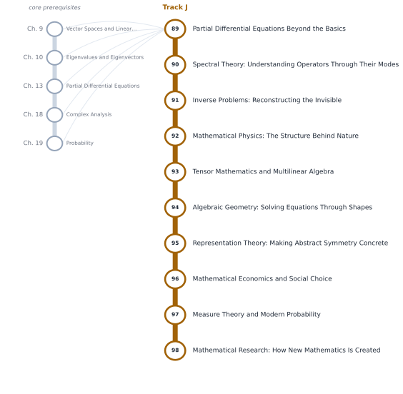

# Track J — Mathematics at the Frontier

[← Table of Contents](../../00-front/table-of-contents.md) · [Start: Ch. 89 →](89-pde-beyond-the-basics.md)

> **Level 3 — Research Frontier.** Not prerequisites for every programmer: the deeper territories to explore as your interests develop. The frontier is open-ended.

*Suggested reading order for Track J. The grey stations on the left are the core chapters it leans on.*

## Before you start

This track assumes you are comfortable with these core chapters:

- Ch. 9 — [Vector Spaces and Linear Transformations](../../part-3-linear-algebra/09-vector-spaces-and-linear-transformations.md)
- Ch. 10 — [Eigenvalues and Eigenvectors](../../part-3-linear-algebra/10-eigenvalues-and-eigenvectors.md)
- Ch. 13 — [Partial Differential Equations](../../part-4-differential-equations/13-partial-differential-equations.md)
- Ch. 18 — [Complex Analysis](../../part-5-transforms/18-complex-analysis.md)
- Ch. 19 — [Probability](../../part-6-probability-statistics/19-probability.md)

## Chapters

| Ch. | Chapter | What it explores |
|---|---|---|
| 89 | [Partial Differential Equations Beyond the Basics](89-pde-beyond-the-basics.md) | Weak solutions, boundary-value problems, regularity. |
| 90 | [Spectral Theory: Understanding Operators Through Their Modes](90-spectral-theory.md) | Eigenfunction expansions, operator spectra, applications to PDEs. |
| 91 | [Inverse Problems: Reconstructing the Invisible](91-inverse-problems.md) | Parameter estimation, regularization, ill-posed problems. |
| 92 | [Mathematical Physics: The Structure Behind Nature](92-mathematical-physics.md) | Variational principles, symmetries, Hamiltonian mechanics. |
| 93 | [Tensor Mathematics and Multilinear Algebra](93-tensor-mathematics.md) | Tensor products, multilinear maps, tensor decompositions. |
| 94 | [Algebraic Geometry: Solving Equations Through Shapes](94-algebraic-geometry.md) | Polynomial varieties, ideals, coordinate rings. |
| 95 | [Representation Theory: Making Abstract Symmetry Concrete](95-representation-theory.md) | Group representations, characters, irreducible structures. |
| 96 | [Mathematical Economics and Social Choice](96-mathematical-economics.md) | Equilibrium, preference relations, welfare, voting theory. |
| 97 | [Measure Theory and Modern Probability](97-measure-theory.md) | Sigma-algebras, measures, Lebesgue integration, convergence. |
| 98 | [Mathematical Research: How New Mathematics Is Created](98-mathematical-research.md) | Conjectures, counterexamples, proof strategy, literature exploration. |

Every chapter follows the same arc: **the hook** (a puzzle or a failure), **the big idea**, **the mathematics**, **the algorithm**, **the experiment** you can run, **the challenge**, and **loose threads**: the questions the chapter deliberately leaves open.
